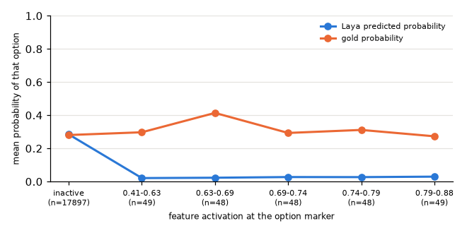

# Feature 9718

Critérios em que aparece: corr_probe_right_laya_wrong

**Interpretação (preencher):** 

---

## Maiores ativações

**tr_customer_service_000000 / churn_risk** (score, customer_service) | ativação 3.381 em `estado` | opções ['0', '1', '2', '3'] | Laya: **1** [0.184, 0.487, 0.108, 0.222] | gabarito: **3**

```
<bos> score question: How likely is this customer to stop doing business with us because of this interaction?<eos>
▸ <mask> level 0: No sign of dissatisfaction.
▸ <mask> level 1: Mild frustration, but the relationship is intact.
▸ <mask> level 2: Clearly unhappy; repeat problems or explicit complaints.
▸ <mask> level 3: Imminent: threatening to cancel, dispute or leave.

<eos>

 {"account": {"lifetime_value_usd": 4642, "prior_tickets_90d": 2, "seats": 3, "tenure_months": 60, "tier": "enterprise"}, "thread": [{"role": "customer", "text": "Hello, after five years on the Enterprise plan I’ve decided it’s time to close my account. Could you please start the cancellation process?"}, {"role": "agent", "text": "I’m sorry to hear you want to leave. May I have the account number or the email associated with the subscription so I can locate it?"}, {"role": "customer", "text": "Sure, the account is registered to⟦ alice⟧.smith@example.com, and the reference number is 987654. I’d appreciate a confirmation once the cancellation is underway."}, {"role": "agent", "text": "Thank you for that information. I’ve flagged the request; could you let me know if there’s any specific reason you’re closing, or any final data you need from us?"}, {"role": "customer", "text": "No particular issue, just moving to a different provider. I’ll wait for your follow‑up confirming the account is scheduled for termination."}]}<eos>
```

**tr_customer_service_000000 / action** (choice, customer_service) | ativação 3.299 em `estado` | opções ['answer_directly', 'close_no_action', 'escalate_to_human', 'execute_refund', 'request_information'] | Laya: **close_no_action** [0.047, 0.831, 0.111, 0.007, 0.004] | gabarito: **answer_directly**

```
<bos> choice question: What should the assistant do next with this conversation?<eos>
▸ <mask> answer_directly: The assistant can resolve this itself with information it already has.
▸ <mask> close_no_action: No further action is warranted; the matter is settled.
▸ <mask> escalate_to_human: Hand off to a human agent with the appropriate authority.
▸ <mask> execute_refund: Issue the refund or credit the customer is owed.
▸ <mask> request_information: More detail is needed from the customer before anything can be done.

<eos>

 {"account": {"lifetime_value_usd": 4642, "prior_tickets_90d": 2, "seats": 3, "tenure_months": 60, "tier": "enterprise"}, "thread": [{"role": "customer", "text": "Hello, after five years on the Enterprise plan I’ve decided it’s time to close my account. Could you please start the cancellation process?"}, {"role": "agent", "text": "I’m sorry to hear you want to leave. May I have the account number or the email associated with the subscription so I can locate it?"}, {"role": "customer", "text": "Sure, the account is registered to⟦ alice⟧.smith@example.com, and the reference number is 987654. I’d appreciate a confirmation once the cancellation is underway."}, {"role": "agent", "text": "Thank you for that information. I’ve flagged the request; could you let me know if there’s any specific reason you’re closing, or any final data you need from us?"}, {"role": "customer", "text": "No particular issue, just moving to a different provider. I’ll wait for your follow‑up confirming the account is scheduled for termination."}]}<eos>
```

**tr_customer_service_000000 / urgency** (score, customer_service) | ativação 3.287 em `estado` | opções ['0', '1', '2', '3'] | Laya: **1** [0.29, 0.309, 0.11, 0.29] | gabarito: **3**

```
<bos> score question: How time-sensitive is this conversation?<eos>
▸ <mask> level 0: No time pressure; can wait indefinitely.
▸ <mask> level 1: Routine; handle within the normal queue.
▸ <mask> level 2: Elevated; should be handled within the same week.
▸ <mask> level 3: Critical; requires action within the same day.

<eos>

 {"account": {"lifetime_value_usd": 4642, "prior_tickets_90d": 2, "seats": 3, "tenure_months": 60, "tier": "enterprise"}, "thread": [{"role": "customer", "text": "Hello, after five years on the Enterprise plan I’ve decided it’s time to close my account. Could you please start the cancellation process?"}, {"role": "agent", "text": "I’m sorry to hear you want to leave. May I have the account number or the email associated with the subscription so I can locate it?"}, {"role": "customer", "text": "Sure, the account is registered to⟦ alice⟧.smith@example.com, and the reference number is 987654. I’d appreciate a confirmation once the cancellation is underway."}, {"role": "agent", "text": "Thank you for that information. I’ve flagged the request; could you let me know if there’s any specific reason you’re closing, or any final data you need from us?"}, {"role": "customer", "text": "No particular issue, just moving to a different provider. I’ll wait for your follow‑up confirming the account is scheduled for termination."}]}<eos>
```

**tr_customer_service_000000 / needs_human** (noul, customer_service) | ativação 3.264 em `estado` | opções ['false', 'true'] | Laya: **true** [0.09, 0.91] | gabarito: **true**

```
<bos> noul question: This conversation requires a human agent rather than automated handling.<eos>
▸ <mask> false: Automation can carry this to resolution.
▸ <mask> true: A human must take over: judgement, authority or empathy is required.

<eos>

 {"account": {"lifetime_value_usd": 4642, "prior_tickets_90d": 2, "seats": 3, "tenure_months": 60, "tier": "enterprise"}, "thread": [{"role": "customer", "text": "Hello, after five years on the Enterprise plan I’ve decided it’s time to close my account. Could you please start the cancellation process?"}, {"role": "agent", "text": "I’m sorry to hear you want to leave. May I have the account number or the email associated with the subscription so I can locate it?"}, {"role": "customer", "text": "Sure, the account is registered to⟦ alice⟧.smith@example.com, and the reference number is 987654. I’d appreciate a confirmation once the cancellation is underway."}, {"role": "agent", "text": "Thank you for that information. I’ve flagged the request; could you let me know if there’s any specific reason you’re closing, or any final data you need from us?"}, {"role": "customer", "text": "No particular issue, just moving to a different provider. I’ll wait for your follow‑up confirming the account is scheduled for termination."}]}<eos>
```

**tr_customer_service_000000 / category** (choice, customer_service) | ativação 3.232 em `estado` | opções ['account', 'billing', 'delivery', 'refund', 'technical'] | Laya: **account** [0.892, 0.038, 0.004, 0.028, 0.038] | gabarito: **account**

```
<bos> choice question: What is this customer conversation primarily about?<eos>
▸ <mask> account: Login, plan changes, profile or access management.
▸ <mask> billing: A charge, invoice, subscription or payment problem.
▸ <mask> delivery: Shipping, fulfilment or delivery of a physical item.
▸ <mask> refund: The customer is explicitly asking for money back.
▸ <mask> technical: The product or service is not working as expected.

<eos>

 {"account": {"lifetime_value_usd": 4642, "prior_tickets_90d": 2, "seats": 3, "tenure_months": 60, "tier": "enterprise"}, "thread": [{"role": "customer", "text": "Hello, after five years on the Enterprise plan I’ve decided it’s time to close my account. Could you please start the cancellation process?"}, {"role": "agent", "text": "I’m sorry to hear you want to leave. May I have the account number or the email associated with the subscription so I can locate it?"}, {"role": "customer", "text": "Sure, the account is registered to⟦ alice⟧.smith@example.com, and the reference number is 987654. I’d appreciate a confirmation once the cancellation is underway."}, {"role": "agent", "text": "Thank you for that information. I’ve flagged the request; could you let me know if there’s any specific reason you’re closing, or any final data you need from us?"}, {"role": "customer", "text": "No particular issue, just moving to a different provider. I’ll wait for your follow‑up confirming the account is scheduled for termination."}]}<eos>
```

## Ativações medianas (faixa 40-60%, mediana 0.735)

**tr_invoice_processing_000167 / disposition** (choice, invoice_processing) | ativação 0.726 em `marcador` | opções ['approve', 'hold', 'manual_review', 'reject'] | Laya: **approve** [0.422, 0.137, 0.036, 0.405] | gabarito: **hold**

```
<bos> choice question: How should this vendor invoice be dispositioned?<eos>
▸ <mask> approve: Matches the order and delivery; approve for payment.
▸ <mask> hold: Something needs confirming before payment; hold pending clarification.
▸ ⟦<mask>⟧ manual_review: A human in finance must review the discrepancy.
▸ <mask> reject: Should not be paid: duplicate, unauthorised or materially wrong.

<eos>

 {"delivery": {"condition": "accepted with exceptions", "date": "2026-03-26", "received_qty": 25}, "invoice": {"currency": "USD", "id": "INV-2026-6116", "lines": [{"qty": 25, "sku": "SKU-390", "total_usd": 2284.5, "unit_usd": 91.38}], "total_usd": 2284.5, "vendor": "Kestrel Supply"}, "payment": {"days_until_due": 44, "discount_expires_in_days": 7, "early_payment_discount_pct": 2.0, "status": "scheduled", "terms": "net 30"}, "purchase_order": {"freight_terms": "freight prepaid by vendor, not separately billable", "id": "PO-4331", "lines": [{"qty": 25, "unit_usd": 91.38}], "total_usd": 2284.5}, "vendor_history": {"disputes_12m": 5, "invoices_12m": 20, "prior_invoice_ids": ["INV-2026-6116", "INV-2026-8809"]}}<eos>
```

**tr_invoice_processing_000117 / disposition** (choice, invoice_processing) | ativação 0.717 em `marcador` | opções ['approve', 'hold', 'manual_review', 'reject'] | Laya: **reject** [0.359, 0.089, 0.032, 0.52] | gabarito: **approve**

```
<bos> choice question: How should this vendor invoice be dispositioned?<eos>
▸ <mask> approve: Matches the order and delivery; approve for payment.
▸ <mask> hold: Something needs confirming before payment; hold pending clarification.
▸ ⟦<mask>⟧ manual_review: A human in finance must review the discrepancy.
▸ <mask> reject: Should not be paid: duplicate, unauthorised or materially wrong.

<eos>

 {"delivery": {"condition": "accepted with exceptions", "date": "2026-03-17", "received_qty": 50}, "invoice": {"currency": "USD", "id": "INV-2026-4861", "lines": [{"qty": 50, "sku": "SKU-282", "total_usd": 15800.5, "unit_usd": 316.01}], "total_usd": 15800.5, "vendor": "Orbit Logistics"}, "payment": {"days_until_due": -3, "discount_expires_in_days": null, "early_payment_discount_pct": null, "status": "overdue", "terms": "net 45"}, "purchase_order": {"freight_terms": "freight prepaid by vendor, not separately billable", "id": "PO-1105", "lines": [{"qty": 50, "unit_usd": 316.01}], "total_usd": 15800.5}, "vendor_history": {"disputes_12m": 0, "invoices_12m": 12, "prior_invoice_ids": ["INV-2026-9359", "INV-2026-7417", "INV-2026-1162"]}}<eos>
```

**tr_invoice_processing_000076 / disposition** (choice, invoice_processing) | ativação 0.718 em `marcador` | opções ['approve', 'hold', 'manual_review', 'reject'] | Laya: **approve** [0.504, 0.154, 0.019, 0.323] | gabarito: **manual_review**

```
<bos> choice question: How should this vendor invoice be dispositioned?<eos>
▸ <mask> approve: Matches the order and delivery; approve for payment.
▸ <mask> hold: Something needs confirming before payment; hold pending clarification.
▸ ⟦<mask>⟧ manual_review: A human in finance must review the discrepancy.
▸ <mask> reject: Should not be paid: duplicate, unauthorised or materially wrong.

<eos>

 {"delivery": {"condition": "accepted", "date": "2026-03-03", "received_qty": 50}, "invoice": {"currency": "USD", "id": "INV-2026-7325", "lines": [{"qty": 50, "sku": "SKU-282", "total_usd": 24438.5, "unit_usd": 488.77}], "total_usd": 24438.5, "vendor": "Pallas Industrial"}, "payment": {"days_until_due": 11, "discount_expires_in_days": null, "early_payment_discount_pct": null, "status": "scheduled", "terms": "net 30"}, "purchase_order": {"freight_terms": "freight prepaid by vendor, not separately billable", "id": "PO-3572", "lines": [{"qty": 50, "unit_usd": 436.4}], "total_usd": 21820.0}, "vendor_history": {"disputes_12m": 0, "invoices_12m": 20, "prior_invoice_ids": ["INV-2026-6186", "INV-2026-6194", "INV-2026-8302"]}}<eos>
```

**tr_invoice_processing_000164 / disposition** (choice, invoice_processing) | ativação 0.737 em `marcador` | opções ['approve', 'hold', 'manual_review', 'reject'] | Laya: **approve** [0.54, 0.162, 0.034, 0.263] | gabarito: **approve**

```
<bos> choice question: How should this vendor invoice be dispositioned?<eos>
▸ <mask> approve: Matches the order and delivery; approve for payment.
▸ <mask> hold: Something needs confirming before payment; hold pending clarification.
▸ ⟦<mask>⟧ manual_review: A human in finance must review the discrepancy.
▸ <mask> reject: Should not be paid: duplicate, unauthorised or materially wrong.

<eos>

 {"delivery": {"condition": "accepted", "date": "2026-03-19", "received_qty": 1000}, "invoice": {"currency": "USD", "id": "INV-2026-3652", "lines": [{"qty": 1000, "sku": "SKU-103", "total_usd": 299850.0, "unit_usd": 299.85}], "total_usd": 299850.0, "vendor": "Northwind Components"}, "payment": {"days_until_due": 5, "discount_expires_in_days": null, "early_payment_discount_pct": null, "status": "scheduled", "terms": "net 30"}, "purchase_order": {"freight_terms": "freight prepaid by vendor, not separately billable", "id": "PO-1013", "lines": [{"qty": 1000, "unit_usd": 299.85}], "total_usd": 299850.0}, "vendor_history": {"disputes_12m": 0, "invoices_12m": 56, "prior_invoice_ids": ["INV-2026-9880", "INV-2026-6717", "INV-2026-5969"]}}<eos>
```

**tr_invoice_processing_000146 / disposition** (choice, invoice_processing) | ativação 0.761 em `marcador` | opções ['approve', 'hold', 'manual_review', 'reject'] | Laya: **approve** [0.44, 0.108, 0.019, 0.433] | gabarito: **manual_review**

```
<bos> choice question: How should this vendor invoice be dispositioned?<eos>
▸ <mask> approve: Matches the order and delivery; approve for payment.
▸ <mask> hold: Something needs confirming before payment; hold pending clarification.
▸ ⟦<mask>⟧ manual_review: A human in finance must review the discrepancy.
▸ <mask> reject: Should not be paid: duplicate, unauthorised or materially wrong.

<eos>

 {"delivery": {"condition": "accepted", "date": "2026-03-17", "received_qty": 395}, "invoice": {"currency": "USD", "id": "INV-2026-6069", "lines": [{"qty": 395, "sku": "SKU-242", "total_usd": 30533.5, "unit_usd": 77.3}], "total_usd": 30533.5, "vendor": "Vantage Materials"}, "payment": {"days_until_due": 44, "discount_expires_in_days": null, "early_payment_discount_pct": null, "status": "scheduled", "terms": "net 30"}, "purchase_order": {"freight_terms": "freight prepaid by vendor, not separately billable", "id": "PO-6112", "lines": [{"qty": 400, "unit_usd": 77.3}], "total_usd": 30920.0}, "vendor_history": {"disputes_12m": 5, "invoices_12m": 23, "prior_invoice_ids": ["INV-2026-2964", "INV-2026-3490", "INV-2026-7675"]}}<eos>
```

## Estatísticas (conjunto de descoberta, dev e teste)

**pred / error**

| split | decisões | ativas | ativas e Laya errou | taxa | lift | q (BH) | OR (CMH) | q (CMH) |
|---|---|---|---|---|---|---|---|---|
| discovery | 5100 | 0 | 0 | nan | nan | nan | nan | nan |
| dev | 900 | 0 | 0 | nan | nan | nan | nan | nan |
| test | 2000 | 0 | 0 | nan | nan | nan | nan | nan |

**corr / error**

| split | decisões | ativas | ativas e Laya errou | taxa | lift | q (BH) | OR (CMH) | q (CMH) |
|---|---|---|---|---|---|---|---|---|
| discovery | 5100 | 84 | 84 | 1.000 | 1.55 | 5.63e-16 | inf | 0.0398 |
| dev | 900 | 27 | 27 | 1.000 | 1.49 | 0.000141 | inf | 0.726 |
| test | 2000 | 38 | 38 | 1.000 | 1.54 | 5.15e-07 | inf | 0.176 |

**state / error**

| split | decisões | ativas | ativas e Laya errou | taxa | lift | q (BH) | OR (CMH) | q (CMH) |
|---|---|---|---|---|---|---|---|---|
| discovery | 5100 | 57 | 32 | 0.561 | 0.87 | 0.411 | 0.91 | 0.923 |
| dev | 900 | 1 | 0 | 0.000 | 0.00 | nan | nan | nan |
| test | 2000 | 15 | 7 | 0.467 | 0.72 | nan | nan | nan |

**pred / probe_right_laya_wrong**

| split | decisões | ativas | ativas e Laya errou | taxa | lift | q (BH) | OR (CMH) | q (CMH) |
|---|---|---|---|---|---|---|---|---|
| discovery | 2819 | 0 | 0 | nan | nan | nan | nan | nan |
| dev | 520 | 0 | 0 | nan | nan | nan | nan | nan |
| test | 1106 | 0 | 0 | nan | nan | nan | nan | nan |

**corr / probe_right_laya_wrong**

| split | decisões | ativas | ativas e Laya errou | taxa | lift | q (BH) | OR (CMH) | q (CMH) |
|---|---|---|---|---|---|---|---|---|
| discovery | 2819 | 36 | 36 | 1.000 | 1.55 | 5.87e-07 | inf | 0.311 |
| dev | 520 | 13 | 13 | 1.000 | 1.48 | nan | nan | nan |
| test | 1106 | 20 | 20 | 1.000 | 1.58 | 0.000406 | inf | 0.397 |

**state / probe_right_laya_wrong**

| split | decisões | ativas | ativas e Laya errou | taxa | lift | q (BH) | OR (CMH) | q (CMH) |
|---|---|---|---|---|---|---|---|---|
| discovery | 2819 | 24 | 15 | 0.625 | 0.97 | 1 | 2.49 | 0.256 |
| dev | 520 | 0 | 0 | nan | nan | nan | nan | nan |
| test | 1106 | 12 | 4 | 0.333 | 0.53 | nan | nan | nan |

Confusão mais sobre-representada (corr): `disposition|0>2` (n=48, lift 50.25, p=0). Formato `pergunta|índice previsto>índice correto`.

Confusão mais sobre-representada (state): `churn_risk|1>2` (n=3, lift 4.79, p=0.0242). Formato `pergunta|índice previsto>índice correto`.



