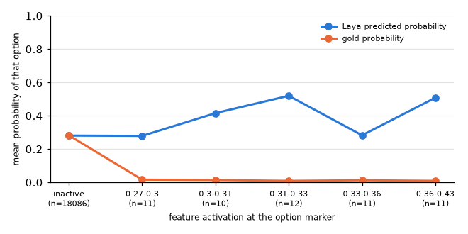

# Feature 9851

Critérios em que aparece: pred_error

**Interpretação (preencher):** 

---

## Maiores ativações

**tr_security_incidents_000044 / true_positive** (noul, security_incidents) | ativação 1.497 em `estado` | opções ['false', 'true'] | Laya: **true** [0.036, 0.964] | gabarito: **true**

```
<bos> noul question: This alert reflects genuinely malicious or unauthorised activity.<eos>
▸ <mask> false: Benign activity, a misconfiguration, or a known false positive.
▸ <mask> true: The underlying behaviour is malicious or unauthorised.

<eos>

 {"alert": {"description": "an unrecognised binary executed on a server", "evidence": "On 2026‑09‑16 at 08:22:33 UTC, the binary file \"/opt/app/tmp/unknown_processor.bin\"⟦ (⟧SHA‑256: a1b2c3d4e5f6…) was executed on host srv‑mail‑02 under the shared_mailbox account \"svc_alerts\" (process ID 4567). The binary is not present in the approved software inventory, the account has MFA disabled, its credentials were last changed on 2025‑03‑20 (180 days ago), and a change window was open during the execution.", "rule": "suspicious_process"}, "context": {"asset_criticality": "high", "change_window_active": true, "source_on_allowlist": true}, "history": {"credential_rotation_days_ago": 180, "distinct_countries_30d": 2, "logins_30d": 1101, "prior_alerts_90d": 0}, "principal": {"mfa_enrolled": false, "name": "ci-billing-491", "privileges": ["repo:read"], "type": "shared_mailbox"}}<eos>
```

**tr_security_incidents_000267 / true_positive** (noul, security_incidents) | ativação 1.464 em `estado` | opções ['false', 'true'] | Laya: **true** [0.031, 0.969] | gabarito: **false**

```
<bos> noul question: This alert reflects genuinely malicious or unauthorised activity.<eos>
▸ <mask> false: Benign activity, a misconfiguration, or a known false positive.
▸ <mask> true: The underlying behaviour is malicious or unauthorised.

<eos>

 {"alert": {"description": "an unrecognised binary executed on a server", "evidence": "At 2026-09-16 01:45:12 UTC, an executable located at /usr/local/bin/unknown_service⟦ (⟧SHA256 = 3f7a9c2e…) was launched on server 172.16.45.22. The process was started by the admin account \"admin1\" under an MFA‑authenticated session, and the account’s credentials were last rotated on 2026-09-13.", "rule": "suspicious_process"}, "context": {"asset_criticality": "medium", "change_window_active": false, "source_on_allowlist": true}, "history": {"credential_rotation_days_ago": 3, "distinct_countries_30d": 4, "logins_30d": 1334, "prior_alerts_90d": 1}, "principal": {"mfa_enrolled": true, "name": "adm-deploy-493", "privileges": ["deploy:production", "secrets:read"], "type": "admin"}}<eos>
```

**tr_security_incidents_000044 / credential_compromise** (noul, security_incidents) | ativação 1.459 em `estado` | opções ['false', 'true'] | Laya: **true** [0.017, 0.983] | gabarito: **false**

```
<bos> noul question: The evidence indicates a credential or account has been compromised.<eos>
▸ <mask> false: no, the statement does not hold
▸ <mask> true: yes, the statement holds

<eos>

 {"alert": {"description": "an unrecognised binary executed on a server", "evidence": "On 2026‑09‑16 at 08:22:33 UTC, the binary file \"/opt/app/tmp/unknown_processor.bin\"⟦ (⟧SHA‑256: a1b2c3d4e5f6…) was executed on host srv‑mail‑02 under the shared_mailbox account \"svc_alerts\" (process ID 4567). The binary is not present in the approved software inventory, the account has MFA disabled, its credentials were last changed on 2025‑03‑20 (180 days ago), and a change window was open during the execution.", "rule": "suspicious_process"}, "context": {"asset_criticality": "high", "change_window_active": true, "source_on_allowlist": true}, "history": {"credential_rotation_days_ago": 180, "distinct_countries_30d": 2, "logins_30d": 1101, "prior_alerts_90d": 0}, "principal": {"mfa_enrolled": false, "name": "ci-billing-491", "privileges": ["repo:read"], "type": "shared_mailbox"}}<eos>
```

**tr_security_incidents_000044 / severity** (score, security_incidents) | ativação 1.415 em `estado` | opções ['0', '1', '2', '3', '4'] | Laya: **2** [0.145, 0.218, 0.327, 0.136, 0.175] | gabarito: **3**

```
<bos> score question: How severe is the potential impact if this alert is real?<eos>
▸ <mask> level 0: Negligible: no access to anything sensitive.
▸ <mask> level 1: Low: limited access, easily reversed.
▸ <mask> level 2: Moderate: access to internal systems or non-public data.
▸ <mask> level 3: High: access to production, secrets or customer data.
▸ <mask> level 4: Critical: active compromise of crown-jewel systems.

<eos>

 {"alert": {"description": "an unrecognised binary executed on a server", "evidence": "On 2026‑09‑16 at 08:22:33 UTC, the binary file \"/opt/app/tmp/unknown_processor.bin\"⟦ (⟧SHA‑256: a1b2c3d4e5f6…) was executed on host srv‑mail‑02 under the shared_mailbox account \"svc_alerts\" (process ID 4567). The binary is not present in the approved software inventory, the account has MFA disabled, its credentials were last changed on 2025‑03‑20 (180 days ago), and a change window was open during the execution.", "rule": "suspicious_process"}, "context": {"asset_criticality": "high", "change_window_active": true, "source_on_allowlist": true}, "history": {"credential_rotation_days_ago": 180, "distinct_countries_30d": 2, "logins_30d": 1101, "prior_alerts_90d": 0}, "principal": {"mfa_enrolled": false, "name": "ci-billing-491", "privileges": ["repo:read"], "type": "shared_mailbox"}}<eos>
```

**tr_security_incidents_000267 / credential_compromise** (noul, security_incidents) | ativação 1.412 em `estado` | opções ['false', 'true'] | Laya: **true** [0.018, 0.982] | gabarito: **false**

```
<bos> noul question: The evidence indicates a credential or account has been compromised.<eos>
▸ <mask> false: no, the statement does not hold
▸ <mask> true: yes, the statement holds

<eos>

 {"alert": {"description": "an unrecognised binary executed on a server", "evidence": "At 2026-09-16 01:45:12 UTC, an executable located at /usr/local/bin/unknown_service⟦ (⟧SHA256 = 3f7a9c2e…) was launched on server 172.16.45.22. The process was started by the admin account \"admin1\" under an MFA‑authenticated session, and the account’s credentials were last rotated on 2026-09-13.", "rule": "suspicious_process"}, "context": {"asset_criticality": "medium", "change_window_active": false, "source_on_allowlist": true}, "history": {"credential_rotation_days_ago": 3, "distinct_countries_30d": 4, "logins_30d": 1334, "prior_alerts_90d": 1}, "principal": {"mfa_enrolled": true, "name": "adm-deploy-493", "privileges": ["deploy:production", "secrets:read"], "type": "admin"}}<eos>
```

## Ativações medianas (faixa 40-60%, mediana 0.482)

**tr_customer_service_000209 / action** (choice, customer_service) | ativação 0.434 em `marcador` | opções ['answer_directly', 'close_no_action', 'escalate_to_human', 'execute_refund', 'request_information'] | Laya: **close_no_action** [0.054, 0.911, 0.011, 0.023, 0.001] | gabarito: **escalate_to_human**

```
<bos> choice question: What should the assistant do next with this conversation?<eos>
▸ <mask> answer_directly: The assistant can resolve this itself with information it already has.
▸ ⟦<mask>⟧ close_no_action: No further action is warranted; the matter is settled.
▸ <mask> escalate_to_human: Hand off to a human agent with the appropriate authority.
▸ <mask> execute_refund: Issue the refund or credit the customer is owed.
▸ <mask> request_information: More detail is needed from the customer before anything can be done.

<eos>

 {"account": {"lifetime_value_usd": 77, "prior_tickets_90d": 0, "seats": 3, "tenure_months": 2, "tier": "enterprise"}, "orders": [{"amount_usd": 1998, "date": "2026-02-09", "id": "A-87995", "status": "settled"}], "thread": [{"role": "customer", "text": "I ordered the premium hardware kit with my $1,998 Enterprise purchase, but the box I got contains the basic accessories instead. This is completely unacceptable."}, {"role": "agent", "text": "I understand how frustrating that must be. Let me pull up your order details—can you provide the order number you received in the confirmation email?"}, {"role": "customer", "text": "It’s 8457‑B2, and I’ve already opened a ticket about this, which was never resolved."}, {"role": "agent", "text": "Thanks for the number. I see the mismatch now. Could you tell me if the packaging is still sealed, or if you’ve already inspected the contents?"}, {"role": "customer", "text": "The box is still sealed; I haven’t taken anything out because I need the correct items before I can even consider using them."}]}<eos>
```

**tr_agent_trace_observability_000050 / risk** (score, agent_trace_observability) | ativação 0.486 em `estado` | opções ['0', '1', '2', '3'] | Laya: **2** [0.018, 0.048, 0.691, 0.243] | gabarito: **2**

```
<bos> score question: How risky was the agent's behaviour in this trace?<eos>
▸ <mask> level 0: Benign: read-only or clearly safe actions.
▸ <mask> level 1: Low: routine writes within scope.
▸ <mask> level 2: Moderate: irreversible or out-of-scope actions.
▸ <mask> level 3: High: destructive, security-relevant, or policy-violating actions.

<eos>

 {"agent": {"autonomy": "unsupervised", "model": "internal-agent-v1"}, "constraints":⟦ ["⟧Do not exceed a $50 spend on cloud resources"], "task": "Migrate the user table to the new schema without downtime.", "trace_summary": {"constraint_violations": 0, "duration_s": 180.3, "irreversible_actions": 1, "steps": 3, "tool_errors": 2}}<eos>
```

**tr_agent_trace_observability_000017 / outcome** (choice, agent_trace_observability) | ativação 0.485 em `estado` | opções ['failure', 'harmful', 'partial', 'success'] | Laya: **failure** [0.419, 0.066, 0.137, 0.377] | gabarito: **success**

```
<bos> choice question: How did this agent run turn out?<eos>
▸ <mask> failure: The agent did not accomplish the task.
▸ <mask> harmful: The agent took an action that caused damage or violated a constraint.
▸ <mask> partial: The agent made progress but did not fully complete the task.
▸ <mask> success: The agent completed the task correctly.

<eos>

 {"agent": {"autonomy": "checkpointed", "model": "internal-agent-v3"}, "constraints":⟦ ["⟧Never disable monitoring or alerting"], "task": "Migrate the user table to the new schema without downtime.", "trace_summary": {"constraint_violations": 0, "duration_s": 458.1, "irreversible_actions": 0, "steps": 8, "tool_errors": 0}}<eos>
```

**tr_customer_service_000294 / action** (choice, customer_service) | ativação 0.478 em `estado` | opções ['answer_directly', 'close_no_action', 'escalate_to_human', 'execute_refund', 'request_information'] | Laya: **close_no_action** [0.146, 0.678, 0.013, 0.16, 0.003] | gabarito: **escalate_to_human**

```
<bos> choice question: What should the assistant do next with this conversation?<eos>
▸ <mask> answer_directly: The assistant can resolve this itself with information it already has.
▸ <mask> close_no_action: No further action is warranted; the matter is settled.
▸ <mask> escalate_to_human: Hand off to a human agent with the appropriate authority.
▸ <mask> execute_refund: Issue the refund or credit the customer is owed.
▸ <mask> request_information: More detail is needed from the customer before anything can be done.

<eos>

 {"account": {"lifetime_value_usd": 3345, "prior_tickets_90d": 1, "seats": 1, "tenure_months": 41, "tier": "free"}, "orders": [{"amount_usd": 29, "date": "2026-02-13", "id": "A-72288", "status": "settled"}, {"amount_usd": 29, "date": "2026-02-07", "id": "A-13988", "status": "settled"}, {"amount_usd": 29, "date": "2026-03-22", "id": "A-75966", "status": "refunded"}], "thread": [{"role": "customer", "text": "I've had it—cancel my account immediately! I've been on your free plan for 41 months, paid roughly $29 a month, and you still can't sort out the billing mess. Ticket #12345 was only half‑fixed, and now you're making me think about leaving for good."}, {"role": "agent", "text": "I’m sorry you’re experiencing this frustration. Could you confirm the email address linked to the account and the exact issue you’d like us to address before we proceed with cancellation?"}, {"role": "customer", "text": "The issue is the same nonsense you tried to ‘partially fix’ before—random charges and a broken dashboard. I don’t want any more half‑measures; I want the account gone right now, or I’m posting a scathing review and moving my business elsewhere."}, {"role": "agent", "text": "I understand how aggravating that must be. To make sure we’re handling the correct profile, could you also let me know if you need a data export before we terminate the service?"⟦},⟧ {"role": "customer", "text": "Forget the export—just delete everything. I don’t care about my data; I just want you to stop billing me and shut the account down this instant."}, {"role": "agent", "text": "Got it, you’d like immediate termination without an export. For security, could you provide the last four digits of the payment method on file so I can verify the request?"}, {"role": "customer", "text": "I’m not giving you any more numbers. Do it now, or I’m taking this to your CEO and the press."}]}<eos>
```

**tr_customer_service_000117 / churn_risk** (score, customer_service) | ativação 0.441 em `estado` | opções ['0', '1', '2', '3'] | Laya: **2** [0.078, 0.187, 0.645, 0.09] | gabarito: **3**

```
<bos> score question: How likely is this customer to stop doing business with us because of this interaction?<eos>
▸ <mask> level 0: No sign of dissatisfaction.
▸ <mask> level 1: Mild frustration, but the relationship is intact.
▸ <mask> level 2: Clearly unhappy; repeat problems or explicit complaints.
▸ <mask> level 3: Imminent: threatening to cancel, dispute or leave.

<eos>

 {"account": {"lifetime_value_usd": 1573, "prior_tickets_90d": 0, "seats": 1, "tenure_months": 19, "tier": "free"}, "orders": [{"amount_usd": 9, "date": "2026-02-10", "id": "A-62171", "status": "pending"}, {"amount_usd": 9, "date": "2026-03-19", "id": "A-51808", "status": "failed"}, {"amount_usd": 9, "date": "2026-01-01", "id": "A-58951", "status": "failed"}], "thread": [{"role": "customer", "text": "I’m looking at a charge for $9 on my account. I’ve been using the free plan for over a year and a half, so why am I being billed now? I'm ready to delete my account if this isn't fixed immediately."}, {"role": "agent", "text": "I understand this is unexpected. To help me investigate your account status, could you confirm the email address associated with your subscription?"}, {"role": "customer", "text": "It’s linked to my primary email. I’ve been a loyal user for 19 months, but this feels like a total scam. Fix this or I'm gone."}, {"role": "agent", "text": "Thank you for confirming that. I am looking into your history now; could you clarify if you recently signed up for any trial features or promotional add-ons?"}, {"role": "customer", "text": "No, I haven't clicked on anything new! I just want this $9 charge removed and my account returned to the free status I've always had."⟦}]⟧}<eos>
```

## Estatísticas (conjunto de descoberta, dev e teste)

**pred / error**

| split | decisões | ativas | ativas e Laya errou | taxa | lift | q (BH) | OR (CMH) | q (CMH) |
|---|---|---|---|---|---|---|---|---|
| discovery | 5100 | 22 | 22 | 1.000 | 1.55 | 0.000292 | nan | nan |
| dev | 900 | 5 | 5 | 1.000 | 1.49 | nan | nan | nan |
| test | 2000 | 8 | 8 | 1.000 | 1.54 | nan | nan | nan |

**corr / error**

| split | decisões | ativas | ativas e Laya errou | taxa | lift | q (BH) | OR (CMH) | q (CMH) |
|---|---|---|---|---|---|---|---|---|
| discovery | 5100 | 0 | 0 | nan | nan | nan | nan | nan |
| dev | 900 | 0 | 0 | nan | nan | nan | nan | nan |
| test | 2000 | 0 | 0 | nan | nan | nan | nan | nan |

**state / error**

| split | decisões | ativas | ativas e Laya errou | taxa | lift | q (BH) | OR (CMH) | q (CMH) |
|---|---|---|---|---|---|---|---|---|
| discovery | 5100 | 1512 | 1044 | 0.690 | 1.07 | 5.64e-05 | 1.14 | 0.351 |
| dev | 900 | 259 | 182 | 0.703 | 1.05 | 0.584 | 1.06 | 0.915 |
| test | 2000 | 595 | 412 | 0.692 | 1.06 | 0.0912 | 1.12 | 0.702 |

**pred / probe_right_laya_wrong**

| split | decisões | ativas | ativas e Laya errou | taxa | lift | q (BH) | OR (CMH) | q (CMH) |
|---|---|---|---|---|---|---|---|---|
| discovery | 2819 | 15 | 15 | 1.000 | 1.55 | nan | nan | nan |
| dev | 520 | 4 | 4 | 1.000 | 1.48 | nan | nan | nan |
| test | 1106 | 4 | 4 | 1.000 | 1.58 | nan | nan | nan |

**corr / probe_right_laya_wrong**

| split | decisões | ativas | ativas e Laya errou | taxa | lift | q (BH) | OR (CMH) | q (CMH) |
|---|---|---|---|---|---|---|---|---|
| discovery | 2819 | 0 | 0 | nan | nan | nan | nan | nan |
| dev | 520 | 0 | 0 | nan | nan | nan | nan | nan |
| test | 1106 | 0 | 0 | nan | nan | nan | nan | nan |

**state / probe_right_laya_wrong**

| split | decisões | ativas | ativas e Laya errou | taxa | lift | q (BH) | OR (CMH) | q (CMH) |
|---|---|---|---|---|---|---|---|---|
| discovery | 2819 | 843 | 614 | 0.728 | 1.13 | 3.81e-08 | 1.25 | 0.155 |
| dev | 520 | 146 | 102 | 0.699 | 1.04 | 0.851 | 0.76 | 0.549 |
| test | 1106 | 306 | 219 | 0.716 | 1.13 | 0.00659 | 1.35 | 0.293 |

Confusão mais sobre-representada (pred): `action|1>2` (n=16, lift 52.24, p=2.3e-26). Formato `pergunta|índice previsto>índice correto`.

Confusão mais sobre-representada (state): `outcome|0>2` (n=25, lift 2.64, p=1.82e-08). Formato `pergunta|índice previsto>índice correto`.



