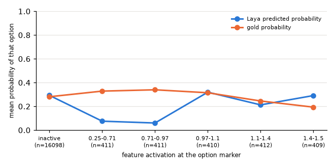

# Feature 9868

Critérios em que aparece: attribution_toward_correct

**Interpretação (preencher):** 

---

## Maiores ativações

**tr_customer_service_000175 / needs_human** (noul, customer_service) | ativação 1.557 em `pergunta` | opções ['false', 'true'] | Laya: **false** [0.678, 0.322] | gabarito: **true**

```
<bos> n⟦oul⟧ question: This conversation requires a human agent rather than automated handling.<eos>
▸ <mask> false: Automation can carry this to resolution.
▸ <mask> true: A human must take over: judgement, authority or empathy is required.

<eos>

 {"account": {"lifetime_value_usd": 133, "prior_tickets_90d": 1, "seats": 40, "tenure_months": 8, "tier": "enterprise"}, "orders": [{"amount_usd": 149, "date": "2026-01-04", "id": "A-23809", "status": "settled"}, {"amount_usd": 149, "date": "2026-01-20", "id": "A-52054", "status": "refunded"}], "thread": [{"role": "customer", "text": "I just opened my enterprise delivery and it is the completely wrong item. After the last issue with the missing shipment, I guess I shouldn't be surprised that this is happening again."}, {"role": "agent", "text": "I am very sorry to hear that you received the incorrect item. Could you please provide the order number and describe the item you received instead?"}, {"role": "customer", "text": "The order number is #88291. It was supposed to be the $149 hardware kit, but I got a box of cables instead. I need the correct items by Friday morning at the latest."}, {"role": "agent", "text": "Thank you for those details. I've noted the discrepancy regarding the hardware kit. Could you please send over a photo of the packing slip that was included in the box?"}, {"role": "customer", "text": "I've attached the photo to this message. I really hope we can get this resolved before my event starts."}]}<eos>
```

**tr_invoice_processing_000122 / disposition** (choice, invoice_processing) | ativação 1.548 em `marcador` | opções ['approve', 'hold', 'manual_review', 'reject'] | Laya: **approve** [0.472, 0.28, 0.034, 0.214] | gabarito: **approve**

```
<bos> choice question: How should this vendor invoice be dispositioned?<eos>
▸ <mask> approve: Matches the order and delivery; approve for payment.
▸ <mask> hold: Something needs confirming before payment; hold pending clarification.
▸ <mask> manual_review: A human in finance must review the discrepancy.
▸ ⟦<mask>⟧ reject: Should not be paid: duplicate, unauthorised or materially wrong.

<eos>

 {"delivery": {"condition": "accepted", "date": "2026-03-06", "received_qty": 50}, "invoice": {"currency": "USD", "id": "INV-2026-6710", "lines": [{"qty": 50, "sku": "SKU-535", "total_usd": 12689.0, "unit_usd": 253.78}], "total_usd": 12689.0, "vendor": "Vantage Materials"}, "payment": {"days_until_due": 0, "discount_expires_in_days": null, "early_payment_discount_pct": null, "status": "scheduled", "terms": "net 30"}, "purchase_order": {"freight_terms": "freight prepaid by vendor, not separately billable", "id": "PO-6025", "lines": [{"qty": 50, "unit_usd": 253.78}], "total_usd": 12689.0}, "vendor_history": {"disputes_12m": 0, "invoices_12m": 35, "prior_invoice_ids": ["INV-2026-6710"]}}<eos>
```

**tr_invoice_processing_000040 / disposition** (choice, invoice_processing) | ativação 1.544 em `marcador` | opções ['approve', 'hold', 'manual_review', 'reject'] | Laya: **hold** [0.292, 0.453, 0.031, 0.224] | gabarito: **hold**

```
<bos> choice question: How should this vendor invoice be dispositioned?<eos>
▸ <mask> approve: Matches the order and delivery; approve for payment.
▸ <mask> hold: Something needs confirming before payment; hold pending clarification.
▸ <mask> manual_review: A human in finance must review the discrepancy.
▸ ⟦<mask>⟧ reject: Should not be paid: duplicate, unauthorised or materially wrong.

<eos>

 {"delivery": {"condition": "accepted", "date": null, "received_qty": 0}, "invoice": {"currency": "USD", "id": "INV-2026-1284", "lines": [{"qty": 1000, "sku": "SKU-548", "total_usd": 285120.0, "unit_usd": 285.12}], "total_usd": 285120.0, "vendor": "Northwind Components"}, "payment": {"days_until_due": 27, "discount_expires_in_days": 3, "early_payment_discount_pct": 2.0, "status": "scheduled", "terms": "net 15"}, "purchase_order": {"freight_terms": "freight prepaid by vendor, not separately billable", "id": "PO-4387", "lines": [{"qty": 1000, "unit_usd": 285.12}], "total_usd": 285120.0}, "vendor_history": {"disputes_12m": 1, "invoices_12m": 9, "prior_invoice_ids": ["INV-2026-8643"]}}<eos>
```

**tr_invoice_processing_000229 / disposition** (choice, invoice_processing) | ativação 1.539 em `marcador` | opções ['approve', 'hold', 'manual_review', 'reject'] | Laya: **approve** [0.487, 0.275, 0.035, 0.203] | gabarito: **hold**

```
<bos> choice question: How should this vendor invoice be dispositioned?<eos>
▸ <mask> approve: Matches the order and delivery; approve for payment.
▸ <mask> hold: Something needs confirming before payment; hold pending clarification.
▸ <mask> manual_review: A human in finance must review the discrepancy.
▸ ⟦<mask>⟧ reject: Should not be paid: duplicate, unauthorised or materially wrong.

<eos>

 {"delivery": {"condition": "accepted with exceptions", "date": null, "received_qty": 0}, "invoice": {"currency": "USD", "id": "INV-2026-3885", "lines": [{"qty": 250, "sku": "SKU-557", "total_usd": 16032.5, "unit_usd": 64.13}], "total_usd": 16032.5, "vendor": "Pallas Industrial"}, "payment": {"days_until_due": 11, "discount_expires_in_days": null, "early_payment_discount_pct": null, "status": "scheduled", "terms": "net 45"}, "purchase_order": {"freight_terms": "freight prepaid by vendor, not separately billable", "id": "PO-6240", "lines": [{"qty": 250, "unit_usd": 64.13}], "total_usd": 16032.5}, "vendor_history": {"disputes_12m": 5, "invoices_12m": 31, "prior_invoice_ids": ["INV-2026-5043"]}}<eos>
```

**tr_invoice_processing_000091 / disposition** (choice, invoice_processing) | ativação 1.537 em `marcador` | opções ['approve', 'hold', 'manual_review', 'reject'] | Laya: **approve** [0.481, 0.25, 0.035, 0.234] | gabarito: **hold**

```
<bos> choice question: How should this vendor invoice be dispositioned?<eos>
▸ <mask> approve: Matches the order and delivery; approve for payment.
▸ <mask> hold: Something needs confirming before payment; hold pending clarification.
▸ <mask> manual_review: A human in finance must review the discrepancy.
▸ ⟦<mask>⟧ reject: Should not be paid: duplicate, unauthorised or materially wrong.

<eos>

 {"delivery": {"condition": "accepted", "date": "2026-03-05", "received_qty": 50}, "invoice": {"currency": "USD", "id": "INV-2026-1102", "lines": [{"qty": 50, "sku": "SKU-658", "total_usd": 15868.0, "unit_usd": 317.36}], "total_usd": 15868.0, "vendor": "Acme Fabrication"}, "payment": {"days_until_due": -9, "discount_expires_in_days": 4, "early_payment_discount_pct": 2.0, "status": "overdue", "terms": "net 15"}, "purchase_order": {"freight_terms": "freight prepaid by vendor, not separately billable", "id": "PO-1320", "lines": [{"qty": 50, "unit_usd": 317.36}], "total_usd": 15868.0}, "vendor_history": {"disputes_12m": 1, "invoices_12m": 1, "prior_invoice_ids": ["INV-2026-1102", "INV-2026-8587", "INV-2026-9515"]}}<eos>
```

## Ativações medianas (faixa 40-60%, mediana 0.970)

**tr_security_incidents_000163 / disposition** (choice, security_incidents) | ativação 1.023 em `marcador` | opções ['close_benign', 'contain', 'investigate', 'monitor'] | Laya: **monitor** [0.048, 0.128, 0.126, 0.698] | gabarito: **investigate**

```
<bos> choice question: How should this security alert be dispositioned?<eos>
▸ <mask> close_benign: Expected, explainable activity; close without analyst time.
▸ ⟦<mask>⟧ contain: Contain the host or account immediately; do not wait for triage.
▸ <mask> investigate: Warrants an analyst opening an investigation.
▸ <mask> monitor: Not clearly malicious, but worth watching for recurrence.

<eos>

 {"alert": {"description": "audit logging was turned off on a host", "evidence": "A privileged contractor account executed a command to disable audit logging on the host. This activity occurred outside of any scheduled change window, though the source address is currently on the system allowlist.", "rule": "disabled_logging"}, "context": {"asset_criticality": "medium", "change_window_active": false, "source_on_allowlist": true}, "history": {"credential_rotation_days_ago": 30, "distinct_countries_30d": 1, "logins_30d": 8, "prior_alerts_90d": 3}, "principal": {"mfa_enrolled": true, "name": "adm-deploy-786", "privileges": ["deploy:production", "secrets:read"], "type": "contractor"}}<eos>
```

**tr_security_incidents_000025 / disposition** (choice, security_incidents) | ativação 1.042 em `marcador` | opções ['close_benign', 'contain', 'investigate', 'monitor'] | Laya: **monitor** [0.175, 0.211, 0.173, 0.441] | gabarito: **close_benign**

```
<bos> choice question: How should this security alert be dispositioned?<eos>
▸ <mask> close_benign: Expected, explainable activity; close without analyst time.
▸ ⟦<mask>⟧ contain: Contain the host or account immediately; do not wait for triage.
▸ <mask> investigate: Warrants an analyst opening an investigation.
▸ <mask> monitor: Not clearly malicious, but worth watching for recurrence.

<eos>

 {"alert": {"description": "two successful logins from distant locations too close together", "evidence": "Two successful logins for the shared mailbox occurred from geographically distant locations within a timeframe that precludes physical travel. Both connections originated from an IP address currently on the allowlist.", "rule": "impossible_travel"}, "context": {"asset_criticality": "crown_jewel", "change_window_active": false, "source_on_allowlist": true}, "history": {"credential_rotation_days_ago": 180, "distinct_countries_30d": 4, "logins_30d": 1031, "prior_alerts_90d": 3}, "principal": {"mfa_enrolled": true, "name": "adm-deploy-597", "privileges": ["repo:read"], "type": "shared_mailbox"}}<eos>
```

**tr_invoice_processing_000109 / disposition** (choice, invoice_processing) | ativação 1.034 em `marcador` | opções ['approve', 'hold', 'manual_review', 'reject'] | Laya: **approve** [0.514, 0.112, 0.028, 0.346] | gabarito: **manual_review**

```
<bos> choice question: How should this vendor invoice be dispositioned?<eos>
▸ ⟦<mask>⟧ approve: Matches the order and delivery; approve for payment.
▸ <mask> hold: Something needs confirming before payment; hold pending clarification.
▸ <mask> manual_review: A human in finance must review the discrepancy.
▸ <mask> reject: Should not be paid: duplicate, unauthorised or materially wrong.

<eos>

 {"delivery": {"condition": "accepted", "date": "2026-03-13", "received_qty": 50}, "invoice": {"currency": "USD", "id": "INV-2026-1558", "lines": [{"qty": 100, "sku": "SKU-351", "total_usd": 8003.0, "unit_usd": 80.03}], "total_usd": 8003.0, "vendor": "Vantage Materials"}, "payment": {"days_until_due": 44, "discount_expires_in_days": null, "early_payment_discount_pct": null, "status": "scheduled", "terms": "net 30"}, "purchase_order": {"freight_terms": "freight prepaid by vendor, not separately billable", "id": "PO-3499", "lines": [{"qty": 50, "unit_usd": 80.03}], "total_usd": 4001.5}, "vendor_history": {"disputes_12m": 0, "invoices_12m": 9, "prior_invoice_ids": ["INV-2026-2254", "INV-2026-7618", "INV-2026-3837", "INV-2026-2225"]}}<eos>
```

**tr_security_incidents_000284 / disposition** (choice, security_incidents) | ativação 0.928 em `marcador` | opções ['close_benign', 'contain', 'investigate', 'monitor'] | Laya: **monitor** [0.059, 0.181, 0.11, 0.651] | gabarito: **investigate**

```
<bos> choice question: How should this security alert be dispositioned?<eos>
▸ <mask> close_benign: Expected, explainable activity; close without analyst time.
▸ ⟦<mask>⟧ contain: Contain the host or account immediately; do not wait for triage.
▸ <mask> investigate: Warrants an analyst opening an investigation.
▸ <mask> monitor: Not clearly malicious, but worth watching for recurrence.

<eos>

 {"alert": {"description": "a large transfer to an external destination", "evidence": "A large volume of data was transferred to an unrecognized external endpoint by a privileged employee account. The activity occurred during an open change window, and the account credentials were last rotated 3 days ago.", "rule": "data_egress"}, "context": {"asset_criticality": "low", "change_window_active": true, "source_on_allowlist": false}, "history": {"credential_rotation_days_ago": 3, "distinct_countries_30d": 3, "logins_30d": 861, "prior_alerts_90d": 1}, "principal": {"mfa_enrolled": true, "name": "svc-deploy-149", "privileges": ["deploy:production", "secrets:read"], "type": "employee"}}<eos>
```

**tr_invoice_processing_000035 / disposition** (choice, invoice_processing) | ativação 1.034 em `marcador` | opções ['approve', 'hold', 'manual_review', 'reject'] | Laya: **approve** [0.521, 0.186, 0.02, 0.272] | gabarito: **approve**

```
<bos> choice question: How should this vendor invoice be dispositioned?<eos>
▸ ⟦<mask>⟧ approve: Matches the order and delivery; approve for payment.
▸ <mask> hold: Something needs confirming before payment; hold pending clarification.
▸ <mask> manual_review: A human in finance must review the discrepancy.
▸ <mask> reject: Should not be paid: duplicate, unauthorised or materially wrong.

<eos>

 {"delivery": {"condition": "accepted", "date": "2026-03-03", "received_qty": 400}, "invoice": {"currency": "USD", "id": "INV-2026-5138", "lines": [{"qty": 400, "sku": "SKU-564", "total_usd": 107000.0, "unit_usd": 267.5}], "total_usd": 107000.0, "vendor": "Acme Fabrication"}, "payment": {"days_until_due": -3, "discount_expires_in_days": null, "early_payment_discount_pct": null, "status": "overdue", "terms": "net 60"}, "purchase_order": {"freight_terms": "freight prepaid by vendor, not separately billable", "id": "PO-4223", "lines": [{"qty": 400, "unit_usd": 267.5}], "total_usd": 107000.0}, "vendor_history": {"disputes_12m": 5, "invoices_12m": 22, "prior_invoice_ids": ["INV-2026-5241", "INV-2026-9263", "INV-2026-3455", "INV-2026-4358"]}}<eos>
```

## Estatísticas (conjunto de descoberta, dev e teste)

**pred / error**

| split | decisões | ativas | ativas e Laya errou | taxa | lift | q (BH) | OR (CMH) | q (CMH) |
|---|---|---|---|---|---|---|---|---|
| discovery | 5100 | 300 | 204 | 0.680 | 1.06 | 0.245 | 1.27 | 0.722 |
| dev | 900 | 68 | 51 | 0.750 | 1.12 | 0.307 | 1.38 | 0.834 |
| test | 2000 | 131 | 83 | 0.634 | 0.97 | 0.788 | 0.79 | 0.894 |

**corr / error**

| split | decisões | ativas | ativas e Laya errou | taxa | lift | q (BH) | OR (CMH) | q (CMH) |
|---|---|---|---|---|---|---|---|---|
| discovery | 5100 | 612 | 516 | 0.843 | 1.31 | 9.55e-30 | 1.23 | 0.466 |
| dev | 900 | 112 | 95 | 0.848 | 1.26 | 6.8e-05 | 1.08 | 0.982 |
| test | 2000 | 229 | 181 | 0.790 | 1.22 | 5.05e-06 | 1.62 | 0.522 |

**state / error**

| split | decisões | ativas | ativas e Laya errou | taxa | lift | q (BH) | OR (CMH) | q (CMH) |
|---|---|---|---|---|---|---|---|---|
| discovery | 5100 | 1306 | 866 | 0.663 | 1.03 | 0.205 | 0.66 | 0.00329 |
| dev | 900 | 299 | 215 | 0.719 | 1.07 | 0.262 | 0.55 | 0.257 |
| test | 2000 | 527 | 360 | 0.683 | 1.05 | 0.261 | 0.68 | 0.264 |

**pred / probe_right_laya_wrong**

| split | decisões | ativas | ativas e Laya errou | taxa | lift | q (BH) | OR (CMH) | q (CMH) |
|---|---|---|---|---|---|---|---|---|
| discovery | 2819 | 150 | 81 | 0.540 | 0.83 | 0.0103 | 0.29 | 0.0342 |
| dev | 520 | 37 | 22 | 0.595 | 0.88 | 0.487 | 0.16 | 0.21 |
| test | 1106 | 73 | 39 | 0.534 | 0.84 | 0.139 | 1.65 | 0.793 |

**corr / probe_right_laya_wrong**

| split | decisões | ativas | ativas e Laya errou | taxa | lift | q (BH) | OR (CMH) | q (CMH) |
|---|---|---|---|---|---|---|---|---|
| discovery | 2819 | 335 | 266 | 0.794 | 1.23 | 2.12e-09 | inf | 0.265 |
| dev | 520 | 62 | 47 | 0.758 | 1.12 | 0.248 | inf | 0.731 |
| test | 1106 | 117 | 83 | 0.709 | 1.12 | 0.109 | inf | 0.397 |

**state / probe_right_laya_wrong**

| split | decisões | ativas | ativas e Laya errou | taxa | lift | q (BH) | OR (CMH) | q (CMH) |
|---|---|---|---|---|---|---|---|---|
| discovery | 2819 | 778 | 540 | 0.694 | 1.07 | 0.00515 | 0.40 | 8.71e-09 |
| dev | 520 | 183 | 131 | 0.716 | 1.06 | 0.483 | 0.29 | 0.00516 |
| test | 1106 | 318 | 221 | 0.695 | 1.10 | 0.0434 | 0.42 | 0.00633 |

Confusão mais sobre-representada (pred): `disposition|0>2` (n=48, lift 14.07, p=0). Formato `pergunta|índice previsto>índice correto`.

Confusão mais sobre-representada (corr): `action|3>1` (n=111, lift 8.33, p=0). Formato `pergunta|índice previsto>índice correto`.

Confusão mais sobre-representada (state): `discrepancy_severity|2>0` (n=108, lift 3.91, p=0). Formato `pergunta|índice previsto>índice correto`.



