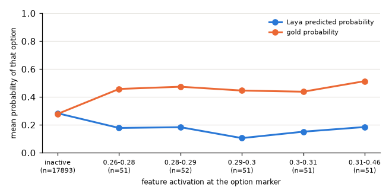

# Feature 9956

Critérios em que aparece: corr_error_stratified

**Interpretação (preencher):** 

---

## Maiores ativações

**tr_customer_service_000076 / category** (choice, customer_service) | ativação 5.527 em `estado` | opções ['account', 'billing', 'delivery', 'refund', 'technical'] | Laya: **technical** [0.017, 0.009, 0.068, 0.001, 0.905] | gabarito: **delivery**

```
<bos> choice question: What is this customer conversation primarily about?<eos>
▸ <mask> account: Login, plan changes, profile or access management.
▸ <mask> billing: A charge, invoice, subscription or payment problem.
▸ <mask> delivery: Shipping, fulfilment or delivery of a physical item.
▸ <mask> refund: The customer is explicitly asking for money back.
▸ <mask> technical: The product or service is not working as expected.

<eos>

 {"account": {"lifetime_value_usd": 2408, "prior_tickets_90d": 1, "seats": 1, "tenure_months": 72, "tier": "standard"}, "orders": [{"amount_usd": 298, "date": "2026-02-13", "id": "A-26883", "status": "refunded"}, {"amount_usd": 298, "date": "2026-02-21", "id": "A-47417", "status": "failed"}], "thread": [{"role": "customer", "text": "I’ve been paying for the standard plan for six years now, yet my $298 order is nowhere to be found. This delivery is late again, just like the last issue I had to open a ticket for."}, {"role": "agent", "text": "I see your history with us and⟦ I⟧'m sorry to hear that this delivery is experiencing a delay. Could you please provide your order number so I can take a look at the current status?"}, {"role": "customer", "text": "It’s #99284. I don't care what you see in the system, I just want to know where my stuff is since it clearly didn't arrive when it was supposed to."}]}<eos>
```

**tr_customer_service_000076 / urgency** (score, customer_service) | ativação 5.516 em `estado` | opções ['0', '1', '2', '3'] | Laya: **1** [0.314, 0.489, 0.082, 0.115] | gabarito: **2**

```
<bos> score question: How time-sensitive is this conversation?<eos>
▸ <mask> level 0: No time pressure; can wait indefinitely.
▸ <mask> level 1: Routine; handle within the normal queue.
▸ <mask> level 2: Elevated; should be handled within the same week.
▸ <mask> level 3: Critical; requires action within the same day.

<eos>

 {"account": {"lifetime_value_usd": 2408, "prior_tickets_90d": 1, "seats": 1, "tenure_months": 72, "tier": "standard"}, "orders": [{"amount_usd": 298, "date": "2026-02-13", "id": "A-26883", "status": "refunded"}, {"amount_usd": 298, "date": "2026-02-21", "id": "A-47417", "status": "failed"}], "thread": [{"role": "customer", "text": "I’ve been paying for the standard plan for six years now, yet my $298 order is nowhere to be found. This delivery is late again, just like the last issue I had to open a ticket for."}, {"role": "agent", "text": "I see your history with us and⟦ I⟧'m sorry to hear that this delivery is experiencing a delay. Could you please provide your order number so I can take a look at the current status?"}, {"role": "customer", "text": "It’s #99284. I don't care what you see in the system, I just want to know where my stuff is since it clearly didn't arrive when it was supposed to."}]}<eos>
```

**tr_customer_service_000076 / churn_risk** (score, customer_service) | ativação 5.496 em `estado` | opções ['0', '1', '2', '3'] | Laya: **2** [0.115, 0.371, 0.428, 0.086] | gabarito: **2**

```
<bos> score question: How likely is this customer to stop doing business with us because of this interaction?<eos>
▸ <mask> level 0: No sign of dissatisfaction.
▸ <mask> level 1: Mild frustration, but the relationship is intact.
▸ <mask> level 2: Clearly unhappy; repeat problems or explicit complaints.
▸ <mask> level 3: Imminent: threatening to cancel, dispute or leave.

<eos>

 {"account": {"lifetime_value_usd": 2408, "prior_tickets_90d": 1, "seats": 1, "tenure_months": 72, "tier": "standard"}, "orders": [{"amount_usd": 298, "date": "2026-02-13", "id": "A-26883", "status": "refunded"}, {"amount_usd": 298, "date": "2026-02-21", "id": "A-47417", "status": "failed"}], "thread": [{"role": "customer", "text": "I’ve been paying for the standard plan for six years now, yet my $298 order is nowhere to be found. This delivery is late again, just like the last issue I had to open a ticket for."}, {"role": "agent", "text": "I see your history with us and⟦ I⟧'m sorry to hear that this delivery is experiencing a delay. Could you please provide your order number so I can take a look at the current status?"}, {"role": "customer", "text": "It’s #99284. I don't care what you see in the system, I just want to know where my stuff is since it clearly didn't arrive when it was supposed to."}]}<eos>
```

**tr_customer_service_000258 / category** (choice, customer_service) | ativação 5.480 em `estado` | opções ['account', 'billing', 'delivery', 'refund', 'technical'] | Laya: **delivery** [0.0, 0.0, 0.999, 0.0, 0.0] | gabarito: **delivery**

```
<bos> choice question: What is this customer conversation primarily about?<eos>
▸ <mask> account: Login, plan changes, profile or access management.
▸ <mask> billing: A charge, invoice, subscription or payment problem.
▸ <mask> delivery: Shipping, fulfilment or delivery of a physical item.
▸ <mask> refund: The customer is explicitly asking for money back.
▸ <mask> technical: The product or service is not working as expected.

<eos>

 {"account": {"lifetime_value_usd": 48, "prior_tickets_90d": 0, "seats": 1, "tenure_months": 1, "tier": "free"}, "thread": [{"role": "customer", "text": "I ordered the deluxe starter kit and you sent me the basic one instead—this is unacceptable, and I need it fixed before Friday or I'm cancelling my subscription."}, {"role": "agent", "text": "⟦I⟧’m sorry to hear you received the wrong kit. Could you share the order number so I can pull up the details?"}, {"role": "customer", "text": "The order number is 8742‑19. I’ve already waited a week, and if I don’t have the correct item by Friday I’m done with your service."}, {"role": "agent", "text": "Thank you for the number. I’ll check the shipment records and see what went wrong. May I also get the email address linked to the account?"}, {"role": "customer", "text": "It’s john.doe@example.com. I expect you to have a solution in place before the deadline—I’m not willing to wait any longer."}]}<eos>
```

**tr_customer_service_000076 / action** (choice, customer_service) | ativação 5.449 em `estado` | opções ['answer_directly', 'close_no_action', 'escalate_to_human', 'execute_refund', 'request_information'] | Laya: **answer_directly** [0.602, 0.293, 0.069, 0.023, 0.012] | gabarito: **escalate_to_human**

```
<bos> choice question: What should the assistant do next with this conversation?<eos>
▸ <mask> answer_directly: The assistant can resolve this itself with information it already has.
▸ <mask> close_no_action: No further action is warranted; the matter is settled.
▸ <mask> escalate_to_human: Hand off to a human agent with the appropriate authority.
▸ <mask> execute_refund: Issue the refund or credit the customer is owed.
▸ <mask> request_information: More detail is needed from the customer before anything can be done.

<eos>

 {"account": {"lifetime_value_usd": 2408, "prior_tickets_90d": 1, "seats": 1, "tenure_months": 72, "tier": "standard"}, "orders": [{"amount_usd": 298, "date": "2026-02-13", "id": "A-26883", "status": "refunded"}, {"amount_usd": 298, "date": "2026-02-21", "id": "A-47417", "status": "failed"}], "thread": [{"role": "customer", "text": "I’ve been paying for the standard plan for six years now, yet my $298 order is nowhere to be found. This delivery is late again, just like the last issue I had to open a ticket for."}, {"role": "agent", "text": "I see your history with us and⟦ I⟧'m sorry to hear that this delivery is experiencing a delay. Could you please provide your order number so I can take a look at the current status?"}, {"role": "customer", "text": "It’s #99284. I don't care what you see in the system, I just want to know where my stuff is since it clearly didn't arrive when it was supposed to."}]}<eos>
```

## Ativações medianas (faixa 40-60%, mediana 1.152)

**tr_customer_service_000187 / urgency** (score, customer_service) | ativação 1.316 em `estado` | opções ['0', '1', '2', '3'] | Laya: **1** [0.02, 0.664, 0.074, 0.242] | gabarito: **3**

```
<bos> score question: How time-sensitive is this conversation?<eos>
▸ <mask> level 0: No time pressure; can wait indefinitely.
▸ <mask> level 1: Routine; handle within the normal queue.
▸ <mask> level 2: Elevated; should be handled within the same week.
▸ <mask> level 3: Critical; requires action within the same day.

<eos>

 {"account": {"lifetime_value_usd": 1666, "prior_tickets_90d": 0, "seats": 1, "tenure_months": 49, "tier": "standard"}, "orders": [{"amount_usd": 447, "date": "2026-01-13", "id": "A-73036", "status": "settled"}, {"amount_usd": 447, "date": "2026-01-14", "id": "A-19724", "status": "refunded"}], "thread": [{"role": "customer", "text": "The seat allocation tool is a joke—my team can’t add anyone new and you keep throwing error code 502 at us!"}, {"role": "agent", "text": "I’m sorry the seat manager is failing you. Can⟦ you⟧ tell me exactly which action triggers the 502 response, and if you see any additional message details?"}, {"role": "customer", "text": "Every time I click ‘Add seat’ after typing the email it just crashes; I’ve tried it on Chrome and Firefox, same garbage."}, {"role": "agent", "text": "Thanks for the specifics. To investigate further, could you share the email addresses you attempted to add and the timestamps of those attempts?"}, {"role": "customer", "text": "We tried john.smith@company.com at 10:15 AM and lisa.brown@company.com at 10:17 AM today, and both blew up. This is delaying a project worth thousands."}, {"role": "agent", "text": "I’ve noted those details. While I can’t fix it instantly, I’ll forward this to our engineering squad. Meanwhile, could you confirm whether any other admin users are experiencing the same issue?"}, {"role": "customer", "text": "All of our admins get the same error, so it’s clearly a system problem—not just my account."}]}<eos>
```

**tr_customer_service_000286 / action** (choice, customer_service) | ativação 1.269 em `estado` | opções ['answer_directly', 'close_no_action', 'escalate_to_human', 'execute_refund', 'request_information'] | Laya: **answer_directly** [0.43, 0.404, 0.028, 0.102, 0.035] | gabarito: **request_information**

```
<bos> choice question: What should the assistant do next with this conversation?<eos>
▸ <mask> answer_directly: The assistant can resolve this itself with information it already has.
▸ <mask> close_no_action: No further action is warranted; the matter is settled.
▸ <mask> escalate_to_human: Hand off to a human agent with the appropriate authority.
▸ <mask> execute_refund: Issue the refund or credit the customer is owed.
▸ <mask> request_information: More detail is needed from the customer before anything can be done.

<eos>

 {"account": {"lifetime_value_usd": 2881, "prior_tickets_90d": 1, "seats": 1, "tenure_months": 49, "tier": "premium"}, "orders": [{"amount_usd": 9, "date": "2026-01-14", "id": "A-85515", "status": "failed"}], "thread": [{"role": "customer", "text": "My package was supposed to arrive yesterday and it still isn’t here—this is a hard deadline for me and⟦ I⟧ need it today!"}]}<eos>
```

**tr_customer_service_000117 / needs_human** (noul, customer_service) | ativação 1.369 em `estado` | opções ['false', 'true'] | Laya: **false** [0.639, 0.361] | gabarito: **true**

```
<bos> noul question: This conversation requires a human agent rather than automated handling.<eos>
▸ <mask> false: Automation can carry this to resolution.
▸ <mask> true: A human must take over: judgement, authority or empathy is required.

<eos>

 {"account": {"lifetime_value_usd": 1573, "prior_tickets_90d": 0, "seats": 1, "tenure_months": 19, "tier": "free"}, "orders": [{"amount_usd": 9, "date": "2026-02-10", "id": "A-62171", "status": "pending"}, {"amount_usd": 9, "date": "2026-03-19", "id": "A-51808", "status": "failed"}, {"amount_usd": 9, "date": "2026-01-01", "id": "A-58951", "status": "failed"}], "thread": [{"role": "customer", "text": "I’m looking at a charge for $9 on my account. I’ve been using the free plan for over a year and a half, so why am I being billed now? I'm ready to delete my account if this isn't fixed immediately."}, {"role": "agent", "text": "I understand this is unexpected. To help me investigate your account status, could you confirm the email address associated with your subscription?"}, {"role": "customer", "text": "It’s linked to my primary email. I’ve been a loyal user for 19 months, but this feels like a total scam. Fix this or I'm gone."}, {"role": "agent", "text": "Thank you for confirming that. I am looking into your history now; could you clarify if you recently signed up for any trial features or promotional add-ons?"}, {"role": "customer", "text": "No,⟦ I⟧ haven't clicked on anything new! I just want this $9 charge removed and my account returned to the free status I've always had."}]}<eos>
```

**tr_customer_service_000022 / churn_risk** (score, customer_service) | ativação 0.996 em `estado` | opções ['0', '1', '2', '3'] | Laya: **2** [0.034, 0.201, 0.75, 0.015] | gabarito: **1**

```
<bos> score question: How likely is this customer to stop doing business with us because of this interaction?<eos>
▸ <mask> level 0: No sign of dissatisfaction.
▸ <mask> level 1: Mild frustration, but the relationship is intact.
▸ <mask> level 2: Clearly unhappy; repeat problems or explicit complaints.
▸ <mask> level 3: Imminent: threatening to cancel, dispute or leave.

<eos>

 {"account": {"lifetime_value_usd": 60, "prior_tickets_90d": 1, "seats": 1, "tenure_months": 1, "tier": "premium"}, "thread": [{"role": "customer", "text": "Last week you promised a refund for my premium subscription, but nothing’s shown up yet. I’m just waiting for an update."}, {"role": "agent", "text": "I’m sorry you haven’t seen the refund yet. Could you provide the ticket number⟦ you⟧ were given for that request?"}, {"role": "customer", "text": "The ticket number is #4529. I just need to know if the refund is on its way."}, {"role": "agent", "text": "Thanks for the reference. I’ll check with our finance team. Do you still have the original payment method details handy?"}, {"role": "customer", "text": "Yes, it was the Visa ending in 1234. I’ll wait for your next update."}]}<eos>
```

**tr_customer_service_000210 / churn_risk** (score, customer_service) | ativação 1.223 em `estado` | opções ['0', '1', '2', '3'] | Laya: **1** [0.398, 0.453, 0.084, 0.065] | gabarito: **2**

```
<bos> score question: How likely is this customer to stop doing business with us because of this interaction?<eos>
▸ <mask> level 0: No sign of dissatisfaction.
▸ <mask> level 1: Mild frustration, but the relationship is intact.
▸ <mask> level 2: Clearly unhappy; repeat problems or explicit complaints.
▸ <mask> level 3: Imminent: threatening to cancel, dispute or leave.

<eos>

 {"account": {"lifetime_value_usd": 459, "prior_tickets_90d": 5, "seats": 1, "tenure_months": 14, "tier": "free"}, "orders": [{"amount_usd": 299, "date": "2026-03-18", "id": "A-97738", "status": "failed"}, {"amount_usd": 299, "date": "2026-02-26", "id": "A-91369", "status": "refunded"}, {"amount_usd": 299, "date": "2026-03-24", "id": "A-52614", "status": "settled"}], "thread": [{"role": "customer", "text": "Hello, I’d like to downgrade my account to the Free plan. I’ve been with you for over a year and have $299 worth of credits, but I need this change by the end of the month."}, {"role": "agent", "text": "Thank you for reaching out. Just to confirm, you’re currently on a paid tier and want to move to the Free plan. May⟦ I⟧ ask which features you rely on most so we can ensure the downgrade won’t impact your workflow?"}, {"role": "customer", "text": "I mainly use the analytics dashboard and the API access; I’m okay losing the advanced reporting, but I can’t lose API keys."}, {"role": "agent", "text": "Got it. Could you also let me know if there are any pending invoices or credit adjustments that need to be addressed before we proceed?"}, {"role": "customer", "text": "No pending invoices—just the $299 credit I’ve accumulated, which I’d like applied before the downgrade takes effect."}]}<eos>
```

## Estatísticas (conjunto de descoberta, dev e teste)

**pred / error**

| split | decisões | ativas | ativas e Laya errou | taxa | lift | q (BH) | OR (CMH) | q (CMH) |
|---|---|---|---|---|---|---|---|---|
| discovery | 5100 | 34 | 18 | 0.529 | 0.82 | 0.276 | 1.15 | 0.897 |
| dev | 900 | 9 | 5 | 0.556 | 0.83 | nan | nan | nan |
| test | 2000 | 18 | 8 | 0.444 | 0.68 | nan | nan | nan |

**corr / error**

| split | decisões | ativas | ativas e Laya errou | taxa | lift | q (BH) | OR (CMH) | q (CMH) |
|---|---|---|---|---|---|---|---|---|
| discovery | 5100 | 117 | 101 | 0.863 | 1.34 | 3.24e-07 | 6.52 | 3.91e-22 |
| dev | 900 | 32 | 28 | 0.875 | 1.30 | 0.028 | 6.41 | 9.96e-06 |
| test | 2000 | 55 | 45 | 0.818 | 1.26 | 0.0143 | 5.17 | 2.35e-09 |

**state / error**

| split | decisões | ativas | ativas e Laya errou | taxa | lift | q (BH) | OR (CMH) | q (CMH) |
|---|---|---|---|---|---|---|---|---|
| discovery | 5100 | 1799 | 1093 | 0.608 | 0.94 | 0.000552 | 1.08 | 0.827 |
| dev | 900 | 272 | 172 | 0.632 | 0.94 | 0.381 | 0.97 | 0.979 |
| test | 2000 | 692 | 412 | 0.595 | 0.92 | 0.0099 | 0.62 | 0.214 |

**pred / probe_right_laya_wrong**

| split | decisões | ativas | ativas e Laya errou | taxa | lift | q (BH) | OR (CMH) | q (CMH) |
|---|---|---|---|---|---|---|---|---|
| discovery | 2819 | 20 | 14 | 0.700 | 1.08 | 0.837 | 1.50 | 0.623 |
| dev | 520 | 5 | 5 | 1.000 | 1.48 | nan | nan | nan |
| test | 1106 | 10 | 6 | 0.600 | 0.95 | nan | nan | nan |

**corr / probe_right_laya_wrong**

| split | decisões | ativas | ativas e Laya errou | taxa | lift | q (BH) | OR (CMH) | q (CMH) |
|---|---|---|---|---|---|---|---|---|
| discovery | 2819 | 56 | 50 | 0.893 | 1.38 | 8.12e-05 | 7.77 | 2.71e-14 |
| dev | 520 | 14 | 14 | 1.000 | 1.48 | nan | nan | nan |
| test | 1106 | 27 | 23 | 0.852 | 1.35 | 0.0322 | 5.77 | 3.43e-06 |

**state / probe_right_laya_wrong**

| split | decisões | ativas | ativas e Laya errou | taxa | lift | q (BH) | OR (CMH) | q (CMH) |
|---|---|---|---|---|---|---|---|---|
| discovery | 2819 | 976 | 572 | 0.586 | 0.91 | 9.47e-06 | 1.13 | 0.68 |
| dev | 520 | 150 | 95 | 0.633 | 0.94 | 0.55 | 1.25 | 0.651 |
| test | 1106 | 370 | 208 | 0.562 | 0.89 | 0.00914 | 1.12 | 0.849 |

Confusão mais sobre-representada (pred): `needs_review|0>1` (n=18, lift 25.71, p=1.65e-22). Formato `pergunta|índice previsto>índice correto`.

Confusão mais sobre-representada (corr): `matches_order|1>0` (n=95, lift 34.80, p=0). Formato `pergunta|índice previsto>índice correto`.

Confusão mais sobre-representada (state): `action|1>2` (n=71, lift 2.83, p=2.98e-33). Formato `pergunta|índice previsto>índice correto`.



