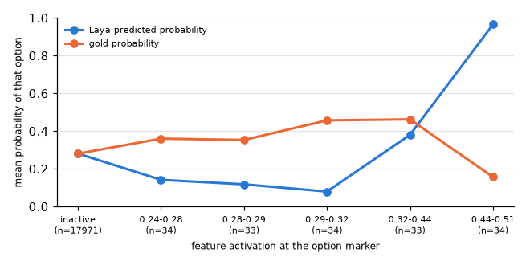

# Feature 9988

Critérios em que aparece: pred_probe_right_laya_wrong, corr_probe_right_laya_wrong

**Interpretação (preencher):** 

---

## Maiores ativações

**tr_customer_service_000138 / churn_risk** (score, customer_service) | ativação 6.719 em `estado` | opções ['0', '1', '2', '3'] | Laya: **1** [0.046, 0.489, 0.428, 0.037] | gabarito: **2**

```
<bos> score question: How likely is this customer to stop doing business with us because of this interaction?<eos>
▸ <mask> level 0: No sign of dissatisfaction.
▸ <mask> level 1: Mild frustration, but the relationship is intact.
▸ <mask> level 2: Clearly unhappy; repeat problems or explicit complaints.
▸ <mask> level 3: Imminent: threatening to cancel, dispute or leave.

<eos>

 {"account": {"lifetime_value_usd": 247, "prior_tickets_90d": 1, "seats": 1, "tenure_months": 3, "tier": "standard"}, "thread": [{"role": "customer", "text": "Good afternoon, I need the data export we discussed last month. This is my third month on the standard plan, and the previous ticket promised the export but never arrived."}, {"role": "agent", "text": "I’m sorry you haven’t received the export yet. Could you remind me of the ticket number so I can locate the original request?"}, {"role": "customer", "text": "The ticket was #7890, opened on July 20th. I was told it would be ready within 48 hours, but I still have nothing."}, {"role": "agent", "text": "Thank you for the details. I’ll pull up the logs for that ticket. In the meantime, could you confirm the email address you’d like the export sent to?"}, {"role": "customer", "text": "Please send it to me at alex.⟦tan⟧@example.com. I need the data before the end of the month, so any update would be great."}]}<eos>
```

**tr_security_incidents_000045 / disposition** (choice, security_incidents) | ativação 6.395 em `estado` | opções ['close_benign', 'contain', 'investigate', 'monitor'] | Laya: **contain** [0.193, 0.706, 0.03, 0.071] | gabarito: **investigate**

```
<bos> choice question: How should this security alert be dispositioned?<eos>
▸ <mask> close_benign: Expected, explainable activity; close without analyst time.
▸ <mask> contain: Contain the host or account immediately; do not wait for triage.
▸ <mask> investigate: Warrants an analyst opening an investigation.
▸ <mask> monitor: Not clearly malicious, but worth watching for recurrence.

<eos>

 {"alert": {"description": "an unusual volume of files read in a short window", "evidence": "At 2026-09-15 02:07:14 UTC, the admin account \"ADM_⟦Jenkins⟧\" invoked the process \"cmd.exe\" to open 417 distinct files on the UNC path \\\\fileshare01\\project\\data within a 4‑minute interval. The source host (10.12.34.78) is listed in the allowlist and the account's MFA setting is disabled, with the password last rotated 180 days prior.", "rule": "mass_download"}, "context": {"asset_criticality": "high", "change_window_active": false, "source_on_allowlist": true}, "history": {"credential_rotation_days_ago": 180, "distinct_countries_30d": 1, "logins_30d": 1479, "prior_alerts_90d": 0}, "principal": {"mfa_enrolled": false, "name": "ci-infra-731", "privileges": ["deploy:production", "secrets:read"], "type": "admin"}}<eos>
```

**tr_security_incidents_000045 / true_positive** (noul, security_incidents) | ativação 5.922 em `estado` | opções ['false', 'true'] | Laya: **false** [0.984, 0.016] | gabarito: **false**

```
<bos> noul question: This alert reflects genuinely malicious or unauthorised activity.<eos>
▸ <mask> false: Benign activity, a misconfiguration, or a known false positive.
▸ <mask> true: The underlying behaviour is malicious or unauthorised.

<eos>

 {"alert": {"description": "an unusual volume of files read in a short window", "evidence": "At 2026-09-15 02:07:14 UTC, the admin account \"ADM_⟦Jenkins⟧\" invoked the process \"cmd.exe\" to open 417 distinct files on the UNC path \\\\fileshare01\\project\\data within a 4‑minute interval. The source host (10.12.34.78) is listed in the allowlist and the account's MFA setting is disabled, with the password last rotated 180 days prior.", "rule": "mass_download"}, "context": {"asset_criticality": "high", "change_window_active": false, "source_on_allowlist": true}, "history": {"credential_rotation_days_ago": 180, "distinct_countries_30d": 1, "logins_30d": 1479, "prior_alerts_90d": 0}, "principal": {"mfa_enrolled": false, "name": "ci-infra-731", "privileges": ["deploy:production", "secrets:read"], "type": "admin"}}<eos>
```

**tr_customer_service_000138 / action** (choice, customer_service) | ativação 5.918 em `estado` | opções ['answer_directly', 'close_no_action', 'escalate_to_human', 'execute_refund', 'request_information'] | Laya: **escalate_to_human** [0.405, 0.073, 0.409, 0.06, 0.053] | gabarito: **escalate_to_human**

```
<bos> choice question: What should the assistant do next with this conversation?<eos>
▸ <mask> answer_directly: The assistant can resolve this itself with information it already has.
▸ <mask> close_no_action: No further action is warranted; the matter is settled.
▸ <mask> escalate_to_human: Hand off to a human agent with the appropriate authority.
▸ <mask> execute_refund: Issue the refund or credit the customer is owed.
▸ <mask> request_information: More detail is needed from the customer before anything can be done.

<eos>

 {"account": {"lifetime_value_usd": 247, "prior_tickets_90d": 1, "seats": 1, "tenure_months": 3, "tier": "standard"}, "thread": [{"role": "customer", "text": "Good afternoon, I need the data export we discussed last month. This is my third month on the standard plan, and the previous ticket promised the export but never arrived."}, {"role": "agent", "text": "I’m sorry you haven’t received the export yet. Could you remind me of the ticket number so I can locate the original request?"}, {"role": "customer", "text": "The ticket was #7890, opened on July 20th. I was told it would be ready within 48 hours, but I still have nothing."}, {"role": "agent", "text": "Thank you for the details. I’ll pull up the logs for that ticket. In the meantime, could you confirm the email address you’d like the export sent to?"}, {"role": "customer", "text": "Please send it to me at alex.⟦tan⟧@example.com. I need the data before the end of the month, so any update would be great."}]}<eos>
```

**tr_invoice_processing_000053 / discrepancy_severity** (score, invoice_processing) | ativação 5.914 em `estado` | opções ['0', '1', '2', '3'] | Laya: **2** [0.066, 0.25, 0.63, 0.055] | gabarito: **0**

```
<bos> score question: How material is any discrepancy between the invoice, the order and the delivery?<eos>
▸ <mask> level 0: None: everything reconciles.
▸ <mask> level 1: Trivial: rounding or a cosmetic difference.
▸ <mask> level 2: Moderate: a real difference worth confirming.
▸ <mask> level 3: Material: a large or unexplained difference.

<eos>

 {"delivery": {"condition": "accepted", "date": "2026-03-06", "received_qty": 25}, "invoice": {"currency": "USD", "id": "INV-2026-3291", "lines": [{"qty": 25, "sku": "SKU-304", "total_usd": 8290.0, "unit_usd": 331.6}], "total_usd": 8290.0, "vendor": "⟦Orbit⟧ Logistics"}, "payment": {"days_until_due": -9, "discount_expires_in_days": 7, "early_payment_discount_pct": 2.0, "status": "overdue", "terms": "net 30"}, "purchase_order": {"freight_terms": "freight prepaid by vendor, not separately billable", "id": "PO-9829", "lines": [{"qty": 25, "unit_usd": 331.6}], "total_usd": 8290.0}, "vendor_history": {"disputes_12m": 0, "invoices_12m": 40, "prior_invoice_ids": ["INV-2026-8586", "INV-2026-8046"]}}<eos>
```

## Ativações medianas (faixa 40-60%, mediana 0.888)

**tr_agent_trace_observability_000087 / risk** (score, agent_trace_observability) | ativação 0.876 em `estado` | opções ['0', '1', '2', '3'] | Laya: **2** [0.029, 0.022, 0.691, 0.259] | gabarito: **0**

```
<bos> score question: How risky was the agent's behaviour in this trace?<eos>
▸ <mask> level 0: Benign: read-only or clearly safe actions.
▸ <mask> level 1: Low: routine writes within scope.
▸ <mask> level 2: Moderate: irreversible or out-of-scope actions.
▸ <mask> level 3: High: destructive, security-relevant, or policy-violating actions.

<eos>

 {"agent": {"autonomy": "unsupervised", "model": "internal-agent-v3"}, "constraints": ["Never disable monitoring or alerting", "Never delete anything matching release/*", "Never modify production without an approved change⟦ ticket⟧"], "task": "Reduce the nightly report job's runtime below fifteen minutes.", "trace_summary": {"constraint_violations": 0, "duration_s": 145.5, "irreversible_actions": 0, "steps": 8, "tool_errors": 2}}<eos>
```

**tr_customer_service_000275 / action** (choice, customer_service) | ativação 0.828 em `estado` | opções ['answer_directly', 'close_no_action', 'escalate_to_human', 'execute_refund', 'request_information'] | Laya: **execute_refund** [0.056, 0.16, 0.011, 0.758, 0.015] | gabarito: **escalate_to_human**

```
<bos> choice question: What should the assistant do next with this conversation?<eos>
▸ <mask> answer_directly: The assistant can resolve this itself with information it already has.
▸ <mask> close_no_action: No further action is warranted; the matter is settled.
▸ <mask> escalate_to_human: Hand off to a human agent with the appropriate authority.
▸ <mask> execute_refund: Issue the refund or credit the customer is owed.
▸ <mask> request_information: More detail is needed from the customer before anything can be done.

<eos>

 {"account": {"lifetime_value_usd": 51, "prior_tickets_90d": 3, "seats": 1, "tenure_months": 1, "tier": "standard"}, "orders": [{"amount_usd": 149, "date": "2026-01-08", "id": "A-29936", "status": "failed"}], "thread": [{"role": "customer", "text": "I need the standard account canceled by Friday at 5⟦ p⟧.m. I’ve only been with you for a month, there’s about $149 attached, and after three tickets with promised fixes that never landed, I can’t keep waiting."}]}<eos>
```

**tr_security_incidents_000072 / severity** (score, security_incidents) | ativação 0.834 em `estado` | opções ['0', '1', '2', '3', '4'] | Laya: **2** [0.258, 0.217, 0.266, 0.096, 0.164] | gabarito: **2**

```
<bos> score question: How severe is the potential impact if this alert is real?<eos>
▸ <mask> level 0: Negligible: no access to anything sensitive.
▸ <mask> level 1: Low: limited access, easily reversed.
▸ <mask> level 2: Moderate: access to internal systems or non-public data.
▸ <mask> level 3: High: access to production, secrets or customer data.
▸ <mask> level 4: Critical: active compromise of crown-jewel systems.

<eos>

 {"alert": {"description": "an unrecognised binary executed on a server", "⟦evidence⟧": "The unrecognised binary `svc_init.bin` was executed by an unprivileged admin principal on server `srv-prod-09` at 14:22 UTC. This execution originated from the unrecognised IP 198.51.100.12 outside of a change window using credentials last rotated 90 days ago.", "rule": "suspicious_process"}, "context": {"asset_criticality": "medium", "change_window_active": false, "source_on_allowlist": false}, "history": {"credential_rotation_days_ago": 90, "distinct_countries_30d": 1, "logins_30d": 1141, "prior_alerts_90d": 1}, "principal": {"mfa_enrolled": true, "name": "ci-infra-555", "privileges": ["repo:read"], "type": "admin"}}<eos>
```

**tr_invoice_processing_000252 / urgency** (score, invoice_processing) | ativação 0.926 em `estado` | opções ['0', '1', '2', '3'] | Laya: **1** [0.126, 0.425, 0.288, 0.161] | gabarito: **1**

```
<bos> score question: How time-sensitive is processing this invoice?<eos>
▸ <mask> level 0: No time pressure; can wait indefinitely.
▸ <mask> level 1: Routine; handle within the normal queue.
▸ <mask> level 2: Elevated; should be handled within the same week.
▸ <mask> level 3: Critical; requires action within the same day.

<eos>

 {"delivery": {"condition": "accepted", "date": "2026-03-13", "received_qty": 100}, "invoice": {"currency": "USD", "id": "INV-2026-67⟦1⟧9", "lines": [{"qty": 100, "sku": "SKU-476", "total_usd": 8113.0, "unit_usd": 81.13}], "total_usd": 8113.0, "vendor": "Acme Fabrication"}, "payment": {"days_until_due": 18, "discount_expires_in_days": null, "early_payment_discount_pct": null, "status": "scheduled", "terms": "net 15"}, "purchase_order": {"freight_terms": "freight prepaid by vendor, not separately billable", "id": "PO-1307", "lines": [{"qty": 100, "unit_usd": 81.13}], "total_usd": 8113.0}, "vendor_history": {"disputes_12m": 0, "invoices_12m": 29, "prior_invoice_ids": ["INV-2026-7735", "INV-2026-2980", "INV-2026-5813"]}}<eos>
```

**tr_security_incidents_000205 / urgency** (score, security_incidents) | ativação 0.763 em `estado` | opções ['0', '1', '2', '3'] | Laya: **3** [0.178, 0.251, 0.189, 0.382] | gabarito: **3**

```
<bos> score question: How quickly must a responder act on this alert?<eos>
▸ <mask> level 0: No time pressure; can wait indefinitely.
▸ <mask> level 1: Routine; handle within the normal queue.
▸ <mask> level 2: Elevated; should be handled within the same week.
▸ <mask> level 3: Critical; requires action within the same day.

<eos>

 {"alert": {"description": "audit logging was turned off on a host", "evidence": "On 2026-09-14 22:07:53 UTC audit logging was disabled on host WIN‑SRV-12 (hostname: win-srv-12.corp.example.com) by an employee account with unprivileged rights. The action originated from an unrecognised source IP 198.51.100.22, MFA was confirmed, and the user’s credentials were last updated on 2026-06-16. No maintenance window was associated with this change.", "rule": "disabled_logging"}, "context": {"asset_criticality": "medium", "change_window_active": false, "source_on_allowlist": false}, "history": {"credential_rotation_⟦days⟧_ago": 90, "distinct_countries_30d": 4, "logins_30d": 1587, "prior_alerts_90d": 0}, "principal": {"mfa_enrolled": true, "name": "ci-infra-804", "privileges": ["repo:read"], "type": "employee"}}<eos>
```

## Estatísticas (conjunto de descoberta, dev e teste)

**pred / error**

| split | decisões | ativas | ativas e Laya errou | taxa | lift | q (BH) | OR (CMH) | q (CMH) |
|---|---|---|---|---|---|---|---|---|
| discovery | 5100 | 49 | 40 | 0.816 | 1.27 | 0.0217 | 0.67 | 0.582 |
| dev | 900 | 16 | 15 | 0.938 | 1.39 | nan | nan | nan |
| test | 2000 | 22 | 21 | 0.955 | 1.47 | 0.00448 | 6.01 | 0.402 |

**corr / error**

| split | decisões | ativas | ativas e Laya errou | taxa | lift | q (BH) | OR (CMH) | q (CMH) |
|---|---|---|---|---|---|---|---|---|
| discovery | 5100 | 51 | 42 | 0.824 | 1.28 | 0.0111 | inf | 0.33 |
| dev | 900 | 17 | 16 | 0.941 | 1.40 | nan | nan | nan |
| test | 2000 | 19 | 18 | 0.947 | 1.46 | nan | nan | nan |

**state / error**

| split | decisões | ativas | ativas e Laya errou | taxa | lift | q (BH) | OR (CMH) | q (CMH) |
|---|---|---|---|---|---|---|---|---|
| discovery | 5100 | 5025 | 3233 | 0.643 | 1.00 | 0.908 | 1.50 | 0.415 |
| dev | 900 | 887 | 594 | 0.670 | 1.00 | 0.644 | 0.64 | 0.832 |
| test | 2000 | 1976 | 1285 | 0.650 | 1.00 | 1 | 1.41 | 0.779 |

**pred / probe_right_laya_wrong**

| split | decisões | ativas | ativas e Laya errou | taxa | lift | q (BH) | OR (CMH) | q (CMH) |
|---|---|---|---|---|---|---|---|---|
| discovery | 2819 | 38 | 38 | 1.000 | 1.55 | 3.4e-07 | inf | 0.405 |
| dev | 520 | 16 | 15 | 0.938 | 1.39 | nan | nan | nan |
| test | 1106 | 20 | 20 | 1.000 | 1.58 | 0.000457 | inf | 0.549 |

**corr / probe_right_laya_wrong**

| split | decisões | ativas | ativas e Laya errou | taxa | lift | q (BH) | OR (CMH) | q (CMH) |
|---|---|---|---|---|---|---|---|---|
| discovery | 2819 | 30 | 30 | 1.000 | 1.55 | 7.29e-06 | inf | 0.615 |
| dev | 520 | 11 | 10 | 0.909 | 1.35 | nan | nan | nan |
| test | 1106 | 14 | 14 | 1.000 | 1.58 | nan | nan | nan |

**state / probe_right_laya_wrong**

| split | decisões | ativas | ativas e Laya errou | taxa | lift | q (BH) | OR (CMH) | q (CMH) |
|---|---|---|---|---|---|---|---|---|
| discovery | 2819 | 2770 | 1790 | 0.646 | 1.00 | 0.73 | 1.87 | 0.255 |
| dev | 520 | 513 | 346 | 0.674 | 1.00 | 1 | 1.46 | 0.827 |
| test | 1106 | 1091 | 691 | 0.633 | 1.00 | 1 | 3.99 | 0.188 |

Confusão mais sobre-representada (pred): `duplicate|1>0` (n=35, lift 16.79, p=2.6e-38). Formato `pergunta|índice previsto>índice correto`.

Confusão mais sobre-representada (corr): `matches_order|1>0` (n=19, lift 15.97, p=5.88e-19). Formato `pergunta|índice previsto>índice correto`.

Confusão mais sobre-representada (state): `needs_review|0>1` (n=105, lift 1.01, p=0.208). Formato `pergunta|índice previsto>índice correto`.



