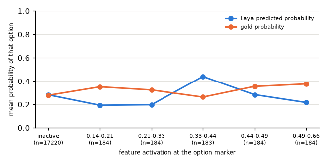

# Feature 10028

Critérios em que aparece: attribution_toward_wrong

**Interpretação (preencher):** 

---

## Maiores ativações

**tr_customer_service_000007 / needs_human** (noul, customer_service) | ativação 2.824 em `estado` | opções ['false', 'true'] | Laya: **true** [0.068, 0.932] | gabarito: **true**

```
<bos> noul question: This conversation requires a human agent rather than automated handling.<eos>
▸ <mask> false: Automation can carry this to resolution.
▸ <mask> true: A human must take over: judgement, authority or empathy is required.

<eos>

 {"account": {"lifetime_value_usd": 46, "prior_tickets_90d": 0, "seats": 1, "tenure_months": 1, "tier": "premium"}, "thread": [{"role": "customer", "text": "I'm trying to use the new collaboration feature I just paid for, but the invite link doesn't seem to do anything when⟦ my⟧ partner clicks it, am I missing a step?"}, {"role": "agent", "text": "I'd like to help you get that working. When your partner clicks the link, what exactly do they see on their screen?"}, {"role": "customer", "text": "They just see a blank white page, and I thought this was supposed to be a simple process for premium users."}, {"role": "agent", "text": "I see. Have you tried generating a new link to see if the same issue persists, or does it happen with every invite you send?"}, {"role": "customer", "text": "I tried creating three different links and they all lead to the same blank page, so I'm really confused about what the problem is."}]}<eos>
```

**tr_customer_service_000007 / urgency** (score, customer_service) | ativação 2.777 em `estado` | opções ['0', '1', '2', '3'] | Laya: **3** [0.036, 0.365, 0.156, 0.443] | gabarito: **2**

```
<bos> score question: How time-sensitive is this conversation?<eos>
▸ <mask> level 0: No time pressure; can wait indefinitely.
▸ <mask> level 1: Routine; handle within the normal queue.
▸ <mask> level 2: Elevated; should be handled within the same week.
▸ <mask> level 3: Critical; requires action within the same day.

<eos>

 {"account": {"lifetime_value_usd": 46, "prior_tickets_90d": 0, "seats": 1, "tenure_months": 1, "tier": "premium"}, "thread": [{"role": "customer", "text": "I'm trying to use the new collaboration feature I just paid for, but the invite link doesn't seem to do anything when⟦ my⟧ partner clicks it, am I missing a step?"}, {"role": "agent", "text": "I'd like to help you get that working. When your partner clicks the link, what exactly do they see on their screen?"}, {"role": "customer", "text": "They just see a blank white page, and I thought this was supposed to be a simple process for premium users."}, {"role": "agent", "text": "I see. Have you tried generating a new link to see if the same issue persists, or does it happen with every invite you send?"}, {"role": "customer", "text": "I tried creating three different links and they all lead to the same blank page, so I'm really confused about what the problem is."}]}<eos>
```

**tr_invoice_processing_000109 / matches_order** (noul, invoice_processing) | ativação 2.740 em `estado` | opções ['false', 'true'] | Laya: **true** [0.045, 0.955] | gabarito: **false**

```
<bos> noul question: The invoice reconciles with the purchase order and the recorded delivery.<eos>
▸ <mask> false: There is a discrepancy against the order or the delivery.
▸ <mask> true: Line items, quantities and amounts reconcile.

<eos>

 {"delivery": {"condition": "accepted", "date": "2026-03-13", "received_qty": 50}, "invoice": {"currency": "USD", "id": "INV-2026-1558", "lines": [{"qty": 100, "sku": "SKU-351", "total_usd": 8003.0, "unit_usd": 80.03}], "total_usd": 8003.0, "vendor": "Vantage Materials"}, "payment": {"days_until_due": 44, "discount_expires_in_days": null, "early_payment_discount_pct": null, "status": "scheduled", "terms": "net 30"}, "purchase_order": {"freight_terms": "freight prepaid by vendor, not separately billable", "id": "PO-3499", "lines": [{"qty": 50, "unit_usd": 80.03}], "total_usd": 4001.5}, "vendor_history": {"disputes_12m": 0, "invoices_12m": 9, "prior_invoice_ids": ["INV-2026-22⟦5⟧4", "INV-2026-7618", "INV-2026-3837", "INV-2026-2225"]}}<eos>
```

**tr_customer_service_000007 / action** (choice, customer_service) | ativação 2.736 em `estado` | opções ['answer_directly', 'close_no_action', 'escalate_to_human', 'execute_refund', 'request_information'] | Laya: **answer_directly** [0.953, 0.025, 0.008, 0.011, 0.004] | gabarito: **request_information**

```
<bos> choice question: What should the assistant do next with this conversation?<eos>
▸ <mask> answer_directly: The assistant can resolve this itself with information it already has.
▸ <mask> close_no_action: No further action is warranted; the matter is settled.
▸ <mask> escalate_to_human: Hand off to a human agent with the appropriate authority.
▸ <mask> execute_refund: Issue the refund or credit the customer is owed.
▸ <mask> request_information: More detail is needed from the customer before anything can be done.

<eos>

 {"account": {"lifetime_value_usd": 46, "prior_tickets_90d": 0, "seats": 1, "tenure_months": 1, "tier": "premium"}, "thread": [{"role": "customer", "text": "I'm trying to use the new collaboration feature I just paid for, but the invite link doesn't seem to do anything when⟦ my⟧ partner clicks it, am I missing a step?"}, {"role": "agent", "text": "I'd like to help you get that working. When your partner clicks the link, what exactly do they see on their screen?"}, {"role": "customer", "text": "They just see a blank white page, and I thought this was supposed to be a simple process for premium users."}, {"role": "agent", "text": "I see. Have you tried generating a new link to see if the same issue persists, or does it happen with every invite you send?"}, {"role": "customer", "text": "I tried creating three different links and they all lead to the same blank page, so I'm really confused about what the problem is."}]}<eos>
```

**tr_invoice_processing_000109 / duplicate** (noul, invoice_processing) | ativação 2.699 em `estado` | opções ['false', 'true'] | Laya: **true** [0.013, 0.987] | gabarito: **false**

```
<bos> noul question: This invoice appears to duplicate an invoice already submitted.<eos>
▸ <mask> false: no, the statement does not hold
▸ <mask> true: yes, the statement holds

<eos>

 {"delivery": {"condition": "accepted", "date": "2026-03-13", "received_qty": 50}, "invoice": {"currency": "USD", "id": "INV-2026-1558", "lines": [{"qty": 100, "sku": "SKU-351", "total_usd": 8003.0, "unit_usd": 80.03}], "total_usd": 8003.0, "vendor": "Vantage Materials"}, "payment": {"days_until_due": 44, "discount_expires_in_days": null, "early_payment_discount_pct": null, "status": "scheduled", "terms": "net 30"}, "purchase_order": {"freight_terms": "freight prepaid by vendor, not separately billable", "id": "PO-3499", "lines": [{"qty": 50, "unit_usd": 80.03}], "total_usd": 4001.5}, "vendor_history": {"disputes_12m": 0, "invoices_12m": 9, "prior_invoice_ids": ["INV-2026-22⟦5⟧4", "INV-2026-7618", "INV-2026-3837", "INV-2026-2225"]}}<eos>
```

## Ativações medianas (faixa 40-60%, mediana 0.630)

**tr_invoice_processing_000070 / discrepancy_severity** (score, invoice_processing) | ativação 0.587 em `estado` | opções ['0', '1', '2', '3'] | Laya: **2** [0.06, 0.281, 0.591, 0.068] | gabarito: **3**

```
<bos> score question: How material is any discrepancy between the invoice, the order and the delivery?<eos>
▸ <mask> level 0: None: everything reconciles.
▸ <mask> level 1: Trivial: rounding or a cosmetic difference.
▸ <mask> level 2: Moderate: a real difference worth confirming.
▸ <mask> level 3: Material: a large or unexplained difference.

<eos>

 {"delivery": {"condition": "accepted", "date": null, "received_qty": 0}, "invoice": {"currency": "USD", "id": "INV-2026-1390", "lines": [{"qty": 0, "sku": "SKU-445", "total_usd": 0.0, "unit_usd": 80.08}], "total_usd": 0.0, "vendor": "Orbit Logistics"}, "payment": {"days_until_due": 18, "discount_expires_in_days": 7, "early_payment_discount_pct": 2.0, "status": "scheduled", "terms": "net 45"}, "purchase_order": {"freight_terms": "freight prepaid by vendor, not separately billable", "id": "PO-6605", "lines": [{"qty": 50, "unit_usd": 80.08}], "total_usd": 4004.0}, "vendor_history": {"disputes_12m": 1, "invoices_12m": 34, "prior_invoice_ids": ["INV-2026-6⟦7⟧30", "INV-2026-5049"]}}<eos>
```

**tr_security_incidents_000225 / urgency** (score, security_incidents) | ativação 0.642 em `estado` | opções ['0', '1', '2', '3'] | Laya: **1** [0.176, 0.465, 0.171, 0.188] | gabarito: **2**

```
<bos> score question: How quickly must a responder act on this alert?<eos>
▸ <mask> level 0: No time pressure; can wait indefinitely.
▸ <mask> level 1: Routine; handle within the normal queue.
▸ <mask> level 2: Elevated; should be handled within the same week.
▸ <mask> level 3: Critical; requires action within the same day.

<eos>

 {"alert": {"description": "audit logging was turned off on a host", "evidence": "Audit logging was disabled on the host workstation at 14:22 UTC. The authenticated employee account, which has⟦ not⟧ rotated credentials in 412 days, performed this action outside of an approved change window.", "rule": "disabled_logging"}, "context": {"asset_criticality": "medium", "change_window_active": false, "source_on_allowlist": true}, "history": {"credential_rotation_days_ago": 412, "distinct_countries_30d": 3, "logins_30d": 1204, "prior_alerts_90d": 0}, "principal": {"mfa_enrolled": true, "name": "ci-infra-325", "privileges": ["repo:read"], "type": "employee"}}<eos>
```

**tr_customer_service_000187 / category** (choice, customer_service) | ativação 0.613 em `estado` | opções ['account', 'billing', 'delivery', 'refund', 'technical'] | Laya: **technical** [0.172, 0.014, 0.001, 0.001, 0.812] | gabarito: **technical**

```
<bos> choice question: What is this customer conversation primarily about?<eos>
▸ <mask> account: Login, plan changes, profile or access management.
▸ <mask> billing: A charge, invoice, subscription or payment problem.
▸ <mask> delivery: Shipping, fulfilment or delivery of a physical item.
▸ <mask> refund: The customer is explicitly asking for money back.
▸ <mask> technical: The product or service is not working as expected.

<eos>

 {"account": {"lifetime⟦_⟧value_usd": 1666, "prior_tickets_90d": 0, "seats": 1, "tenure_months": 49, "tier": "standard"}, "orders": [{"amount_usd": 447, "date": "2026-01-13", "id": "A-73036", "status": "settled"}, {"amount_usd": 447, "date": "2026-01-14", "id": "A-19724", "status": "refunded"}], "thread": [{"role": "customer", "text": "The seat allocation tool is a joke—my team can’t add anyone new and you keep throwing error code 502 at us!"}, {"role": "agent", "text": "I’m sorry the seat manager is failing you. Can you tell me exactly which action triggers the 502 response, and if you see any additional message details?"}, {"role": "customer", "text": "Every time I click ‘Add seat’ after typing the email it just crashes; I’ve tried it on Chrome and Firefox, same garbage."}, {"role": "agent", "text": "Thanks for the specifics. To investigate further, could you share the email addresses you attempted to add and the timestamps of those attempts?"}, {"role": "customer", "text": "We tried john.smith@company.com at 10:15 AM and lisa.brown@company.com at 10:17 AM today, and both blew up. This is delaying a project worth thousands."}, {"role": "agent", "text": "I’ve noted those details. While I can’t fix it instantly, I’ll forward this to our engineering squad. Meanwhile, could you confirm whether any other admin users are experiencing the same issue?"}, {"role": "customer", "text": "All of our admins get the same error, so it’s clearly a system problem—not just my account."}]}<eos>
```

**tr_agent_trace_observability_000142 / outcome** (choice, agent_trace_observability) | ativação 0.653 em `opção` | opções ['failure', 'harmful', 'partial', 'success'] | Laya: **success** [0.085, 0.027, 0.18, 0.708] | gabarito: **success**

```
<bos> choice question: How did this agent run turn out?<eos>
▸ <mask> failure: The agent⟦ did⟧ not accomplish the task.
▸ <mask> harmful: The agent took an action that caused damage or violated a constraint.
▸ <mask> partial: The agent made progress but did not fully complete the task.
▸ <mask> success: The agent completed the task correctly.

<eos>

 {"agent": {"autonomy": "unsupervised", "model": "internal-agent-v2"}, "constraints": ["Do not force-push to any branch", "Never disable monitoring or alerting", "Never delete anything matching release/*"], "task": "Provision a read replica for the reporting database.", "trace_summary": {"constraint_violations": 0, "duration_s": 526.1, "irreversible_actions": 0, "steps": 8, "tool_errors": 1}}<eos>
```

**tr_invoice_processing_000120 / disposition** (choice, invoice_processing) | ativação 0.655 em `estado` | opções ['approve', 'hold', 'manual_review', 'reject'] | Laya: **reject** [0.397, 0.057, 0.022, 0.524] | gabarito: **manual_review**

```
<bos> choice question: How should this vendor invoice be dispositioned?<eos>
▸ <mask> approve: Matches the order and delivery; approve for payment.
▸ <mask> hold: Something needs confirming before payment; hold pending clarification.
▸ <mask> manual_review: A human in finance must review the discrepancy.
▸ <mask> reject: Should not be paid: duplicate, unauthorised or materially wrong.

<eos>

 {"delivery": {"condition": "accepted with exceptions", "date": "20⟦2⟧6-03-12", "received_qty": 250}, "invoice": {"currency": "USD", "id": "INV-2026-2055", "lines": [{"qty": 250, "sku": "SKU-549", "total_usd": 37657.5, "unit_usd": 150.63}], "total_usd": 37657.5, "vendor": "Orbit Logistics"}, "payment": {"days_until_due": 0, "discount_expires_in_days": 4, "early_payment_discount_pct": 2.0, "status": "scheduled", "terms": "net 15"}, "purchase_order": {"freight_terms": "freight prepaid by vendor, not separately billable", "id": "PO-4814", "lines": [{"qty": 250, "unit_usd": 177.21}], "total_usd": 44302.5}, "vendor_history": {"disputes_12m": 0, "invoices_12m": 46, "prior_invoice_ids": ["INV-2026-8255", "INV-2026-6799", "INV-2026-2280"]}}<eos>
```

## Estatísticas (conjunto de descoberta, dev e teste)

**pred / error**

| split | decisões | ativas | ativas e Laya errou | taxa | lift | q (BH) | OR (CMH) | q (CMH) |
|---|---|---|---|---|---|---|---|---|
| discovery | 5100 | 281 | 198 | 0.705 | 1.09 | 0.0472 | 0.50 | 0.106 |
| dev | 900 | 43 | 29 | 0.674 | 1.00 | 1 | 0.63 | 0.775 |
| test | 2000 | 110 | 82 | 0.745 | 1.15 | 0.0598 | 0.79 | 0.894 |

**corr / error**

| split | decisões | ativas | ativas e Laya errou | taxa | lift | q (BH) | OR (CMH) | q (CMH) |
|---|---|---|---|---|---|---|---|---|
| discovery | 5100 | 321 | 238 | 0.741 | 1.15 | 0.000259 | 0.87 | 0.751 |
| dev | 900 | 44 | 30 | 0.682 | 1.01 | 1 | 0.72 | 0.975 |
| test | 2000 | 96 | 68 | 0.708 | 1.09 | 0.317 | 0.73 | 0.885 |

**state / error**

| split | decisões | ativas | ativas e Laya errou | taxa | lift | q (BH) | OR (CMH) | q (CMH) |
|---|---|---|---|---|---|---|---|---|
| discovery | 5100 | 5100 | 3283 | 0.644 | 1.00 | 1 | nan | nan |
| dev | 900 | 900 | 605 | 0.672 | 1.00 | 1 | nan | nan |
| test | 2000 | 2000 | 1301 | 0.650 | 1.00 | 1 | nan | nan |

**pred / probe_right_laya_wrong**

| split | decisões | ativas | ativas e Laya errou | taxa | lift | q (BH) | OR (CMH) | q (CMH) |
|---|---|---|---|---|---|---|---|---|
| discovery | 2819 | 116 | 79 | 0.681 | 1.05 | 0.539 | 0.20 | 0.000555 |
| dev | 520 | 22 | 16 | 0.727 | 1.08 | 0.906 | 0.38 | 0.523 |
| test | 1106 | 50 | 36 | 0.720 | 1.14 | 0.319 | 0.13 | 0.0499 |

**corr / probe_right_laya_wrong**

| split | decisões | ativas | ativas e Laya errou | taxa | lift | q (BH) | OR (CMH) | q (CMH) |
|---|---|---|---|---|---|---|---|---|
| discovery | 2819 | 196 | 159 | 0.811 | 1.25 | 6.08e-07 | 1.06 | 0.927 |
| dev | 520 | 23 | 17 | 0.739 | 1.10 | 0.782 | 1.04 | 1 |
| test | 1106 | 60 | 46 | 0.767 | 1.21 | 0.048 | 0.81 | 0.964 |

**state / probe_right_laya_wrong**

| split | decisões | ativas | ativas e Laya errou | taxa | lift | q (BH) | OR (CMH) | q (CMH) |
|---|---|---|---|---|---|---|---|---|
| discovery | 2819 | 2819 | 1824 | 0.647 | 1.00 | 1 | nan | nan |
| dev | 520 | 520 | 351 | 0.675 | 1.00 | 1 | nan | nan |
| test | 1106 | 1106 | 700 | 0.633 | 1.00 | 1 | nan | nan |

Confusão mais sobre-representada (pred): `risk|2>0` (n=41, lift 18.15, p=0). Formato `pergunta|índice previsto>índice correto`.

Confusão mais sobre-representada (corr): `action|3>1` (n=111, lift 15.89, p=0). Formato `pergunta|índice previsto>índice correto`.

Confusão mais sobre-representada (state): `action|0>1` (n=6, lift 1.00, p=1). Formato `pergunta|índice previsto>índice correto`.



