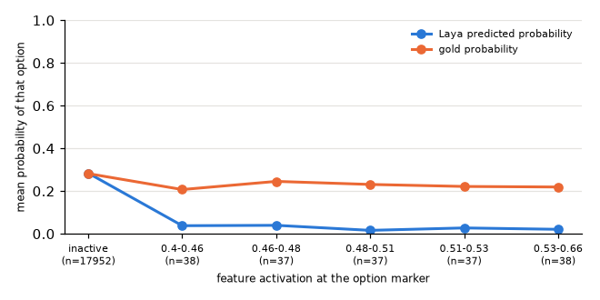

# Feature 10064

Critérios em que aparece: corr_error

**Interpretação (preencher):** 

---

## Maiores ativações

**tr_security_incidents_000113 / credential_compromise** (noul, security_incidents) | ativação 1.276 em `estado` | opções ['false', 'true'] | Laya: **false** [0.868, 0.132] | gabarito: **true**

```
<bos> noul question: The evidence indicates a credential or account has been compromised.<eos>
▸ <mask> false: no, the statement does not hold
▸ <mask> true: yes, the statement holds

<eos>

 {"alert": {"description": "audit logging was turned off on a host", "evidence": "At 2026-09-15 09:03:12 UTC the process \"auditctl\" executed on host \"win-01.example.com\" with arguments⟦ \⟧"-e 0\" and disabled audit logging for the system. The command was issued by the shared_mailbox account \"audit_monitor\" from an allow‑listed source, and MFA was disabled for this principal.", "rule": "disabled_logging"}, "context": {"asset_criticality": "crown_jewel", "change_window_active": false, "source_on_allowlist": true}, "history": {"credential_rotation_days_ago": 412, "distinct_countries_30d": 2, "logins_30d": 491, "prior_alerts_90d": 8}, "principal": {"mfa_enrolled": false, "name": "adm-support-214", "privileges": ["repo:read"], "type": "shared_mailbox"}}<eos>
```

**tr_security_incidents_000065 / credential_compromise** (noul, security_incidents) | ativação 1.214 em `estado` | opções ['false', 'true'] | Laya: **true** [0.056, 0.944] | gabarito: **true**

```
<bos> noul question: The evidence indicates a credential or account has been compromised.<eos>
▸ <mask> false: no, the statement does not hold
▸ <mask> true: yes, the statement holds

<eos>

 {"alert": {"description": "an unrecognised binary executed on a server", "evidence": "At 2026-09-15 14:23:08 UTC, an employee workstation \"workstation-12\" launched the unknown binary⟦ \⟧"/tmp/lsass_helper\" (PID 5874) on server \"app-prod-01\" during an open change window. The execution originated from an unrecognised source IP 192.0.2.55, and the employee’s MFA token was validated. The user’s credentials were last rotated 90 days ago.", "rule": "suspicious_process"}, "context": {"asset_criticality": "low", "change_window_active": true, "source_on_allowlist": false}, "history": {"credential_rotation_days_ago": 90, "distinct_countries_30d": 4, "logins_30d": 1617, "prior_alerts_90d": 0}, "principal": {"mfa_enrolled": true, "name": "usr-billing-187", "privileges": ["repo:read"], "type": "employee"}}<eos>
```

**tr_security_incidents_000113 / severity** (score, security_incidents) | ativação 1.203 em `estado` | opções ['0', '1', '2', '3', '4'] | Laya: **1** [0.087, 0.454, 0.232, 0.084, 0.143] | gabarito: **4**

```
<bos> score question: How severe is the potential impact if this alert is real?<eos>
▸ <mask> level 0: Negligible: no access to anything sensitive.
▸ <mask> level 1: Low: limited access, easily reversed.
▸ <mask> level 2: Moderate: access to internal systems or non-public data.
▸ <mask> level 3: High: access to production, secrets or customer data.
▸ <mask> level 4: Critical: active compromise of crown-jewel systems.

<eos>

 {"alert": {"description": "audit logging was turned off on a host", "evidence": "At 2026-09-15 09:03:12 UTC the process \"auditctl\" executed on host \"win-01.example.com\" with arguments⟦ \⟧"-e 0\" and disabled audit logging for the system. The command was issued by the shared_mailbox account \"audit_monitor\" from an allow‑listed source, and MFA was disabled for this principal.", "rule": "disabled_logging"}, "context": {"asset_criticality": "crown_jewel", "change_window_active": false, "source_on_allowlist": true}, "history": {"credential_rotation_days_ago": 412, "distinct_countries_30d": 2, "logins_30d": 491, "prior_alerts_90d": 8}, "principal": {"mfa_enrolled": false, "name": "adm-support-214", "privileges": ["repo:read"], "type": "shared_mailbox"}}<eos>
```

**tr_security_incidents_000065 / true_positive** (noul, security_incidents) | ativação 1.195 em `estado` | opções ['false', 'true'] | Laya: **true** [0.09, 0.91] | gabarito: **true**

```
<bos> noul question: This alert reflects genuinely malicious or unauthorised activity.<eos>
▸ <mask> false: Benign activity, a misconfiguration, or a known false positive.
▸ <mask> true: The underlying behaviour is malicious or unauthorised.

<eos>

 {"alert": {"description": "an unrecognised binary executed on a server", "evidence": "At 2026-09-15 14:23:08 UTC, an employee workstation \"workstation-12\" launched the unknown binary⟦ \⟧"/tmp/lsass_helper\" (PID 5874) on server \"app-prod-01\" during an open change window. The execution originated from an unrecognised source IP 192.0.2.55, and the employee’s MFA token was validated. The user’s credentials were last rotated 90 days ago.", "rule": "suspicious_process"}, "context": {"asset_criticality": "low", "change_window_active": true, "source_on_allowlist": false}, "history": {"credential_rotation_days_ago": 90, "distinct_countries_30d": 4, "logins_30d": 1617, "prior_alerts_90d": 0}, "principal": {"mfa_enrolled": true, "name": "usr-billing-187", "privileges": ["repo:read"], "type": "employee"}}<eos>
```

**tr_security_incidents_000113 / true_positive** (noul, security_incidents) | ativação 1.193 em `estado` | opções ['false', 'true'] | Laya: **true** [0.077, 0.923] | gabarito: **true**

```
<bos> noul question: This alert reflects genuinely malicious or unauthorised activity.<eos>
▸ <mask> false: Benign activity, a misconfiguration, or a known false positive.
▸ <mask> true: The underlying behaviour is malicious or unauthorised.

<eos>

 {"alert": {"description": "audit logging was turned off on a host", "evidence": "At 2026-09-15 09:03:12 UTC the process \"auditctl\" executed on host \"win-01.example.com\" with arguments⟦ \⟧"-e 0\" and disabled audit logging for the system. The command was issued by the shared_mailbox account \"audit_monitor\" from an allow‑listed source, and MFA was disabled for this principal.", "rule": "disabled_logging"}, "context": {"asset_criticality": "crown_jewel", "change_window_active": false, "source_on_allowlist": true}, "history": {"credential_rotation_days_ago": 412, "distinct_countries_30d": 2, "logins_30d": 491, "prior_alerts_90d": 8}, "principal": {"mfa_enrolled": false, "name": "adm-support-214", "privileges": ["repo:read"], "type": "shared_mailbox"}}<eos>
```

## Ativações medianas (faixa 40-60%, mediana 0.501)

**tr_customer_service_000283 / action** (choice, customer_service) | ativação 0.511 em `marcador` | opções ['answer_directly', 'close_no_action', 'escalate_to_human', 'execute_refund', 'request_information'] | Laya: **close_no_action** [0.11, 0.798, 0.044, 0.034, 0.014] | gabarito: **escalate_to_human**

```
<bos> choice question: What should the assistant do next with this conversation?<eos>
▸ <mask> answer_directly: The assistant can resolve this itself with information it already has.
▸ <mask> close_no_action: No further action is warranted; the matter is settled.
▸ <mask> escalate_to_human: Hand off to a human agent with the appropriate authority.
▸ <mask> execute_refund: Issue the refund or credit the customer is owed.
▸ ⟦<mask>⟧ request_information: More detail is needed from the customer before anything can be done.

<eos>

 {"account": {"lifetime_value_usd": 4664, "prior_tickets_90d": 3, "seats": 1, "tenure_months": 60, "tier": "enterprise"}, "orders": [{"amount_usd": 299, "date": "2026-01-17", "id": "A-34538", "status": "settled"}, {"amount_usd": 299, "date": "2026-03-02", "id": "A-34919", "status": "settled"}, {"amount_usd": 299, "date": "2026-02-25", "id": "A-33586", "status": "settled"}], "thread": [{"role": "customer", "text": "We're trying to pull our data for the quarterly audit, but the export tool is hanging at 15% again, just like the last three times I've contacted support about this over the years."}, {"role": "agent", "text": "I'm sorry to hear the export tool is stalling during your audit preparation. Could you specify which data modules you are currently attempting to include in this specific batch?"}, {"role": "customer", "text": "It's the full user activity log for the enterprise tier. Honestly, after five years and paying nearly $300 a month, I'm tired of fighting with this interface; if we can't get our data out, we'll have to find a provider that actually works."}, {"role": "agent", "text": "I hear your frustration regarding the recurring nature of this issue. Are you seeing any specific error codes on the screen, or does the progress bar simply stop moving?"}, {"role": "customer", "text": "No codes, just a spinning wheel that goes nowhere. I've had partial fixes before, but I'm just about done with the excuses at this point."}]}<eos>
```

**tr_customer_service_000004 / action** (choice, customer_service) | ativação 0.502 em `marcador` | opções ['answer_directly', 'close_no_action', 'escalate_to_human', 'execute_refund', 'request_information'] | Laya: **close_no_action** [0.156, 0.74, 0.021, 0.066, 0.017] | gabarito: **escalate_to_human**

```
<bos> choice question: What should the assistant do next with this conversation?<eos>
▸ <mask> answer_directly: The assistant can resolve this itself with information it already has.
▸ <mask> close_no_action: No further action is warranted; the matter is settled.
▸ <mask> escalate_to_human: Hand off to a human agent with the appropriate authority.
▸ <mask> execute_refund: Issue the refund or credit the customer is owed.
▸ ⟦<mask>⟧ request_information: More detail is needed from the customer before anything can be done.

<eos>

 {"account": {"lifetime_value_usd": 3018, "prior_tickets_90d": 1, "seats": 1, "tenure_months": 60, "tier": "premium"}, "orders": [{"amount_usd": 147, "date": "2026-02-10", "id": "A-12312", "status": "settled"}, {"amount_usd": 147, "date": "2026-02-24", "id": "A-70365", "status": "refunded"}], "thread": [{"role": "customer", "text": "I'm back again because I still can't get into my account, and honestly, after the last ticket didn't go anywhere, I'm just expecting more of the same login loops."}]}<eos>
```

**tr_customer_service_000247 / action** (choice, customer_service) | ativação 0.490 em `marcador` | opções ['answer_directly', 'close_no_action', 'escalate_to_human', 'execute_refund', 'request_information'] | Laya: **answer_directly** [0.762, 0.11, 0.026, 0.018, 0.085] | gabarito: **request_information**

```
<bos> choice question: What should the assistant do next with this conversation?<eos>
▸ <mask> answer_directly: The assistant can resolve this itself with information it already has.
▸ <mask> close_no_action: No further action is warranted; the matter is settled.
▸ <mask> escalate_to_human: Hand off to a human agent with the appropriate authority.
▸ <mask> execute_refund: Issue the refund or credit the customer is owed.
▸ ⟦<mask>⟧ request_information: More detail is needed from the customer before anything can be done.

<eos>

 {"account": {"lifetime_value_usd": 2665, "prior_tickets_90d": 2, "seats": 1, "tenure_months": 49, "tier": "enterprise"}, "orders": [{"amount_usd": 299, "date": "2026-03-24", "id": "A-46595", "status": "failed"}, {"amount_usd": 299, "date": "2026-02-03", "id": "A-35425", "status": "pending"}], "thread": [{"role": "customer", "text": "I'm looking at the delivery that arrived for our office this morning and I'm a bit lost because these appear to be Model X components, but our enterprise contract is specifically for the Series 4 kits."}, {"role": "agent", "text": "I'm sorry for the confusion regarding the items in your shipment. Would you mind providing the batch number listed on the packing slip inside the box?"}, {"role": "customer", "text": "The slip actually lists the Series 4 parts, which is even more confusing since the physical items in the box are definitely the blue Model X ones, so I'm not really sure how to proceed with this."}]}<eos>
```

**tr_customer_service_000216 / action** (choice, customer_service) | ativação 0.510 em `marcador` | opções ['answer_directly', 'close_no_action', 'escalate_to_human', 'execute_refund', 'request_information'] | Laya: **answer_directly** [0.615, 0.134, 0.042, 0.014, 0.195] | gabarito: **answer_directly**

```
<bos> choice question: What should the assistant do next with this conversation?<eos>
▸ <mask> answer_directly: The assistant can resolve this itself with information it already has.
▸ <mask> close_no_action: No further action is warranted; the matter is settled.
▸ <mask> escalate_to_human: Hand off to a human agent with the appropriate authority.
▸ <mask> execute_refund: Issue the refund or credit the customer is owed.
▸ ⟦<mask>⟧ request_information: More detail is needed from the customer before anything can be done.

<eos>

 {"account": {"lifetime_value_usd": 90, "prior_tickets_90d": 0, "seats": 1, "tenure_months": 2, "tier": "free"}, "thread": [{"role": "customer", "text": "Hello there, I am checking on the status of my order. It’s for a birthday party this weekend, so I’m a bit worried it hasn't arrived yet."}, {"role": "agent", "text": "I would be happy to look into that for you. Could you please provide the order number so I can check the current shipping status in our system?"}, {"role": "customer", "text": "Of course, the order number is #44921. I really need these supplies by Friday at the latest for the event to go smoothly, so any help is appreciated."}]}<eos>
```

**tr_customer_service_000138 / action** (choice, customer_service) | ativação 0.497 em `marcador` | opções ['answer_directly', 'close_no_action', 'escalate_to_human', 'execute_refund', 'request_information'] | Laya: **escalate_to_human** [0.405, 0.073, 0.409, 0.06, 0.053] | gabarito: **escalate_to_human**

```
<bos> choice question: What should the assistant do next with this conversation?<eos>
▸ <mask> answer_directly: The assistant can resolve this itself with information it already has.
▸ <mask> close_no_action: No further action is warranted; the matter is settled.
▸ <mask> escalate_to_human: Hand off to a human agent with the appropriate authority.
▸ <mask> execute_refund: Issue the refund or credit the customer is owed.
▸ ⟦<mask>⟧ request_information: More detail is needed from the customer before anything can be done.

<eos>

 {"account": {"lifetime_value_usd": 247, "prior_tickets_90d": 1, "seats": 1, "tenure_months": 3, "tier": "standard"}, "thread": [{"role": "customer", "text": "Good afternoon, I need the data export we discussed last month. This is my third month on the standard plan, and the previous ticket promised the export but never arrived."}, {"role": "agent", "text": "I’m sorry you haven’t received the export yet. Could you remind me of the ticket number so I can locate the original request?"}, {"role": "customer", "text": "The ticket was #7890, opened on July 20th. I was told it would be ready within 48 hours, but I still have nothing."}, {"role": "agent", "text": "Thank you for the details. I’ll pull up the logs for that ticket. In the meantime, could you confirm the email address you’d like the export sent to?"}, {"role": "customer", "text": "Please send it to me at alex.tan@example.com. I need the data before the end of the month, so any update would be great."}]}<eos>
```

## Estatísticas (conjunto de descoberta, dev e teste)

**pred / error**

| split | decisões | ativas | ativas e Laya errou | taxa | lift | q (BH) | OR (CMH) | q (CMH) |
|---|---|---|---|---|---|---|---|---|
| discovery | 5100 | 1 | 1 | 1.000 | 1.55 | nan | nan | nan |
| dev | 900 | 0 | 0 | nan | nan | nan | nan | nan |
| test | 2000 | 0 | 0 | nan | nan | nan | nan | nan |

**corr / error**

| split | decisões | ativas | ativas e Laya errou | taxa | lift | q (BH) | OR (CMH) | q (CMH) |
|---|---|---|---|---|---|---|---|---|
| discovery | 5100 | 39 | 39 | 1.000 | 1.55 | 1.6e-07 | nan | nan |
| dev | 900 | 6 | 6 | 1.000 | 1.49 | nan | nan | nan |
| test | 2000 | 21 | 21 | 1.000 | 1.54 | 0.000483 | nan | nan |

**state / error**

| split | decisões | ativas | ativas e Laya errou | taxa | lift | q (BH) | OR (CMH) | q (CMH) |
|---|---|---|---|---|---|---|---|---|
| discovery | 5100 | 18 | 10 | 0.556 | 0.86 | nan | nan | nan |
| dev | 900 | 0 | 0 | nan | nan | nan | nan | nan |
| test | 2000 | 16 | 10 | 0.625 | 0.96 | nan | nan | nan |

**pred / probe_right_laya_wrong**

| split | decisões | ativas | ativas e Laya errou | taxa | lift | q (BH) | OR (CMH) | q (CMH) |
|---|---|---|---|---|---|---|---|---|
| discovery | 2819 | 1 | 1 | 1.000 | 1.55 | nan | nan | nan |
| dev | 520 | 0 | 0 | nan | nan | nan | nan | nan |
| test | 1106 | 0 | 0 | nan | nan | nan | nan | nan |

**corr / probe_right_laya_wrong**

| split | decisões | ativas | ativas e Laya errou | taxa | lift | q (BH) | OR (CMH) | q (CMH) |
|---|---|---|---|---|---|---|---|---|
| discovery | 2819 | 2 | 2 | 1.000 | 1.55 | nan | nan | nan |
| dev | 520 | 1 | 1 | 1.000 | 1.48 | nan | nan | nan |
| test | 1106 | 3 | 3 | 1.000 | 1.58 | nan | nan | nan |

**state / probe_right_laya_wrong**

| split | decisões | ativas | ativas e Laya errou | taxa | lift | q (BH) | OR (CMH) | q (CMH) |
|---|---|---|---|---|---|---|---|---|
| discovery | 2819 | 15 | 7 | 0.467 | 0.72 | nan | nan | nan |
| dev | 520 | 0 | 0 | nan | nan | nan | nan | nan |
| test | 1106 | 12 | 9 | 0.750 | 1.19 | nan | nan | nan |

Confusão mais sobre-representada (pred): `action|4>2` (n=1, lift 5100.00, p=nan). Formato `pergunta|índice previsto>índice correto`.

Confusão mais sobre-representada (corr): `action|0>4` (n=24, lift 116.24, p=0). Formato `pergunta|índice previsto>índice correto`.

Confusão mais sobre-representada (state): `urgency|3>2` (n=2, lift 10.69, p=nan). Formato `pergunta|índice previsto>índice correto`.



