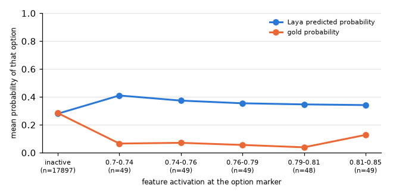

# Feature 10203

Critérios em que aparece: pred_error, pred_probe_right_laya_wrong

**Interpretação (preencher):** 

---

## Maiores ativações

**tr_customer_service_000225 / action** (choice, customer_service) | ativação 1.385 em `estado` | opções ['answer_directly', 'close_no_action', 'escalate_to_human', 'execute_refund', 'request_information'] | Laya: **close_no_action** [0.095, 0.85, 0.008, 0.02, 0.028] | gabarito: **request_information**

```
<bos> choice question: What should the assistant do next with this conversation?<eos>
▸ <mask> answer_directly: The assistant can resolve this itself with information it already has.
▸ <mask> close_no_action: No further action is warranted; the matter is settled.
▸ <mask> escalate_to_human: Hand off to a human agent with the appropriate authority.
▸ <mask> execute_refund: Issue the refund or credit the customer is owed.
▸ <mask> request_information: More detail is needed from the customer before anything can be done.

<eos>

 {"account": {"lifetime_value_usd": 419, "prior_tickets_90d": 1, "seats": 1, "tenure_months": 5, "tier": "standard"}, "orders": [{"amount_usd": 99, "date": "2026-01-07", "id": "A-67520", "status": "settled"}, {"amount_usd": 99, "date": "2026-03-11", "id": "A-78780", "status": "settled"}, {"amount_usd": 99, "date": "2026-02-08", "id": "A-39325", "status": "settled"}], "thread": [{"role": "customer", "text": "Hello, I’m writing because I accidentally dropped the $99 device I bought five months ago, and the screen is now completely cracked."}, {"role": "agent", "text": "I’m sorry to hear that your device was damaged. Could you please provide your order number and a brief description of the current display functionality?"}, {"role": "customer", "text": "The order number is #88291, and while the touch screen is unresponsive, the device still⟦ powers⟧ on."}, {"role": "agent", "text": "Thank you for providing those details. Just to ensure I have the full picture, could you tell me if there is any visible damage to the charging port or the frame?"}, {"role": "customer", "text": "No, the frame and charging port look perfectly fine, it is just the screen."}]}<eos>
```

**tr_customer_service_000225 / needs_human** (noul, customer_service) | ativação 1.261 em `estado` | opções ['false', 'true'] | Laya: **true** [0.219, 0.781] | gabarito: **true**

```
<bos> noul question: This conversation requires a human agent rather than automated handling.<eos>
▸ <mask> false: Automation can carry this to resolution.
▸ <mask> true: A human must take over: judgement, authority or empathy is required.

<eos>

 {"account": {"lifetime_value_usd": 419, "prior_tickets_90d": 1, "seats": 1, "tenure_months": 5, "tier": "standard"}, "orders": [{"amount_usd": 99, "date": "2026-01-07", "id": "A-67520", "status": "settled"}, {"amount_usd": 99, "date": "2026-03-11", "id": "A-78780", "status": "settled"}, {"amount_usd": 99, "date": "2026-02-08", "id": "A-39325", "status": "settled"}], "thread": [{"role": "customer", "text": "Hello, I’m writing because I accidentally dropped the $99 device I bought five months ago, and the screen is now completely cracked."}, {"role": "agent", "text": "I’m sorry to hear that your device was damaged. Could you please provide your order number and a brief description of the current display functionality?"}, {"role": "customer", "text": "The order number is #88291, and while the touch screen is unresponsive, the device still⟦ powers⟧ on."}, {"role": "agent", "text": "Thank you for providing those details. Just to ensure I have the full picture, could you tell me if there is any visible damage to the charging port or the frame?"}, {"role": "customer", "text": "No, the frame and charging port look perfectly fine, it is just the screen."}]}<eos>
```

**tr_customer_service_000225 / churn_risk** (score, customer_service) | ativação 1.220 em `estado` | opções ['0', '1', '2', '3'] | Laya: **2** [0.271, 0.298, 0.335, 0.095] | gabarito: **1**

```
<bos> score question: How likely is this customer to stop doing business with us because of this interaction?<eos>
▸ <mask> level 0: No sign of dissatisfaction.
▸ <mask> level 1: Mild frustration, but the relationship is intact.
▸ <mask> level 2: Clearly unhappy; repeat problems or explicit complaints.
▸ <mask> level 3: Imminent: threatening to cancel, dispute or leave.

<eos>

 {"account": {"lifetime_value_usd": 419, "prior_tickets_90d": 1, "seats": 1, "tenure_months": 5, "tier": "standard"}, "orders": [{"amount_usd": 99, "date": "2026-01-07", "id": "A-67520", "status": "settled"}, {"amount_usd": 99, "date": "2026-03-11", "id": "A-78780", "status": "settled"}, {"amount_usd": 99, "date": "2026-02-08", "id": "A-39325", "status": "settled"}], "thread": [{"role": "customer", "text": "Hello, I’m writing because I accidentally dropped the $99 device I bought five months ago, and the screen is now completely cracked."}, {"role": "agent", "text": "I’m sorry to hear that your device was damaged. Could you please provide your order number and a brief description of the current display functionality?"}, {"role": "customer", "text": "The order number is #88291, and while the touch screen is unresponsive, the device still⟦ powers⟧ on."}, {"role": "agent", "text": "Thank you for providing those details. Just to ensure I have the full picture, could you tell me if there is any visible damage to the charging port or the frame?"}, {"role": "customer", "text": "No, the frame and charging port look perfectly fine, it is just the screen."}]}<eos>
```

**tr_customer_service_000250 / needs_human** (noul, customer_service) | ativação 1.197 em `opção` | opções ['false', 'true'] | Laya: **true** [0.064, 0.936] | gabarito: **false**

```
<bos> noul question: This conversation requires a human agent rather than automated handling.<eos>
▸ <mask> false: Automation can carry this to resolution.
▸ <mask> true: A human must⟦ take⟧ over: judgement, authority or empathy is required.

<eos>

 {"account": {"lifetime_value_usd": 145, "prior_tickets_90d": 0, "seats": 1, "tenure_months": 2, "tier": "standard"}, "thread": [{"role": "customer", "text": "Could you please send me a copy of my latest invoice? Thank you!"}]}<eos>
```

**tr_customer_service_000135 / needs_human** (noul, customer_service) | ativação 1.196 em `opção` | opções ['false', 'true'] | Laya: **true** [0.051, 0.949] | gabarito: **false**

```
<bos> noul question: This conversation requires a human agent rather than automated handling.<eos>
▸ <mask> false: Automation can carry this to resolution.
▸ <mask> true: A human must⟦ take⟧ over: judgement, authority or empathy is required.

<eos>

 {"account": {"lifetime_value_usd": 72, "prior_tickets_90d": 0, "seats": 1, "tenure_months": 1, "tier": "premium"}, "thread": [{"role": "customer", "text": "I’m not sure why I haven’t seen the refund hit my account yet—could you check the status for me?"}]}<eos>
```

## Ativações medianas (faixa 40-60%, mediana 0.824)

**tr_invoice_processing_000040 / disposition** (choice, invoice_processing) | ativação 0.810 em `marcador` | opções ['approve', 'hold', 'manual_review', 'reject'] | Laya: **hold** [0.292, 0.453, 0.031, 0.224] | gabarito: **hold**

```
<bos> choice question: How should this vendor invoice be dispositioned?<eos>
▸ <mask> approve: Matches the order and delivery; approve for payment.
▸ <mask> hold: Something needs confirming before payment; hold pending clarification.
▸ <mask> manual_review: A human in finance must review the discrepancy.
▸ ⟦<mask>⟧ reject: Should not be paid: duplicate, unauthorised or materially wrong.

<eos>

 {"delivery": {"condition": "accepted", "date": null, "received_qty": 0}, "invoice": {"currency": "USD", "id": "INV-2026-1284", "lines": [{"qty": 1000, "sku": "SKU-548", "total_usd": 285120.0, "unit_usd": 285.12}], "total_usd": 285120.0, "vendor": "Northwind Components"}, "payment": {"days_until_due": 27, "discount_expires_in_days": 3, "early_payment_discount_pct": 2.0, "status": "scheduled", "terms": "net 15"}, "purchase_order": {"freight_terms": "freight prepaid by vendor, not separately billable", "id": "PO-4387", "lines": [{"qty": 1000, "unit_usd": 285.12}], "total_usd": 285120.0}, "vendor_history": {"disputes_12m": 1, "invoices_12m": 9, "prior_invoice_ids": ["INV-2026-8643"]}}<eos>
```

**tr_customer_service_000012 / needs_human** (noul, customer_service) | ativação 0.851 em `opção` | opções ['false', 'true'] | Laya: **true** [0.305, 0.695] | gabarito: **false**

```
<bos> noul question: This conversation requires a human agent rather than automated handling.<eos>
▸ <mask> false: Automation can carry this to resolution.
▸ <mask> true: A human must⟦ take⟧ over: judgement, authority or empathy is required.

<eos>

 {"account": {"lifetime_value_usd": 916, "prior_tickets_90d": 0, "seats": 1, "tenure_months": 11, "tier": "free"}, "orders": [{"amount_usd": 299, "date": "2026-02-20", "id": "A-54343", "status": "settled"}, {"amount_usd": 299, "date": "2026-03-22", "id": "A-86923", "status": "pending"}, {"amount_usd": 299, "date": "2026-03-03", "id": "A-84166", "status": "failed"}], "thread": [{"role": "customer", "text": "I just opened the box and the device is cracked. I've been with the free plan for almost a year now, paying the $299 when I upgraded, and this is disappointing."}, {"role": "agent", "text": "I'm sorry to hear the item arrived damaged. Could you let me know the model number and whether you have a photo of the damage?"}, {"role": "customer", "text": "Sure, it's model X200 and I can snap a picture, but I need to know what you can do about it before I send anything back."}]}<eos>
```

**tr_invoice_processing_000261 / disposition** (choice, invoice_processing) | ativação 0.813 em `marcador` | opções ['approve', 'hold', 'manual_review', 'reject'] | Laya: **approve** [0.494, 0.271, 0.037, 0.198] | gabarito: **approve**

```
<bos> choice question: How should this vendor invoice be dispositioned?<eos>
▸ <mask> approve: Matches the order and delivery; approve for payment.
▸ <mask> hold: Something needs confirming before payment; hold pending clarification.
▸ <mask> manual_review: A human in finance must review the discrepancy.
▸ ⟦<mask>⟧ reject: Should not be paid: duplicate, unauthorised or materially wrong.

<eos>

 {"delivery": {"condition": "accepted", "date": "2026-03-09", "received_qty": 400}, "invoice": {"currency": "USD", "id": "INV-2026-6026", "lines": [{"qty": 400, "sku": "SKU-802", "total_usd": 72944.0, "unit_usd": 182.36}], "total_usd": 72944.0, "vendor": "Orbit Logistics"}, "payment": {"days_until_due": -21, "discount_expires_in_days": null, "early_payment_discount_pct": null, "status": "overdue", "terms": "net 30"}, "purchase_order": {"freight_terms": "freight prepaid by vendor, not separately billable", "id": "PO-7576", "lines": [{"qty": 400, "unit_usd": 182.36}], "total_usd": 72944.0}, "vendor_history": {"disputes_12m": 0, "invoices_12m": 18, "prior_invoice_ids": ["INV-2026-6063", "INV-2026-2691"]}}<eos>
```

**tr_customer_service_000215 / needs_human** (noul, customer_service) | ativação 0.840 em `opção` | opções ['false', 'true'] | Laya: **false** [0.551, 0.449] | gabarito: **false**

```
<bos> noul question: This conversation requires a human agent rather than automated handling.<eos>
▸ <mask> false: Automation can carry this to resolution.
▸ <mask> true: A human must⟦ take⟧ over: judgement, authority or empathy is required.

<eos>

 {"account": {"lifetime_value_usd": 182, "prior_tickets_90d": 1, "seats": 1, "tenure_months": 8, "tier": "free"}, "thread": [{"role": "customer", "text": "Managing seats on the free tier is a nightmare—every time I try to add or remove a user, the UI freezes and I lose my changes."}, {"role": "agent", "text": "That definitely isn’t the experience we want you to have. Could you let me know exactly where in the seat management page the freeze occurs?"}, {"role": "customer", "text": "It happens when I hit ‘Add new seat’ and also when I click the trash can icon to delete a user. The screen just spins and never updates."}, {"role": "agent", "text": "Thanks for the specifics. Are you seeing any error messages in the browser console, or does it just stay on the loading spinner?"}, {"role": "customer", "text": "No error pop‑ups, just the endless spinner. I’ve been on the free plan for eight months and this is the only time I’ve run into such a problem."}]}<eos>
```

**tr_customer_service_000081 / needs_human** (noul, customer_service) | ativação 0.808 em `opção` | opções ['false', 'true'] | Laya: **false** [0.75, 0.25] | gabarito: **true**

```
<bos> noul question: This conversation requires a human agent rather than automated handling.<eos>
▸ <mask> false: Automation can carry this to resolution.
▸ <mask> true: A human must⟦ take⟧ over: judgement, authority or empathy is required.

<eos>

 {"account": {"lifetime_value_usd": 2666, "prior_tickets_90d": 0, "seats": 1, "tenure_months": 33, "tier": "free"}, "orders": [{"amount_usd": 99, "date": "2026-03-03", "id": "A-62974", "status": "settled"}, {"amount_usd": 99, "date": "2026-01-10", "id": "A-57266", "status": "pending"}, {"amount_usd": 99, "date": "2026-02-19", "id": "A-75157", "status": "refunded"}], "thread": [{"role": "customer", "text": "Hello, I’m having trouble with the new analytics widget on my dashboard – it just stays blank. I’m on the free plan and have been with you for 33 months, but I need it working by next Monday for a presentation."}, {"role": "agent", "text": "Thank you for reaching out. Could you describe what you see when you try to load the widget and any error messages that appear?"}, {"role": "customer", "text": "Sure, the area where the chart should be just shows a gray box with the text “Loading…”. No other error pops up. I’ve tried refreshing and clearing cache."}, {"role": "agent", "text": "I appreciate the details. May I ask which browser and version you’re using, as that can affect the widget rendering?"}, {"role": "customer", "text": "I’m on Chrome version 115.0.5790.110 on Windows 10."}, {"role": "agent", "text": "Got it, thank you. I’ll investigate this on my end and let you know if we need any additional info."}, {"role": "customer", "text": "Thanks for looking into it. Please keep me posted—I really need this fixed before my Monday deadline."}]}<eos>
```

## Estatísticas (conjunto de descoberta, dev e teste)

**pred / error**

| split | decisões | ativas | ativas e Laya errou | taxa | lift | q (BH) | OR (CMH) | q (CMH) |
|---|---|---|---|---|---|---|---|---|
| discovery | 5100 | 85 | 81 | 0.953 | 1.48 | 1.07e-10 | 2.03 | 0.507 |
| dev | 900 | 23 | 23 | 1.000 | 1.49 | 0.000903 | inf | 0.729 |
| test | 2000 | 31 | 29 | 0.935 | 1.44 | 0.00128 | 0.87 | 0.964 |

**corr / error**

| split | decisões | ativas | ativas e Laya errou | taxa | lift | q (BH) | OR (CMH) | q (CMH) |
|---|---|---|---|---|---|---|---|---|
| discovery | 5100 | 13 | 9 | 0.692 | 1.08 | nan | nan | nan |
| dev | 900 | 0 | 0 | nan | nan | nan | nan | nan |
| test | 2000 | 5 | 3 | 0.600 | 0.92 | nan | nan | nan |

**state / error**

| split | decisões | ativas | ativas e Laya errou | taxa | lift | q (BH) | OR (CMH) | q (CMH) |
|---|---|---|---|---|---|---|---|---|
| discovery | 5100 | 21 | 9 | 0.429 | 0.67 | 0.165 | 0.64 | 0.693 |
| dev | 900 | 3 | 3 | 1.000 | 1.49 | nan | nan | nan |
| test | 2000 | 19 | 12 | 0.632 | 0.97 | nan | nan | nan |

**pred / probe_right_laya_wrong**

| split | decisões | ativas | ativas e Laya errou | taxa | lift | q (BH) | OR (CMH) | q (CMH) |
|---|---|---|---|---|---|---|---|---|
| discovery | 2819 | 26 | 26 | 1.000 | 1.55 | 4.64e-05 | nan | nan |
| dev | 520 | 11 | 11 | 1.000 | 1.48 | nan | nan | nan |
| test | 1106 | 14 | 14 | 1.000 | 1.58 | nan | nan | nan |

**corr / probe_right_laya_wrong**

| split | decisões | ativas | ativas e Laya errou | taxa | lift | q (BH) | OR (CMH) | q (CMH) |
|---|---|---|---|---|---|---|---|---|
| discovery | 2819 | 0 | 0 | nan | nan | nan | nan | nan |
| dev | 520 | 0 | 0 | nan | nan | nan | nan | nan |
| test | 1106 | 0 | 0 | nan | nan | nan | nan | nan |

**state / probe_right_laya_wrong**

| split | decisões | ativas | ativas e Laya errou | taxa | lift | q (BH) | OR (CMH) | q (CMH) |
|---|---|---|---|---|---|---|---|---|
| discovery | 2819 | 12 | 3 | 0.250 | 0.39 | nan | nan | nan |
| dev | 520 | 1 | 1 | 1.000 | 1.48 | nan | nan | nan |
| test | 1106 | 10 | 4 | 0.400 | 0.63 | nan | nan | nan |

Confusão mais sobre-representada (pred): `disposition|3>1` (n=27, lift 34.47, p=7.89e-38). Formato `pergunta|índice previsto>índice correto`.

Confusão mais sobre-representada (corr): `disposition|0>3` (n=8, lift 392.31, p=nan). Formato `pergunta|índice previsto>índice correto`.

Confusão mais sobre-representada (state): `needs_human|0>1` (n=2, lift 8.99, p=0.0203). Formato `pergunta|índice previsto>índice correto`.



