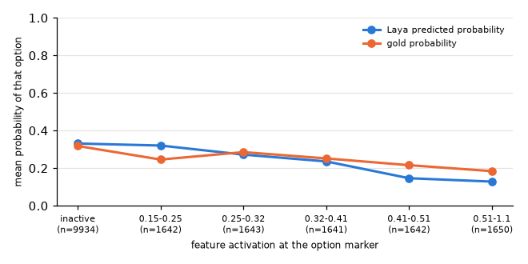

# Feature 10217

Critérios em que aparece: corr_error_stratified

**Interpretação (preencher):** 

---

## Maiores ativações

**tr_security_incidents_000196 / disposition** (choice, security_incidents) | ativação 3.838 em `estado` | opções ['close_benign', 'contain', 'investigate', 'monitor'] | Laya: **monitor** [0.225, 0.195, 0.198, 0.382] | gabarito: **investigate**

```
<bos> choice question: How should this security alert be dispositioned?<eos>
▸ <mask> close_benign: Expected, explainable activity; close without analyst time.
▸ <mask> contain: Contain the host or account immediately; do not wait for triage.
▸ <mask> investigate: Warrants an analyst opening an investigation.
▸ <mask> monitor: Not clearly malicious, but worth watching for recurrence.

<eos>

 {"alert": {"description": "an unrecognised binary executed on a server", "evidence": "During an open change window,⟦ an⟧ unrecognized binary named 'svc_temp_6.exe' was executed on server WEB-PROD-01 by an unprivileged administrator account. The execution was initiated from an allowlisted source address using credentials that were last rotated 180 days ago.", "rule": "suspicious_process"}, "context": {"asset_criticality": "medium", "change_window_active": true, "source_on_allowlist": true}, "history": {"credential_rotation_days_ago": 180, "distinct_countries_30d": 4, "logins_30d": 5, "prior_alerts_90d": 25}, "principal": {"mfa_enrolled": true, "name": "adm-deploy-891", "privileges": ["repo:read"], "type": "admin"}}<eos>
```

**tr_security_incidents_000019 / disposition** (choice, security_incidents) | ativação 3.750 em `estado` | opções ['close_benign', 'contain', 'investigate', 'monitor'] | Laya: **investigate** [0.073, 0.098, 0.451, 0.378] | gabarito: **investigate**

```
<bos> choice question: How should this security alert be dispositioned?<eos>
▸ <mask> close_benign: Expected, explainable activity; close without analyst time.
▸ <mask> contain: Contain the host or account immediately; do not wait for triage.
▸ <mask> investigate: Warrants an analyst opening an investigation.
▸ <mask> monitor: Not clearly malicious, but worth watching for recurrence.

<eos>

 {"alert": {"description": "an unrecognised binary executed on a server", "evidence": "A privileged service account executed⟦ an⟧ unrecognized binary titled 'db_sync_tool' on the production server during an open change window. The execution was traced to an allowlisted source IP, and logs show the account credentials have not been rotated for 180 days. MFA authentication was successfully verified for this privileged session.", "rule": "suspicious_process"}, "context": {"asset_criticality": "crown_jewel", "change_window_active": true, "source_on_allowlist": true}, "history": {"credential_rotation_days_ago": 180, "distinct_countries_30d": 4, "logins_30d": 1491, "prior_alerts_90d": 3}, "principal": {"mfa_enrolled": true, "name": "usr-deploy-880", "privileges": ["deploy:production", "secrets:read"], "type": "service_account"}}<eos>
```

**tr_security_incidents_000196 / true_positive** (noul, security_incidents) | ativação 3.666 em `estado` | opções ['false', 'true'] | Laya: **true** [0.076, 0.924] | gabarito: **true**

```
<bos> noul question: This alert reflects genuinely malicious or unauthorised activity.<eos>
▸ <mask> false: Benign activity, a misconfiguration, or a known false positive.
▸ <mask> true: The underlying behaviour is malicious or unauthorised.

<eos>

 {"alert": {"description": "an unrecognised binary executed on a server", "evidence": "During an open change window,⟦ an⟧ unrecognized binary named 'svc_temp_6.exe' was executed on server WEB-PROD-01 by an unprivileged administrator account. The execution was initiated from an allowlisted source address using credentials that were last rotated 180 days ago.", "rule": "suspicious_process"}, "context": {"asset_criticality": "medium", "change_window_active": true, "source_on_allowlist": true}, "history": {"credential_rotation_days_ago": 180, "distinct_countries_30d": 4, "logins_30d": 5, "prior_alerts_90d": 25}, "principal": {"mfa_enrolled": true, "name": "adm-deploy-891", "privileges": ["repo:read"], "type": "admin"}}<eos>
```

**tr_security_incidents_000019 / true_positive** (noul, security_incidents) | ativação 3.539 em `estado` | opções ['false', 'true'] | Laya: **true** [0.085, 0.915] | gabarito: **false**

```
<bos> noul question: This alert reflects genuinely malicious or unauthorised activity.<eos>
▸ <mask> false: Benign activity, a misconfiguration, or a known false positive.
▸ <mask> true: The underlying behaviour is malicious or unauthorised.

<eos>

 {"alert": {"description": "an unrecognised binary executed on a server", "evidence": "A privileged service account executed⟦ an⟧ unrecognized binary titled 'db_sync_tool' on the production server during an open change window. The execution was traced to an allowlisted source IP, and logs show the account credentials have not been rotated for 180 days. MFA authentication was successfully verified for this privileged session.", "rule": "suspicious_process"}, "context": {"asset_criticality": "crown_jewel", "change_window_active": true, "source_on_allowlist": true}, "history": {"credential_rotation_days_ago": 180, "distinct_countries_30d": 4, "logins_30d": 1491, "prior_alerts_90d": 3}, "principal": {"mfa_enrolled": true, "name": "usr-deploy-880", "privileges": ["deploy:production", "secrets:read"], "type": "service_account"}}<eos>
```

**tr_security_incidents_000196 / severity** (score, security_incidents) | ativação 3.527 em `estado` | opções ['0', '1', '2', '3', '4'] | Laya: **1** [0.067, 0.786, 0.07, 0.031, 0.046] | gabarito: **2**

```
<bos> score question: How severe is the potential impact if this alert is real?<eos>
▸ <mask> level 0: Negligible: no access to anything sensitive.
▸ <mask> level 1: Low: limited access, easily reversed.
▸ <mask> level 2: Moderate: access to internal systems or non-public data.
▸ <mask> level 3: High: access to production, secrets or customer data.
▸ <mask> level 4: Critical: active compromise of crown-jewel systems.

<eos>

 {"alert": {"description": "an unrecognised binary executed on a server", "evidence": "During an open change window,⟦ an⟧ unrecognized binary named 'svc_temp_6.exe' was executed on server WEB-PROD-01 by an unprivileged administrator account. The execution was initiated from an allowlisted source address using credentials that were last rotated 180 days ago.", "rule": "suspicious_process"}, "context": {"asset_criticality": "medium", "change_window_active": true, "source_on_allowlist": true}, "history": {"credential_rotation_days_ago": 180, "distinct_countries_30d": 4, "logins_30d": 5, "prior_alerts_90d": 25}, "principal": {"mfa_enrolled": true, "name": "adm-deploy-891", "privileges": ["repo:read"], "type": "admin"}}<eos>
```

## Ativações medianas (faixa 40-60%, mediana 0.770)

**tr_invoice_processing_000025 / duplicate** (noul, invoice_processing) | ativação 0.788 em `estado` | opções ['false', 'true'] | Laya: **true** [0.116, 0.884] | gabarito: **true**

```
<bos> noul question: This invoice appears to duplicate an invoice already submitted.<eos>
▸ <mask> false: no, the statement does not hold
▸ <mask> true: yes, the statement holds

<eos>

 {"delivery": {"condition": "accepted with exceptions", "date": "2026-03-21", "received_qty": 100}, "invoice": {"currency": "USD", "id": "INV-2026-4404", "lines": [{"qty": 100, "sku": "SKU-745", "total_usd": 29286.0, "unit_usd": 292.86}], "total_usd": 29286.0, "vendor": "Orbit Logistics"}, "payment": {"days_until_due": 18, "discount_expires_in_days": null, "early_payment_discount_pct": null, "status": "scheduled", "terms": "net 15"}, "purchase_order": {"freight_terms": "freight prepaid by vendor, not separately billable", "id": "PO-4009", "lines": [{"qty": 100, "unit_usd": 292.86}], "total_usd": 29286.0}, "vendor_history⟦":⟧ {"disputes_12m": 2, "invoices_12m": 1, "prior_invoice_ids": ["INV-2026-4404"]}}<eos>
```

**tr_invoice_processing_000211 / duplicate** (noul, invoice_processing) | ativação 0.704 em `estado` | opções ['false', 'true'] | Laya: **true** [0.02, 0.98] | gabarito: **false**

```
<bos> noul question: This invoice appears to duplicate an invoice already submitted.<eos>
▸ <mask> false: no, the statement does not hold
▸ <mask> true: yes, the statement holds

<eos>

 {"delivery": {"condition": "accepted", "date": "2026-03-13", "received_qty": 250}, "invoice": {"currency": "USD", "id": "INV-2026-3915⟦",⟧ "lines": [{"qty": 250, "sku": "SKU-253", "total_usd": 8630.0, "unit_usd": 34.52}], "total_usd": 8630.0, "vendor": "Northwind Components"}, "payment": {"days_until_due": 18, "discount_expires_in_days": 8, "early_payment_discount_pct": 2.0, "status": "scheduled", "terms": "net 15"}, "purchase_order": {"freight_terms": "freight prepaid by vendor, not separately billable", "id": "PO-7813", "lines": [{"qty": 250, "unit_usd": 34.52}], "total_usd": 8630.0}, "vendor_history": {"disputes_12m": 0, "invoices_12m": 13, "prior_invoice_ids": ["INV-2026-9545", "INV-2026-2014", "INV-2026-4515", "INV-2026-1956"]}}<eos>
```

**tr_invoice_processing_000075 / urgency** (score, invoice_processing) | ativação 0.757 em `estado` | opções ['0', '1', '2', '3'] | Laya: **1** [0.105, 0.463, 0.236, 0.196] | gabarito: **1**

```
<bos> score question: How time-sensitive is processing this invoice?<eos>
▸ <mask> level 0: No time pressure; can wait indefinitely.
▸ <mask> level 1: Routine; handle within the normal queue.
▸ <mask> level 2: Elevated; should be handled within the same week.
▸ <mask> level 3: Critical; requires action within the same day.

<eos>

 {"delivery": {"condition": "accepted", "date": "2026-03-02", "received_qty": 400}, "invoice": {"currency": "USD", "id": "INV-2026-9818", "lines": [{"qty": 400, "sku": "SKU-820", "total_usd": 34120.0, "unit_usd": 85.3}], "total_usd": 34120.0, "vendor⟦":⟧ "Kestrel Supply"}, "payment": {"days_until_due": 44, "discount_expires_in_days": null, "early_payment_discount_pct": null, "status": "scheduled", "terms": "net 15"}, "purchase_order": {"freight_terms": "freight prepaid by vendor, not separately billable", "id": null, "lines": [{"qty": 400, "unit_usd": 85.3}], "total_usd": 34120.0}, "vendor_history": {"disputes_12m": 5, "invoices_12m": 9, "prior_invoice_ids": ["INV-2026-4070", "INV-2026-6716", "INV-2026-7156"]}}<eos>
```

**tr_customer_service_000139 / category** (choice, customer_service) | ativação 0.708 em `opção` | opções ['account', 'billing', 'delivery', 'refund', 'technical'] | Laya: **account** [1.0, 0.0, 0.0, 0.0, 0.0] | gabarito: **account**

```
<bos> choice question: What is this customer conversation primarily about?<eos>
▸ <mask> account: Login, plan changes, profile or access management.
▸ <mask> billing: A charge, invoice, subscription or payment problem.
▸ <mask> delivery: Shipping, fulfilment or delivery of a physical item.
▸ <mask> refund⟦:⟧ The customer is explicitly asking for money back.
▸ <mask> technical: The product or service is not working as expected.

<eos>

 {"account": {"lifetime_value_usd": 216, "prior_tickets_90d": 0, "seats": 1, "tenure_months": 5, "tier": "standard"}, "thread": [{"role": "customer", "text": "I’m a bit confused—how do I request a data export? I’ve been on the standard plan for five months and can’t find the option."}]}<eos>
```

**tr_invoice_processing_000288 / urgency** (score, invoice_processing) | ativação 0.842 em `estado` | opções ['0', '1', '2', '3'] | Laya: **1** [0.135, 0.404, 0.265, 0.197] | gabarito: **3**

```
<bos> score question: How time-sensitive is processing this invoice?<eos>
▸ <mask> level 0: No time pressure; can wait indefinitely.
▸ <mask> level 1: Routine; handle within the normal queue.
▸ <mask> level 2: Elevated; should be handled within the same week.
▸ <mask> level 3: Critical; requires action within the same day.

<eos>

 {"delivery": {"condition": "accepted", "date": "2026-03-18", "received_qty": 1000}, "invoice": {"currency": "USD", "id": "INV-2026-4845⟦",⟧ "lines": [{"qty": 1000, "sku": "SKU-946", "total_usd": 365740.0, "unit_usd": 365.74}], "total_usd": 365740.0, "vendor": "Northwind Components"}, "payment": {"days_until_due": 18, "discount_expires_in_days": 1, "early_payment_discount_pct": 2.0, "status": "scheduled", "terms": "net 15"}, "purchase_order": {"freight_terms": "freight prepaid by vendor, not separately billable", "id": "PO-3908", "lines": [{"qty": 1000, "unit_usd": 365.74}], "total_usd": 365740.0}, "vendor_history": {"disputes_12m": 0, "invoices_12m": 45, "prior_invoice_ids": ["INV-2026-4845", "INV-2026-1550", "INV-2026-3604"]}}<eos>
```

## Estatísticas (conjunto de descoberta, dev e teste)

**pred / error**

| split | decisões | ativas | ativas e Laya errou | taxa | lift | q (BH) | OR (CMH) | q (CMH) |
|---|---|---|---|---|---|---|---|---|
| discovery | 5100 | 1690 | 1144 | 0.677 | 1.05 | 0.00111 | 0.81 | 0.391 |
| dev | 900 | 319 | 229 | 0.718 | 1.07 | 0.0776 | 0.80 | 0.768 |
| test | 2000 | 690 | 509 | 0.738 | 1.13 | 3.2e-08 | 0.90 | 0.937 |

**corr / error**

| split | decisões | ativas | ativas e Laya errou | taxa | lift | q (BH) | OR (CMH) | q (CMH) |
|---|---|---|---|---|---|---|---|---|
| discovery | 5100 | 1970 | 1424 | 0.723 | 1.12 | 4.45e-20 | 2.25 | 1.02e-06 |
| dev | 900 | 348 | 258 | 0.741 | 1.10 | 0.00144 | 2.92 | 0.0668 |
| test | 2000 | 762 | 581 | 0.762 | 1.17 | 1.7e-15 | 1.96 | 0.0719 |

**state / error**

| split | decisões | ativas | ativas e Laya errou | taxa | lift | q (BH) | OR (CMH) | q (CMH) |
|---|---|---|---|---|---|---|---|---|
| discovery | 5100 | 5100 | 3283 | 0.644 | 1.00 | 1 | nan | nan |
| dev | 900 | 900 | 605 | 0.672 | 1.00 | 1 | nan | nan |
| test | 2000 | 2000 | 1301 | 0.650 | 1.00 | 1 | nan | nan |

**pred / probe_right_laya_wrong**

| split | decisões | ativas | ativas e Laya errou | taxa | lift | q (BH) | OR (CMH) | q (CMH) |
|---|---|---|---|---|---|---|---|---|
| discovery | 2819 | 836 | 582 | 0.696 | 1.08 | 0.000727 | 0.45 | 0.00221 |
| dev | 520 | 157 | 116 | 0.739 | 1.09 | 0.098 | 0.69 | 0.954 |
| test | 1106 | 336 | 248 | 0.738 | 1.17 | 5.47e-06 | 0.14 | 0.00556 |

**corr / probe_right_laya_wrong**

| split | decisões | ativas | ativas e Laya errou | taxa | lift | q (BH) | OR (CMH) | q (CMH) |
|---|---|---|---|---|---|---|---|---|
| discovery | 2819 | 1024 | 770 | 0.752 | 1.16 | 4.39e-18 | 1.69 | 0.311 |
| dev | 520 | 186 | 145 | 0.780 | 1.15 | 0.000496 | 2.34 | 0.731 |
| test | 1106 | 401 | 313 | 0.781 | 1.23 | 9.3e-14 | 1.76 | 0.397 |

**state / probe_right_laya_wrong**

| split | decisões | ativas | ativas e Laya errou | taxa | lift | q (BH) | OR (CMH) | q (CMH) |
|---|---|---|---|---|---|---|---|---|
| discovery | 2819 | 2819 | 1824 | 0.647 | 1.00 | 1 | nan | nan |
| dev | 520 | 520 | 351 | 0.675 | 1.00 | 1 | nan | nan |
| test | 1106 | 1106 | 700 | 0.633 | 1.00 | 1 | nan | nan |

Confusão mais sobre-representada (pred): `discrepancy_severity|2>0` (n=108, lift 3.02, p=0). Formato `pergunta|índice previsto>índice correto`.

Confusão mais sobre-representada (corr): `discrepancy_severity|2>0` (n=108, lift 2.59, p=0). Formato `pergunta|índice previsto>índice correto`.

Confusão mais sobre-representada (state): `action|0>1` (n=6, lift 1.00, p=1). Formato `pergunta|índice previsto>índice correto`.



