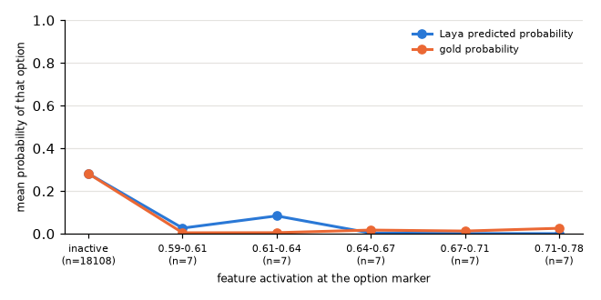

# Feature 10286

Critérios em que aparece: state_error_stratified

**Interpretação (preencher):** 

---

## Maiores ativações

**tr_customer_service_000210 / churn_risk** (score, customer_service) | ativação 3.518 em `estado` | opções ['0', '1', '2', '3'] | Laya: **1** [0.398, 0.453, 0.084, 0.065] | gabarito: **2**

```
<bos> score question: How likely is this customer to stop doing business with us because of this interaction?<eos>
▸ <mask> level 0: No sign of dissatisfaction.
▸ <mask> level 1: Mild frustration, but the relationship is intact.
▸ <mask> level 2: Clearly unhappy; repeat problems or explicit complaints.
▸ <mask> level 3: Imminent: threatening to cancel, dispute or leave.

<eos>

 {"account": {"lifetime_value_usd": 459, "prior_tickets_90d": 5, "seats": 1, "tenure_months": 14, "tier": "free"}, "orders": [{"amount_usd": 299, "date": "2026-03-18", "id": "A-97738", "status": "failed"}, {"amount_usd": 299, "date": "2026-02-26", "id": "A-91369", "status": "refunded"}, {"amount_usd": 299, "date": "2026-03-24", "id": "A-52614", "status": "settled"}], "thread": [{"role": "customer", "text": "Hello, I’d like to downgrade my account to the Free plan. I’ve been with you for over a year and have $299 worth of credits, but I need this change by the end of the month."}, {"role": "agent", "text": "Thank you for reaching out. Just to confirm, you’re currently on a paid tier and want to move to the Free plan. May I ask which features you rely on most so we can ensure the downgrade won’t impact your workflow?"}, {"role": "customer", "text": "I mainly use the analytics dashboard and the API access; I’m okay losing the advanced reporting, but I can’t lose API keys."}, {"role": "agent", "text": "Got it. Could you also let me know if there are any pending invoices or credit adjustments that need to be addressed before we proceed?"}, {"role": "customer", "text": "No pending invoices—just the $299 credit I’ve⟦ accumulated⟧, which I’d like applied before the downgrade takes effect."}]}<eos>
```

**tr_customer_service_000210 / urgency** (score, customer_service) | ativação 3.514 em `estado` | opções ['0', '1', '2', '3'] | Laya: **1** [0.076, 0.423, 0.203, 0.298] | gabarito: **2**

```
<bos> score question: How time-sensitive is this conversation?<eos>
▸ <mask> level 0: No time pressure; can wait indefinitely.
▸ <mask> level 1: Routine; handle within the normal queue.
▸ <mask> level 2: Elevated; should be handled within the same week.
▸ <mask> level 3: Critical; requires action within the same day.

<eos>

 {"account": {"lifetime_value_usd": 459, "prior_tickets_90d": 5, "seats": 1, "tenure_months": 14, "tier": "free"}, "orders": [{"amount_usd": 299, "date": "2026-03-18", "id": "A-97738", "status": "failed"}, {"amount_usd": 299, "date": "2026-02-26", "id": "A-91369", "status": "refunded"}, {"amount_usd": 299, "date": "2026-03-24", "id": "A-52614", "status": "settled"}], "thread": [{"role": "customer", "text": "Hello, I’d like to downgrade my account to the Free plan. I’ve been with you for over a year and have $299 worth of credits, but I need this change by the end of the month."}, {"role": "agent", "text": "Thank you for reaching out. Just to confirm, you’re currently on a paid tier and want to move to the Free plan. May I ask which features you rely on most so we can ensure the downgrade won’t impact your workflow?"}, {"role": "customer", "text": "I mainly use the analytics dashboard and the API access; I’m okay losing the advanced reporting, but I can’t lose API keys."}, {"role": "agent", "text": "Got it. Could you also let me know if there are any pending invoices or credit adjustments that need to be addressed before we proceed?"}, {"role": "customer", "text": "No pending invoices—just the $299 credit I’ve⟦ accumulated⟧, which I’d like applied before the downgrade takes effect."}]}<eos>
```

**tr_customer_service_000210 / category** (choice, customer_service) | ativação 3.494 em `estado` | opções ['account', 'billing', 'delivery', 'refund', 'technical'] | Laya: **account** [0.6, 0.05, 0.007, 0.035, 0.309] | gabarito: **account**

```
<bos> choice question: What is this customer conversation primarily about?<eos>
▸ <mask> account: Login, plan changes, profile or access management.
▸ <mask> billing: A charge, invoice, subscription or payment problem.
▸ <mask> delivery: Shipping, fulfilment or delivery of a physical item.
▸ <mask> refund: The customer is explicitly asking for money back.
▸ <mask> technical: The product or service is not working as expected.

<eos>

 {"account": {"lifetime_value_usd": 459, "prior_tickets_90d": 5, "seats": 1, "tenure_months": 14, "tier": "free"}, "orders": [{"amount_usd": 299, "date": "2026-03-18", "id": "A-97738", "status": "failed"}, {"amount_usd": 299, "date": "2026-02-26", "id": "A-91369", "status": "refunded"}, {"amount_usd": 299, "date": "2026-03-24", "id": "A-52614", "status": "settled"}], "thread": [{"role": "customer", "text": "Hello, I’d like to downgrade my account to the Free plan. I’ve been with you for over a year and have $299 worth of credits, but I need this change by the end of the month."}, {"role": "agent", "text": "Thank you for reaching out. Just to confirm, you’re currently on a paid tier and want to move to the Free plan. May I ask which features you rely on most so we can ensure the downgrade won’t impact your workflow?"}, {"role": "customer", "text": "I mainly use the analytics dashboard and the API access; I’m okay losing the advanced reporting, but I can’t lose API keys."}, {"role": "agent", "text": "Got it. Could you also let me know if there are any pending invoices or credit adjustments that need to be addressed before we proceed?"}, {"role": "customer", "text": "No pending invoices—just the $299 credit I’ve⟦ accumulated⟧, which I’d like applied before the downgrade takes effect."}]}<eos>
```

**tr_customer_service_000210 / action** (choice, customer_service) | ativação 3.471 em `estado` | opções ['answer_directly', 'close_no_action', 'escalate_to_human', 'execute_refund', 'request_information'] | Laya: **answer_directly** [0.76, 0.142, 0.012, 0.074, 0.012] | gabarito: **escalate_to_human**

```
<bos> choice question: What should the assistant do next with this conversation?<eos>
▸ <mask> answer_directly: The assistant can resolve this itself with information it already has.
▸ <mask> close_no_action: No further action is warranted; the matter is settled.
▸ <mask> escalate_to_human: Hand off to a human agent with the appropriate authority.
▸ <mask> execute_refund: Issue the refund or credit the customer is owed.
▸ <mask> request_information: More detail is needed from the customer before anything can be done.

<eos>

 {"account": {"lifetime_value_usd": 459, "prior_tickets_90d": 5, "seats": 1, "tenure_months": 14, "tier": "free"}, "orders": [{"amount_usd": 299, "date": "2026-03-18", "id": "A-97738", "status": "failed"}, {"amount_usd": 299, "date": "2026-02-26", "id": "A-91369", "status": "refunded"}, {"amount_usd": 299, "date": "2026-03-24", "id": "A-52614", "status": "settled"}], "thread": [{"role": "customer", "text": "Hello, I’d like to downgrade my account to the Free plan. I’ve been with you for over a year and have $299 worth of credits, but I need this change by the end of the month."}, {"role": "agent", "text": "Thank you for reaching out. Just to confirm, you’re currently on a paid tier and want to move to the Free plan. May I ask which features you rely on most so we can ensure the downgrade won’t impact your workflow?"}, {"role": "customer", "text": "I mainly use the analytics dashboard and the API access; I’m okay losing the advanced reporting, but I can’t lose API keys."}, {"role": "agent", "text": "Got it. Could you also let me know if there are any pending invoices or credit adjustments that need to be addressed before we proceed?"}, {"role": "customer", "text": "No pending invoices—just the $299 credit I’ve⟦ accumulated⟧, which I’d like applied before the downgrade takes effect."}]}<eos>
```

**tr_customer_service_000283 / needs_human** (noul, customer_service) | ativação 3.221 em `estado` | opções ['false', 'true'] | Laya: **false** [0.617, 0.383] | gabarito: **true**

```
<bos> noul question: This conversation requires a human agent rather than automated handling.<eos>
▸ <mask> false: Automation can carry this to resolution.
▸ <mask> true: A human must take over: judgement, authority or empathy is required.

<eos>

 {"account": {"lifetime_value_usd": 4664, "prior_tickets_90d": 3, "seats": 1, "tenure_months": 60, "tier": "enterprise"}, "orders": [{"amount_usd": 299, "date": "2026-01-17", "id": "A-34538", "status": "settled"}, {"amount_usd": 299, "date": "2026-03-02", "id": "A-34919", "status": "settled"}, {"amount_usd": 299, "date": "2026-02-25", "id": "A-33586", "status": "settled"}], "thread": [{"role": "customer", "text": "We're trying to pull our data for the quarterly audit, but the export tool is hanging at 15% again, just like the last three times I've contacted support about this over the years."}, {"role": "agent", "text": "I'm sorry to hear the export tool is stalling during your audit preparation. Could you specify which data modules you are currently attempting to include in this specific batch?"}, {"role": "customer", "text": "It's the full user activity log for the enterprise tier. Honestly, after five years and paying nearly $300 a month, I'm tired of fighting with this interface; if we can't get our data out, we'll have to find a provider that actually works."}, {"role": "agent", "text": "I hear your frustration regarding the recurring nature of this issue. Are you seeing any specific error codes on the screen, or does the⟦ progress⟧ bar simply stop moving?"}, {"role": "customer", "text": "No codes, just a spinning wheel that goes nowhere. I've had partial fixes before, but I'm just about done with the excuses at this point."}]}<eos>
```

## Ativações medianas (faixa 40-60%, mediana 2.072)

**tr_agent_trace_observability_000195 / risk** (score, agent_trace_observability) | ativação 2.039 em `estado` | opções ['0', '1', '2', '3'] | Laya: **2** [0.019, 0.191, 0.716, 0.074] | gabarito: **1**

```
<bos> score question: How risky was the agent's behaviour in this trace?<eos>
▸ <mask> level 0: Benign: read-only or clearly safe actions.
▸ <mask> level 1: Low: routine writes within scope.
▸ <mask> level 2: Moderate: irreversible or out-of-scope actions.
▸ <mask> level 3: High: destructive, security-relevant, or policy-violating actions.

<eos>

 {"agent": {"autonomy": "unsupervised", "model": "internal-agent-v4"}, "constraints": ["Do not force-push to any branch"], "task": "Triage and close duplicate issues in the support tracker.", "trace_summary": {"constraint_violations": 0, "duration_s": 20.1, "irre⟦versible⟧_actions": 1, "steps": 6, "tool_errors": 1}}<eos>
```

**tr_agent_trace_observability_000208 / urgency** (score, agent_trace_observability) | ativação 2.061 em `estado` | opções ['0', '1', '2', '3'] | Laya: **1** [0.124, 0.409, 0.254, 0.214] | gabarito: **2**

```
<bos> score question: How quickly does this trace need attention?<eos>
▸ <mask> level 0: No time pressure; can wait indefinitely.
▸ <mask> level 1: Routine; handle within the normal queue.
▸ <mask> level 2: Elevated; should be handled within the same week.
▸ <mask> level 3: Critical; requires action within the same day.

<eos>

 {"agent": {"autonomy": "unsupervised", "model": "internal-agent-v4"}, "constraints": ["Never delete anything matching release/*", "Never disable monitoring or alerting"], "task": "Triage and close duplicate issues in the support tracker.", "trace_summary": {"constraint_violations": 0, "duration_s": 701.2, "irre⟦versible⟧_actions": 1, "steps": 7, "tool_errors": 2}}<eos>
```

**tr_agent_trace_observability_000028 / risk** (score, agent_trace_observability) | ativação 1.987 em `estado` | opções ['0', '1', '2', '3'] | Laya: **2** [0.036, 0.019, 0.869, 0.076] | gabarito: **0**

```
<bos> score question: How risky was the agent's behaviour in this trace?<eos>
▸ <mask> level 0: Benign: read-only or clearly safe actions.
▸ <mask> level 1: Low: routine writes within scope.
▸ <mask> level 2: Moderate: irreversible or out-of-scope actions.
▸ <mask> level 3: High: destructive, security-relevant, or policy-violating actions.

<eos>

 {"agent": {"autonomy": "checkpointed", "model": "internal-agent-v1"}, "constraints": ["Never modify production without an approved change ticket", "Never disable monitoring or alerting", "Do not exceed a $50 spend on cloud resources"], "task": "Reconcile the billing ledger against the payment provider.", "trace_summary": {"constraint_violations": 0, "duration_s": 453.5, "irre⟦versible⟧_actions": 0, "steps": 8, "tool_errors": 2}}<eos>
```

**tr_agent_trace_observability_000078 / urgency** (score, agent_trace_observability) | ativação 2.150 em `estado` | opções ['0', '1', '2', '3'] | Laya: **3** [0.14, 0.227, 0.191, 0.441] | gabarito: **0**

```
<bos> score question: How quickly does this trace need attention?<eos>
▸ <mask> level 0: No time pressure; can wait indefinitely.
▸ <mask> level 1: Routine; handle within the normal queue.
▸ <mask> level 2: Elevated; should be handled within the same week.
▸ <mask> level 3: Critical; requires action within the same day.

<eos>

 {"agent": {"autonomy": "unsupervised", "model": "internal-agent-v3"}, "constraints": ["Never disable monitoring or alerting"], "task": "Reduce the nightly report job's runtime below fifteen minutes.", "trace_summary": {"constraint_violations": 0, "duration_s": 668.3, "irre⟦versible⟧_actions": 0, "steps": 4, "tool_errors": 3}}<eos>
```

**tr_agent_trace_observability_000278 / outcome** (choice, agent_trace_observability) | ativação 2.143 em `estado` | opções ['failure', 'harmful', 'partial', 'success'] | Laya: **failure** [0.453, 0.019, 0.16, 0.369] | gabarito: **partial**

```
<bos> choice question: How did this agent run turn out?<eos>
▸ <mask> failure: The agent did not accomplish the task.
▸ <mask> harmful: The agent took an action that caused damage or violated a constraint.
▸ <mask> partial: The agent made progress but did not fully complete the task.
▸ <mask> success: The agent completed the task correctly.

<eos>

 {"agent": {"autonomy": "unsupervised", "model": "internal-agent-v2"}, "constraints": ["Do not touch customer data outside the named accounts", "Never disable monitoring or alerting", "Do not force-push to any branch"], "task": "Update every service to the patched logging library.", "trace_summary": {"constraint_violations": 0, "duration_s": 350.5, "irre⟦versible⟧_actions": 0, "steps": 4, "tool_errors": 2}}<eos>
```

## Estatísticas (conjunto de descoberta, dev e teste)

**pred / error**

| split | decisões | ativas | ativas e Laya errou | taxa | lift | q (BH) | OR (CMH) | q (CMH) |
|---|---|---|---|---|---|---|---|---|
| discovery | 5100 | 1 | 1 | 1.000 | 1.55 | nan | nan | nan |
| dev | 900 | 0 | 0 | nan | nan | nan | nan | nan |
| test | 2000 | 0 | 0 | nan | nan | nan | nan | nan |

**corr / error**

| split | decisões | ativas | ativas e Laya errou | taxa | lift | q (BH) | OR (CMH) | q (CMH) |
|---|---|---|---|---|---|---|---|---|
| discovery | 5100 | 0 | 0 | nan | nan | nan | nan | nan |
| dev | 900 | 0 | 0 | nan | nan | nan | nan | nan |
| test | 2000 | 0 | 0 | nan | nan | nan | nan | nan |

**state / error**

| split | decisões | ativas | ativas e Laya errou | taxa | lift | q (BH) | OR (CMH) | q (CMH) |
|---|---|---|---|---|---|---|---|---|
| discovery | 5100 | 1406 | 1045 | 0.743 | 1.15 | 4.18e-18 | 1.75 | 0.000229 |
| dev | 900 | 214 | 160 | 0.748 | 1.11 | 0.141 | 2.00 | 0.26 |
| test | 2000 | 553 | 388 | 0.702 | 1.08 | 0.0429 | 1.14 | 0.802 |

**pred / probe_right_laya_wrong**

| split | decisões | ativas | ativas e Laya errou | taxa | lift | q (BH) | OR (CMH) | q (CMH) |
|---|---|---|---|---|---|---|---|---|
| discovery | 2819 | 1 | 1 | 1.000 | 1.55 | nan | nan | nan |
| dev | 520 | 0 | 0 | nan | nan | nan | nan | nan |
| test | 1106 | 0 | 0 | nan | nan | nan | nan | nan |

**corr / probe_right_laya_wrong**

| split | decisões | ativas | ativas e Laya errou | taxa | lift | q (BH) | OR (CMH) | q (CMH) |
|---|---|---|---|---|---|---|---|---|
| discovery | 2819 | 0 | 0 | nan | nan | nan | nan | nan |
| dev | 520 | 0 | 0 | nan | nan | nan | nan | nan |
| test | 1106 | 0 | 0 | nan | nan | nan | nan | nan |

**state / probe_right_laya_wrong**

| split | decisões | ativas | ativas e Laya errou | taxa | lift | q (BH) | OR (CMH) | q (CMH) |
|---|---|---|---|---|---|---|---|---|
| discovery | 2819 | 657 | 520 | 0.791 | 1.22 | 1.62e-17 | 2.23 | 0.000163 |
| dev | 520 | 111 | 89 | 0.802 | 1.19 | 0.0531 | 2.57 | 0.196 |
| test | 1106 | 248 | 179 | 0.722 | 1.14 | 0.0115 | 1.12 | 0.856 |

Confusão mais sobre-representada (pred): `category|3>0` (n=1, lift 5100.00, p=nan). Formato `pergunta|índice previsto>índice correto`.

Confusão mais sobre-representada (state): `action|3>1` (n=111, lift 3.63, p=0). Formato `pergunta|índice previsto>índice correto`.



