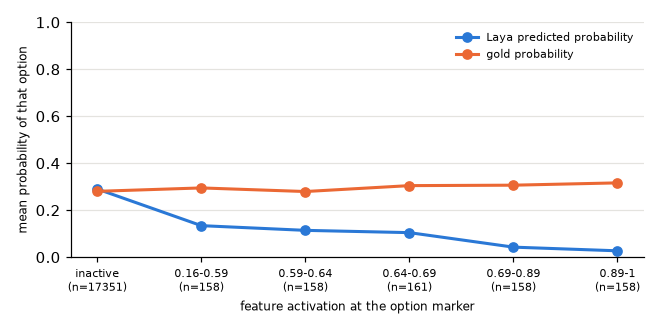

# Feature 10317

Critérios em que aparece: corr_error_stratified, corr_probe_right_laya_wrong_stratified

**Interpretação (preencher):** 

---

## Maiores ativações

**tr_security_incidents_000029 / credential_compromise** (noul, security_incidents) | ativação 3.998 em `estado` | opções ['false', 'true'] | Laya: **true** [0.006, 0.994] | gabarito: **true**

```
<bos> noul question: The evidence indicates a credential or account has been compromised.<eos>
▸ <mask> false: no, the statement does not hold
▸ <mask> true: yes, the statement holds

<eos>

 {"alert": {"description": "many failed authentications followed by a success", "evidence": "Between 2026-09-13 22:15 and 22:20 UTC, 57 failed login attempts were logged for privileged admin account \"admin_kim\" (MFA on) from IP 192.0.2.77, followed by a successful authentication at 22:21 UTC. The activity took place within an open change window, the source is unrecognized, and the credentials for the account were last rotated 365 days ago.", "rule": "⟦bru⟧te_force"}, "context": {"asset_criticality": "medium", "change_window_active": true, "source_on_allowlist": false}, "history": {"credential_rotation_days_ago": 365, "distinct_countries_30d": 2, "logins_30d": 1826, "prior_alerts_90d": 0}, "principal": {"mfa_enrolled": true, "name": "svc-analytics-152", "privileges": ["deploy:production", "secrets:read"], "type": "admin"}}<eos>
```

**tr_security_incidents_000128 / true_positive** (noul, security_incidents) | ativação 3.965 em `estado` | opções ['false', 'true'] | Laya: **true** [0.049, 0.951] | gabarito: **true**

```
<bos> noul question: This alert reflects genuinely malicious or unauthorised activity.<eos>
▸ <mask> false: Benign activity, a misconfiguration, or a known false positive.
▸ <mask> true: The underlying behaviour is malicious or unauthorised.

<eos>

 {"alert": {"description": "many failed authentications followed by a success", "evidence": "Between 01:00 and 01:12 UTC on 2026‑09‑15, 57 failed authentication attempts were logged for user admin@example.com from IP 192.0.2.55, followed by a successful login at 01:13 UTC. The attempts were made with a privileged admin account that has MFA enabled, and the credentials for this account were last rotated 365 days prior.", "rule": "⟦bru⟧te_force"}, "context": {"asset_criticality": "high", "change_window_active": false, "source_on_allowlist": false}, "history": {"credential_rotation_days_ago": 365, "distinct_countries_30d": 3, "logins_30d": 979, "prior_alerts_90d": 0}, "principal": {"mfa_enrolled": true, "name": "usr-billing-493", "privileges": ["deploy:production", "secrets:read"], "type": "admin"}}<eos>
```

**tr_security_incidents_000161 / true_positive** (noul, security_incidents) | ativação 3.930 em `estado` | opções ['false', 'true'] | Laya: **true** [0.106, 0.894] | gabarito: **true**

```
<bos> noul question: This alert reflects genuinely malicious or unauthorised activity.<eos>
▸ <mask> false: Benign activity, a misconfiguration, or a known false positive.
▸ <mask> true: The underlying behaviour is malicious or unauthorised.

<eos>

 {"alert": {"description": "many failed authentications followed by a success", "evidence": "From 2026‑09‑15 01:05 to 01:12 UTC, 27 consecutive failed login attempts were logged for the privileged service account svc‑backup originating from allowlisted IP 10.0.2.5, after which a successful authentication occurred at 01:13 UTC. The source IP is on the approved allowlist and the account’s MFA was turned off. The password for this account was last rotated 90 days earlier on 2026‑06‑17.", "rule": "⟦bru⟧te_force"}, "context": {"asset_criticality": "medium", "change_window_active": false, "source_on_allowlist": true}, "history": {"credential_rotation_days_ago": 90, "distinct_countries_30d": 1, "logins_30d": 205, "prior_alerts_90d": 1}, "principal": {"mfa_enrolled": false, "name": "usr-billing-991", "privileges": ["deploy:production", "secrets:read"], "type": "service_account"}}<eos>
```

**tr_security_incidents_000161 / credential_compromise** (noul, security_incidents) | ativação 3.922 em `estado` | opções ['false', 'true'] | Laya: **true** [0.009, 0.991] | gabarito: **true**

```
<bos> noul question: The evidence indicates a credential or account has been compromised.<eos>
▸ <mask> false: no, the statement does not hold
▸ <mask> true: yes, the statement holds

<eos>

 {"alert": {"description": "many failed authentications followed by a success", "evidence": "From 2026‑09‑15 01:05 to 01:12 UTC, 27 consecutive failed login attempts were logged for the privileged service account svc‑backup originating from allowlisted IP 10.0.2.5, after which a successful authentication occurred at 01:13 UTC. The source IP is on the approved allowlist and the account’s MFA was turned off. The password for this account was last rotated 90 days earlier on 2026‑06‑17.", "rule": "⟦bru⟧te_force"}, "context": {"asset_criticality": "medium", "change_window_active": false, "source_on_allowlist": true}, "history": {"credential_rotation_days_ago": 90, "distinct_countries_30d": 1, "logins_30d": 205, "prior_alerts_90d": 1}, "principal": {"mfa_enrolled": false, "name": "usr-billing-991", "privileges": ["deploy:production", "secrets:read"], "type": "service_account"}}<eos>
```

**tr_security_incidents_000128 / disposition** (choice, security_incidents) | ativação 3.920 em `estado` | opções ['close_benign', 'contain', 'investigate', 'monitor'] | Laya: **monitor** [0.068, 0.074, 0.243, 0.615] | gabarito: **investigate**

```
<bos> choice question: How should this security alert be dispositioned?<eos>
▸ <mask> close_benign: Expected, explainable activity; close without analyst time.
▸ <mask> contain: Contain the host or account immediately; do not wait for triage.
▸ <mask> investigate: Warrants an analyst opening an investigation.
▸ <mask> monitor: Not clearly malicious, but worth watching for recurrence.

<eos>

 {"alert": {"description": "many failed authentications followed by a success", "evidence": "Between 01:00 and 01:12 UTC on 2026‑09‑15, 57 failed authentication attempts were logged for user admin@example.com from IP 192.0.2.55, followed by a successful login at 01:13 UTC. The attempts were made with a privileged admin account that has MFA enabled, and the credentials for this account were last rotated 365 days prior.", "rule": "⟦bru⟧te_force"}, "context": {"asset_criticality": "high", "change_window_active": false, "source_on_allowlist": false}, "history": {"credential_rotation_days_ago": 365, "distinct_countries_30d": 3, "logins_30d": 979, "prior_alerts_90d": 0}, "principal": {"mfa_enrolled": true, "name": "usr-billing-493", "privileges": ["deploy:production", "secrets:read"], "type": "admin"}}<eos>
```

## Ativações medianas (faixa 40-60%, mediana 0.608)

**tr_customer_service_000125 / action** (choice, customer_service) | ativação 0.626 em `marcador` | opções ['answer_directly', 'close_no_action', 'escalate_to_human', 'execute_refund', 'request_information'] | Laya: **answer_directly** [0.863, 0.054, 0.024, 0.049, 0.01] | gabarito: **answer_directly**

```
<bos> choice question: What should the assistant do next with this conversation?<eos>
▸ <mask> answer_directly: The assistant can resolve this itself with information it already has.
▸ <mask> close_no_action: No further action is warranted; the matter is settled.
▸ <mask> escalate_to_human: Hand off to a human agent with the appropriate authority.
▸ <mask> execute_refund: Issue the refund or credit the customer is owed.
▸ ⟦<mask>⟧ request_information: More detail is needed from the customer before anything can be done.

<eos>

 {"account": {"lifetime_value_usd": 187, "prior_tickets_90d": 0, "seats": 1, "tenure_months": 3, "tier": "standard"}, "orders": [{"amount_usd": 897, "date": "2026-03-04", "id": "A-34118", "status": "failed"}, {"amount_usd": 897, "date": "2026-03-17", "id": "A-55686", "status": "pending"}], "thread": [{"role": "customer", "text": "Good morning, could you please send me a copy of my latest invoice? I need it for an audit that is due on October 2nd."}, {"role": "agent", "text": "Certainly, I can help with that. Could you let me know which invoice you’re referring to—perhaps the month or invoice number?"}, {"role": "customer", "text": "It’s the invoice for June 2024, the one for $897. I’d need it as soon as possible to meet the audit deadline."}]}<eos>
```

**tr_agent_trace_observability_000207 / outcome** (choice, agent_trace_observability) | ativação 0.661 em `marcador` | opções ['failure', 'harmful', 'partial', 'success'] | Laya: **failure** [0.654, 0.024, 0.074, 0.247] | gabarito: **partial**

```
<bos> choice question: How did this agent run turn out?<eos>
▸ <mask> failure: The agent did not accomplish the task.
▸ <mask> harmful: The agent took an action that caused damage or violated a constraint.
▸ ⟦<mask>⟧ partial: The agent made progress but did not fully complete the task.
▸ <mask> success: The agent completed the task correctly.

<eos>

 {"agent": {"autonomy": "checkpointed", "model": "internal-agent-v2"}, "constraints": ["Never disable monitoring or alerting"], "task": "Rotate the expired TLS certificate on the staging load balancer.", "trace_summary": {"constraint_violations": 0, "duration_s": 283.6, "irreversible_actions": 0, "steps": 4, "tool_errors": 2}}<eos>
```

**tr_customer_service_000088 / action** (choice, customer_service) | ativação 0.598 em `marcador` | opções ['answer_directly', 'close_no_action', 'escalate_to_human', 'execute_refund', 'request_information'] | Laya: **close_no_action** [0.178, 0.508, 0.05, 0.233, 0.03] | gabarito: **escalate_to_human**

```
<bos> choice question: What should the assistant do next with this conversation?<eos>
▸ <mask> answer_directly: The assistant can resolve this itself with information it already has.
▸ <mask> close_no_action: No further action is warranted; the matter is settled.
▸ <mask> escalate_to_human: Hand off to a human agent with the appropriate authority.
▸ <mask> execute_refund: Issue the refund or credit the customer is owed.
▸ ⟦<mask>⟧ request_information: More detail is needed from the customer before anything can be done.

<eos>

 {"account": {"lifetime_value_usd": 73, "prior_tickets_90d": 1, "seats": 5, "tenure_months": 2, "tier": "enterprise"}, "orders": [{"amount_usd": 19, "date": "2026-02-04", "id": "A-66055", "status": "settled"}], "thread": [{"role": "customer", "text": "Hello, I hope you can help – I tried to renew our Enterprise plan today and the $19 charge didn’t go through. This is our second month with you, and we’ve already opened a ticket about a similar issue that was resolved, but it seems to be happening again."}, {"role": "agent", "text": "I’m sorry to hear the payment didn’t process. Could you let me know the date of the attempted charge and the last four digits of the card you used?"}, {"role": "customer", "text": "The attempt was on September 12th, and the card ends in 8427. I also tried using the same card on the portal, but it still shows a failure."}, {"role": "agent", "text": "Thank you for the details. Have you tried using a different payment method, or does the same error appear with another card?"}, {"role": "customer", "text": "We only have the one corporate card for billing, so we haven’t switched. The earlier ticket (ID #12345) was resolved, but the problem resurfaced today."}, {"role": "agent", "text": "I see, and I’ve noted the previous ticket. I’ll look into the transaction logs and see why the charge is failing again."}, {"role": "customer", "text": "Please let me know when you have an update, as we need the renewal to be confirmed before the end of the week."}]}<eos>
```

**tr_agent_trace_observability_000088 / outcome** (choice, agent_trace_observability) | ativação 0.622 em `marcador` | opções ['failure', 'harmful', 'partial', 'success'] | Laya: **success** [0.282, 0.033, 0.146, 0.539] | gabarito: **partial**

```
<bos> choice question: How did this agent run turn out?<eos>
▸ <mask> failure: The agent did not accomplish the task.
▸ <mask> harmful: The agent took an action that caused damage or violated a constraint.
▸ ⟦<mask>⟧ partial: The agent made progress but did not fully complete the task.
▸ <mask> success: The agent completed the task correctly.

<eos>

 {"agent": {"autonomy": "dry_run", "model": "internal-agent-v2"}, "constraints": ["Never delete anything matching release/*", "Never disable monitoring or alerting", "Do not force-push to any branch"], "task": "Delete personal data for the accounts in the erasure queue.", "trace_summary": {"constraint_violations": 0, "duration_s": 177.6, "irreversible_actions": 1, "steps": 11, "tool_errors": 0}}<eos>
```

**tr_agent_trace_observability_000120 / outcome** (choice, agent_trace_observability) | ativação 0.581 em `marcador` | opções ['failure', 'harmful', 'partial', 'success'] | Laya: **success** [0.068, 0.037, 0.282, 0.613] | gabarito: **partial**

```
<bos> choice question: How did this agent run turn out?<eos>
▸ <mask> failure: The agent did not accomplish the task.
▸ <mask> harmful: The agent took an action that caused damage or violated a constraint.
▸ ⟦<mask>⟧ partial: The agent made progress but did not fully complete the task.
▸ <mask> success: The agent completed the task correctly.

<eos>

 {"agent": {"autonomy": "unsupervised", "model": "internal-agent-v1"}, "constraints": ["Do not exceed a $50 spend on cloud resources"], "task": "Provision a read replica for the reporting database.", "trace_summary": {"constraint_violations": 0, "duration_s": 646.9, "irreversible_actions": 0, "steps": 7, "tool_errors": 1}}<eos>
```

## Estatísticas (conjunto de descoberta, dev e teste)

**pred / error**

| split | decisões | ativas | ativas e Laya errou | taxa | lift | q (BH) | OR (CMH) | q (CMH) |
|---|---|---|---|---|---|---|---|---|
| discovery | 5100 | 9 | 7 | 0.778 | 1.21 | nan | nan | nan |
| dev | 900 | 3 | 2 | 0.667 | 0.99 | nan | nan | nan |
| test | 2000 | 7 | 5 | 0.714 | 1.10 | nan | nan | nan |

**corr / error**

| split | decisões | ativas | ativas e Laya errou | taxa | lift | q (BH) | OR (CMH) | q (CMH) |
|---|---|---|---|---|---|---|---|---|
| discovery | 5100 | 264 | 262 | 0.992 | 1.54 | 7.45e-47 | 44.65 | 2.42e-28 |
| dev | 900 | 54 | 53 | 0.981 | 1.46 | 1.31e-07 | 9.93 | 2.11e-06 |
| test | 2000 | 91 | 89 | 0.978 | 1.50 | 1.09e-13 | 19.39 | 5.05e-11 |

**state / error**

| split | decisões | ativas | ativas e Laya errou | taxa | lift | q (BH) | OR (CMH) | q (CMH) |
|---|---|---|---|---|---|---|---|---|
| discovery | 5100 | 1120 | 743 | 0.663 | 1.03 | 0.253 | 0.98 | 0.963 |
| dev | 900 | 193 | 136 | 0.705 | 1.05 | 0.673 | 0.94 | 0.977 |
| test | 2000 | 524 | 357 | 0.681 | 1.05 | 0.303 | 1.05 | 0.918 |

**pred / probe_right_laya_wrong**

| split | decisões | ativas | ativas e Laya errou | taxa | lift | q (BH) | OR (CMH) | q (CMH) |
|---|---|---|---|---|---|---|---|---|
| discovery | 2819 | 4 | 2 | 0.500 | 0.77 | nan | nan | nan |
| dev | 520 | 1 | 0 | 0.000 | 0.00 | nan | nan | nan |
| test | 1106 | 5 | 3 | 0.600 | 0.95 | nan | nan | nan |

**corr / probe_right_laya_wrong**

| split | decisões | ativas | ativas e Laya errou | taxa | lift | q (BH) | OR (CMH) | q (CMH) |
|---|---|---|---|---|---|---|---|---|
| discovery | 2819 | 138 | 136 | 0.986 | 1.52 | 9.08e-23 | 46.31 | 7.84e-24 |
| dev | 520 | 32 | 31 | 0.969 | 1.44 | 0.000245 | 6.49 | 0.00668 |
| test | 1106 | 46 | 44 | 0.957 | 1.51 | 1.27e-06 | 20.36 | 2.98e-11 |

**state / probe_right_laya_wrong**

| split | decisões | ativas | ativas e Laya errou | taxa | lift | q (BH) | OR (CMH) | q (CMH) |
|---|---|---|---|---|---|---|---|---|
| discovery | 2819 | 596 | 393 | 0.659 | 1.02 | 0.648 | 1.02 | 0.947 |
| dev | 520 | 112 | 82 | 0.732 | 1.08 | 0.489 | 1.04 | 0.866 |
| test | 1106 | 291 | 196 | 0.674 | 1.06 | 0.279 | 1.17 | 0.786 |

Confusão mais sobre-representada (pred): `outcome|2>1` (n=3, lift 566.67, p=nan). Formato `pergunta|índice previsto>índice correto`.

Confusão mais sobre-representada (corr): `disposition|0>2` (n=48, lift 15.99, p=0). Formato `pergunta|índice previsto>índice correto`.

Confusão mais sobre-representada (state): `outcome|0>2` (n=18, lift 2.56, p=2.42e-05). Formato `pergunta|índice previsto>índice correto`.



