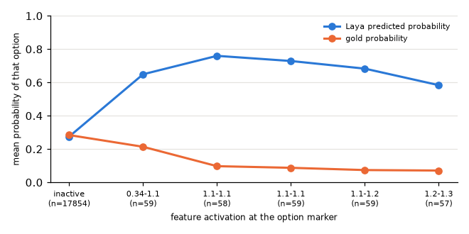

# Feature 10340

Critérios em que aparece: pred_error, attribution_toward_wrong

**Interpretação (preencher):** 

---

## Maiores ativações

**tr_security_incidents_000030 / true_positive** (noul, security_incidents) | ativação 2.137 em `estado` | opções ['false', 'true'] | Laya: **true** [0.469, 0.531] | gabarito: **true**

```
<bos> noul question: This alert reflects genuinely malicious or unauthorised activity.<eos>
▸ <mask> false: Benign activity, a misconfiguration, or a known false positive.
▸ <mask> true: The underlying behaviour is malicious or unauthorised.

<eos>

 {"alert": {"description": "a long-unused account became active", "evidence": "A successful logon to employee account J⟦DOE⟧ was recorded at 2026-09-15 08:12:34 UTC from source IP 198.51.100.22, marking the first authentication event for this user in the past 180 days. The authentication occurred without multi‑factor verification and originated from a device not listed in the known asset inventory.", "rule": "dormant_account_use"}, "context": {"asset_criticality": "low", "change_window_active": false, "source_on_allowlist": false}, "history": {"credential_rotation_days_ago": 180, "distinct_countries_30d": 2, "logins_30d": 450, "prior_alerts_90d": 1}, "principal": {"mfa_enrolled": false, "name": "ci-infra-957", "privileges": ["repo:read"], "type": "employee"}}<eos>
```

**tr_security_incidents_000030 / disposition** (choice, security_incidents) | ativação 2.098 em `estado` | opções ['close_benign', 'contain', 'investigate', 'monitor'] | Laya: **monitor** [0.14, 0.284, 0.057, 0.519] | gabarito: **investigate**

```
<bos> choice question: How should this security alert be dispositioned?<eos>
▸ <mask> close_benign: Expected, explainable activity; close without analyst time.
▸ <mask> contain: Contain the host or account immediately; do not wait for triage.
▸ <mask> investigate: Warrants an analyst opening an investigation.
▸ <mask> monitor: Not clearly malicious, but worth watching for recurrence.

<eos>

 {"alert": {"description": "a long-unused account became active", "evidence": "A successful logon to employee account J⟦DOE⟧ was recorded at 2026-09-15 08:12:34 UTC from source IP 198.51.100.22, marking the first authentication event for this user in the past 180 days. The authentication occurred without multi‑factor verification and originated from a device not listed in the known asset inventory.", "rule": "dormant_account_use"}, "context": {"asset_criticality": "low", "change_window_active": false, "source_on_allowlist": false}, "history": {"credential_rotation_days_ago": 180, "distinct_countries_30d": 2, "logins_30d": 450, "prior_alerts_90d": 1}, "principal": {"mfa_enrolled": false, "name": "ci-infra-957", "privileges": ["repo:read"], "type": "employee"}}<eos>
```

**tr_security_incidents_000030 / credential_compromise** (noul, security_incidents) | ativação 2.031 em `estado` | opções ['false', 'true'] | Laya: **true** [0.185, 0.815] | gabarito: **true**

```
<bos> noul question: The evidence indicates a credential or account has been compromised.<eos>
▸ <mask> false: no, the statement does not hold
▸ <mask> true: yes, the statement holds

<eos>

 {"alert": {"description": "a long-unused account became active", "evidence": "A successful logon to employee account J⟦DOE⟧ was recorded at 2026-09-15 08:12:34 UTC from source IP 198.51.100.22, marking the first authentication event for this user in the past 180 days. The authentication occurred without multi‑factor verification and originated from a device not listed in the known asset inventory.", "rule": "dormant_account_use"}, "context": {"asset_criticality": "low", "change_window_active": false, "source_on_allowlist": false}, "history": {"credential_rotation_days_ago": 180, "distinct_countries_30d": 2, "logins_30d": 450, "prior_alerts_90d": 1}, "principal": {"mfa_enrolled": false, "name": "ci-infra-957", "privileges": ["repo:read"], "type": "employee"}}<eos>
```

**tr_security_incidents_000030 / urgency** (score, security_incidents) | ativação 2.031 em `estado` | opções ['0', '1', '2', '3'] | Laya: **1** [0.14, 0.466, 0.197, 0.197] | gabarito: **2**

```
<bos> score question: How quickly must a responder act on this alert?<eos>
▸ <mask> level 0: No time pressure; can wait indefinitely.
▸ <mask> level 1: Routine; handle within the normal queue.
▸ <mask> level 2: Elevated; should be handled within the same week.
▸ <mask> level 3: Critical; requires action within the same day.

<eos>

 {"alert": {"description": "a long-unused account became active", "evidence": "A successful logon to employee account J⟦DOE⟧ was recorded at 2026-09-15 08:12:34 UTC from source IP 198.51.100.22, marking the first authentication event for this user in the past 180 days. The authentication occurred without multi‑factor verification and originated from a device not listed in the known asset inventory.", "rule": "dormant_account_use"}, "context": {"asset_criticality": "low", "change_window_active": false, "source_on_allowlist": false}, "history": {"credential_rotation_days_ago": 180, "distinct_countries_30d": 2, "logins_30d": 450, "prior_alerts_90d": 1}, "principal": {"mfa_enrolled": false, "name": "ci-infra-957", "privileges": ["repo:read"], "type": "employee"}}<eos>
```

**tr_security_incidents_000030 / severity** (score, security_incidents) | ativação 1.999 em `estado` | opções ['0', '1', '2', '3', '4'] | Laya: **1** [0.141, 0.322, 0.28, 0.128, 0.128] | gabarito: **1**

```
<bos> score question: How severe is the potential impact if this alert is real?<eos>
▸ <mask> level 0: Negligible: no access to anything sensitive.
▸ <mask> level 1: Low: limited access, easily reversed.
▸ <mask> level 2: Moderate: access to internal systems or non-public data.
▸ <mask> level 3: High: access to production, secrets or customer data.
▸ <mask> level 4: Critical: active compromise of crown-jewel systems.

<eos>

 {"alert": {"description": "a long-unused account became active", "evidence": "A successful logon to employee account J⟦DOE⟧ was recorded at 2026-09-15 08:12:34 UTC from source IP 198.51.100.22, marking the first authentication event for this user in the past 180 days. The authentication occurred without multi‑factor verification and originated from a device not listed in the known asset inventory.", "rule": "dormant_account_use"}, "context": {"asset_criticality": "low", "change_window_active": false, "source_on_allowlist": false}, "history": {"credential_rotation_days_ago": 180, "distinct_countries_30d": 2, "logins_30d": 450, "prior_alerts_90d": 1}, "principal": {"mfa_enrolled": false, "name": "ci-infra-957", "privileges": ["repo:read"], "type": "employee"}}<eos>
```

## Ativações medianas (faixa 40-60%, mediana 1.257)

**tr_invoice_processing_000209 / urgency** (score, invoice_processing) | ativação 1.277 em `estado` | opções ['0', '1', '2', '3'] | Laya: **1** [0.113, 0.54, 0.255, 0.091] | gabarito: **2**

```
<bos> score question: How time-sensitive is processing this invoice?<eos>
▸ <mask> level 0: No time pressure; can wait indefinitely.
▸ <mask> level 1: Routine; handle within the normal queue.
▸ <mask> level 2: Elevated; should be handled within the same week.
▸ <mask> level 3: Critical; requires action within the same day.

<eos>

 {"delivery": {"condition": "accepted", "date": "2026-03-16", "received_qty": 80}, "invoice": {"currency": "USD", "id": "INV-2026-4623", "lines": [{"qty": 80, "sku": "SKU-665", "total_usd": 22786.4, "unit_usd": 284.83}], "total_usd": 22786.4, "vendor": "Pallas Industrial"}, "payment": {"days_until_due": -3, "discount_expires_in_days": null, "early_payment_discount_pct": null, "status": "overdue", "terms": "net 60"}, "purchase_order": {"freight_terms": "freight prepaid by vendor, not⟦ separately⟧ billable", "id": "PO-7949", "lines": [{"qty": 100, "unit_usd": 284.83}], "total_usd": 28483.0}, "vendor_history": {"disputes_12m": 0, "invoices_12m": 31, "prior_invoice_ids": ["INV-2026-3629"]}}<eos>
```

**tr_invoice_processing_000246 / urgency** (score, invoice_processing) | ativação 1.257 em `estado` | opções ['0', '1', '2', '3'] | Laya: **1** [0.085, 0.523, 0.253, 0.139] | gabarito: **1**

```
<bos> score question: How time-sensitive is processing this invoice?<eos>
▸ <mask> level 0: No time pressure; can wait indefinitely.
▸ <mask> level 1: Routine; handle within the normal queue.
▸ <mask> level 2: Elevated; should be handled within the same week.
▸ <mask> level 3: Critical; requires action within the same day.

<eos>

 {"delivery": {"condition": "accepted with exceptions", "date": "2026-03-13", "received_qty": 100}, "invoice": {"currency": "USD", "id": "INV-2026-9771", "lines": [{"qty": 100, "sku": "SKU-808", "total_usd": 28674.0, "unit_usd": 286.74}], "total_usd": 28674.0, "vendor": "Vantage Materials"}, "payment": {"days_until_due": 18, "discount_expires_in_days": null, "early_payment_discount_pct": null, "status": "scheduled", "terms": "net 30"}, "purchase_order": {"freight_terms": "freight prepaid by vendor, not⟦ separately⟧ billable", "id": "PO-5067", "lines": [{"qty": 100, "unit_usd": 286.74}], "total_usd": 28674.0}, "vendor_history": {"disputes_12m": 0, "invoices_12m": 33, "prior_invoice_ids": ["INV-2026-6899", "INV-2026-5358", "INV-2026-9069", "INV-2026-1688"]}}<eos>
```

**tr_agent_trace_observability_000151 / action** (choice, agent_trace_observability) | ativação 1.251 em `marcador` | opções ['continue', 'human_review', 'observe', 'stop'] | Laya: **stop** [0.254, 0.008, 0.12, 0.618] | gabarito: **observe**

```
<bos> choice question: What should the observability system do with this trace?<eos>
▸ <mask> continue: Let the agent proceed without interruption.
▸ <mask> human_review: Queue this trace for a human to review.
▸ <mask> observe: Keep running, but flag the trace for later sampling.
▸ ⟦<mask>⟧ stop: Halt the agent now.

<eos>

 {"agent": {"autonomy": "checkpointed", "model": "internal-agent-v1"}, "constraints": ["Never modify production without an approved change ticket", "Never disable monitoring or alerting", "Do not exceed a $50 spend on cloud resources"], "task": "Rotate the expired TLS certificate on the staging load balancer.", "trace_summary": {"constraint_violations": 0, "duration_s": 366.7, "irreversible_actions": 0, "steps": 10, "tool_errors": 3}}<eos>
```

**tr_invoice_processing_000153 / urgency** (score, invoice_processing) | ativação 1.229 em `estado` | opções ['0', '1', '2', '3'] | Laya: **1** [0.081, 0.469, 0.213, 0.238] | gabarito: **2**

```
<bos> score question: How time-sensitive is processing this invoice?<eos>
▸ <mask> level 0: No time pressure; can wait indefinitely.
▸ <mask> level 1: Routine; handle within the normal queue.
▸ <mask> level 2: Elevated; should be handled within the same week.
▸ <mask> level 3: Critical; requires action within the same day.

<eos>

 {"delivery": {"condition": "accepted with exceptions", "date": null, "received_qty": 0}, "invoice": {"currency": "USD", "id": "INV-2026-9865", "lines": [{"qty": 1000, "sku": "SKU-844", "total_usd": 237850.0, "unit_usd": 237.85}], "total_usd": 237850.0, "vendor": "Kestrel Supply"}, "payment": {"days_until_due": 18, "discount_expires_in_days": 4, "early_payment_discount_pct": 2.0, "status": "scheduled", "terms": "net 15"}, "purchase_order": {"freight_terms": "freight prepaid by vendor, not⟦ separately⟧ billable", "id": "PO-9394", "lines": [{"qty": 1000, "unit_usd": 237.85}], "total_usd": 237850.0}, "vendor_history": {"disputes_12m": 1, "invoices_12m": 13, "prior_invoice_ids": ["INV-2026-5658", "INV-2026-4550", "INV-2026-8891"]}}<eos>
```

**tr_invoice_processing_000149 / disposition** (choice, invoice_processing) | ativação 1.230 em `estado` | opções ['approve', 'hold', 'manual_review', 'reject'] | Laya: **approve** [0.499, 0.243, 0.029, 0.228] | gabarito: **approve**

```
<bos> choice question: How should this vendor invoice be dispositioned?<eos>
▸ <mask> approve: Matches the order and delivery; approve for payment.
▸ <mask> hold: Something needs confirming before payment; hold pending clarification.
▸ <mask> manual_review: A human in finance must review the discrepancy.
▸ <mask> reject: Should not be paid: duplicate, unauthorised or materially wrong.

<eos>

 {"delivery": {"condition": "accepted", "date": "2026-03-14", "received_qty": 50}, "invoice": {"currency": "USD", "id": "INV-2026-2574", "lines": [{"qty": 50, "sku": "SKU-822", "total_usd": 4408.0, "unit_usd": 88.16}], "total_usd": 4408.0, "vendor": "Orbit Logistics"}, "payment": {"days_until_due": 18, "discount_expires_in_days": 7, "early_payment_discount_pct": 2.0, "status": "scheduled", "terms": "net 15"}, "purchase_order": {"freight_terms": "freight prepaid by vendor, not⟦ separately⟧ billable", "id": "PO-5874", "lines": [{"qty": 50, "unit_usd": 88.16}], "total_usd": 4408.0}, "vendor_history": {"disputes_12m": 0, "invoices_12m": 23, "prior_invoice_ids": ["INV-2026-1898", "INV-2026-1599", "INV-2026-7232"]}}<eos>
```

## Estatísticas (conjunto de descoberta, dev e teste)

**pred / error**

| split | decisões | ativas | ativas e Laya errou | taxa | lift | q (BH) | OR (CMH) | q (CMH) |
|---|---|---|---|---|---|---|---|---|
| discovery | 5100 | 255 | 243 | 0.953 | 1.48 | 6.19e-32 | 0.83 | 0.897 |
| dev | 900 | 39 | 37 | 0.949 | 1.41 | 0.000355 | 0.00 | 0.729 |
| test | 2000 | 97 | 91 | 0.938 | 1.44 | 3.15e-10 | 1.58 | 0.698 |

**corr / error**

| split | decisões | ativas | ativas e Laya errou | taxa | lift | q (BH) | OR (CMH) | q (CMH) |
|---|---|---|---|---|---|---|---|---|
| discovery | 5100 | 15 | 3 | 0.200 | 0.31 | nan | nan | nan |
| dev | 900 | 2 | 0 | 0.000 | 0.00 | nan | nan | nan |
| test | 2000 | 7 | 1 | 0.143 | 0.22 | nan | nan | nan |

**state / error**

| split | decisões | ativas | ativas e Laya errou | taxa | lift | q (BH) | OR (CMH) | q (CMH) |
|---|---|---|---|---|---|---|---|---|
| discovery | 5100 | 1263 | 841 | 0.666 | 1.03 | 0.149 | 0.64 | 0.00281 |
| dev | 900 | 303 | 218 | 0.719 | 1.07 | 0.252 | 0.61 | 0.343 |
| test | 2000 | 510 | 350 | 0.686 | 1.05 | 0.217 | 0.65 | 0.23 |

**pred / probe_right_laya_wrong**

| split | decisões | ativas | ativas e Laya errou | taxa | lift | q (BH) | OR (CMH) | q (CMH) |
|---|---|---|---|---|---|---|---|---|
| discovery | 2819 | 123 | 115 | 0.935 | 1.44 | 1.95e-13 | 0.08 | 0.382 |
| dev | 520 | 14 | 12 | 0.857 | 1.27 | nan | nan | nan |
| test | 1106 | 36 | 34 | 0.944 | 1.49 | 7.16e-05 | 4.07 | 0.547 |

**corr / probe_right_laya_wrong**

| split | decisões | ativas | ativas e Laya errou | taxa | lift | q (BH) | OR (CMH) | q (CMH) |
|---|---|---|---|---|---|---|---|---|
| discovery | 2819 | 10 | 2 | 0.200 | 0.31 | nan | nan | nan |
| dev | 520 | 2 | 0 | 0.000 | 0.00 | nan | nan | nan |
| test | 1106 | 2 | 0 | 0.000 | 0.00 | nan | nan | nan |

**state / probe_right_laya_wrong**

| split | decisões | ativas | ativas e Laya errou | taxa | lift | q (BH) | OR (CMH) | q (CMH) |
|---|---|---|---|---|---|---|---|---|
| discovery | 2819 | 753 | 527 | 0.700 | 1.08 | 0.00192 | 0.40 | 1.73e-08 |
| dev | 520 | 184 | 131 | 0.712 | 1.05 | 0.527 | 0.28 | 0.00603 |
| test | 1106 | 307 | 216 | 0.704 | 1.11 | 0.0216 | 0.37 | 0.00492 |

Confusão mais sobre-representada (pred): `action|3>1` (n=111, lift 20.00, p=0). Formato `pergunta|índice previsto>índice correto`.

Confusão mais sobre-representada (corr): `true_positive|0>1` (n=2, lift 30.91, p=nan). Formato `pergunta|índice previsto>índice correto`.

Confusão mais sobre-representada (state): `discrepancy_severity|2>0` (n=108, lift 4.04, p=0). Formato `pergunta|índice previsto>índice correto`.



