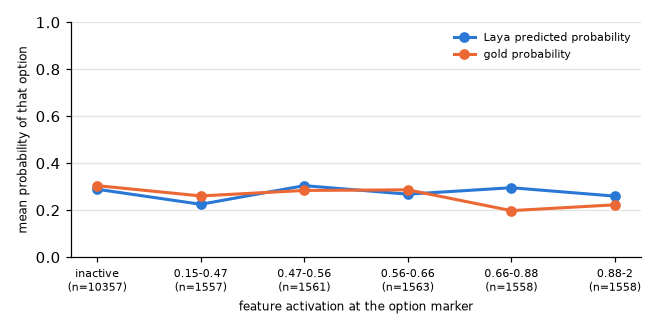

# Feature 10357

Critérios em que aparece: attribution_toward_correct

**Interpretação (preencher):** 

---

## Maiores ativações

**tr_customer_service_000111 / urgency** (score, customer_service) | ativação 6.074 em `pergunta` | opções ['0', '1', '2', '3'] | Laya: **3** [0.128, 0.303, 0.248, 0.32] | gabarito: **3**

```
<bos> score question: How time-sensitive is this conversation?⟦<eos>⟧
▸ <mask> level 0: No time pressure; can wait indefinitely.
▸ <mask> level 1: Routine; handle within the normal queue.
▸ <mask> level 2: Elevated; should be handled within the same week.
▸ <mask> level 3: Critical; requires action within the same day.

<eos>

 {"account": {"lifetime_value_usd": 181, "prior_tickets_90d": 0, "seats": 1, "tenure_months": 2, "tier": "free"}, "thread": [{"role": "customer", "text": "We have to add three more seats to our team right now, or we can't meet our client deadline tomorrow. If this isn't sorted immediately, we'll have to look for another service."}, {"role": "agent", "text": "Got it. Can you provide the account ID and let me know which usernames need the new seats?"}, {"role": "customer", "text": "We're on the free plan, account ID 98765. Please tell me what I need to do to get those seats added before 5 pm today."}]}<eos>
```

**tr_security_incidents_000138 / severity** (score, security_incidents) | ativação 6.035 em `pergunta` | opções ['0', '1', '2', '3', '4'] | Laya: **0** [0.38, 0.261, 0.216, 0.058, 0.085] | gabarito: **3**

```
<bos> score question: How severe is the potential impact if this alert is real?⟦<eos>⟧
▸ <mask> level 0: Negligible: no access to anything sensitive.
▸ <mask> level 1: Low: limited access, easily reversed.
▸ <mask> level 2: Moderate: access to internal systems or non-public data.
▸ <mask> level 3: High: access to production, secrets or customer data.
▸ <mask> level 4: Critical: active compromise of crown-jewel systems.

<eos>

 {"alert": {"description": "an account granted itself or received elevated permissions", "evidence": "At 02:45:10 UTC on 2026-09-16, the unprivileged service account svc-data-ingest on host 172.16.45.12 executed a `sudo` command that added its own SID to the local sudoers file. The request originated from an unrecognised source IP 203.0.113.55, and the account's credentials were last rotated 3 days ago.", "rule": "privilege_escalation"}, "context": {"asset_criticality": "medium", "change_window_active": false, "source_on_allowlist": false}, "history": {"credential_rotation_days_ago": 3, "distinct_countries_30d": 3, "logins_30d": 818, "prior_alerts_90d": 8}, "principal": {"mfa_enrolled": true, "name": "usr-billing-689", "privileges": ["repo:read"], "type": "service_account"}}<eos>
```

**tr_security_incidents_000140 / severity** (score, security_incidents) | ativação 6.031 em `pergunta` | opções ['0', '1', '2', '3', '4'] | Laya: **1** [0.137, 0.323, 0.24, 0.124, 0.176] | gabarito: **4**

```
<bos> score question: How severe is the potential impact if this alert is real?⟦<eos>⟧
▸ <mask> level 0: Negligible: no access to anything sensitive.
▸ <mask> level 1: Low: limited access, easily reversed.
▸ <mask> level 2: Moderate: access to internal systems or non-public data.
▸ <mask> level 3: High: access to production, secrets or customer data.
▸ <mask> level 4: Critical: active compromise of crown-jewel systems.

<eos>

 {"alert": {"description": "audit logging was turned off on a host", "evidence": "On 2026-09-16 at 01:07:58 UTC, the unprivileged service account svc-monitor on host 192.168.100.200 renamed the security log file C:\\Windows\\System32\\winevt\\Logs\\Security.evtx to Security.evtx.bak, effectively stopping audit logging. The action was initiated from an unrecognised source IP 172.20.30.40, and the account’s credentials have not been rotated for 412 days.", "rule": "disabled_logging"}, "context": {"asset_criticality": "crown_jewel", "change_window_active": false, "source_on_allowlist": false}, "history": {"credential_rotation_days_ago": 412, "distinct_countries_30d": 3, "logins_30d": 1000, "prior_alerts_90d": 0}, "principal": {"mfa_enrolled": false, "name": "usr-support-416", "privileges": ["repo:read"], "type": "service_account"}}<eos>
```

**tr_security_incidents_000112 / severity** (score, security_incidents) | ativação 6.031 em `pergunta` | opções ['0', '1', '2', '3', '4'] | Laya: **2** [0.118, 0.316, 0.337, 0.114, 0.114] | gabarito: **4**

```
<bos> score question: How severe is the potential impact if this alert is real?⟦<eos>⟧
▸ <mask> level 0: Negligible: no access to anything sensitive.
▸ <mask> level 1: Low: limited access, easily reversed.
▸ <mask> level 2: Moderate: access to internal systems or non-public data.
▸ <mask> level 3: High: access to production, secrets or customer data.
▸ <mask> level 4: Critical: active compromise of crown-jewel systems.

<eos>

 {"alert": {"description": "a large transfer to an external destination", "evidence": "On 2026-09-16 02:11:43 UTC the admin user \"svc_admin\" initiated an SMB transfer of 3.74 GB from the host \"srv-data01\" to external destination 198.51.100.77, targeting the directory \\shared\\exports. The credentials used were last rotated 412 days ago and the activity occurred outside any scheduled change window.", "rule": "data_egress"}, "context": {"asset_criticality": "crown_jewel", "change_window_active": false, "source_on_allowlist": false}, "history": {"credential_rotation_days_ago": 412, "distinct_countries_30d": 1, "logins_30d": 475, "prior_alerts_90d": 8}, "principal": {"mfa_enrolled": true, "name": "ci-support-676", "privileges": ["repo:read"], "type": "admin"}}<eos>
```

**tr_customer_service_000111 / churn_risk** (score, customer_service) | ativação 6.027 em `pergunta` | opções ['0', '1', '2', '3'] | Laya: **1** [0.088, 0.457, 0.313, 0.142] | gabarito: **3**

```
<bos> score question: How likely is this customer to stop doing business with us because of this interaction?⟦<eos>⟧
▸ <mask> level 0: No sign of dissatisfaction.
▸ <mask> level 1: Mild frustration, but the relationship is intact.
▸ <mask> level 2: Clearly unhappy; repeat problems or explicit complaints.
▸ <mask> level 3: Imminent: threatening to cancel, dispute or leave.

<eos>

 {"account": {"lifetime_value_usd": 181, "prior_tickets_90d": 0, "seats": 1, "tenure_months": 2, "tier": "free"}, "thread": [{"role": "customer", "text": "We have to add three more seats to our team right now, or we can't meet our client deadline tomorrow. If this isn't sorted immediately, we'll have to look for another service."}, {"role": "agent", "text": "Got it. Can you provide the account ID and let me know which usernames need the new seats?"}, {"role": "customer", "text": "We're on the free plan, account ID 98765. Please tell me what I need to do to get those seats added before 5 pm today."}]}<eos>
```

## Ativações medianas (faixa 40-60%, mediana 1.207)

**tr_invoice_processing_000144 / disposition** (choice, invoice_processing) | ativação 1.146 em `SEP-fim` | opções ['approve', 'hold', 'manual_review', 'reject'] | Laya: **approve** [0.553, 0.142, 0.037, 0.268] | gabarito: **approve**

```
<bos> choice question: How should this vendor invoice be dispositioned?<eos>
▸ <mask> approve: Matches the order and delivery; approve for payment.
▸ <mask> hold: Something needs confirming before payment; hold pending clarification.
▸ <mask> manual_review: A human in finance must review the discrepancy.
▸ <mask> reject: Should not be paid: duplicate, unauthorised or materially wrong.

<eos>

 {"delivery": {"condition": "accepted", "date": "2026-03-03", "received_qty": 250}, "invoice": {"currency": "USD", "id": "INV-2026-4721", "lines": [{"qty": 250, "sku": "SKU-840", "total_usd": 80237.5, "unit_usd": 320.95}], "total_usd": 80237.5, "vendor": "Pallas Industrial"}, "payment": {"days_until_due": -9, "discount_expires_in_days": null, "early_payment_discount_pct": null, "status": "overdue", "terms": "net 60"}, "purchase_order": {"freight_terms": "freight prepaid by vendor, not separately billable", "id": null, "lines": [{"qty": 250, "unit_usd": 320.95}], "total_usd": 80237.5}, "vendor_history": {"disputes_12m": 1, "invoices_12m": 56, "prior_invoice_ids": ["INV-2026-5685", "INV-2026-2769"]}}⟦<eos>⟧
```

**tr_customer_service_000291 / action** (choice, customer_service) | ativação 0.955 em `marcador` | opções ['answer_directly', 'close_no_action', 'escalate_to_human', 'execute_refund', 'request_information'] | Laya: **answer_directly** [0.829, 0.129, 0.013, 0.012, 0.016] | gabarito: **escalate_to_human**

```
<bos> choice question: What should the assistant do next with this conversation?<eos>
▸ <mask> answer_directly: The assistant can resolve this itself with information it already has.
▸ ⟦<mask>⟧ close_no_action: No further action is warranted; the matter is settled.
▸ <mask> escalate_to_human: Hand off to a human agent with the appropriate authority.
▸ <mask> execute_refund: Issue the refund or credit the customer is owed.
▸ <mask> request_information: More detail is needed from the customer before anything can be done.

<eos>

 {"account": {"lifetime_value_usd": 403, "prior_tickets_90d": 1, "seats": 1, "tenure_months": 5, "tier": "standard"}, "thread": [{"role": "customer", "text": "My recent order, number 992-BX, has not arrived by the scheduled date of Tuesday and the tracking hasn't updated."}, {"role": "agent", "text": "I can look into that for you. Could you please provide the email address associated with your standard plan account?"}, {"role": "customer", "text": "The email is j.smith@example.com. I'm checking back because when I had a delay last month, the ticket was only partially addressed and I still haven't seen the full resolution."}, {"role": "agent", "text": "I see that prior ticket in our records. To help me narrow this down, has the tracking status changed at all in the last 24 hours?"}, {"role": "customer", "text": "The tracking has stayed at 'Processing' since Monday morning, so I would like to know the current location of the package."}]}<eos>
```

**tr_security_incidents_000102 / disposition** (choice, security_incidents) | ativação 1.425 em `marcador` | opções ['close_benign', 'contain', 'investigate', 'monitor'] | Laya: **contain** [0.07, 0.48, 0.132, 0.318] | gabarito: **close_benign**

```
<bos> choice question: How should this security alert be dispositioned?<eos>
▸ <mask> close_benign: Expected, explainable activity; close without analyst time.
▸ ⟦<mask>⟧ contain: Contain the host or account immediately; do not wait for triage.
▸ <mask> investigate: Warrants an analyst opening an investigation.
▸ <mask> monitor: Not clearly malicious, but worth watching for recurrence.

<eos>

 {"alert": {"description": "a long-unused account became active", "evidence": "The employee account \"e12345\" generated a successful interactive logon from IP 10.12.45.8 at 2026-09-15T03:41:27Z. The source host (hostname \"WORKSTN-12\") is listed in the approved allowlist and MFA verification succeeded. The account's password was last rotated on 2026-09-01 (14 days prior).", "rule": "dormant_account_use"}, "context": {"asset_criticality": "medium", "change_window_active": false, "source_on_allowlist": true}, "history": {"credential_rotation_days_ago": 14, "distinct_countries_30d": 2, "logins_30d": 1715, "prior_alerts_90d": 0}, "principal": {"mfa_enrolled": true, "name": "usr-deploy-604", "privileges": ["repo:read"], "type": "employee"}}<eos>
```

**tr_invoice_processing_000112 / urgency** (score, invoice_processing) | ativação 1.189 em `SEP-fim` | opções ['0', '1', '2', '3'] | Laya: **1** [0.131, 0.456, 0.26, 0.153] | gabarito: **1**

```
<bos> score question: How time-sensitive is processing this invoice?<eos>
▸ <mask> level 0: No time pressure; can wait indefinitely.
▸ <mask> level 1: Routine; handle within the normal queue.
▸ <mask> level 2: Elevated; should be handled within the same week.
▸ <mask> level 3: Critical; requires action within the same day.

<eos>

 {"delivery": {"condition": "accepted with exceptions", "date": "2026-03-06", "received_qty": 25}, "invoice": {"currency": "USD", "id": "INV-2026-3744", "lines": [{"qty": 25, "sku": "SKU-461", "total_usd": 206.5, "unit_usd": 8.26}], "total_usd": 206.5, "vendor": "Vantage Materials"}, "payment": {"days_until_due": 18, "discount_expires_in_days": null, "early_payment_discount_pct": null, "status": "scheduled", "terms": "net 30"}, "purchase_order": {"freight_terms": "freight prepaid by vendor, not separately billable", "id": "PO-5714", "lines": [{"qty": 25, "unit_usd": 5.9}], "total_usd": 147.5}, "vendor_history": {"disputes_12m": 0, "invoices_12m": 47, "prior_invoice_ids": ["INV-2026-6639", "INV-2026-1574"]}}⟦<eos>⟧
```

**tr_security_incidents_000234 / true_positive** (noul, security_incidents) | ativação 0.970 em `pergunta` | opções ['false', 'true'] | Laya: **true** [0.034, 0.966] | gabarito: **true**

```
<bos>⟦ n⟧oul question: This alert reflects genuinely malicious or unauthorised activity.<eos>
▸ <mask> false: Benign activity, a misconfiguration, or a known false positive.
▸ <mask> true: The underlying behaviour is malicious or unauthorised.

<eos>

 {"alert": {"description": "an unrecognised binary executed on a server", "evidence": "At 14:22 UTC, the unprivileged ci_runner service executed an unrecognized binary named 'sys_update_util' on production server SRV-PROD-04. The process originated from external IP 198.51.100.12 outside of a maintenance window using credentials that were last rotated 90 days ago.", "rule": "suspicious_process"}, "context": {"asset_criticality": "crown_jewel", "change_window_active": false, "source_on_allowlist": false}, "history": {"credential_rotation_days_ago": 90, "distinct_countries_30d": 4, "logins_30d": 1084, "prior_alerts_90d": 0}, "principal": {"mfa_enrolled": true, "name": "adm-billing-703", "privileges": ["repo:read"], "type": "ci_runner"}}<eos>
```

## Estatísticas (conjunto de descoberta, dev e teste)

**pred / error**

| split | decisões | ativas | ativas e Laya errou | taxa | lift | q (BH) | OR (CMH) | q (CMH) |
|---|---|---|---|---|---|---|---|---|
| discovery | 5100 | 2239 | 1725 | 0.770 | 1.20 | 2.37e-61 | 1.10 | 0.889 |
| dev | 900 | 409 | 319 | 0.780 | 1.16 | 2.97e-08 | 1.74 | 0.729 |
| test | 2000 | 894 | 720 | 0.805 | 1.24 | 1.86e-37 | 1.18 | 0.83 |

**corr / error**

| split | decisões | ativas | ativas e Laya errou | taxa | lift | q (BH) | OR (CMH) | q (CMH) |
|---|---|---|---|---|---|---|---|---|
| discovery | 5100 | 1987 | 1473 | 0.741 | 1.15 | 1.65e-30 | 1.82 | 0.0035 |
| dev | 900 | 343 | 253 | 0.738 | 1.10 | 0.00291 | 5.17 | 0.0244 |
| test | 2000 | 754 | 580 | 0.769 | 1.18 | 5.18e-17 | 1.68 | 0.192 |

**state / error**

| split | decisões | ativas | ativas e Laya errou | taxa | lift | q (BH) | OR (CMH) | q (CMH) |
|---|---|---|---|---|---|---|---|---|
| discovery | 5100 | 22 | 18 | 0.818 | 1.27 | 0.252 | 3.05 | 0.264 |
| dev | 900 | 0 | 0 | nan | nan | nan | nan | nan |
| test | 2000 | 13 | 7 | 0.538 | 0.83 | nan | nan | nan |

**pred / probe_right_laya_wrong**

| split | decisões | ativas | ativas e Laya errou | taxa | lift | q (BH) | OR (CMH) | q (CMH) |
|---|---|---|---|---|---|---|---|---|
| discovery | 2819 | 1103 | 920 | 0.834 | 1.29 | 1.76e-63 | 2.21 | 0.0335 |
| dev | 520 | 205 | 169 | 0.824 | 1.22 | 7.58e-08 | 2.30 | 0.278 |
| test | 1106 | 437 | 368 | 0.842 | 1.33 | 1.17e-30 | 0.25 | 0.403 |

**corr / probe_right_laya_wrong**

| split | decisões | ativas | ativas e Laya errou | taxa | lift | q (BH) | OR (CMH) | q (CMH) |
|---|---|---|---|---|---|---|---|---|
| discovery | 2819 | 987 | 804 | 0.815 | 1.26 | 5.26e-43 | 0.69 | 0.574 |
| dev | 520 | 173 | 137 | 0.792 | 1.17 | 0.000245 | 2.34 | 0.731 |
| test | 1106 | 366 | 297 | 0.811 | 1.28 | 2.04e-17 | 0.55 | 0.632 |

**state / probe_right_laya_wrong**

| split | decisões | ativas | ativas e Laya errou | taxa | lift | q (BH) | OR (CMH) | q (CMH) |
|---|---|---|---|---|---|---|---|---|
| discovery | 2819 | 13 | 11 | 0.846 | 1.31 | nan | nan | nan |
| dev | 520 | 0 | 0 | nan | nan | nan | nan | nan |
| test | 1106 | 7 | 4 | 0.571 | 0.90 | nan | nan | nan |

Confusão mais sobre-representada (pred): `disposition|3>2` (n=168, lift 2.28, p=0). Formato `pergunta|índice previsto>índice correto`.

Confusão mais sobre-representada (corr): `action|3>1` (n=111, lift 2.57, p=0). Formato `pergunta|índice previsto>índice correto`.

Confusão mais sobre-representada (state): `severity|1>0` (n=1, lift 77.27, p=0.0129). Formato `pergunta|índice previsto>índice correto`.



