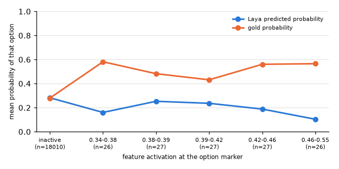

# Feature 10524

Critérios em que aparece: corr_probe_right_laya_wrong_stratified

**Interpretação (preencher):** 

---

## Maiores ativações

**tr_customer_service_000069 / churn_risk** (score, customer_service) | ativação 16.031 em `estado` | opções ['0', '1', '2', '3'] | Laya: **1** [0.084, 0.648, 0.182, 0.086] | gabarito: **2**

```
<bos> score question: How likely is this customer to stop doing business with us because of this interaction?<eos>
▸ <mask> level 0: No sign of dissatisfaction.
▸ <mask> level 1: Mild frustration, but the relationship is intact.
▸ <mask> level 2: Clearly unhappy; repeat problems or explicit complaints.
▸ <mask> level 3: Imminent: threatening to cancel, dispute or leave.

<eos>

 {"account": {"lifetime_value_usd": 1693, "prior_tickets_90d": 0, "seats": 1, "tenure_months": 26, "tier": "free"}, "thread": [{"role": "customer", "text": "I'm trying to pull our team's records into a CSV for a client deliverable and the export just spins. We're on the free plan, this has been going on for days, and I need the file by Friday at 5 p.m. It's our 26th month on the platform, so it's surprising how broken basic export is."}, {"role": "agent", "text": "Thanks for letting me know where you're at. Could you tell me whether the export fails during the initial request, after selecting the date range, or when the download file is supposed to start?"}, {"role": "customer", "text": "It fails right after I click generate. No error, just the spinner. I've tried Chrome and Safari, and I've even cleared cookies. The client deadline doesn't move, so I need someone to actually look at this before Friday."}, {"role": "agent", "text": "I understand the timing is tight. To help narrow it down, can you share the approximate number of records you're trying to export and whether you're exporting all projects or a subset?"}, {"role": "customer", "text": "It's roughly the whole workspace, but I can't get past the spinner to confirm. If it'⟦s⟧ an account limit or a backend issue, I need that explained by tomorrow, because Friday is non-negotiable."}]}<eos>
```

**tr_customer_service_000069 / action** (choice, customer_service) | ativação 15.820 em `estado` | opções ['answer_directly', 'close_no_action', 'escalate_to_human', 'execute_refund', 'request_information'] | Laya: **close_no_action** [0.008, 0.963, 0.02, 0.005, 0.003] | gabarito: **escalate_to_human**

```
<bos> choice question: What should the assistant do next with this conversation?<eos>
▸ <mask> answer_directly: The assistant can resolve this itself with information it already has.
▸ <mask> close_no_action: No further action is warranted; the matter is settled.
▸ <mask> escalate_to_human: Hand off to a human agent with the appropriate authority.
▸ <mask> execute_refund: Issue the refund or credit the customer is owed.
▸ <mask> request_information: More detail is needed from the customer before anything can be done.

<eos>

 {"account": {"lifetime_value_usd": 1693, "prior_tickets_90d": 0, "seats": 1, "tenure_months": 26, "tier": "free"}, "thread": [{"role": "customer", "text": "I'm trying to pull our team's records into a CSV for a client deliverable and the export just spins. We're on the free plan, this has been going on for days, and I need the file by Friday at 5 p.m. It's our 26th month on the platform, so it's surprising how broken basic export is."}, {"role": "agent", "text": "Thanks for letting me know where you're at. Could you tell me whether the export fails during the initial request, after selecting the date range, or when the download file is supposed to start?"}, {"role": "customer", "text": "It fails right after I click generate. No error, just the spinner. I've tried Chrome and Safari, and I've even cleared cookies. The client deadline doesn't move, so I need someone to actually look at this before Friday."}, {"role": "agent", "text": "I understand the timing is tight. To help narrow it down, can you share the approximate number of records you're trying to export and whether you're exporting all projects or a subset?"}, {"role": "customer", "text": "It's roughly the whole workspace, but I can't get past the spinner to confirm. If it'⟦s⟧ an account limit or a backend issue, I need that explained by tomorrow, because Friday is non-negotiable."}]}<eos>
```

**tr_customer_service_000200 / needs_human** (noul, customer_service) | ativação 15.805 em `estado` | opções ['false', 'true'] | Laya: **false** [0.926, 0.074] | gabarito: **false**

```
<bos> noul question: This conversation requires a human agent rather than automated handling.<eos>
▸ <mask> false: Automation can carry this to resolution.
▸ <mask> true: A human must take over: judgement, authority or empathy is required.

<eos>

 {"account": {"lifetime_value_usd": 1072, "prior_tickets_90d": 0, "seats": 12, "tenure_months": 41, "tier": "premium"}, "orders": [{"amount_usd": 29, "date": "2026-03-18", "id": "A-98366", "status": "refunded"}, {"amount_usd": 29, "date": "2026-03-25", "id": "A-11332", "status": "settled"}, {"amount_usd": 29, "date": "2026-03-18", "id": "A-35045", "status": "failed"}], "thread": [{"role": "customer", "text": "I can't believe you just charged me $29 this month! I've been on the premium plan for over three years and never saw this price before. This is unacceptable!"}, {"role": "agent", "text": "I’m sorry you’re seeing an unexpected charge. Could you confirm the email address linked to your account so I can look into the billing details?"}, {"role": "customer", "text": "Fine. It’s john.doe@example.com. I’ve been paying the same amount for 41 months, and now this random jump appears on my statement. I need an explanation, not a generic apology."}, {"role": "agent", "text": "Thank you for confirming. I’ll pull up the recent invoices. Just to be sure, are you referring to the $29.00 charge labeled as “Premium Plan Renewal” on your latest bill?"}, {"role": "customer", "text": "Yes, that’⟦s⟧ the one. I want to know why it’s higher now and what I’m supposed to do about it. Please tell me what’s going on."}]}<eos>
```

**tr_customer_service_000069 / urgency** (score, customer_service) | ativação 15.805 em `estado` | opções ['0', '1', '2', '3'] | Laya: **1** [0.228, 0.465, 0.152, 0.154] | gabarito: **2**

```
<bos> score question: How time-sensitive is this conversation?<eos>
▸ <mask> level 0: No time pressure; can wait indefinitely.
▸ <mask> level 1: Routine; handle within the normal queue.
▸ <mask> level 2: Elevated; should be handled within the same week.
▸ <mask> level 3: Critical; requires action within the same day.

<eos>

 {"account": {"lifetime_value_usd": 1693, "prior_tickets_90d": 0, "seats": 1, "tenure_months": 26, "tier": "free"}, "thread": [{"role": "customer", "text": "I'm trying to pull our team's records into a CSV for a client deliverable and the export just spins. We're on the free plan, this has been going on for days, and I need the file by Friday at 5 p.m. It's our 26th month on the platform, so it's surprising how broken basic export is."}, {"role": "agent", "text": "Thanks for letting me know where you're at. Could you tell me whether the export fails during the initial request, after selecting the date range, or when the download file is supposed to start?"}, {"role": "customer", "text": "It fails right after I click generate. No error, just the spinner. I've tried Chrome and Safari, and I've even cleared cookies. The client deadline doesn't move, so I need someone to actually look at this before Friday."}, {"role": "agent", "text": "I understand the timing is tight. To help narrow it down, can you share the approximate number of records you're trying to export and whether you're exporting all projects or a subset?"}, {"role": "customer", "text": "It's roughly the whole workspace, but I can't get past the spinner to confirm. If it'⟦s⟧ an account limit or a backend issue, I need that explained by tomorrow, because Friday is non-negotiable."}]}<eos>
```

**tr_customer_service_000069 / needs_human** (noul, customer_service) | ativação 15.789 em `estado` | opções ['false', 'true'] | Laya: **false** [0.676, 0.324] | gabarito: **true**

```
<bos> noul question: This conversation requires a human agent rather than automated handling.<eos>
▸ <mask> false: Automation can carry this to resolution.
▸ <mask> true: A human must take over: judgement, authority or empathy is required.

<eos>

 {"account": {"lifetime_value_usd": 1693, "prior_tickets_90d": 0, "seats": 1, "tenure_months": 26, "tier": "free"}, "thread": [{"role": "customer", "text": "I'm trying to pull our team's records into a CSV for a client deliverable and the export just spins. We're on the free plan, this has been going on for days, and I need the file by Friday at 5 p.m. It's our 26th month on the platform, so it's surprising how broken basic export is."}, {"role": "agent", "text": "Thanks for letting me know where you're at. Could you tell me whether the export fails during the initial request, after selecting the date range, or when the download file is supposed to start?"}, {"role": "customer", "text": "It fails right after I click generate. No error, just the spinner. I've tried Chrome and Safari, and I've even cleared cookies. The client deadline doesn't move, so I need someone to actually look at this before Friday."}, {"role": "agent", "text": "I understand the timing is tight. To help narrow it down, can you share the approximate number of records you're trying to export and whether you're exporting all projects or a subset?"}, {"role": "customer", "text": "It's roughly the whole workspace, but I can't get past the spinner to confirm. If it'⟦s⟧ an account limit or a backend issue, I need that explained by tomorrow, because Friday is non-negotiable."}]}<eos>
```

## Ativações medianas (faixa 40-60%, mediana 5.551)

**tr_customer_service_000117 / category** (choice, customer_service) | ativação 6.105 em `opção` | opções ['account', 'billing', 'delivery', 'refund', 'technical'] | Laya: **billing** [0.001, 0.99, 0.0, 0.003, 0.005] | gabarito: **billing**

```
<bos> choice question: What is this customer conversation primarily about?<eos>
▸ <mask> account: Login, plan changes, profile or access management.
▸ <mask> billing: A charge, invoice, subscription or payment problem.
▸ <mask> delivery: Shipping, fulfilment or delivery of a physical item.
▸ <mask> refund: The customer is explicitly asking for money back.
▸ <mask> technical: The product or service⟦ is⟧ not working as expected.

<eos>

 {"account": {"lifetime_value_usd": 1573, "prior_tickets_90d": 0, "seats": 1, "tenure_months": 19, "tier": "free"}, "orders": [{"amount_usd": 9, "date": "2026-02-10", "id": "A-62171", "status": "pending"}, {"amount_usd": 9, "date": "2026-03-19", "id": "A-51808", "status": "failed"}, {"amount_usd": 9, "date": "2026-01-01", "id": "A-58951", "status": "failed"}], "thread": [{"role": "customer", "text": "I’m looking at a charge for $9 on my account. I’ve been using the free plan for over a year and a half, so why am I being billed now? I'm ready to delete my account if this isn't fixed immediately."}, {"role": "agent", "text": "I understand this is unexpected. To help me investigate your account status, could you confirm the email address associated with your subscription?"}, {"role": "customer", "text": "It’s linked to my primary email. I’ve been a loyal user for 19 months, but this feels like a total scam. Fix this or I'm gone."}, {"role": "agent", "text": "Thank you for confirming that. I am looking into your history now; could you clarify if you recently signed up for any trial features or promotional add-ons?"}, {"role": "customer", "text": "No, I haven't clicked on anything new! I just want this $9 charge removed and my account returned to the free status I've always had."}]}<eos>
```

**tr_customer_service_000034 / category** (choice, customer_service) | ativação 6.145 em `opção` | opções ['account', 'billing', 'delivery', 'refund', 'technical'] | Laya: **delivery** [0.0, 0.0, 0.997, 0.0, 0.002] | gabarito: **delivery**

```
<bos> choice question: What is this customer conversation primarily about?<eos>
▸ <mask> account: Login, plan changes, profile or access management.
▸ <mask> billing: A charge, invoice, subscription or payment problem.
▸ <mask> delivery: Shipping, fulfilment or delivery of a physical item.
▸ <mask> refund: The customer is explicitly asking for money back.
▸ <mask> technical: The product or service⟦ is⟧ not working as expected.

<eos>

 {"account": {"lifetime_value_usd": 102, "prior_tickets_90d": 1, "seats": 1, "tenure_months": 2, "tier": "standard"}, "thread": [{"role": "customer", "text": "I just opened my delivery and the item is in pieces, but the shipping box looks totally fine? I don't understand how this happened. I have a hard deadline for a project this Friday and if this isn't resolved by then, I'm closing my account and going to a competitor."}, {"role": "agent", "text": "I'm sorry to hear that your item arrived damaged. Could you please provide a few more details about the state of the internal protective packaging when you first opened it?"}, {"role": "customer", "text": "The bubble wrap was there but it clearly didn't do anything. I've only been with you for two months and my first ticket about the setup is still unresolved; I really can't afford to wait past Friday for a solution on this."}]}<eos>
```

**tr_customer_service_000086 / needs_human** (noul, customer_service) | ativação 5.363 em `opção` | opções ['false', 'true'] | Laya: **true** [0.15, 0.85] | gabarito: **false**

```
<bos> noul question: This conversation requires a human agent rather than automated handling.<eos>
▸ <mask> false: Automation can carry this to resolution.
▸ <mask> true: A human must take over: judgement, authority or empathy⟦ is⟧ required.

<eos>

 {"account": {"lifetime_value_usd": 1071, "prior_tickets_90d": 2, "seats": 1, "tenure_months": 19, "tier": "standard"}, "thread": [{"role": "customer", "text": "I just got a bill that’s higher than what I expected, and I don’t understand why the charge jumped. Can someone explain what’s going on? I need this cleared up by tomorrow."}, {"role": "agent", "text": "I’m sorry for the surprise. Could you tell me the date and amount shown on the statement so I can compare it to your plan details?"}, {"role": "customer", "text": "It’s the charge dated 9/14 and I need to know if this is a mistake or a new fee before the end of the day."}]}<eos>
```

**tr_invoice_processing_000100 / urgency** (score, invoice_processing) | ativação 5.895 em `pergunta` | opções ['0', '1', '2', '3'] | Laya: **1** [0.116, 0.358, 0.321, 0.204] | gabarito: **2**

```
<bos> score question: How time-sensitive⟦ is⟧ processing this invoice?<eos>
▸ <mask> level 0: No time pressure; can wait indefinitely.
▸ <mask> level 1: Routine; handle within the normal queue.
▸ <mask> level 2: Elevated; should be handled within the same week.
▸ <mask> level 3: Critical; requires action within the same day.

<eos>

 {"delivery": {"condition": "accepted", "date": "2026-03-06", "received_qty": 25}, "invoice": {"currency": "USD", "id": "INV-2026-3933", "lines": [{"qty": 25, "sku": "SKU-346", "total_usd": 5973.25, "unit_usd": 238.93}], "total_usd": 5973.25, "vendor": "Acme Fabrication"}, "payment": {"days_until_due": 44, "discount_expires_in_days": 3, "early_payment_discount_pct": 2.0, "status": "scheduled", "terms": "net 30"}, "purchase_order": {"freight_terms": "freight prepaid by vendor, not separately billable", "id": null, "lines": [{"qty": 25, "unit_usd": 238.93}], "total_usd": 5973.25}, "vendor_history": {"disputes_12m": 1, "invoices_12m": 6, "prior_invoice_ids": ["INV-2026-7649"]}}<eos>
```

**tr_customer_service_000207 / churn_risk** (score, customer_service) | ativação 5.578 em `estado` | opções ['0', '1', '2', '3'] | Laya: **1** [0.145, 0.553, 0.174, 0.127] | gabarito: **2**

```
<bos> score question: How likely is this customer to stop doing business with us because of this interaction?<eos>
▸ <mask> level 0: No sign of dissatisfaction.
▸ <mask> level 1: Mild frustration, but the relationship is intact.
▸ <mask> level 2: Clearly unhappy; repeat problems or explicit complaints.
▸ <mask> level 3: Imminent: threatening to cancel, dispute or leave.

<eos>

 {"account": {"lifetime_value_usd": 17, "prior_tickets_90d": 0, "seats": 1, "tenure_months": 1, "tier": "premium"}, "orders": [{"amount_usd": 149, "date": "2026-01-08", "id": "A-46380", "status": "settled"}], "thread": [{"role": "customer", "text": "I thought I could switch to the Basic plan, but my account still shows I'm on Premium and I'⟦m⟧ being charged $149. I'm not sure what's happening."}, {"role": "agent", "text": "I’m sorry for the mix‑up. Just to double‑check, could you tell me the email address linked to your account and when you tried to make the change?"}, {"role": "customer", "text": "The email is jane.doe@example.com. I clicked the downgrade button in the dashboard yesterday evening, after being on Premium for a month."}, {"role": "agent", "text": "Got it, thank you. I see the downgrade request in the system, but it looks like the change didn’t finish processing. Have you received any confirmation email about the downgrade?"}, {"role": "customer", "text": "No, I didn’t get any email. The dashboard still says Premium, and my next payment of $149 is scheduled for tomorrow."}, {"role": "agent", "text": "Understood. I’ll look into why the request got stuck. Could you let me know if you made the change from a mobile app or the web portal?"}, {"role": "customer", "text": "I used the web portal on Chrome. I’m just hoping this can be sorted before the next charge hits."}]}<eos>
```

## Estatísticas (conjunto de descoberta, dev e teste)

**pred / error**

| split | decisões | ativas | ativas e Laya errou | taxa | lift | q (BH) | OR (CMH) | q (CMH) |
|---|---|---|---|---|---|---|---|---|
| discovery | 5100 | 10 | 5 | 0.500 | 0.78 | nan | nan | nan |
| dev | 900 | 1 | 1 | 1.000 | 1.49 | nan | nan | nan |
| test | 2000 | 4 | 1 | 0.250 | 0.38 | nan | nan | nan |

**corr / error**

| split | decisões | ativas | ativas e Laya errou | taxa | lift | q (BH) | OR (CMH) | q (CMH) |
|---|---|---|---|---|---|---|---|---|
| discovery | 5100 | 66 | 61 | 0.924 | 1.44 | 5.17e-07 | 5.63 | 0.00423 |
| dev | 900 | 8 | 8 | 1.000 | 1.49 | nan | nan | nan |
| test | 2000 | 19 | 16 | 0.842 | 1.29 | nan | nan | nan |

**state / error**

| split | decisões | ativas | ativas e Laya errou | taxa | lift | q (BH) | OR (CMH) | q (CMH) |
|---|---|---|---|---|---|---|---|---|
| discovery | 5100 | 3205 | 1933 | 0.603 | 0.94 | 1.49e-13 | 1.00 | 0.988 |
| dev | 900 | 558 | 361 | 0.647 | 0.96 | 0.277 | 1.32 | 0.522 |
| test | 2000 | 1309 | 802 | 0.613 | 0.94 | 0.000309 | 0.85 | 0.62 |

**pred / probe_right_laya_wrong**

| split | decisões | ativas | ativas e Laya errou | taxa | lift | q (BH) | OR (CMH) | q (CMH) |
|---|---|---|---|---|---|---|---|---|
| discovery | 2819 | 7 | 4 | 0.571 | 0.88 | nan | nan | nan |
| dev | 520 | 1 | 1 | 1.000 | 1.48 | nan | nan | nan |
| test | 1106 | 2 | 1 | 0.500 | 0.79 | nan | nan | nan |

**corr / probe_right_laya_wrong**

| split | decisões | ativas | ativas e Laya errou | taxa | lift | q (BH) | OR (CMH) | q (CMH) |
|---|---|---|---|---|---|---|---|---|
| discovery | 2819 | 45 | 42 | 0.933 | 1.44 | 2.51e-05 | 6.47 | 0.0406 |
| dev | 520 | 8 | 8 | 1.000 | 1.48 | nan | nan | nan |
| test | 1106 | 9 | 8 | 0.889 | 1.40 | nan | nan | nan |

**state / probe_right_laya_wrong**

| split | decisões | ativas | ativas e Laya errou | taxa | lift | q (BH) | OR (CMH) | q (CMH) |
|---|---|---|---|---|---|---|---|---|
| discovery | 2819 | 1817 | 1072 | 0.590 | 0.91 | 4.42e-16 | 1.34 | 0.0572 |
| dev | 520 | 323 | 206 | 0.638 | 0.94 | 0.19 | 1.79 | 0.147 |
| test | 1106 | 754 | 432 | 0.573 | 0.91 | 1.13e-06 | 1.08 | 0.864 |

Confusão mais sobre-representada (pred): `needs_review|1>0` (n=5, lift 87.93, p=nan). Formato `pergunta|índice previsto>índice correto`.

Confusão mais sobre-representada (corr): `needs_review|0>1` (n=60, lift 44.16, p=0). Formato `pergunta|índice previsto>índice correto`.

Confusão mais sobre-representada (state): `action|1>2` (n=71, lift 1.59, p=3.55e-15). Formato `pergunta|índice previsto>índice correto`.



