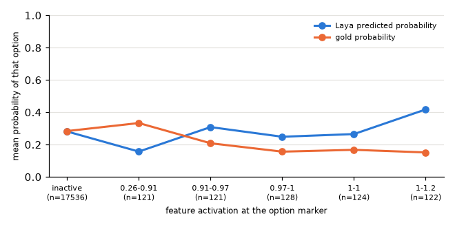

# Feature 10537

Critérios em que aparece: attribution_toward_wrong

**Interpretação (preencher):** 

---

## Maiores ativações

**tr_security_incidents_000154 / credential_compromise** (noul, security_incidents) | ativação 2.676 em `estado` | opções ['false', 'true'] | Laya: **true** [0.061, 0.939] | gabarito: **false**

```
<bos> noul question: The evidence indicates a credential or account has been compromised.<eos>
▸ <mask> false: no, the statement does not hold
▸ <mask> true: yes, the statement holds

<eos>

 {"alert": {"description": "audit logging was turned off on a host", "evidence": "Audit logging services were terminated on host⟦ SR⟧V-LRN-09 at 14:22 UTC while a valid change window was active. This action was initiated by a shared mailbox account accessing the system from an unrecognized source address.", "rule": "disabled_logging"}, "context": {"asset_criticality": "low", "change_window_active": true, "source_on_allowlist": false}, "history": {"credential_rotation_days_ago": 3, "distinct_countries_30d": 2, "logins_30d": 1152, "prior_alerts_90d": 0}, "principal": {"mfa_enrolled": true, "name": "ci-analytics-263", "privileges": ["repo:read"], "type": "shared_mailbox"}}<eos>
```

**tr_security_incidents_000154 / severity** (score, security_incidents) | ativação 2.482 em `estado` | opções ['0', '1', '2', '3', '4'] | Laya: **1** [0.169, 0.27, 0.18, 0.169, 0.211] | gabarito: **1**

```
<bos> score question: How severe is the potential impact if this alert is real?<eos>
▸ <mask> level 0: Negligible: no access to anything sensitive.
▸ <mask> level 1: Low: limited access, easily reversed.
▸ <mask> level 2: Moderate: access to internal systems or non-public data.
▸ <mask> level 3: High: access to production, secrets or customer data.
▸ <mask> level 4: Critical: active compromise of crown-jewel systems.

<eos>

 {"alert": {"description": "audit logging was turned off on a host", "evidence": "Audit logging services were terminated on host⟦ SR⟧V-LRN-09 at 14:22 UTC while a valid change window was active. This action was initiated by a shared mailbox account accessing the system from an unrecognized source address.", "rule": "disabled_logging"}, "context": {"asset_criticality": "low", "change_window_active": true, "source_on_allowlist": false}, "history": {"credential_rotation_days_ago": 3, "distinct_countries_30d": 2, "logins_30d": 1152, "prior_alerts_90d": 0}, "principal": {"mfa_enrolled": true, "name": "ci-analytics-263", "privileges": ["repo:read"], "type": "shared_mailbox"}}<eos>
```

**tr_security_incidents_000154 / true_positive** (noul, security_incidents) | ativação 2.480 em `estado` | opções ['false', 'true'] | Laya: **true** [0.083, 0.917] | gabarito: **true**

```
<bos> noul question: This alert reflects genuinely malicious or unauthorised activity.<eos>
▸ <mask> false: Benign activity, a misconfiguration, or a known false positive.
▸ <mask> true: The underlying behaviour is malicious or unauthorised.

<eos>

 {"alert": {"description": "audit logging was turned off on a host", "evidence": "Audit logging services were terminated on host⟦ SR⟧V-LRN-09 at 14:22 UTC while a valid change window was active. This action was initiated by a shared mailbox account accessing the system from an unrecognized source address.", "rule": "disabled_logging"}, "context": {"asset_criticality": "low", "change_window_active": true, "source_on_allowlist": false}, "history": {"credential_rotation_days_ago": 3, "distinct_countries_30d": 2, "logins_30d": 1152, "prior_alerts_90d": 0}, "principal": {"mfa_enrolled": true, "name": "ci-analytics-263", "privileges": ["repo:read"], "type": "shared_mailbox"}}<eos>
```

**tr_security_incidents_000154 / disposition** (choice, security_incidents) | ativação 2.471 em `estado` | opções ['close_benign', 'contain', 'investigate', 'monitor'] | Laya: **close_benign** [0.492, 0.122, 0.087, 0.298] | gabarito: **investigate**

```
<bos> choice question: How should this security alert be dispositioned?<eos>
▸ <mask> close_benign: Expected, explainable activity; close without analyst time.
▸ <mask> contain: Contain the host or account immediately; do not wait for triage.
▸ <mask> investigate: Warrants an analyst opening an investigation.
▸ <mask> monitor: Not clearly malicious, but worth watching for recurrence.

<eos>

 {"alert": {"description": "audit logging was turned off on a host", "evidence": "Audit logging services were terminated on host⟦ SR⟧V-LRN-09 at 14:22 UTC while a valid change window was active. This action was initiated by a shared mailbox account accessing the system from an unrecognized source address.", "rule": "disabled_logging"}, "context": {"asset_criticality": "low", "change_window_active": true, "source_on_allowlist": false}, "history": {"credential_rotation_days_ago": 3, "distinct_countries_30d": 2, "logins_30d": 1152, "prior_alerts_90d": 0}, "principal": {"mfa_enrolled": true, "name": "ci-analytics-263", "privileges": ["repo:read"], "type": "shared_mailbox"}}<eos>
```

**tr_security_incidents_000107 / disposition** (choice, security_incidents) | ativação 2.416 em `estado` | opções ['close_benign', 'contain', 'investigate', 'monitor'] | Laya: **investigate** [0.008, 0.02, 0.635, 0.338] | gabarito: **investigate**

```
<bos> choice question: How should this security alert be dispositioned?<eos>
▸ <mask> close_benign: Expected, explainable activity; close without analyst time.
▸ <mask> contain: Contain the host or account immediately; do not wait for triage.
▸ <mask> investigate: Warrants an analyst opening an investigation.
▸ <mask> monitor: Not clearly malicious, but worth watching for recurrence.

<eos>

 {"alert": {"description": "an endpoint agent matched a known signature", "evidence": "The privileged service account 'svc-prod-sync' triggered a malware signature match on host⟦ SR⟧V-DB-01 at 22:10 UTC. This detection occurred outside of any active change window while MFA was disabled for the principal. The source address is currently on the allowlist, and the account credentials were last rotated 14 days ago.", "rule": "malware_signature"}, "context": {"asset_criticality": "medium", "change_window_active": false, "source_on_allowlist": true}, "history": {"credential_rotation_days_ago": 14, "distinct_countries_30d": 1, "logins_30d": 778, "prior_alerts_90d": 0}, "principal": {"mfa_enrolled": false, "name": "usr-billing-280", "privileges": ["deploy:production", "secrets:read"], "type": "service_account"}}<eos>
```

## Ativações medianas (faixa 40-60%, mediana 0.974)

**tr_customer_service_000059 / category** (choice, customer_service) | ativação 0.963 em `marcador` | opções ['account', 'billing', 'delivery', 'refund', 'technical'] | Laya: **account** [0.821, 0.003, 0.001, 0.119, 0.056] | gabarito: **account**

```
<bos> choice question: What is this customer conversation primarily about?<eos>
▸ <mask> account: Login, plan changes, profile or access management.
▸ <mask> billing: A charge, invoice, subscription or payment problem.
▸ ⟦<mask>⟧ delivery: Shipping, fulfilment or delivery of a physical item.
▸ <mask> refund: The customer is explicitly asking for money back.
▸ <mask> technical: The product or service is not working as expected.

<eos>

 {"account": {"lifetime_value_usd": 169, "prior_tickets_90d": 3, "seats": 1, "tenure_months": 5, "tier": "enterprise"}, "thread": [{"role": "customer", "text": "I need my account cancelled immediately; this can’t wait any longer."}, {"role": "agent", "text": "I understand. May I ask the reason you’re choosing to cancel?"}, {"role": "customer", "text": "I’ve dealt with the same problems over and over despite three prior tickets being closed; I want confirmation that the account will be terminated."}, {"role": "agent", "text": "Got it. Could you provide the email address associated with the account so I can verify your request?"}, {"role": "customer", "text": "myname@example.com – please proceed right away."}]}<eos>
```

**tr_security_incidents_000116 / disposition** (choice, security_incidents) | ativação 0.963 em `marcador` | opções ['close_benign', 'contain', 'investigate', 'monitor'] | Laya: **monitor** [0.11, 0.091, 0.063, 0.736] | gabarito: **investigate**

```
<bos> choice question: How should this security alert be dispositioned?<eos>
▸ <mask> close_benign: Expected, explainable activity; close without analyst time.
▸ <mask> contain: Contain the host or account immediately; do not wait for triage.
▸ <mask> investigate: Warrants an analyst opening an investigation.
▸ ⟦<mask>⟧ monitor: Not clearly malicious, but worth watching for recurrence.

<eos>

 {"alert": {"description": "a large transfer to an external destination", "evidence": "Between 2026-09-16 04:55:12 UTC and 04:57:03 UTC an admin account transferred 4.2 GB of data to external endpoint 185.53.177.22 over HTTPS (port 443) using the rsync process. The transfer occurred while a change window was open, the source host is unrecognised, and the admin’s credentials have not been rotated for 700 days.", "rule": "data_egress"}, "context": {"asset_criticality": "high", "change_window_active": true, "source_on_allowlist": false}, "history": {"credential_rotation_days_ago": 700, "distinct_countries_30d": 3, "logins_30d": 690, "prior_alerts_90d": 8}, "principal": {"mfa_enrolled": true, "name": "ci-infra-262", "privileges": ["repo:read"], "type": "admin"}}<eos>
```

**tr_customer_service_000222 / category** (choice, customer_service) | ativação 0.968 em `marcador` | opções ['account', 'billing', 'delivery', 'refund', 'technical'] | Laya: **account** [0.939, 0.001, 0.001, 0.057, 0.003] | gabarito: **account**

```
<bos> choice question: What is this customer conversation primarily about?<eos>
▸ <mask> account: Login, plan changes, profile or access management.
▸ <mask> billing: A charge, invoice, subscription or payment problem.
▸ ⟦<mask>⟧ delivery: Shipping, fulfilment or delivery of a physical item.
▸ <mask> refund: The customer is explicitly asking for money back.
▸ <mask> technical: The product or service is not working as expected.

<eos>

 {"account": {"lifetime_value_usd": 3359, "prior_tickets_90d": 1, "seats": 12, "tenure_months": 41, "tier": "enterprise"}, "thread": [{"role": "customer", "text": "I am writing to request an immediate downgrade of my enterprise plan. Given that my previous request for service improvements was ignored, I am finding it difficult to justify continuing our partnership and may be forced to take my business elsewhere if this is not addressed promptly."}]}<eos>
```

**tr_customer_service_000238 / category** (choice, customer_service) | ativação 0.987 em `marcador` | opções ['account', 'billing', 'delivery', 'refund', 'technical'] | Laya: **technical** [0.011, 0.01, 0.001, 0.001, 0.977] | gabarito: **technical**

```
<bos> choice question: What is this customer conversation primarily about?<eos>
▸ <mask> account: Login, plan changes, profile or access management.
▸ <mask> billing: A charge, invoice, subscription or payment problem.
▸ ⟦<mask>⟧ delivery: Shipping, fulfilment or delivery of a physical item.
▸ <mask> refund: The customer is explicitly asking for money back.
▸ <mask> technical: The product or service is not working as expected.

<eos>

 {"account": {"lifetime_value_usd": 699, "prior_tickets_90d": 0, "seats": 12, "tenure_months": 19, "tier": "premium"}, "orders": [{"amount_usd": 49, "date": "2026-02-27", "id": "A-61611", "status": "failed"}, {"amount_usd": 49, "date": "2026-03-13", "id": "A-63348", "status": "settled"}], "thread": [{"role": "customer", "text": "The dashboard has been taking nearly two minutes to load every morning this week. I have a presentation at noon, but I suppose it’s just how things are now."}, {"role": "agent", "text": "I understand how frustrating that latency must be. To help me investigate, could you tell me if you are experiencing this slow-down on a specific browser or connection?"}, {"role": "customer", "text": "It’s the same on Chrome and Firefox, regardless of my network. I’ve been paying for the premium tier for a long time, but it doesn't seem to make much of a difference."}]}<eos>
```

**tr_security_incidents_000268 / disposition** (choice, security_incidents) | ativação 0.981 em `marcador` | opções ['close_benign', 'contain', 'investigate', 'monitor'] | Laya: **monitor** [0.3, 0.077, 0.105, 0.518] | gabarito: **investigate**

```
<bos> choice question: How should this security alert be dispositioned?<eos>
▸ <mask> close_benign: Expected, explainable activity; close without analyst time.
▸ <mask> contain: Contain the host or account immediately; do not wait for triage.
▸ <mask> investigate: Warrants an analyst opening an investigation.
▸ ⟦<mask>⟧ monitor: Not clearly malicious, but worth watching for recurrence.

<eos>

 {"alert": {"description": "audit logging was turned off on a host", "evidence": "Audit logging was disabled on host 10.0.5.7 at 2026-09-16 03:07:55 UTC. The change was issued by CI runner account \"gitlab-runner-23\", which has no privileged rights, with MFA enabled; the runner’s credentials were last rotated on 2026-09-13, and the originating source host was not recognized.", "rule": "disabled_logging"}, "context": {"asset_criticality": "medium", "change_window_active": false, "source_on_allowlist": false}, "history": {"credential_rotation_days_ago": 3, "distinct_countries_30d": 1, "logins_30d": 370, "prior_alerts_90d": 3}, "principal": {"mfa_enrolled": true, "name": "adm-support-681", "privileges": ["repo:read"], "type": "ci_runner"}}<eos>
```

## Estatísticas (conjunto de descoberta, dev e teste)

**pred / error**

| split | decisões | ativas | ativas e Laya errou | taxa | lift | q (BH) | OR (CMH) | q (CMH) |
|---|---|---|---|---|---|---|---|---|
| discovery | 5100 | 222 | 172 | 0.775 | 1.20 | 6.12e-05 | 0.49 | 0.507 |
| dev | 900 | 40 | 33 | 0.825 | 1.23 | 0.094 | 0.00 | 0.729 |
| test | 2000 | 86 | 67 | 0.779 | 1.20 | 0.0215 | 1.16 | 0.964 |

**corr / error**

| split | decisões | ativas | ativas e Laya errou | taxa | lift | q (BH) | OR (CMH) | q (CMH) |
|---|---|---|---|---|---|---|---|---|
| discovery | 5100 | 104 | 54 | 0.519 | 0.81 | 0.0157 | 0.59 | 0.491 |
| dev | 900 | 15 | 8 | 0.533 | 0.79 | nan | nan | nan |
| test | 2000 | 39 | 20 | 0.513 | 0.79 | 0.135 | 1.52 | 0.904 |

**state / error**

| split | decisões | ativas | ativas e Laya errou | taxa | lift | q (BH) | OR (CMH) | q (CMH) |
|---|---|---|---|---|---|---|---|---|
| discovery | 5100 | 72 | 42 | 0.583 | 0.91 | 0.518 | 0.94 | 0.95 |
| dev | 900 | 5 | 5 | 1.000 | 1.49 | nan | nan | nan |
| test | 2000 | 17 | 11 | 0.647 | 0.99 | nan | nan | nan |

**pred / probe_right_laya_wrong**

| split | decisões | ativas | ativas e Laya errou | taxa | lift | q (BH) | OR (CMH) | q (CMH) |
|---|---|---|---|---|---|---|---|---|
| discovery | 2819 | 157 | 130 | 0.828 | 1.28 | 1.22e-06 | nan | nan |
| dev | 520 | 29 | 23 | 0.793 | 1.17 | 0.344 | nan | nan |
| test | 1106 | 65 | 52 | 0.800 | 1.26 | 0.00804 | 0.00 | 0.793 |

**corr / probe_right_laya_wrong**

| split | decisões | ativas | ativas e Laya errou | taxa | lift | q (BH) | OR (CMH) | q (CMH) |
|---|---|---|---|---|---|---|---|---|
| discovery | 2819 | 47 | 20 | 0.426 | 0.66 | 0.00425 | inf | 0.389 |
| dev | 520 | 10 | 4 | 0.400 | 0.59 | nan | nan | nan |
| test | 1106 | 16 | 3 | 0.188 | 0.30 | nan | nan | nan |

**state / probe_right_laya_wrong**

| split | decisões | ativas | ativas e Laya errou | taxa | lift | q (BH) | OR (CMH) | q (CMH) |
|---|---|---|---|---|---|---|---|---|
| discovery | 2819 | 42 | 23 | 0.548 | 0.85 | 0.358 | 1.01 | 0.989 |
| dev | 520 | 3 | 3 | 1.000 | 1.48 | nan | nan | nan |
| test | 1106 | 12 | 7 | 0.583 | 0.92 | nan | nan | nan |

Confusão mais sobre-representada (pred): `disposition|3>2` (n=133, lift 18.19, p=0). Formato `pergunta|índice previsto>índice correto`.

Confusão mais sobre-representada (corr): `disposition|0>2` (n=21, lift 17.76, p=7.02e-22). Formato `pergunta|índice previsto>índice correto`.

Confusão mais sobre-representada (state): `matches_order|1>0` (n=7, lift 4.17, p=0.00133). Formato `pergunta|índice previsto>índice correto`.



