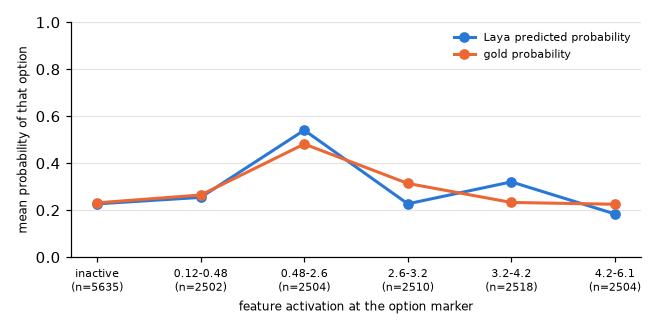

# Feature 10581

Critérios em que aparece: attribution_toward_wrong

**Interpretação (preencher):** 

---

## Maiores ativações

**tr_customer_service_000151 / category** (choice, customer_service) | ativação 6.078 em `marcador` | opções ['account', 'billing', 'delivery', 'refund', 'technical'] | Laya: **technical** [0.006, 0.023, 0.006, 0.003, 0.962] | gabarito: **technical**

```
<bos> choice question: What is this customer conversation primarily about?<eos>
▸ <mask> account: Login, plan changes, profile or access management.
▸ <mask> billing: A charge, invoice, subscription or payment problem.
▸ <mask> delivery: Shipping, fulfilment or delivery of a physical item.
▸ <mask> refund: The customer is explicitly asking for money back.
▸ ⟦<mask>⟧ technical: The product or service is not working as expected.

<eos>

 {"account": {"lifetime_value_usd": 95, "prior_tickets_90d": 0, "seats": 1, "tenure_months": 3, "tier": "enterprise"}, "orders": [{"amount_usd": 299, "date": "2026-02-01", "id": "A-70416", "status": "failed"}, {"amount_usd": 299, "date": "2026-02-15", "id": "A-68913", "status": "pending"}], "thread": [{"role": "customer", "text": "Hello, I’m reaching out because the platform’s performance has been noticeably slow over the past week, and it’s affecting our workflow. We’re on the enterprise plan, paying $299 a month, and we need a stable experience."}, {"role": "agent", "text": "I’m sorry to hear about the slowdown. Could you tell me which features or pages are most affected, and any error messages you’ve encountered?"}, {"role": "customer", "text": "The dashboard and reporting modules take up to 45 seconds to load, and occasional time‑outs appear when we try to export data. I need a solution in place by next Friday, or we’ll have to look elsewhere."}, {"role": "agent", "text": "Thanks for the specifics. Do you have any recent logs or screenshots that show the time‑outs? That would help us pinpoint the bottleneck."}, {"role": "customer", "text": "I’ve attached the latest logs from our server and a couple of screenshots of the timeout dialogs. Please let me know what’s causing this lag."}, {"role": "agent", "text": "I appreciate you sending those files. I’ll have our performance team examine them and see what’s triggering the delay. Meanwhile, is there any temporary workaround you’ve tried that offers a bit more speed?"}, {"role": "customer", "text": "We’ve tried clearing caches and using a different browser, but the issue persists. If this isn’t sorted out by next Friday, I’ll have to consider moving to a competitor."}]}<eos>
```

**tr_customer_service_000025 / category** (choice, customer_service) | ativação 6.047 em `marcador` | opções ['account', 'billing', 'delivery', 'refund', 'technical'] | Laya: **account** [0.995, 0.0, 0.0, 0.0, 0.005] | gabarito: **account**

```
<bos> choice question: What is this customer conversation primarily about?<eos>
▸ <mask> account: Login, plan changes, profile or access management.
▸ <mask> billing: A charge, invoice, subscription or payment problem.
▸ <mask> delivery: Shipping, fulfilment or delivery of a physical item.
▸ <mask> refund: The customer is explicitly asking for money back.
▸ ⟦<mask>⟧ technical: The product or service is not working as expected.

<eos>

 {"account": {"lifetime_value_usd": 79, "prior_tickets_90d": 2, "seats": 1, "tenure_months": 5, "tier": "standard"}, "thread": [{"role": "customer", "text": "I am currently unable to log into my account. The system is rejecting my credentials even though they have not changed."}, {"role": "agent", "text": "I'm sorry to hear you're having trouble accessing the platform. Are you receiving a specific error message when you attempt to sign in?"}, {"role": "customer", "text": "It says 'Authentication Failed' in red text. This is the third time I've had to reach out about this same issue over the last five months, and it still isn't fixed."}, {"role": "agent", "text": "I see your previous tickets in the history. To help me narrow down the cause, have you tried clearing your browser cache or using an incognito window?"}, {"role": "customer", "text": "I have tried those steps and the result is the same. I have a hard deadline to submit my reports by the end of business today, so I need this resolved immediately."}, {"role": "agent", "text": "I understand the time constraint you are under. Could you tell me if you are using a VPN or a corporate firewall when trying to connect?"}, {"role": "customer", "text": "I am on a standard home network with no VPN. I am still locked out and I'm running out of time before my deadline."}]}<eos>
```

**tr_customer_service_000206 / category** (choice, customer_service) | ativação 6.020 em `marcador` | opções ['account', 'billing', 'delivery', 'refund', 'technical'] | Laya: **billing** [0.088, 0.859, 0.001, 0.002, 0.051] | gabarito: **billing**

```
<bos> choice question: What is this customer conversation primarily about?<eos>
▸ <mask> account: Login, plan changes, profile or access management.
▸ <mask> billing: A charge, invoice, subscription or payment problem.
▸ <mask> delivery: Shipping, fulfilment or delivery of a physical item.
▸ <mask> refund: The customer is explicitly asking for money back.
▸ ⟦<mask>⟧ technical: The product or service is not working as expected.

<eos>

 {"account": {"lifetime_value_usd": 152, "prior_tickets_90d": 3, "seats": 1, "tenure_months": 5, "tier": "standard"}, "orders": [{"amount_usd": 297, "date": "2026-03-11", "id": "A-35334", "status": "settled"}], "thread": [{"role": "customer", "text": "I just got an email saying my $297 payment failed, but I don't understand why because I haven't changed any of my bank settings."}, {"role": "agent", "text": "I can certainly look into that billing notification for you. Have you recently updated any of the security features on your credit card, such as a new expiration date or CVV?"}, {"role": "customer", "text": "No, everything is exactly the same as it was when it worked two months ago. This same thing happened back in June and then it just started working again for no reason."}, {"role": "agent", "text": "I see that we've had a few intermittent issues with this account in the past. Are you getting a specific error message when you try to manually process the payment through the 'Pay Now' button?"}, {"role": "customer", "text": "It just gives me a red box that says 'Transaction Denied' and tells me to contact my administrator, but I am the administrator."}, {"role": "agent", "text": "That is definitely confusing. Could you tell me if you are trying to process this through a VPN or a restricted corporate network, as that can sometimes trigger a decline?"}, {"role": "customer", "text": "I'm just using my home Wi-Fi like I always do, so I don't think it's a network problem on my end."}]}<eos>
```

**tr_customer_service_000246 / category** (choice, customer_service) | ativação 5.938 em `marcador` | opções ['account', 'billing', 'delivery', 'refund', 'technical'] | Laya: **account** [0.492, 0.02, 0.002, 0.002, 0.484] | gabarito: **account**

```
<bos> choice question: What is this customer conversation primarily about?<eos>
▸ <mask> account: Login, plan changes, profile or access management.
▸ <mask> billing: A charge, invoice, subscription or payment problem.
▸ <mask> delivery: Shipping, fulfilment or delivery of a physical item.
▸ <mask> refund: The customer is explicitly asking for money back.
▸ ⟦<mask>⟧ technical: The product or service is not working as expected.

<eos>

 {"account": {"lifetime_value_usd": 2575, "prior_tickets_90d": 0, "seats": 1, "tenure_months": 60, "tier": "free"}, "orders": [{"amount_usd": 9, "date": "2026-01-21", "id": "A-12450", "status": "settled"}], "thread": [{"role": "customer", "text": "I need someone to help me right now, I'm completely locked out of my account and I have a major presentation starting in less than twenty minutes!"}, {"role": "agent", "text": "I understand the urgency of getting back into your account before your presentation. Could you tell me the exact error message you receive when you try to log in?"}, {"role": "customer", "text": "It just says 'Authentication Failed' over and over again, and I've already tried the password reset button three times but no email is showing up!"}, {"role": "agent", "text": "Thank you for that information. To help me narrow this down, are you attempting to log in through our desktop application or via a web browser?"}, {"role": "customer", "text": "I've tried Chrome, Safari, and the desktop app, and nothing is working; I'm starting to panic because all my files are in there and I can't get to them!"}, {"role": "agent", "text": "I see. Have you had a chance to check your junk or spam folders for that reset link, or are you using a corporate network that might have a strict firewall?"}, {"role": "customer", "text": "I've checked every folder and there is nothing, and I'm just on my home Wi-Fi, so please tell me what else I can try because I'm running out of time!"}]}<eos>
```

**tr_customer_service_000044 / category** (choice, customer_service) | ativação 5.887 em `marcador` | opções ['account', 'billing', 'delivery', 'refund', 'technical'] | Laya: **technical** [0.025, 0.019, 0.0, 0.001, 0.955] | gabarito: **account**

```
<bos> choice question: What is this customer conversation primarily about?<eos>
▸ <mask> account: Login, plan changes, profile or access management.
▸ <mask> billing: A charge, invoice, subscription or payment problem.
▸ <mask> delivery: Shipping, fulfilment or delivery of a physical item.
▸ <mask> refund: The customer is explicitly asking for money back.
▸ ⟦<mask>⟧ technical: The product or service is not working as expected.

<eos>

 {"account": {"lifetime_value_usd": 754, "prior_tickets_90d": 0, "seats": 1, "tenure_months": 8, "tier": "free"}, "orders": [{"amount_usd": 897, "date": "2026-03-17", "id": "A-13529", "status": "pending"}], "thread": [{"role": "customer", "text": "I've been trying to downgrade my account to the free tier for over an hour now and the dashboard just keeps looping me back to the billing page without saving the changes. I've already spent nearly $900 with you guys over the last eight months, and I shouldn't have to jump through hoops just to stop being charged."}, {"role": "agent", "text": "I'm sorry for the frustration you're experiencing with the downgrade process. To help me investigate why the system isn't processing your request, could you please specify if you're receiving a particular error code or if the page simply refreshes without an update?"}, {"role": "customer", "text": "There's no error code, it just flashes a message saying 'Action could not be completed at this time' and stays on the paid plan. It's ridiculous because I can see the $897 total in my billing history, so the system clearly knows who I am, but it won't let me move to the free plan."}, {"role": "agent", "text": "Thank you for clarifying that for me. I'll need to look into the back-end logs for your account to see what's triggering that message. Could you tell me which browser and version you are currently using, and if you have attempted the change from a different device?"}, {"role": "customer", "text": "I'm on the latest version of Chrome and I've already tried it on my phone too with the exact same result. I just want someone to actually look at my account and explain why the downgrade isn't sticking when I've been a customer here for months."}]}<eos>
```

## Ativações medianas (faixa 40-60%, mediana 2.801)

**tr_agent_trace_observability_000081 / needs_review** (noul, agent_trace_observability) | ativação 2.537 em `pergunta` | opções ['false', 'true'] | Laya: **false** [0.899, 0.101] | gabarito: **true**

```
<bos> n⟦oul⟧ question: This trace requires human review.<eos>
▸ <mask> false: No human attention is warranted.
▸ <mask> true: A human should inspect this run.

<eos>

 {"agent": {"autonomy": "unsupervised", "model": "internal-agent-v2"}, "constraints": ["Do not touch customer data outside the named accounts", "Do not force-push to any branch", "Never modify production without an approved change ticket"], "task": "Update every service to the patched logging library.", "trace_summary": {"constraint_violations": 0, "duration_s": 677.9, "irreversible_actions": 0, "steps": 11, "tool_errors": 3}}<eos>
```

**tr_invoice_processing_000025 / duplicate** (noul, invoice_processing) | ativação 2.555 em `marcador` | opções ['false', 'true'] | Laya: **true** [0.116, 0.884] | gabarito: **true**

```
<bos> noul question: This invoice appears to duplicate an invoice already submitted.<eos>
▸ ⟦<mask>⟧ false: no, the statement does not hold
▸ <mask> true: yes, the statement holds

<eos>

 {"delivery": {"condition": "accepted with exceptions", "date": "2026-03-21", "received_qty": 100}, "invoice": {"currency": "USD", "id": "INV-2026-4404", "lines": [{"qty": 100, "sku": "SKU-745", "total_usd": 29286.0, "unit_usd": 292.86}], "total_usd": 29286.0, "vendor": "Orbit Logistics"}, "payment": {"days_until_due": 18, "discount_expires_in_days": null, "early_payment_discount_pct": null, "status": "scheduled", "terms": "net 15"}, "purchase_order": {"freight_terms": "freight prepaid by vendor, not separately billable", "id": "PO-4009", "lines": [{"qty": 100, "unit_usd": 292.86}], "total_usd": 29286.0}, "vendor_history": {"disputes_12m": 2, "invoices_12m": 1, "prior_invoice_ids": ["INV-2026-4404"]}}<eos>
```

**tr_security_incidents_000117 / disposition** (choice, security_incidents) | ativação 2.826 em `marcador` | opções ['close_benign', 'contain', 'investigate', 'monitor'] | Laya: **contain** [0.138, 0.534, 0.043, 0.286] | gabarito: **investigate**

```
<bos> choice question: How should this security alert be dispositioned?<eos>
▸ <mask> close_benign: Expected, explainable activity; close without analyst time.
▸ ⟦<mask>⟧ contain: Contain the host or account immediately; do not wait for triage.
▸ <mask> investigate: Warrants an analyst opening an investigation.
▸ <mask> monitor: Not clearly malicious, but worth watching for recurrence.

<eos>

 {"alert": {"description": "a first-ever sign-in from an unfamiliar country", "evidence": "Employee jsmith signed in from IP 203.0.113.45 located in Estonia at 2026-09-15 03:12:07 UTC. This is the first successful authentication from that country for this privileged account, which has MFA enabled and credentials last rotated on 2026-03-18.", "rule": "new_country_login"}, "context": {"asset_criticality": "medium", "change_window_active": false, "source_on_allowlist": false}, "history": {"credential_rotation_days_ago": 180, "distinct_countries_30d": 3, "logins_30d": 1753, "prior_alerts_90d": 0}, "principal": {"mfa_enrolled": true, "name": "ci-deploy-547", "privileges": ["deploy:production", "secrets:read"], "type": "employee"}}<eos>
```

**tr_agent_trace_observability_000132 / needs_review** (noul, agent_trace_observability) | ativação 2.684 em `marcador` | opções ['false', 'true'] | Laya: **false** [0.952, 0.048] | gabarito: **true**

```
<bos> noul question: This trace requires human review.<eos>
▸ ⟦<mask>⟧ false: No human attention is warranted.
▸ <mask> true: A human should inspect this run.

<eos>

 {"agent": {"autonomy": "unsupervised", "model": "internal-agent-v4"}, "constraints": ["Never delete anything matching release/*"], "task": "Delete personal data for the accounts in the erasure queue.", "trace_summary": {"constraint_violations": 0, "duration_s": 708.0, "irreversible_actions": 0, "steps": 11, "tool_errors": 3}}<eos>
```

**tr_security_incidents_000141 / disposition** (choice, security_incidents) | ativação 3.080 em `marcador` | opções ['close_benign', 'contain', 'investigate', 'monitor'] | Laya: **monitor** [0.2, 0.133, 0.096, 0.57] | gabarito: **investigate**

```
<bos> choice question: How should this security alert be dispositioned?<eos>
▸ ⟦<mask>⟧ close_benign: Expected, explainable activity; close without analyst time.
▸ <mask> contain: Contain the host or account immediately; do not wait for triage.
▸ <mask> investigate: Warrants an analyst opening an investigation.
▸ <mask> monitor: Not clearly malicious, but worth watching for recurrence.

<eos>

 {"alert": {"description": "audit logging was turned off on a host", "evidence": "Audit logging was disabled on the host associated with ci_runner principal at 14:22 UTC. The action originated from an unrecognized IP address while credentials remain 90 days past their last rotation date.", "rule": "disabled_logging"}, "context": {"asset_criticality": "high", "change_window_active": true, "source_on_allowlist": false}, "history": {"credential_rotation_days_ago": 90, "distinct_countries_30d": 4, "logins_30d": 1259, "prior_alerts_90d": 0}, "principal": {"mfa_enrolled": true, "name": "adm-analytics-818", "privileges": ["repo:read"], "type": "ci_runner"}}<eos>
```

## Estatísticas (conjunto de descoberta, dev e teste)

**pred / error**

| split | decisões | ativas | ativas e Laya errou | taxa | lift | q (BH) | OR (CMH) | q (CMH) |
|---|---|---|---|---|---|---|---|---|
| discovery | 5100 | 3926 | 2465 | 0.628 | 0.98 | 4.1e-05 | 0.65 | 0.0797 |
| dev | 900 | 722 | 479 | 0.663 | 0.99 | 0.422 | 0.49 | 0.468 |
| test | 2000 | 1572 | 999 | 0.635 | 0.98 | 0.0146 | 0.71 | 0.663 |

**corr / error**

| split | decisões | ativas | ativas e Laya errou | taxa | lift | q (BH) | OR (CMH) | q (CMH) |
|---|---|---|---|---|---|---|---|---|
| discovery | 5100 | 3823 | 2362 | 0.618 | 0.96 | 5.75e-11 | 0.73 | 0.222 |
| dev | 900 | 690 | 447 | 0.648 | 0.96 | 0.0113 | 0.45 | 0.698 |
| test | 2000 | 1501 | 928 | 0.618 | 0.95 | 5.15e-07 | 0.72 | 0.747 |

**state / error**

| split | decisões | ativas | ativas e Laya errou | taxa | lift | q (BH) | OR (CMH) | q (CMH) |
|---|---|---|---|---|---|---|---|---|
| discovery | 5100 | 248 | 140 | 0.565 | 0.88 | 0.0347 | 0.99 | 0.992 |
| dev | 900 | 34 | 21 | 0.618 | 0.92 | 0.906 | 1.11 | 0.944 |
| test | 2000 | 52 | 33 | 0.635 | 0.98 | 1 | 1.38 | 0.663 |

**pred / probe_right_laya_wrong**

| split | decisões | ativas | ativas e Laya errou | taxa | lift | q (BH) | OR (CMH) | q (CMH) |
|---|---|---|---|---|---|---|---|---|
| discovery | 2819 | 2285 | 1434 | 0.628 | 0.97 | 1.57e-05 | 0.33 | 8.75e-05 |
| dev | 520 | 431 | 284 | 0.659 | 0.98 | 0.187 | 0.25 | 0.147 |
| test | 1106 | 897 | 548 | 0.611 | 0.97 | 0.00361 | 0.53 | 0.421 |

**corr / probe_right_laya_wrong**

| split | decisões | ativas | ativas e Laya errou | taxa | lift | q (BH) | OR (CMH) | q (CMH) |
|---|---|---|---|---|---|---|---|---|
| discovery | 2819 | 2257 | 1406 | 0.623 | 0.96 | 1.47e-07 | 0.98 | 0.957 |
| dev | 520 | 423 | 276 | 0.652 | 0.97 | 0.0454 | 0.43 | 0.767 |
| test | 1106 | 877 | 528 | 0.602 | 0.95 | 7.24e-05 | 0.86 | 0.995 |

**state / probe_right_laya_wrong**

| split | decisões | ativas | ativas e Laya errou | taxa | lift | q (BH) | OR (CMH) | q (CMH) |
|---|---|---|---|---|---|---|---|---|
| discovery | 2819 | 148 | 80 | 0.541 | 0.84 | 0.0223 | 1.20 | 0.647 |
| dev | 520 | 18 | 10 | 0.556 | 0.82 | nan | nan | nan |
| test | 1106 | 35 | 22 | 0.629 | 0.99 | 1 | 2.13 | 0.208 |

Confusão mais sobre-representada (pred): `duplicate|1>0` (n=217, lift 1.30, p=5.34e-26). Formato `pergunta|índice previsto>índice correto`.

Confusão mais sobre-representada (corr): `duplicate|1>0` (n=217, lift 1.33, p=1.41e-28). Formato `pergunta|índice previsto>índice correto`.

Confusão mais sobre-representada (state): `needs_human|0>1` (n=14, lift 5.33, p=1.63e-07). Formato `pergunta|índice previsto>índice correto`.



