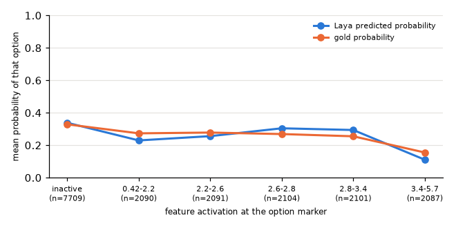

# Feature 10623

Critérios em que aparece: attribution_toward_correct

**Interpretação (preencher):** 

---

## Maiores ativações

**tr_customer_service_000243 / churn_risk** (score, customer_service) | ativação 5.738 em `marcador` | opções ['0', '1', '2', '3'] | Laya: **2** [0.028, 0.032, 0.906, 0.033] | gabarito: **2**

```
<bos> score question: How likely is this customer to stop doing business with us because of this interaction?<eos>
▸ ⟦<mask>⟧ level 0: No sign of dissatisfaction.
▸ <mask> level 1: Mild frustration, but the relationship is intact.
▸ <mask> level 2: Clearly unhappy; repeat problems or explicit complaints.
▸ <mask> level 3: Imminent: threatening to cancel, dispute or leave.

<eos>

 {"account": {"lifetime_value_usd": 2942, "prior_tickets_90d": 0, "seats": 1, "tenure_months": 49, "tier": "standard"}, "orders": [{"amount_usd": 299, "date": "2026-01-20", "id": "A-16271", "status": "pending"}], "thread": [{"role": "customer", "text": "Look, I've been using this service for over four years now and I have never seen it this slow. Every time I try to load a report, the screen just hangs for nearly a minute. It’s making it impossible to get through my daily tasks."}, {"role": "agent", "text": "I understand how frustrating it is when the system isn't responsive. To better assist you, are you noticing this lag on all pages of the dashboard or just when running specific reports?"}, {"role": "customer", "text": "It’s pretty much everywhere, but the billing section is particularly painful. I spent almost $300 this month and I can't even view my own data without a massive delay. I've already tried restarting my router and it didn't help one bit."}, {"role": "agent", "text": "Thank you for that information. Could you please let me know if you are using a VPN or any specific browser extensions that might be active while you're accessing the site?"}, {"role": "customer", "text": "No VPN, just standard Chrome. I've even tried incognito mode and the performance is still abysmal. What are the next steps to get this actually looked at?"}]}<eos>
```

**tr_customer_service_000283 / churn_risk** (score, customer_service) | ativação 5.656 em `marcador` | opções ['0', '1', '2', '3'] | Laya: **1** [0.042, 0.634, 0.291, 0.033] | gabarito: **3**

```
<bos> score question: How likely is this customer to stop doing business with us because of this interaction?<eos>
▸ ⟦<mask>⟧ level 0: No sign of dissatisfaction.
▸ <mask> level 1: Mild frustration, but the relationship is intact.
▸ <mask> level 2: Clearly unhappy; repeat problems or explicit complaints.
▸ <mask> level 3: Imminent: threatening to cancel, dispute or leave.

<eos>

 {"account": {"lifetime_value_usd": 4664, "prior_tickets_90d": 3, "seats": 1, "tenure_months": 60, "tier": "enterprise"}, "orders": [{"amount_usd": 299, "date": "2026-01-17", "id": "A-34538", "status": "settled"}, {"amount_usd": 299, "date": "2026-03-02", "id": "A-34919", "status": "settled"}, {"amount_usd": 299, "date": "2026-02-25", "id": "A-33586", "status": "settled"}], "thread": [{"role": "customer", "text": "We're trying to pull our data for the quarterly audit, but the export tool is hanging at 15% again, just like the last three times I've contacted support about this over the years."}, {"role": "agent", "text": "I'm sorry to hear the export tool is stalling during your audit preparation. Could you specify which data modules you are currently attempting to include in this specific batch?"}, {"role": "customer", "text": "It's the full user activity log for the enterprise tier. Honestly, after five years and paying nearly $300 a month, I'm tired of fighting with this interface; if we can't get our data out, we'll have to find a provider that actually works."}, {"role": "agent", "text": "I hear your frustration regarding the recurring nature of this issue. Are you seeing any specific error codes on the screen, or does the progress bar simply stop moving?"}, {"role": "customer", "text": "No codes, just a spinning wheel that goes nowhere. I've had partial fixes before, but I'm just about done with the excuses at this point."}]}<eos>
```

**tr_customer_service_000251 / churn_risk** (score, customer_service) | ativação 5.652 em `marcador` | opções ['0', '1', '2', '3'] | Laya: **0** [0.739, 0.165, 0.089, 0.007] | gabarito: **1**

```
<bos> score question: How likely is this customer to stop doing business with us because of this interaction?<eos>
▸ ⟦<mask>⟧ level 0: No sign of dissatisfaction.
▸ <mask> level 1: Mild frustration, but the relationship is intact.
▸ <mask> level 2: Clearly unhappy; repeat problems or explicit complaints.
▸ <mask> level 3: Imminent: threatening to cancel, dispute or leave.

<eos>

 {"account": {"lifetime_value_usd": 173, "prior_tickets_90d": 0, "seats": 3, "tenure_months": 2, "tier": "enterprise"}, "orders": [{"amount_usd": 38, "date": "2026-02-05", "id": "A-71684", "status": "settled"}], "thread": [{"role": "customer", "text": "Our team’s been dealing with extremely slow load times on the dashboard for the past few days; everything feels laggy, and it’s hampering our workflow."}, {"role": "agent", "text": "I understand how frustrating that can be; can you tell me if the slowdown occurs on specific pages or across the entire platform?"}, {"role": "customer", "text": "It’s pretty much everywhere—reports, the analytics view, even the basic settings page takes ages to render."}, {"role": "agent", "text": "Got it. Have you noticed any pattern, like the issue worsening at certain times of day or after particular actions?"}, {"role": "customer", "text": "It seems constant, though it does feel a bit worse during our peak usage windows around 10 AM UTC."}, {"role": "agent", "text": "Thanks for that detail. Are you accessing the service via a VPN or any corporate proxy that might affect latency?"}, {"role": "customer", "text": "We use our standard corporate VPN, which we’ve used without problems before, so I’m not sure if that’s a factor."}]}<eos>
```

**tr_customer_service_000121 / churn_risk** (score, customer_service) | ativação 5.637 em `marcador` | opções ['0', '1', '2', '3'] | Laya: **3** [0.114, 0.287, 0.268, 0.331] | gabarito: **2**

```
<bos> score question: How likely is this customer to stop doing business with us because of this interaction?<eos>
▸ ⟦<mask>⟧ level 0: No sign of dissatisfaction.
▸ <mask> level 1: Mild frustration, but the relationship is intact.
▸ <mask> level 2: Clearly unhappy; repeat problems or explicit complaints.
▸ <mask> level 3: Imminent: threatening to cancel, dispute or leave.

<eos>

 {"account": {"lifetime_value_usd": 285, "prior_tickets_90d": 2, "seats": 5, "tenure_months": 5, "tier": "enterprise"}, "orders": [{"amount_usd": 999, "date": "2026-01-20", "id": "A-59192", "status": "settled"}], "thread": [{"role": "customer", "text": "I just checked our Enterprise account and we have been charged $999 twice this morning. This needs to be corrected immediately as it's a significant duplicate hit on our corporate card."}, {"role": "agent", "text": "I understand the urgency of this billing matter. Let me pull up your transaction history to see what might have triggered the double charge."}, {"role": "customer", "text": "We've only been with you for five months and I already have two other unresolved tickets regarding our seat configuration. Now this happens and I have a hard deadline of 4:00 PM today to finalize our monthly budget report."}, {"role": "agent", "text": "I see those open tickets in our system and I appreciate you bringing this new discrepancy to our attention. Are both charges showing as 'posted' on your bank statement, or is one still in a 'pending' state?"}, {"role": "customer", "text": "Both are fully posted. I cannot submit my financial report to my director with a $1,000 error, so I need a status update as soon as possible."}, {"role": "agent", "text": "Understood. To help me investigate further, could you confirm the last four digits of the credit card that was charged and the exact timestamps for both transactions?"}, {"role": "customer", "text": "The card ends in 8821. The first charge was at 8:05 AM and the second was at 8:07 AM. Please get back to me quickly because the clock is ticking on my reporting deadline."}]}<eos>
```

**tr_customer_service_000253 / churn_risk** (score, customer_service) | ativação 5.629 em `marcador` | opções ['0', '1', '2', '3'] | Laya: **1** [0.133, 0.702, 0.137, 0.028] | gabarito: **2**

```
<bos> score question: How likely is this customer to stop doing business with us because of this interaction?<eos>
▸ ⟦<mask>⟧ level 0: No sign of dissatisfaction.
▸ <mask> level 1: Mild frustration, but the relationship is intact.
▸ <mask> level 2: Clearly unhappy; repeat problems or explicit complaints.
▸ <mask> level 3: Imminent: threatening to cancel, dispute or leave.

<eos>

 {"account": {"lifetime_value_usd": 4869, "prior_tickets_90d": 1, "seats": 40, "tenure_months": 60, "tier": "premium"}, "thread": [{"role": "customer", "text": "My premium package is late yet again. I’ve been a loyal customer for 60 months, and frankly, I’m tired of dealing with these same logistical failures."}, {"role": "agent", "text": "I understand your frustration regarding this delay. To help me investigate the status of your shipment, could you please provide your order reference number?"}, {"role": "customer", "text": "It’s 8829-X. You guys had this issue last year, and here we are repeating the exact same problem."}, {"role": "agent", "text": "Thank you for that information. I am checking the current tracking status for you now; could you verify if the address listed on your account is the one where the delivery was expected?"}, {"role": "customer", "text": "Yes, it is the same address as always. Just tell me where the package is instead of making me repeat myself."}]}<eos>
```

## Ativações medianas (faixa 40-60%, mediana 2.334)

**tr_customer_service_000112 / urgency** (score, customer_service) | ativação 2.254 em `marcador` | opções ['0', '1', '2', '3'] | Laya: **1** [0.038, 0.57, 0.255, 0.136] | gabarito: **2**

```
<bos> score question: How time-sensitive is this conversation?<eos>
▸ <mask> level 0: No time pressure; can wait indefinitely.
▸ <mask> level 1: Routine; handle within the normal queue.
▸ ⟦<mask>⟧ level 2: Elevated; should be handled within the same week.
▸ <mask> level 3: Critical; requires action within the same day.

<eos>

 {"account": {"lifetime_value_usd": 2088, "prior_tickets_90d": 5, "seats": 5, "tenure_months": 72, "tier": "premium"}, "thread": [{"role": "customer", "text": "I'm looking at my bank statement and I see two separate charges for my premium subscription again. This is the sixth time I've had to reach out about this specific double-billing issue, and I'm just tired of having to repeat the same conversation every month."}, {"role": "agent", "text": "I'm sorry to hear that you're seeing a duplicate transaction on your account again. To help me investigate, could you please confirm if both charges appeared on the same date?"}, {"role": "customer", "text": "They both showed up on the 14th. I've been a customer for six years and I really expected that after five previous tickets, someone would have found a permanent solution to stop this from happening."}, {"role": "agent", "text": "I appreciate your long-standing loyalty to our service. I'm looking into your billing history now; are you seeing two different invoice numbers in your account portal, or just one?"}, {"role": "customer", "text": "There is only one invoice listed in the portal, but the money has definitely left my account twice. I just want to know why this keeps recurring when I was told last month it was finally handled."}]}<eos>
```

**tr_agent_trace_observability_000130 / urgency** (score, agent_trace_observability) | ativação 2.270 em `marcador` | opções ['0', '1', '2', '3'] | Laya: **2** [0.099, 0.196, 0.528, 0.177] | gabarito: **1**

```
<bos> score question: How quickly does this trace need attention?<eos>
▸ <mask> level 0: No time pressure; can wait indefinitely.
▸ <mask> level 1: Routine; handle within the normal queue.
▸ ⟦<mask>⟧ level 2: Elevated; should be handled within the same week.
▸ <mask> level 3: Critical; requires action within the same day.

<eos>

 {"agent": {"autonomy": "checkpointed", "model": "internal-agent-v3"}, "constraints": ["Never modify production without an approved change ticket", "Never disable monitoring or alerting"], "task": "Reconcile the billing ledger against the payment provider.", "trace_summary": {"constraint_violations": 0, "duration_s": 270.6, "irreversible_actions": 0, "steps": 8, "tool_errors": 2}}<eos>
```

**tr_agent_trace_observability_000155 / urgency** (score, agent_trace_observability) | ativação 2.471 em `marcador` | opções ['0', '1', '2', '3'] | Laya: **1** [0.117, 0.483, 0.231, 0.169] | gabarito: **3**

```
<bos> score question: How quickly does this trace need attention?<eos>
▸ <mask> level 0: No time pressure; can wait indefinitely.
▸ ⟦<mask>⟧ level 1: Routine; handle within the normal queue.
▸ <mask> level 2: Elevated; should be handled within the same week.
▸ <mask> level 3: Critical; requires action within the same day.

<eos>

 {"agent": {"autonomy": "unsupervised", "model": "internal-agent-v3"}, "constraints": ["Never modify production without an approved change ticket"], "task": "Triage and close duplicate issues in the support tracker.", "trace_summary": {"constraint_violations": 1, "duration_s": 132.9, "irreversible_actions": 1, "steps": 11, "tool_errors": 2}}<eos>
```

**tr_security_incidents_000079 / severity** (score, security_incidents) | ativação 2.254 em `marcador` | opções ['0', '1', '2', '3', '4'] | Laya: **2** [0.174, 0.21, 0.269, 0.168, 0.179] | gabarito: **2**

```
<bos> score question: How severe is the potential impact if this alert is real?<eos>
▸ <mask> level 0: Negligible: no access to anything sensitive.
▸ <mask> level 1: Low: limited access, easily reversed.
▸ ⟦<mask>⟧ level 2: Moderate: access to internal systems or non-public data.
▸ <mask> level 3: High: access to production, secrets or customer data.
▸ <mask> level 4: Critical: active compromise of crown-jewel systems.

<eos>

 {"alert": {"description": "many failed authentications followed by a success", "evidence": "Between 2026-09-16T08:05:12Z and 08:12:47Z, the shared mailbox \"alerts@corp.com\" recorded 27 consecutive failed login attempts from allow‑listed IP 198.51.100.22, followed by a successful authentication at 08:13:04Z. MFA was active for this account, and the password was rotated 3 days prior to the event.", "rule": "brute_force"}, "context": {"asset_criticality": "medium", "change_window_active": false, "source_on_allowlist": true}, "history": {"credential_rotation_days_ago": 3, "distinct_countries_30d": 3, "logins_30d": 1029, "prior_alerts_90d": 0}, "principal": {"mfa_enrolled": true, "name": "svc-analytics-857", "privileges": ["repo:read"], "type": "shared_mailbox"}}<eos>
```

**tr_security_incidents_000158 / urgency** (score, security_incidents) | ativação 2.395 em `marcador` | opções ['0', '1', '2', '3'] | Laya: **1** [0.145, 0.467, 0.149, 0.239] | gabarito: **3**

```
<bos> score question: How quickly must a responder act on this alert?<eos>
▸ <mask> level 0: No time pressure; can wait indefinitely.
▸ <mask> level 1: Routine; handle within the normal queue.
▸ ⟦<mask>⟧ level 2: Elevated; should be handled within the same week.
▸ <mask> level 3: Critical; requires action within the same day.

<eos>

 {"alert": {"description": "many failed authentications followed by a success", "evidence": "Between 2026-09-16 11:02 UTC and 11:07 UTC, a contractor account experienced 27 consecutive failed authentication attempts from 198.51.100.22, after which a successful login occurred at 11:09 UTC using MFA. The originating address is absent from the approved source list, and the account's credentials were last rotated on 2026‑08‑17.", "rule": "brute_force"}, "context": {"asset_criticality": "medium", "change_window_active": false, "source_on_allowlist": false}, "history": {"credential_rotation_days_ago": 30, "distinct_countries_30d": 2, "logins_30d": 1639, "prior_alerts_90d": 3}, "principal": {"mfa_enrolled": true, "name": "ci-analytics-833", "privileges": ["repo:read"], "type": "contractor"}}<eos>
```

## Estatísticas (conjunto de descoberta, dev e teste)

**pred / error**

| split | decisões | ativas | ativas e Laya errou | taxa | lift | q (BH) | OR (CMH) | q (CMH) |
|---|---|---|---|---|---|---|---|---|
| discovery | 5100 | 2533 | 1628 | 0.643 | 1.00 | 0.939 | 0.63 | 0.442 |
| dev | 900 | 440 | 292 | 0.664 | 0.99 | 0.772 | 0.38 | 0.62 |
| test | 2000 | 981 | 668 | 0.681 | 1.05 | 0.0116 | 0.69 | 0.819 |

**corr / error**

| split | decisões | ativas | ativas e Laya errou | taxa | lift | q (BH) | OR (CMH) | q (CMH) |
|---|---|---|---|---|---|---|---|---|
| discovery | 5100 | 2539 | 1634 | 0.644 | 1.00 | 1 | 0.13 | 7.43e-09 |
| dev | 900 | 439 | 291 | 0.663 | 0.99 | 0.726 | 0.09 | 0.0668 |
| test | 2000 | 987 | 674 | 0.683 | 1.05 | 0.0053 | 0.16 | 0.0692 |

**state / error**

| split | decisões | ativas | ativas e Laya errou | taxa | lift | q (BH) | OR (CMH) | q (CMH) |
|---|---|---|---|---|---|---|---|---|
| discovery | 5100 | 1298 | 776 | 0.598 | 0.93 | 0.000545 | 1.21 | 0.391 |
| dev | 900 | 218 | 135 | 0.619 | 0.92 | 0.309 | 1.67 | 0.393 |
| test | 2000 | 507 | 308 | 0.607 | 0.93 | 0.137 | 1.47 | 0.283 |

**pred / probe_right_laya_wrong**

| split | decisões | ativas | ativas e Laya errou | taxa | lift | q (BH) | OR (CMH) | q (CMH) |
|---|---|---|---|---|---|---|---|---|
| discovery | 2819 | 1224 | 781 | 0.638 | 0.99 | 0.45 | 0.21 | 0.00819 |
| dev | 520 | 224 | 148 | 0.661 | 0.98 | 0.744 | 0.14 | 0.33 |
| test | 1106 | 482 | 315 | 0.654 | 1.03 | 0.307 | 0.54 | 0.741 |

**corr / probe_right_laya_wrong**

| split | decisões | ativas | ativas e Laya errou | taxa | lift | q (BH) | OR (CMH) | q (CMH) |
|---|---|---|---|---|---|---|---|---|
| discovery | 2819 | 1240 | 797 | 0.643 | 0.99 | 0.761 | 0.95 | 0.957 |
| dev | 520 | 218 | 142 | 0.651 | 0.97 | 0.491 | 0.30 | 0.933 |
| test | 1106 | 481 | 314 | 0.653 | 1.03 | 0.303 | 0.34 | 0.72 |

**state / probe_right_laya_wrong**

| split | decisões | ativas | ativas e Laya errou | taxa | lift | q (BH) | OR (CMH) | q (CMH) |
|---|---|---|---|---|---|---|---|---|
| discovery | 2819 | 811 | 489 | 0.603 | 0.93 | 0.00785 | 1.83 | 0.000356 |
| dev | 520 | 140 | 86 | 0.614 | 0.91 | 0.366 | 2.38 | 0.111 |
| test | 1106 | 328 | 188 | 0.573 | 0.91 | 0.0499 | 1.55 | 0.224 |

Confusão mais sobre-representada (pred): `urgency|1>2` (n=209, lift 2.01, p=0). Formato `pergunta|índice previsto>índice correto`.

Confusão mais sobre-representada (corr): `urgency|1>2` (n=209, lift 2.01, p=0). Formato `pergunta|índice previsto>índice correto`.

Confusão mais sobre-representada (state): `credential_compromise|1>0` (n=82, lift 3.93, p=0). Formato `pergunta|índice previsto>índice correto`.



