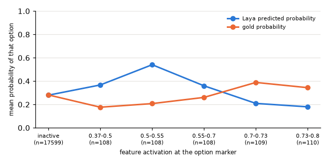

# Feature 10792

Critérios em que aparece: corr_probe_right_laya_wrong_stratified

**Interpretação (preencher):** 

---

## Maiores ativações

**tr_security_incidents_000011 / severity** (score, security_incidents) | ativação 1.908 em `estado` | opções ['0', '1', '2', '3', '4'] | Laya: **1** [0.232, 0.294, 0.24, 0.112, 0.122] | gabarito: **2**

```
<bos> score question: How severe is the potential impact if this alert is real?<eos>
▸ <mask> level 0: Negligible: no access to anything sensitive.
▸ <mask> level 1: Low: limited access, easily reversed.
▸ <mask> level 2: Moderate: access to internal systems or non-public data.
▸ <mask> level 3: High: access to production, secrets or customer data.
▸ <mask> level 4: Critical: active compromise of crown-jewel systems.

<eos>

 {"alert": {"description": "audit logging was turned off on a host", "evidence": "Audit logging was disabled on a host by an unprivileged employee account authenticated via MFA. The action originated from an allowlisted IP address and was performed without⟦ a⟧ corresponding entry in the scheduled change window.", "rule": "disabled_logging"}, "context": {"asset_criticality": "medium", "change_window_active": false, "source_on_allowlist": true}, "history": {"credential_rotation_days_ago": 14, "distinct_countries_30d": 4, "logins_30d": 1338, "prior_alerts_90d": 1}, "principal": {"mfa_enrolled": true, "name": "svc-billing-846", "privileges": ["repo:read"], "type": "employee"}}<eos>
```

**tr_customer_service_000165 / churn_risk** (score, customer_service) | ativação 1.894 em `estado` | opções ['0', '1', '2', '3'] | Laya: **1** [0.089, 0.488, 0.364, 0.058] | gabarito: **2**

```
<bos> score question: How likely is this customer to stop doing business with us because of this interaction?<eos>
▸ <mask> level 0: No sign of dissatisfaction.
▸ <mask> level 1: Mild frustration, but the relationship is intact.
▸ <mask> level 2: Clearly unhappy; repeat problems or explicit complaints.
▸ <mask> level 3: Imminent: threatening to cancel, dispute or leave.

<eos>

 {"account": {"lifetime_value_usd": 4890, "prior_tickets_90d": 3, "seats": 1, "tenure_months": 60, "tier": "premium"}, "orders": [{"amount_usd": 19, "date": "2026-01-24", "id": "A-27992", "status": "settled"}, {"amount_usd": 19, "date": "2026-02-04", "id": "A-63170", "status": "settled"}, {"amount_usd": 19, "date": "2026-02-15", "id": "A-75660", "status": "settled"}], "thread": [{"role": "customer", "text": "Hi, I was checking my bank statement and noticed two charges from you guys for the same $19 amount. I'm really confused—am I getting billed twice for the same premium subscription?"}, {"role": "agent", "text": "Hello, thank you for reaching out to us. I would be happy to look into these charges for you. Could you please confirm the dates of the transactions you are seeing?"}, {"role": "customer", "text": "They both hit on the 12th. I've been with you for five years now and I've had three previous tickets where things were promised but never actually followed through on, so I'm hoping this one is different."}, {"role": "agent", "text": "I appreciate your long-term membership and I sincerely apologize for any previous lapses in service. I am checking your billing ledger now; could you verify the email address associated with the account?"}, {"role": "customer", "text": "It’s under j⟦.⟧doe@email.com. I really just want to understand why my account would show two charges when I’ve only ever had one plan."}, {"role": "agent", "text": "Thank you for that information. I am currently reviewing your billing cycle. To ensure I'm looking at the right data, could you clarify if you recently made any changes to your payment method?"}, {"role": "customer", "text": "No, I haven't touched my settings in years. I’m just trying to make sense of why my balance is off."}]}<eos>
```

**tr_security_incidents_000011 / urgency** (score, security_incidents) | ativação 1.892 em `estado` | opções ['0', '1', '2', '3'] | Laya: **3** [0.109, 0.27, 0.21, 0.411] | gabarito: **2**

```
<bos> score question: How quickly must a responder act on this alert?<eos>
▸ <mask> level 0: No time pressure; can wait indefinitely.
▸ <mask> level 1: Routine; handle within the normal queue.
▸ <mask> level 2: Elevated; should be handled within the same week.
▸ <mask> level 3: Critical; requires action within the same day.

<eos>

 {"alert": {"description": "audit logging was turned off on a host", "evidence": "Audit logging was disabled on a host by an unprivileged employee account authenticated via MFA. The action originated from an allowlisted IP address and was performed without⟦ a⟧ corresponding entry in the scheduled change window.", "rule": "disabled_logging"}, "context": {"asset_criticality": "medium", "change_window_active": false, "source_on_allowlist": true}, "history": {"credential_rotation_days_ago": 14, "distinct_countries_30d": 4, "logins_30d": 1338, "prior_alerts_90d": 1}, "principal": {"mfa_enrolled": true, "name": "svc-billing-846", "privileges": ["repo:read"], "type": "employee"}}<eos>
```

**tr_security_incidents_000233 / urgency** (score, security_incidents) | ativação 1.888 em `estado` | opções ['0', '1', '2', '3'] | Laya: **3** [0.097, 0.216, 0.11, 0.577] | gabarito: **3**

```
<bos> score question: How quickly must a responder act on this alert?<eos>
▸ <mask> level 0: No time pressure; can wait indefinitely.
▸ <mask> level 1: Routine; handle within the normal queue.
▸ <mask> level 2: Elevated; should be handled within the same week.
▸ <mask> level 3: Critical; requires action within the same day.

<eos>

 {"alert": {"description": "an endpoint agent matched a known signature", "evidence": "On 2026-09-15 09:17:03 UTC, the endpoint detection agent on host \"WIN-DC01\" flagged⟦ a⟧ match to the \"Emotet\" malware signature (SHA256: a1b2c3d4e5f6g7h8i9j0...), detected in the file \"C:\\Windows\\Temp\\svchost.exe\". The suspicious file was launched by process \"msiexec.exe\" with PID 6420, the event was recorded as originating from an unrecognized source, and the associated admin account \"svc_admin\" had MFA enabled with its password last changed on 2026-09-12.", "rule": "malware_signature"}, "context": {"asset_criticality": "medium", "change_window_active": false, "source_on_allowlist": false}, "history": {"credential_rotation_days_ago": 3, "distinct_countries_30d": 4, "logins_30d": 695, "prior_alerts_90d": 0}, "principal": {"mfa_enrolled": true, "name": "svc-deploy-569", "privileges": ["deploy:production", "secrets:read"], "type": "admin"}}<eos>
```

**tr_customer_service_000165 / action** (choice, customer_service) | ativação 1.885 em `estado` | opções ['answer_directly', 'close_no_action', 'escalate_to_human', 'execute_refund', 'request_information'] | Laya: **answer_directly** [0.471, 0.346, 0.043, 0.125, 0.015] | gabarito: **escalate_to_human**

```
<bos> choice question: What should the assistant do next with this conversation?<eos>
▸ <mask> answer_directly: The assistant can resolve this itself with information it already has.
▸ <mask> close_no_action: No further action is warranted; the matter is settled.
▸ <mask> escalate_to_human: Hand off to a human agent with the appropriate authority.
▸ <mask> execute_refund: Issue the refund or credit the customer is owed.
▸ <mask> request_information: More detail is needed from the customer before anything can be done.

<eos>

 {"account": {"lifetime_value_usd": 4890, "prior_tickets_90d": 3, "seats": 1, "tenure_months": 60, "tier": "premium"}, "orders": [{"amount_usd": 19, "date": "2026-01-24", "id": "A-27992", "status": "settled"}, {"amount_usd": 19, "date": "2026-02-04", "id": "A-63170", "status": "settled"}, {"amount_usd": 19, "date": "2026-02-15", "id": "A-75660", "status": "settled"}], "thread": [{"role": "customer", "text": "Hi, I was checking my bank statement and noticed two charges from you guys for the same $19 amount. I'm really confused—am I getting billed twice for the same premium subscription?"}, {"role": "agent", "text": "Hello, thank you for reaching out to us. I would be happy to look into these charges for you. Could you please confirm the dates of the transactions you are seeing?"}, {"role": "customer", "text": "They both hit on the 12th. I've been with you for five years now and I've had three previous tickets where things were promised but never actually followed through on, so I'm hoping this one is different."}, {"role": "agent", "text": "I appreciate your long-term membership and I sincerely apologize for any previous lapses in service. I am checking your billing ledger now; could you verify the email address associated with the account?"}, {"role": "customer", "text": "It’s under j⟦.⟧doe@email.com. I really just want to understand why my account would show two charges when I’ve only ever had one plan."}, {"role": "agent", "text": "Thank you for that information. I am currently reviewing your billing cycle. To ensure I'm looking at the right data, could you clarify if you recently made any changes to your payment method?"}, {"role": "customer", "text": "No, I haven't touched my settings in years. I’m just trying to make sense of why my balance is off."}]}<eos>
```

## Ativações medianas (faixa 40-60%, mediana 0.516)

**tr_security_incidents_000092 / urgency** (score, security_incidents) | ativação 0.532 em `estado` | opções ['0', '1', '2', '3'] | Laya: **1** [0.086, 0.496, 0.296, 0.122] | gabarito: **1**

```
<bos> score question: How quickly must a responder act on this alert?<eos>
▸ <mask> level 0: No time pressure; can wait indefinitely.
▸ <mask> level 1: Routine; handle within the normal queue.
▸ <mask> level 2: Elevated; should be handled within the same week.
▸ <mask> level 3: Critical; requires action within the same day.

<eos>

 {"alert": {"description": "a long-unused account became active", "evidence": "An employee account that had no recorded activity since 2024-02-01 generated a successful login at 2026-09-15 11:45:27 UTC from IP 198.51.100.99, which is not recognized in the known source list. The account is unprivileged, MFA was satisfied, and there was no active change window. The password for this account was last rotated on 2024-09-10, 700 days prior to⟦ the⟧ event.", "rule": "dormant_account_use"}, "context": {"asset_criticality": "medium", "change_window_active": false, "source_on_allowlist": false}, "history": {"credential_rotation_days_ago": 700, "distinct_countries_30d": 1, "logins_30d": 181, "prior_alerts_90d": 0}, "principal": {"mfa_enrolled": true, "name": "adm-billing-260", "privileges": ["repo:read"], "type": "employee"}}<eos>
```

**tr_security_incidents_000100 / credential_compromise** (noul, security_incidents) | ativação 0.500 em `opção` | opções ['false', 'true'] | Laya: **false** [0.839, 0.161] | gabarito: **true**

```
<bos> noul question: The evidence indicates a credential or account has been compromised.<eos>
▸ <mask> false: no, the statement does not hold
▸ <mask> true: yes⟦,⟧ the statement holds

<eos>

 {"alert": {"description": "an account granted itself or received elevated permissions", "evidence": "On 2026-09-16 11:07 UTC, user bob@example.com was added to the Administrators group, granting elevated privileges. The operation originated from the approved source IP 10.1.2.5. The authentication token employed has not been rotated since 2025-09-16.", "rule": "privilege_escalation"}, "context": {"asset_criticality": "crown_jewel", "change_window_active": false, "source_on_allowlist": true}, "history": {"credential_rotation_days_ago": 365, "distinct_countries_30d": 3, "logins_30d": 1059, "prior_alerts_90d": 0}, "principal": {"mfa_enrolled": true, "name": "adm-analytics-302", "privileges": ["repo:read"], "type": "admin"}}<eos>
```

**tr_customer_service_000200 / urgency** (score, customer_service) | ativação 0.574 em `estado` | opções ['0', '1', '2', '3'] | Laya: **1** [0.081, 0.472, 0.304, 0.142] | gabarito: **1**

```
<bos> score question: How time-sensitive is this conversation?<eos>
▸ <mask> level 0: No time pressure; can wait indefinitely.
▸ <mask> level 1: Routine; handle within the normal queue.
▸ <mask> level 2: Elevated; should be handled within the same week.
▸ <mask> level 3: Critical; requires action within the same day.

<eos>

 {"account": {"lifetime_value_usd": 1072, "prior_tickets_90d": 0, "seats": 12, "tenure_months": 41, "tier": "premium"}, "orders": [{"amount_usd": 29, "date": "2026-03-18", "id": "A-98366", "status": "refunded"}, {"amount_usd": 29, "date": "2026-03-25", "id": "A-11332", "status": "settled"}, {"amount_usd": 29, "date": "2026-03-18", "id": "A-35045", "status": "failed"}], "thread": [{"role": "customer", "text": "I can't believe you just charged me $29 this month! I've been on the premium plan for over three years and never saw this price before. This is unacceptable!"}, {"role": "agent", "text": "I’m sorry you’re seeing an unexpected charge. Could you confirm the email address linked to your account so I can look into the billing details?"}, {"role": "customer", "text": "Fine. It’s john.doe@example.com. I’ve been paying the same amount for 41 months, and now this random jump appears on my statement. I need an explanation, not a generic apology."}, {"role": "agent", "text": "Thank you for confirming. I’ll pull up the recent invoices. Just to be sure, are you referring to the $29.00 charge labeled as “Premium Plan Renewal” on your latest bill?"}, {"role": "customer", "text": "Yes⟦,⟧ that’s the one. I want to know why it’s higher now and what I’m supposed to do about it. Please tell me what’s going on."}]}<eos>
```

**tr_security_incidents_000248 / severity** (score, security_incidents) | ativação 0.477 em `opção` | opções ['0', '1', '2', '3', '4'] | Laya: **2** [0.125, 0.282, 0.367, 0.129, 0.097] | gabarito: **2**

```
<bos> score question: How severe is the potential impact if this alert is real?<eos>
▸ <mask> level 0: Negligible: no access to anything sensitive.
▸ <mask> level 1: Low: limited access, easily reversed.
▸ <mask> level 2⟦:⟧ Moderate: access to internal systems or non-public data.
▸ <mask> level 3: High: access to production, secrets or customer data.
▸ <mask> level 4: Critical: active compromise of crown-jewel systems.

<eos>

 {"alert": {"description": "a security group was opened to the public internet", "evidence": "A security group configuration was modified to allow inbound traffic from the 0.0.0.0/0 CIDR block at 14:22 UTC. The modification was initiated by an unrecognized source using an unprivileged service account, with no corresponding record in the change management log.", "rule": "config_drift"}, "context": {"asset_criticality": "medium", "change_window_active": false, "source_on_allowlist": false}, "history": {"credential_rotation_days_ago": 180, "distinct_countries_30d": 1, "logins_30d": 1240, "prior_alerts_90d": 0}, "principal": {"mfa_enrolled": true, "name": "svc-infra-709", "privileges": ["repo:read"], "type": "service_account"}}<eos>
```

**tr_security_incidents_000145 / disposition** (choice, security_incidents) | ativação 0.548 em `marcador` | opções ['close_benign', 'contain', 'investigate', 'monitor'] | Laya: **monitor** [0.04, 0.364, 0.104, 0.492] | gabarito: **investigate**

```
<bos> choice question: How should this security alert be dispositioned?<eos>
▸ <mask> close_benign: Expected, explainable activity; close without analyst time.
▸ <mask> contain: Contain the host or account immediately; do not wait for triage.
▸ <mask> investigate: Warrants an analyst opening an investigation.
▸ ⟦<mask>⟧ monitor: Not clearly malicious, but worth watching for recurrence.

<eos>

 {"alert": {"description": "a long-unused account became active", "evidence": "A contractor account, which had been dormant for an extended period, performed authentication from an unrecognized source during an active change window. The account holds privileged access and had its credentials last rotated 14 days prior to this event.", "rule": "dormant_account_use"}, "context": {"asset_criticality": "crown_jewel", "change_window_active": true, "source_on_allowlist": false}, "history": {"credential_rotation_days_ago": 14, "distinct_countries_30d": 1, "logins_30d": 805, "prior_alerts_90d": 3}, "principal": {"mfa_enrolled": true, "name": "adm-billing-648", "privileges": ["deploy:production", "secrets:read"], "type": "contractor"}}<eos>
```

## Estatísticas (conjunto de descoberta, dev e teste)

**pred / error**

| split | decisões | ativas | ativas e Laya errou | taxa | lift | q (BH) | OR (CMH) | q (CMH) |
|---|---|---|---|---|---|---|---|---|
| discovery | 5100 | 190 | 171 | 0.900 | 1.40 | 3.6e-15 | 0.47 | 0.488 |
| dev | 900 | 35 | 33 | 0.943 | 1.40 | 0.0011 | 0.00 | 0.729 |
| test | 2000 | 72 | 66 | 0.917 | 1.41 | 1.49e-06 | 1.47 | 0.894 |

**corr / error**

| split | decisões | ativas | ativas e Laya errou | taxa | lift | q (BH) | OR (CMH) | q (CMH) |
|---|---|---|---|---|---|---|---|---|
| discovery | 5100 | 149 | 130 | 0.872 | 1.36 | 9.98e-10 | 1.43 | 0.0485 |
| dev | 900 | 21 | 19 | 0.905 | 1.35 | 0.0476 | 2.10 | 0.0458 |
| test | 2000 | 36 | 30 | 0.833 | 1.28 | 0.0364 | 1.97 | 0.0478 |

**state / error**

| split | decisões | ativas | ativas e Laya errou | taxa | lift | q (BH) | OR (CMH) | q (CMH) |
|---|---|---|---|---|---|---|---|---|
| discovery | 5100 | 1701 | 1036 | 0.609 | 0.95 | 0.00167 | 0.92 | 0.743 |
| dev | 900 | 293 | 206 | 0.703 | 1.05 | 0.515 | 1.98 | 0.306 |
| test | 2000 | 666 | 427 | 0.641 | 0.99 | 0.829 | 1.05 | 0.917 |

**pred / probe_right_laya_wrong**

| split | decisões | ativas | ativas e Laya errou | taxa | lift | q (BH) | OR (CMH) | q (CMH) |
|---|---|---|---|---|---|---|---|---|
| discovery | 2819 | 129 | 127 | 0.984 | 1.52 | 5.02e-21 | nan | nan |
| dev | 520 | 23 | 22 | 0.957 | 1.42 | 0.00811 | nan | nan |
| test | 1106 | 53 | 50 | 0.943 | 1.49 | 8.64e-07 | 3.28 | 0.56 |

**corr / probe_right_laya_wrong**

| split | decisões | ativas | ativas e Laya errou | taxa | lift | q (BH) | OR (CMH) | q (CMH) |
|---|---|---|---|---|---|---|---|---|
| discovery | 2819 | 99 | 97 | 0.980 | 1.51 | 1.09e-15 | 15.95 | 1.11e-17 |
| dev | 520 | 18 | 17 | 0.944 | 1.40 | nan | nan | nan |
| test | 1106 | 24 | 21 | 0.875 | 1.38 | 0.0245 | 3.23 | 0.00591 |

**state / probe_right_laya_wrong**

| split | decisões | ativas | ativas e Laya errou | taxa | lift | q (BH) | OR (CMH) | q (CMH) |
|---|---|---|---|---|---|---|---|---|
| discovery | 2819 | 929 | 547 | 0.589 | 0.91 | 5.47e-05 | 0.83 | 0.392 |
| dev | 520 | 164 | 113 | 0.689 | 1.02 | 0.973 | 1.65 | 0.164 |
| test | 1106 | 366 | 218 | 0.596 | 0.94 | 0.232 | 0.99 | 0.991 |

Confusão mais sobre-representada (pred): `disposition|3>2` (n=130, lift 20.77, p=0). Formato `pergunta|índice previsto>índice correto`.

Confusão mais sobre-representada (corr): `outcome|0>2` (n=32, lift 34.23, p=0). Formato `pergunta|índice previsto>índice correto`.

Confusão mais sobre-representada (state): `severity|1>3` (n=48, lift 2.03, p=3.03e-09). Formato `pergunta|índice previsto>índice correto`.



