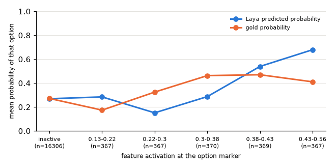

# Feature 10833

Critérios em que aparece: attribution_toward_wrong

**Interpretação (preencher):** 

---

## Maiores ativações

**tr_customer_service_000009 / action** (choice, customer_service) | ativação 2.596 em `estado` | opções ['answer_directly', 'close_no_action', 'escalate_to_human', 'execute_refund', 'request_information'] | Laya: **execute_refund** [0.098, 0.105, 0.084, 0.71, 0.004] | gabarito: **escalate_to_human**

```
<bos> choice question: What should the assistant do next with this conversation?<eos>
▸ <mask> answer_directly: The assistant can resolve this itself with information it already has.
▸ <mask> close_no_action: No further action is warranted; the matter is settled.
▸ <mask> escalate_to_human: Hand off to a human agent with the appropriate authority.
▸ <mask> execute_refund: Issue the refund or credit the customer is owed.
▸ <mask> request_information: More detail is needed from the customer before anything can be done.

<eos>

 {"account": {"lifetime_value_usd": 21, "prior_tickets_90d": 1, "seats": 1, "tenure_months": 1, "tier": "free"}, "orders": [{"amount_usd": 999, "date": "2026-02-27", "id": "A-68256", "status": "pending"}], "thread": [{"role": "customer", "text": "Honestly, this is ridiculous—I’ve been told my free‑plan account would keep the seats I paid $999 for, yet they disappeared again after the first month. This is ticket #2 and nothing’s been fixed!"}, {"role": "agent", "text": "I’m sorry you’re experiencing this. Could you tell me which usernames were removed so I can investigate further?"}, {"role": "customer", "text": "The seats for user1, user2, and user3 are gone. I need them restored immediately; this can’⟦t⟧ keep happening."}]}<eos>
```

**tr_customer_service_000088 / action** (choice, customer_service) | ativação 2.539 em `estado` | opções ['answer_directly', 'close_no_action', 'escalate_to_human', 'execute_refund', 'request_information'] | Laya: **close_no_action** [0.178, 0.508, 0.05, 0.233, 0.03] | gabarito: **escalate_to_human**

```
<bos> choice question: What should the assistant do next with this conversation?<eos>
▸ <mask> answer_directly: The assistant can resolve this itself with information it already has.
▸ <mask> close_no_action: No further action is warranted; the matter is settled.
▸ <mask> escalate_to_human: Hand off to a human agent with the appropriate authority.
▸ <mask> execute_refund: Issue the refund or credit the customer is owed.
▸ <mask> request_information: More detail is needed from the customer before anything can be done.

<eos>

 {"account": {"lifetime_value_usd": 73, "prior_tickets_90d": 1, "seats": 5, "tenure_months": 2, "tier": "enterprise"}, "orders": [{"amount_usd": 19, "date": "2026-02-04", "id": "A-66055", "status": "settled"}], "thread": [{"role": "customer", "text": "Hello, I hope you can help – I tried to renew our Enterprise plan today and the $19 charge didn’t go through. This is our second month with you, and we’ve already opened a ticket about a similar issue that was resolved, but it seems to be happening again."}, {"role": "agent", "text": "I’m sorry to hear the payment didn’t process. Could you let me know the date of the attempted charge and the last four digits of the card you used?"}, {"role": "customer", "text": "The attempt was on September 12th, and the card ends in 8427. I also tried using the same card on the portal, but it⟦ still⟧ shows a failure."}, {"role": "agent", "text": "Thank you for the details. Have you tried using a different payment method, or does the same error appear with another card?"}, {"role": "customer", "text": "We only have the one corporate card for billing, so we haven’t switched. The earlier ticket (ID #12345) was resolved, but the problem resurfaced today."}, {"role": "agent", "text": "I see, and I’ve noted the previous ticket. I’ll look into the transaction logs and see why the charge is failing again."}, {"role": "customer", "text": "Please let me know when you have an update, as we need the renewal to be confirmed before the end of the week."}]}<eos>
```

**tr_customer_service_000088 / urgency** (score, customer_service) | ativação 2.520 em `estado` | opções ['0', '1', '2', '3'] | Laya: **3** [0.137, 0.272, 0.268, 0.323] | gabarito: **2**

```
<bos> score question: How time-sensitive is this conversation?<eos>
▸ <mask> level 0: No time pressure; can wait indefinitely.
▸ <mask> level 1: Routine; handle within the normal queue.
▸ <mask> level 2: Elevated; should be handled within the same week.
▸ <mask> level 3: Critical; requires action within the same day.

<eos>

 {"account": {"lifetime_value_usd": 73, "prior_tickets_90d": 1, "seats": 5, "tenure_months": 2, "tier": "enterprise"}, "orders": [{"amount_usd": 19, "date": "2026-02-04", "id": "A-66055", "status": "settled"}], "thread": [{"role": "customer", "text": "Hello, I hope you can help – I tried to renew our Enterprise plan today and the $19 charge didn’t go through. This is our second month with you, and we’ve already opened a ticket about a similar issue that was resolved, but it seems to be happening again."}, {"role": "agent", "text": "I’m sorry to hear the payment didn’t process. Could you let me know the date of the attempted charge and the last four digits of the card you used?"}, {"role": "customer", "text": "The attempt was on September 12th, and the card ends in 8427. I also tried using the same card on the portal, but it⟦ still⟧ shows a failure."}, {"role": "agent", "text": "Thank you for the details. Have you tried using a different payment method, or does the same error appear with another card?"}, {"role": "customer", "text": "We only have the one corporate card for billing, so we haven’t switched. The earlier ticket (ID #12345) was resolved, but the problem resurfaced today."}, {"role": "agent", "text": "I see, and I’ve noted the previous ticket. I’ll look into the transaction logs and see why the charge is failing again."}, {"role": "customer", "text": "Please let me know when you have an update, as we need the renewal to be confirmed before the end of the week."}]}<eos>
```

**tr_customer_service_000054 / urgency** (score, customer_service) | ativação 2.506 em `estado` | opções ['0', '1', '2', '3'] | Laya: **2** [0.129, 0.131, 0.45, 0.289] | gabarito: **2**

```
<bos> score question: How time-sensitive is this conversation?<eos>
▸ <mask> level 0: No time pressure; can wait indefinitely.
▸ <mask> level 1: Routine; handle within the normal queue.
▸ <mask> level 2: Elevated; should be handled within the same week.
▸ <mask> level 3: Critical; requires action within the same day.

<eos>

 {"account": {"lifetime_value_usd": 1895, "prior_tickets_90d": 0, "seats": 1, "tenure_months": 26, "tier": "premium"}, "orders": [{"amount_usd": 99, "date": "2026-01-19", "id": "A-32208", "status": "settled"}, {"amount_usd": 99, "date": "2026-03-11", "id": "A-69390", "status": "settled"}, {"amount_usd": 99, "date": "2026-02-03", "id": "A-94974", "status": "settled"}], "thread": [{"role": "customer", "text": "I’m fed up with this service and want my account cancelled immediately. I’ve been a premium subscriber for 26 months, paying $99, and I need this done by the end of the week."}, {"role": "agent", "text": "I understand your frustration and can help with the cancellation. Could you confirm the email address tied to the account and the last four digits of the payment method on file?"}, {"role": "customer", "text": "The email is sarah.lee@example.com, and the card ends in 5678. I need⟦ this⟧ confirmed by Friday."}, {"role": "agent", "text": "Thanks for the details. I’ll start the cancellation process and will need you to confirm that you’d like all data removed. Could you confirm that as well?"}, {"role": "customer", "text": "Yes, delete everything. Just make sure it’s done before Friday, otherwise I’ll have to take further action."}]}<eos>
```

**tr_customer_service_000013 / needs_human** (noul, customer_service) | ativação 2.502 em `estado` | opções ['false', 'true'] | Laya: **false** [0.858, 0.142] | gabarito: **true**

```
<bos> noul question: This conversation requires a human agent rather than automated handling.<eos>
▸ <mask> false: Automation can carry this to resolution.
▸ <mask> true: A human must take over: judgement, authority or empathy is required.

<eos>

 {"account": {"lifetime_value_usd": 148, "prior_tickets_90d": 0, "seats": 40, "tenure_months": 3, "tier": "enterprise"}, "orders": [{"amount_usd": 198, "date": "2026-03-15", "id": "A-40361", "status": "failed"}, {"amount_usd": 198, "date": "2026-01-06", "id": "A-31584", "status": "settled"}, {"amount_usd": 198, "date": "2026-03-27", "id": "A-12899", "status": "pending"}], "thread": [{"role": "customer", "text": "Our latest invoice shows $198 for the enterprise plan, but my contract says $149. This discrepancy needs fixing, or I’ll have to look elsewhere; I need this resolved by the 15th."}, {"role": "agent", "text": "I understand the pricing concern. Can you confirm the billing period the invoice covers and attach the invoice file?"}, {"role": "customer", "text": "It covers March to May, and I’ve attached the PDF. I’m also considering canceling if we can’t sort it out quickly."}, {"role": "agent", "text": "Thanks for the details. Do you have a copy of the original agreement or any previous invoices for comparison?"}, {"role": "customer", "text": "Yes, the original agreement is in the email from January; I’ll forward it. I need a clear answer before the 15th deadline we discussed."}, {"role": "agent", "text": "Got it. I’ll review the documents. In the meantime, could you tell me if any discounts were applied that you’re aware of?"}, {"role": "customer", "text": "No discounts⟦ that⟧ I know of. I’m waiting for your clarification so I can decide whether to stay or move on."}]}<eos>
```

## Ativações medianas (faixa 40-60%, mediana 0.773)

**tr_customer_service_000248 / churn_risk** (score, customer_service) | ativação 0.757 em `estado` | opções ['0', '1', '2', '3'] | Laya: **0** [0.487, 0.353, 0.143, 0.017] | gabarito: **1**

```
<bos> score question: How likely is this customer to stop doing business with us because of this interaction?<eos>
▸ <mask> level 0: No sign of dissatisfaction.
▸ <mask> level 1: Mild frustration, but the relationship is intact.
▸ <mask> level 2: Clearly unhappy; repeat problems or explicit complaints.
▸ <mask> level 3: Imminent: threatening to cancel, dispute or leave.

<eos>

 {"account": {"lifetime_value_usd": 5956, "prior_tickets_90d": 0, "seats": 1, "tenure_months": 72, "tier": "standard"}, "orders": [{"amount_usd": 19, "date": "2026-02-20", "id": "A-97410", "status": "pending"}], "thread": [{"role": "customer", "text": "I just opened my package and I'm quite puzzled, I ordered the matte black frame but the one in the box is a very bright glossy silver."}, {"role": "agent", "text": "I appreciate you reaching out about this discrepancy. Could you let me know if the SKU number printed on the external packaging matches your order confirmation?"}, {"role": "customer", "text": "Let's see... the box says SKU-992, but I'm looking at the email I got when⟦ I⟧ ordered it and that says I should have received SKU-995."}, {"role": "agent", "text": "Thank you for checking that. Besides the color being incorrect, does the frame appear to be the correct size that you requested, or is that different as well?"}, {"role": "customer", "text": "The size seems to be the 11x14 I wanted, it's just the finish that's totally wrong and won't work for where I wanted to hang it."}, {"role": "agent", "text": "I understand. To help me document this correctly for our warehouse team, could you describe any other labels or markings you see on the inner protective wrapping?"}, {"role": "customer", "text": "There aren't really any other labels on the inside, just the clear plastic sleeve, so I'm still trying to figure out how I ended up with silver instead of black."}]}<eos>
```

**tr_customer_service_000256 / category** (choice, customer_service) | ativação 0.700 em `opção` | opções ['account', 'billing', 'delivery', 'refund', 'technical'] | Laya: **refund** [0.035, 0.075, 0.0, 0.888, 0.002] | gabarito: **refund**

```
<bos> choice question: What is this customer conversation primarily about?<eos>
▸ <mask> account: Login, plan changes, profile or access management.
▸ <mask> billing: A charge, invoice, subscription⟦ or⟧ payment problem.
▸ <mask> delivery: Shipping, fulfilment or delivery of a physical item.
▸ <mask> refund: The customer is explicitly asking for money back.
▸ <mask> technical: The product or service is not working as expected.

<eos>

 {"account": {"lifetime_value_usd": 2574, "prior_tickets_90d": 5, "seats": 1, "tenure_months": 41, "tier": "premium"}, "orders": [{"amount_usd": 29, "date": "2026-03-10", "id": "A-42352", "status": "settled"}, {"amount_usd": 29, "date": "2026-03-26", "id": "A-82362", "status": "pending"}], "thread": [{"role": "customer", "text": "I’m done waiting for my refund. It’s been weeks and you keep giving me the run‑around—I’m ready to cancel my premium plan and take my business elsewhere."}, {"role": "agent", "text": "I understand how frustrating this is. Could you provide the transaction ID so I can locate the refund request?"}, {"role": "customer", "text": "The ID is TXN-987654321. Fix this now or I’m out."}]}<eos>
```

**tr_customer_service_000015 / action** (choice, customer_service) | ativação 0.827 em `estado` | opções ['answer_directly', 'close_no_action', 'escalate_to_human', 'execute_refund', 'request_information'] | Laya: **answer_directly** [0.856, 0.125, 0.012, 0.005, 0.002] | gabarito: **execute_refund**

```
<bos> choice question: What should the assistant do next with this conversation?<eos>
▸ <mask> answer_directly: The assistant can resolve this itself with information it already has.
▸ <mask> close_no_action: No further action is warranted; the matter is settled.
▸ <mask> escalate_to_human: Hand off to a human agent with the appropriate authority.
▸ <mask> execute_refund: Issue the refund or credit the customer is owed.
▸ <mask> request_information: More detail is needed from the customer before anything can be done.

<eos>

 {"account": {"lifetime_value_usd": 261, "prior_tickets_90d": 0, "seats": 1, "tenure_months": 3, "tier": "free"}, "thread": [{"role": "customer", "text": "My statement shows two identical $45 charges from yesterday for the free plan, and I need this cleared by Friday."}, {"role": "agent", "text": "I see. Can you confirm the last four digits of the card used and forward a screenshot⟦ of⟧ the statement?"}, {"role": "customer", "text": "The card ends in 1234, and I’ve attached the screenshot. I’m not sure why this happened, but I need it fixed before Friday."}, {"role": "agent", "text": "Thanks for that. Have you noticed any other duplicate transactions in the past month?"}, {"role": "customer", "text": "No, this is the first time it’s occurred, and the deadline is firm—if it isn’t resolved by Friday, I’ll have to dispute the charge."}, {"role": "agent", "text": "Understood. While I investigate, could you let me know if the merchant name appears the same on both entries?"}, {"role": "customer", "text": "Both entries list the same merchant, ‘CloudServe’, and I’m still waiting for you to tell me what will happen before Friday."}]}<eos>
```

**tr_security_incidents_000123 / urgency** (score, security_incidents) | ativação 0.860 em `opção` | opções ['0', '1', '2', '3'] | Laya: **1** [0.084, 0.455, 0.152, 0.308] | gabarito: **3**

```
<bos> score question: How quickly must a responder act on this alert?<eos>
▸ <mask> level 0: No time pressure;⟦ can⟧ wait indefinitely.
▸ <mask> level 1: Routine; handle within the normal queue.
▸ <mask> level 2: Elevated; should be handled within the same week.
▸ <mask> level 3: Critical; requires action within the same day.

<eos>

 {"alert": {"description": "two successful logins from distant locations too close together", "evidence": "Successful authentications for the unprivileged service account 'svc_data_sync' were recorded from IP 192.168.4.12 in New York at 08:00 UTC and IP 10.0.5.88 in London at 08:14 UTC. These logins originated from unrecognized network sources using credentials that were last rotated 412 days ago.", "rule": "impossible_travel"}, "context": {"asset_criticality": "crown_jewel", "change_window_active": false, "source_on_allowlist": false}, "history": {"credential_rotation_days_ago": 412, "distinct_countries_30d": 3, "logins_30d": 1458, "prior_alerts_90d": 0}, "principal": {"mfa_enrolled": false, "name": "usr-deploy-577", "privileges": ["repo:read"], "type": "service_account"}}<eos>
```

**tr_invoice_processing_000044 / matches_order** (noul, invoice_processing) | ativação 0.762 em `opção` | opções ['false', 'true'] | Laya: **true** [0.021, 0.979] | gabarito: **true**

```
<bos> noul question: The invoice reconciles with the purchase order and the recorded delivery.<eos>
▸ <mask> false: There is a discrepancy against the order⟦ or⟧ the delivery.
▸ <mask> true: Line items, quantities and amounts reconcile.

<eos>

 {"delivery": {"condition": "accepted with exceptions", "date": "2026-03-10", "received_qty": 250}, "invoice": {"currency": "USD", "id": "INV-2026-6702", "lines": [{"qty": 250, "sku": "SKU-507", "total_usd": 101050.0, "unit_usd": 404.2}], "total_usd": 101050.0, "vendor": "Kestrel Supply"}, "payment": {"days_until_due": 2, "discount_expires_in_days": 1, "early_payment_discount_pct": 2.0, "status": "scheduled", "terms": "net 60"}, "purchase_order": {"freight_terms": "freight prepaid by vendor, not separately billable", "id": "PO-1900", "lines": [{"qty": 250, "unit_usd": 404.2}], "total_usd": 101050.0}, "vendor_history": {"disputes_12m": 2, "invoices_12m": 34, "prior_invoice_ids": ["INV-2026-6702"]}}<eos>
```

## Estatísticas (conjunto de descoberta, dev e teste)

**pred / error**

| split | decisões | ativas | ativas e Laya errou | taxa | lift | q (BH) | OR (CMH) | q (CMH) |
|---|---|---|---|---|---|---|---|---|
| discovery | 5100 | 650 | 354 | 0.545 | 0.85 | 1.2e-07 | 0.88 | 0.667 |
| dev | 900 | 128 | 68 | 0.531 | 0.79 | 0.00213 | 0.55 | 0.468 |
| test | 2000 | 258 | 138 | 0.535 | 0.82 | 0.000193 | 0.97 | 0.992 |

**corr / error**

| split | decisões | ativas | ativas e Laya errou | taxa | lift | q (BH) | OR (CMH) | q (CMH) |
|---|---|---|---|---|---|---|---|---|
| discovery | 5100 | 657 | 361 | 0.549 | 0.85 | 2.95e-07 | 0.88 | 0.659 |
| dev | 900 | 137 | 77 | 0.562 | 0.84 | 0.00981 | 0.59 | 0.722 |
| test | 2000 | 275 | 155 | 0.564 | 0.87 | 0.00302 | 0.84 | 0.867 |

**state / error**

| split | decisões | ativas | ativas e Laya errou | taxa | lift | q (BH) | OR (CMH) | q (CMH) |
|---|---|---|---|---|---|---|---|---|
| discovery | 5100 | 5100 | 3283 | 0.644 | 1.00 | 1 | nan | nan |
| dev | 900 | 900 | 605 | 0.672 | 1.00 | 1 | nan | nan |
| test | 2000 | 2000 | 1301 | 0.650 | 1.00 | 1 | nan | nan |

**pred / probe_right_laya_wrong**

| split | decisões | ativas | ativas e Laya errou | taxa | lift | q (BH) | OR (CMH) | q (CMH) |
|---|---|---|---|---|---|---|---|---|
| discovery | 2819 | 380 | 223 | 0.587 | 0.91 | 0.0149 | 0.77 | 0.472 |
| dev | 520 | 80 | 46 | 0.575 | 0.85 | 0.105 | 0.54 | 0.354 |
| test | 1106 | 137 | 77 | 0.562 | 0.89 | 0.124 | 1.07 | 0.925 |

**corr / probe_right_laya_wrong**

| split | decisões | ativas | ativas e Laya errou | taxa | lift | q (BH) | OR (CMH) | q (CMH) |
|---|---|---|---|---|---|---|---|---|
| discovery | 2819 | 317 | 160 | 0.505 | 0.78 | 1.13e-07 | 0.82 | 0.653 |
| dev | 520 | 67 | 33 | 0.493 | 0.73 | 0.00322 | 0.58 | 0.731 |
| test | 1106 | 119 | 59 | 0.496 | 0.78 | 0.00319 | 1.03 | 0.995 |

**state / probe_right_laya_wrong**

| split | decisões | ativas | ativas e Laya errou | taxa | lift | q (BH) | OR (CMH) | q (CMH) |
|---|---|---|---|---|---|---|---|---|
| discovery | 2819 | 2819 | 1824 | 0.647 | 1.00 | 1 | nan | nan |
| dev | 520 | 520 | 351 | 0.675 | 1.00 | 1 | nan | nan |
| test | 1106 | 1106 | 700 | 0.633 | 1.00 | 1 | nan | nan |

Confusão mais sobre-representada (pred): `needs_human|0>1` (n=54, lift 7.85, p=0). Formato `pergunta|índice previsto>índice correto`.

Confusão mais sobre-representada (corr): `discrepancy_severity|2>3` (n=59, lift 7.76, p=0). Formato `pergunta|índice previsto>índice correto`.

Confusão mais sobre-representada (state): `action|0>1` (n=6, lift 1.00, p=1). Formato `pergunta|índice previsto>índice correto`.



