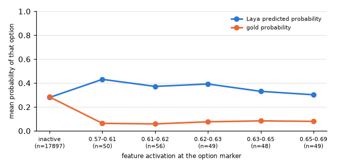

# Feature 10927

Critérios em que aparece: pred_error

**Interpretação (preencher):** 

---

## Maiores ativações

**tr_security_incidents_000233 / true_positive** (noul, security_incidents) | ativação 4.605 em `estado` | opções ['false', 'true'] | Laya: **true** [0.016, 0.984] | gabarito: **true**

```
<bos> noul question: This alert reflects genuinely malicious or unauthorised activity.<eos>
▸ <mask> false: Benign activity, a misconfiguration, or a known false positive.
▸ <mask> true: The underlying behaviour is malicious or unauthorised.

<eos>

 {"alert": {"description": "an endpoint agent matched a known signature", "evidence": "On 2026-09-15 09:17:03 UTC, the endpoint detection agent on host \"WIN-DC01\" flagged a match to the \"Emotet\" malware signature (SHA256:⟦ a⟧1b2c3d4e5f6g7h8i9j0...), detected in the file \"C:\\Windows\\Temp\\svchost.exe\". The suspicious file was launched by process \"msiexec.exe\" with PID 6420, the event was recorded as originating from an unrecognized source, and the associated admin account \"svc_admin\" had MFA enabled with its password last changed on 2026-09-12.", "rule": "malware_signature"}, "context": {"asset_criticality": "medium", "change_window_active": false, "source_on_allowlist": false}, "history": {"credential_rotation_days_ago": 3, "distinct_countries_30d": 4, "logins_30d": 695, "prior_alerts_90d": 0}, "principal": {"mfa_enrolled": true, "name": "svc-deploy-569", "privileges": ["deploy:production", "secrets:read"], "type": "admin"}}<eos>
```

**tr_security_incidents_000233 / disposition** (choice, security_incidents) | ativação 4.496 em `estado` | opções ['close_benign', 'contain', 'investigate', 'monitor'] | Laya: **investigate** [0.01, 0.076, 0.592, 0.322] | gabarito: **contain**

```
<bos> choice question: How should this security alert be dispositioned?<eos>
▸ <mask> close_benign: Expected, explainable activity; close without analyst time.
▸ <mask> contain: Contain the host or account immediately; do not wait for triage.
▸ <mask> investigate: Warrants an analyst opening an investigation.
▸ <mask> monitor: Not clearly malicious, but worth watching for recurrence.

<eos>

 {"alert": {"description": "an endpoint agent matched a known signature", "evidence": "On 2026-09-15 09:17:03 UTC, the endpoint detection agent on host \"WIN-DC01\" flagged a match to the \"Emotet\" malware signature (SHA256:⟦ a⟧1b2c3d4e5f6g7h8i9j0...), detected in the file \"C:\\Windows\\Temp\\svchost.exe\". The suspicious file was launched by process \"msiexec.exe\" with PID 6420, the event was recorded as originating from an unrecognized source, and the associated admin account \"svc_admin\" had MFA enabled with its password last changed on 2026-09-12.", "rule": "malware_signature"}, "context": {"asset_criticality": "medium", "change_window_active": false, "source_on_allowlist": false}, "history": {"credential_rotation_days_ago": 3, "distinct_countries_30d": 4, "logins_30d": 695, "prior_alerts_90d": 0}, "principal": {"mfa_enrolled": true, "name": "svc-deploy-569", "privileges": ["deploy:production", "secrets:read"], "type": "admin"}}<eos>
```

**tr_security_incidents_000233 / urgency** (score, security_incidents) | ativação 4.492 em `estado` | opções ['0', '1', '2', '3'] | Laya: **3** [0.097, 0.216, 0.11, 0.577] | gabarito: **3**

```
<bos> score question: How quickly must a responder act on this alert?<eos>
▸ <mask> level 0: No time pressure; can wait indefinitely.
▸ <mask> level 1: Routine; handle within the normal queue.
▸ <mask> level 2: Elevated; should be handled within the same week.
▸ <mask> level 3: Critical; requires action within the same day.

<eos>

 {"alert": {"description": "an endpoint agent matched a known signature", "evidence": "On 2026-09-15 09:17:03 UTC, the endpoint detection agent on host \"WIN-DC01\" flagged a match to the \"Emotet\" malware signature (SHA256:⟦ a⟧1b2c3d4e5f6g7h8i9j0...), detected in the file \"C:\\Windows\\Temp\\svchost.exe\". The suspicious file was launched by process \"msiexec.exe\" with PID 6420, the event was recorded as originating from an unrecognized source, and the associated admin account \"svc_admin\" had MFA enabled with its password last changed on 2026-09-12.", "rule": "malware_signature"}, "context": {"asset_criticality": "medium", "change_window_active": false, "source_on_allowlist": false}, "history": {"credential_rotation_days_ago": 3, "distinct_countries_30d": 4, "logins_30d": 695, "prior_alerts_90d": 0}, "principal": {"mfa_enrolled": true, "name": "svc-deploy-569", "privileges": ["deploy:production", "secrets:read"], "type": "admin"}}<eos>
```

**tr_security_incidents_000233 / severity** (score, security_incidents) | ativação 4.457 em `estado` | opções ['0', '1', '2', '3', '4'] | Laya: **1** [0.11, 0.377, 0.263, 0.117, 0.132] | gabarito: **3**

```
<bos> score question: How severe is the potential impact if this alert is real?<eos>
▸ <mask> level 0: Negligible: no access to anything sensitive.
▸ <mask> level 1: Low: limited access, easily reversed.
▸ <mask> level 2: Moderate: access to internal systems or non-public data.
▸ <mask> level 3: High: access to production, secrets or customer data.
▸ <mask> level 4: Critical: active compromise of crown-jewel systems.

<eos>

 {"alert": {"description": "an endpoint agent matched a known signature", "evidence": "On 2026-09-15 09:17:03 UTC, the endpoint detection agent on host \"WIN-DC01\" flagged a match to the \"Emotet\" malware signature (SHA256:⟦ a⟧1b2c3d4e5f6g7h8i9j0...), detected in the file \"C:\\Windows\\Temp\\svchost.exe\". The suspicious file was launched by process \"msiexec.exe\" with PID 6420, the event was recorded as originating from an unrecognized source, and the associated admin account \"svc_admin\" had MFA enabled with its password last changed on 2026-09-12.", "rule": "malware_signature"}, "context": {"asset_criticality": "medium", "change_window_active": false, "source_on_allowlist": false}, "history": {"credential_rotation_days_ago": 3, "distinct_countries_30d": 4, "logins_30d": 695, "prior_alerts_90d": 0}, "principal": {"mfa_enrolled": true, "name": "svc-deploy-569", "privileges": ["deploy:production", "secrets:read"], "type": "admin"}}<eos>
```

**tr_security_incidents_000118 / disposition** (choice, security_incidents) | ativação 4.395 em `estado` | opções ['close_benign', 'contain', 'investigate', 'monitor'] | Laya: **investigate** [0.049, 0.086, 0.463, 0.402] | gabarito: **investigate**

```
<bos> choice question: How should this security alert be dispositioned?<eos>
▸ <mask> close_benign: Expected, explainable activity; close without analyst time.
▸ <mask> contain: Contain the host or account immediately; do not wait for triage.
▸ <mask> investigate: Warrants an analyst opening an investigation.
▸ <mask> monitor: Not clearly malicious, but worth watching for recurrence.

<eos>

 {"alert": {"description": "an unrecognised binary executed on a server", "evidence": "At 2026-09-15 22:05:41 UTC, admin user svc_admin launched the executable C:\\Temp\\unknown_7d9f.exe on server app01.company.com. The binary's SHA‑256 hash 3⟦a⟧5f9c2e8b7d4e1a9c6f0b1d2e3a4c5d6e7f8a9b0c1d2e3f4a5b6c7d8e9f0a1b is not listed in the approved software inventory.", "rule": "suspicious_process"}, "context": {"asset_criticality": "medium", "change_window_active": false, "source_on_allowlist": true}, "history": {"credential_rotation_days_ago": 3, "distinct_countries_30d": 3, "logins_30d": 921, "prior_alerts_90d": 0}, "principal": {"mfa_enrolled": false, "name": "usr-support-888", "privileges": ["deploy:production", "secrets:read"], "type": "admin"}}<eos>
```

## Ativações medianas (faixa 40-60%, mediana 1.055)

**tr_invoice_processing_000013 / matches_order** (noul, invoice_processing) | ativação 1.062 em `opção` | opções ['false', 'true'] | Laya: **true** [0.049, 0.951] | gabarito: **false**

```
<bos> noul question: The invoice reconciles with the purchase order and the recorded delivery.<eos>
▸ <mask> false: There is⟦ a⟧ discrepancy against the order or the delivery.
▸ <mask> true: Line items, quantities and amounts reconcile.

<eos>

 {"delivery": {"condition": "accepted", "date": "2026-03-06", "received_qty": 50}, "invoice": {"currency": "USD", "id": "INV-2026-8460", "lines": [{"qty": 50, "sku": "SKU-189", "total_usd": 2863.5, "unit_usd": 57.27}, {"qty": 1, "sku": "FREIGHT", "total_usd": 931.94, "unit_usd": 931.94}], "total_usd": 3795.44, "vendor": "Pallas Industrial"}, "payment": {"days_until_due": 5, "discount_expires_in_days": null, "early_payment_discount_pct": null, "status": "scheduled", "terms": "net 30"}, "purchase_order": {"freight_terms": "freight prepaid by vendor, not separately billable", "id": "PO-3087", "lines": [{"qty": 50, "unit_usd": 57.27}], "total_usd": 2863.5}, "vendor_history": {"disputes_12m": 5, "invoices_12m": 42, "prior_invoice_ids": ["INV-2026-5764", "INV-2026-4247"]}}<eos>
```

**tr_invoice_processing_000194 / matches_order** (noul, invoice_processing) | ativação 1.071 em `opção` | opções ['false', 'true'] | Laya: **true** [0.096, 0.904] | gabarito: **true**

```
<bos> noul question: The invoice reconciles with the purchase order and the recorded delivery.<eos>
▸ <mask> false: There is⟦ a⟧ discrepancy against the order or the delivery.
▸ <mask> true: Line items, quantities and amounts reconcile.

<eos>

 {"delivery": {"condition": "accepted", "date": "2026-03-09", "received_qty": 1000}, "invoice": {"currency": "USD", "id": "INV-2026-6341", "lines": [{"qty": 1000, "sku": "SKU-622", "total_usd": 173280.0, "unit_usd": 173.28}], "total_usd": 173280.0, "vendor": "Acme Fabrication"}, "payment": {"days_until_due": -21, "discount_expires_in_days": null, "early_payment_discount_pct": null, "status": "overdue", "terms": "net 30"}, "purchase_order": {"freight_terms": "freight prepaid by vendor, not separately billable", "id": "PO-3528", "lines": [{"qty": 1000, "unit_usd": 173.28}], "total_usd": 173280.0}, "vendor_history": {"disputes_12m": 0, "invoices_12m": 11, "prior_invoice_ids": ["INV-2026-6341"]}}<eos>
```

**tr_invoice_processing_000144 / matches_order** (noul, invoice_processing) | ativação 1.071 em `opção` | opções ['false', 'true'] | Laya: **true** [0.033, 0.967] | gabarito: **true**

```
<bos> noul question: The invoice reconciles with the purchase order and the recorded delivery.<eos>
▸ <mask> false: There is⟦ a⟧ discrepancy against the order or the delivery.
▸ <mask> true: Line items, quantities and amounts reconcile.

<eos>

 {"delivery": {"condition": "accepted", "date": "2026-03-03", "received_qty": 250}, "invoice": {"currency": "USD", "id": "INV-2026-4721", "lines": [{"qty": 250, "sku": "SKU-840", "total_usd": 80237.5, "unit_usd": 320.95}], "total_usd": 80237.5, "vendor": "Pallas Industrial"}, "payment": {"days_until_due": -9, "discount_expires_in_days": null, "early_payment_discount_pct": null, "status": "overdue", "terms": "net 60"}, "purchase_order": {"freight_terms": "freight prepaid by vendor, not separately billable", "id": null, "lines": [{"qty": 250, "unit_usd": 320.95}], "total_usd": 80237.5}, "vendor_history": {"disputes_12m": 1, "invoices_12m": 56, "prior_invoice_ids": ["INV-2026-5685", "INV-2026-2769"]}}<eos>
```

**tr_customer_service_000245 / urgency** (score, customer_service) | ativação 1.064 em `estado` | opções ['0', '1', '2', '3'] | Laya: **1** [0.205, 0.447, 0.196, 0.152] | gabarito: **2**

```
<bos> score question: How time-sensitive is this conversation?<eos>
▸ <mask> level 0: No time pressure; can wait indefinitely.
▸ <mask> level 1: Routine; handle within the normal queue.
▸ <mask> level 2: Elevated; should be handled within the same week.
▸ <mask> level 3: Critical; requires action within the same day.

<eos>

 {"account": {"lifetime_value_usd": 1250, "prior_tickets_90d": 0, "seats": 1, "tenure_months": 14, "tier": "enterprise"}, "thread": [{"role": "customer", "text": "I'm⟦ a⟧ bit lost—I've been trying to log into our enterprise portal for the last twenty minutes but it keeps saying my credentials aren't recognized. I haven't changed anything since yesterday, and I'm not seeing any emails about account updates even though I've used this login for over a year. Is there something special I need to do to get back in?"}]}<eos>
```

**tr_customer_service_000202 / category** (choice, customer_service) | ativação 1.098 em `estado` | opções ['account', 'billing', 'delivery', 'refund', 'technical'] | Laya: **technical** [0.002, 0.0, 0.0, 0.0, 0.998] | gabarito: **technical**

```
<bos> choice question: What is this customer conversation primarily about?<eos>
▸ <mask> account: Login, plan changes, profile or access management.
▸ <mask> billing: A charge, invoice, subscription or payment problem.
▸ <mask> delivery: Shipping, fulfilment or delivery of a physical item.
▸ <mask> refund: The customer is explicitly asking for money back.
▸ <mask> technical: The product or service is not working as expected.

<eos>

 {"account": {"lifetime_value_usd": 271, "prior_tickets_90d": 1, "seats": 1, "tenure_months": 11, "tier": "free"}, "thread": [{"role": "customer", "text": "Your new analytics dashboard stopped updating two hours ago, and I’ve been trying to get this fixed all day—this is unacceptable!"}, {"role": "agent", "text": "I understand your frustration. Can you tell me which browser and version you’re using, and whether you see any error messages?"}, {"role": "customer", "text": "I’m on Chrome 115, and the page just shows a blank screen with a 500 error. I need this working by tomorrow’s reporting deadline, so I expect⟦ a⟧ quick response."}]}<eos>
```

## Estatísticas (conjunto de descoberta, dev e teste)

**pred / error**

| split | decisões | ativas | ativas e Laya errou | taxa | lift | q (BH) | OR (CMH) | q (CMH) |
|---|---|---|---|---|---|---|---|---|
| discovery | 5100 | 85 | 81 | 0.953 | 1.48 | 1.07e-10 | 2.03 | 0.507 |
| dev | 900 | 23 | 23 | 1.000 | 1.49 | 0.000903 | inf | 0.729 |
| test | 2000 | 31 | 29 | 0.935 | 1.44 | 0.00128 | 0.87 | 0.964 |

**corr / error**

| split | decisões | ativas | ativas e Laya errou | taxa | lift | q (BH) | OR (CMH) | q (CMH) |
|---|---|---|---|---|---|---|---|---|
| discovery | 5100 | 13 | 9 | 0.692 | 1.08 | nan | nan | nan |
| dev | 900 | 0 | 0 | nan | nan | nan | nan | nan |
| test | 2000 | 5 | 3 | 0.600 | 0.92 | nan | nan | nan |

**state / error**

| split | decisões | ativas | ativas e Laya errou | taxa | lift | q (BH) | OR (CMH) | q (CMH) |
|---|---|---|---|---|---|---|---|---|
| discovery | 5100 | 2177 | 1315 | 0.604 | 0.94 | 4.72e-06 | 0.97 | 0.888 |
| dev | 900 | 354 | 231 | 0.653 | 0.97 | 0.698 | 1.10 | 0.836 |
| test | 2000 | 839 | 518 | 0.617 | 0.95 | 0.0815 | 0.87 | 0.57 |

**pred / probe_right_laya_wrong**

| split | decisões | ativas | ativas e Laya errou | taxa | lift | q (BH) | OR (CMH) | q (CMH) |
|---|---|---|---|---|---|---|---|---|
| discovery | 2819 | 26 | 26 | 1.000 | 1.55 | 4.64e-05 | nan | nan |
| dev | 520 | 11 | 11 | 1.000 | 1.48 | nan | nan | nan |
| test | 1106 | 14 | 14 | 1.000 | 1.58 | nan | nan | nan |

**corr / probe_right_laya_wrong**

| split | decisões | ativas | ativas e Laya errou | taxa | lift | q (BH) | OR (CMH) | q (CMH) |
|---|---|---|---|---|---|---|---|---|
| discovery | 2819 | 0 | 0 | nan | nan | nan | nan | nan |
| dev | 520 | 0 | 0 | nan | nan | nan | nan | nan |
| test | 1106 | 0 | 0 | nan | nan | nan | nan | nan |

**state / probe_right_laya_wrong**

| split | decisões | ativas | ativas e Laya errou | taxa | lift | q (BH) | OR (CMH) | q (CMH) |
|---|---|---|---|---|---|---|---|---|
| discovery | 2819 | 1269 | 746 | 0.588 | 0.91 | 4.38e-08 | 1.01 | 0.956 |
| dev | 520 | 214 | 136 | 0.636 | 0.94 | 0.427 | 1.16 | 0.75 |
| test | 1106 | 495 | 290 | 0.586 | 0.93 | 0.0285 | 1.00 | 0.999 |

Confusão mais sobre-representada (pred): `disposition|3>1` (n=27, lift 34.47, p=7.89e-38). Formato `pergunta|índice previsto>índice correto`.

Confusão mais sobre-representada (corr): `disposition|0>3` (n=8, lift 392.31, p=nan). Formato `pergunta|índice previsto>índice correto`.

Confusão mais sobre-representada (state): `action|1>2` (n=63, lift 2.08, p=4.54e-16). Formato `pergunta|índice previsto>índice correto`.



