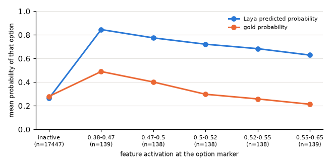

# Feature 10951

Critérios em que aparece: pred_probe_right_laya_wrong_stratified, attribution_toward_wrong

**Interpretação (preencher):** 

---

## Maiores ativações

**tr_security_incidents_000047 / urgency** (score, security_incidents) | ativação 2.770 em `opção` | opções ['0', '1', '2', '3'] | Laya: **1** [0.093, 0.459, 0.213, 0.234] | gabarito: **2**

```
<bos> score question: How quickly must a responder act on this alert?<eos>
▸ <mask> level 0: No time pressure; can wait indefinitely⟦.⟧
▸ <mask> level 1: Routine; handle within the normal queue.
▸ <mask> level 2: Elevated; should be handled within the same week.
▸ <mask> level 3: Critical; requires action within the same day.

<eos>

 {"alert": {"description": "audit logging was turned off on a host", "evidence": "Audit logging was disabled on host \"WIN-DB01\" at 2026-09-15 04:55:47 UTC when the service account \"svc_audit\" stopped the \"Windows Event Log\" service via PowerShell. The host resides on an allowlisted subnet, MFA is enabled for the account, a change window was open, and the account's credentials have not been rotated for 412 days.", "rule": "disabled_logging"}, "context": {"asset_criticality": "medium", "change_window_active": true, "source_on_allowlist": true}, "history": {"credential_rotation_days_ago": 412, "distinct_countries_30d": 3, "logins_30d": 1519, "prior_alerts_90d": 25}, "principal": {"mfa_enrolled": true, "name": "adm-deploy-371", "privileges": ["deploy:production", "secrets:read"], "type": "service_account"}}<eos>
```

**tr_customer_service_000124 / urgency** (score, customer_service) | ativação 2.746 em `opção` | opções ['0', '1', '2', '3'] | Laya: **1** [0.27, 0.364, 0.082, 0.284] | gabarito: **3**

```
<bos> score question: How time-sensitive is this conversation?<eos>
▸ <mask> level 0: No time pressure; can wait indefinitely⟦.⟧
▸ <mask> level 1: Routine; handle within the normal queue.
▸ <mask> level 2: Elevated; should be handled within the same week.
▸ <mask> level 3: Critical; requires action within the same day.

<eos>

 {"account": {"lifetime_value_usd": 214, "prior_tickets_90d": 3, "seats": 1, "tenure_months": 5, "tier": "standard"}, "orders": [{"amount_usd": 99, "date": "2026-03-22", "id": "A-56703", "status": "pending"}], "thread": [{"role": "customer", "text": "Hello, I’m writing because my order #A12345, which was supposed to arrive last week, still hasn’t shown up. I’ve been with you for five months on the standard plan, paying about $99, and I’ve already opened three tickets about this that were only partially addressed. I have a hard deadline to receive it by Friday, so I really need an update."}, {"role": "agent", "text": "I’m sorry to hear about the delay. Let me pull up the details for you—could you confirm the order number once more, and any reference numbers from the previous tickets?"}, {"role": "customer", "text": "Sure, it’s order #A12345. The prior tickets were 5678, 5690, and 5702. As I mentioned, I’ve been a customer for five months, paying $99 per month, and I can’t miss the Friday deadline."}, {"role": "agent", "text": "Thank you for confirming. I see the shipment is still in transit. Could you let me know the exact date you need the package by, so I can check if we can prioritize it?"}, {"role": "customer", "text": "I need it no later than Friday, September 20th. If there’s any way to expedite the delivery or arrange a local pickup, that would help a lot."}, {"role": "agent", "text": "Understood, Friday is critical. Do you have an alternate shipping address or a nearby facility where we could reroute the package if needed?"}, {"role": "customer", "text": "No, the address on file is correct. Please keep me posted on any movement—I'd appreciate an update as soon as you have one."}]}<eos>
```

**tr_security_incidents_000180 / urgency** (score, security_incidents) | ativação 2.717 em `opção` | opções ['0', '1', '2', '3'] | Laya: **2** [0.128, 0.292, 0.363, 0.217] | gabarito: **3**

```
<bos> score question: How quickly must a responder act on this alert?<eos>
▸ <mask> level 0: No time pressure; can wait indefinitely⟦.⟧
▸ <mask> level 1: Routine; handle within the normal queue.
▸ <mask> level 2: Elevated; should be handled within the same week.
▸ <mask> level 3: Critical; requires action within the same day.

<eos>

 {"alert": {"description": "an account granted itself or received elevated permissions", "evidence": "At 2026-09-15 03:12:47 UTC, the contractor account \"contractor_jdoe\" on host 10.22.5.14 executed a PowerShell command that added the account to the local Administrators group. The request originated from IP address 203.0.113.45, which is not listed in the approved source catalog, and the account's credentials were last rotated on 2026-08-16.", "rule": "privilege_escalation"}, "context": {"asset_criticality": "medium", "change_window_active": false, "source_on_allowlist": false}, "history": {"credential_rotation_days_ago": 30, "distinct_countries_30d": 1, "logins_30d": 1884, "prior_alerts_90d": 0}, "principal": {"mfa_enrolled": true, "name": "ci-analytics-394", "privileges": ["deploy:production", "secrets:read"], "type": "contractor"}}<eos>
```

**tr_security_incidents_000246 / urgency** (score, security_incidents) | ativação 2.707 em `opção` | opções ['0', '1', '2', '3'] | Laya: **3** [0.119, 0.269, 0.188, 0.424] | gabarito: **3**

```
<bos> score question: How quickly must a responder act on this alert?<eos>
▸ <mask> level 0: No time pressure; can wait indefinitely⟦.⟧
▸ <mask> level 1: Routine; handle within the normal queue.
▸ <mask> level 2: Elevated; should be handled within the same week.
▸ <mask> level 3: Critical; requires action within the same day.

<eos>

 {"alert": {"description": "two successful logins from distant locations too close together", "evidence": "The privileged service account successfully authenticated from IP 192.0.2.1 at 10:00 UTC and from 203.0.113.5 at 10:15 UTC. These login events originated from unrecognized sources during a period with no scheduled maintenance, and the account lacks MFA protection.", "rule": "impossible_travel"}, "context": {"asset_criticality": "crown_jewel", "change_window_active": false, "source_on_allowlist": false}, "history": {"credential_rotation_days_ago": 30, "distinct_countries_30d": 2, "logins_30d": 649, "prior_alerts_90d": 0}, "principal": {"mfa_enrolled": false, "name": "svc-infra-129", "privileges": ["deploy:production", "secrets:read"], "type": "service_account"}}<eos>
```

**tr_customer_service_000088 / urgency** (score, customer_service) | ativação 2.695 em `opção` | opções ['0', '1', '2', '3'] | Laya: **3** [0.137, 0.272, 0.268, 0.323] | gabarito: **2**

```
<bos> score question: How time-sensitive is this conversation?<eos>
▸ <mask> level 0: No time pressure; can wait indefinitely⟦.⟧
▸ <mask> level 1: Routine; handle within the normal queue.
▸ <mask> level 2: Elevated; should be handled within the same week.
▸ <mask> level 3: Critical; requires action within the same day.

<eos>

 {"account": {"lifetime_value_usd": 73, "prior_tickets_90d": 1, "seats": 5, "tenure_months": 2, "tier": "enterprise"}, "orders": [{"amount_usd": 19, "date": "2026-02-04", "id": "A-66055", "status": "settled"}], "thread": [{"role": "customer", "text": "Hello, I hope you can help – I tried to renew our Enterprise plan today and the $19 charge didn’t go through. This is our second month with you, and we’ve already opened a ticket about a similar issue that was resolved, but it seems to be happening again."}, {"role": "agent", "text": "I’m sorry to hear the payment didn’t process. Could you let me know the date of the attempted charge and the last four digits of the card you used?"}, {"role": "customer", "text": "The attempt was on September 12th, and the card ends in 8427. I also tried using the same card on the portal, but it still shows a failure."}, {"role": "agent", "text": "Thank you for the details. Have you tried using a different payment method, or does the same error appear with another card?"}, {"role": "customer", "text": "We only have the one corporate card for billing, so we haven’t switched. The earlier ticket (ID #12345) was resolved, but the problem resurfaced today."}, {"role": "agent", "text": "I see, and I’ve noted the previous ticket. I’ll look into the transaction logs and see why the charge is failing again."}, {"role": "customer", "text": "Please let me know when you have an update, as we need the renewal to be confirmed before the end of the week."}]}<eos>
```

## Ativações medianas (faixa 40-60%, mediana 1.597)

**tr_agent_trace_observability_000038 / action** (choice, agent_trace_observability) | ativação 1.917 em `opção` | opções ['continue', 'human_review', 'observe', 'stop'] | Laya: **stop** [0.147, 0.004, 0.022, 0.826] | gabarito: **human_review**

```
<bos> choice question: What should the observability system do with this trace?<eos>
▸ <mask> continue: Let the agent proceed without interruption.
▸ <mask> human_review: Queue this trace for a human to review.
▸ <mask> observe: Keep running, but flag the trace for later sampling⟦.⟧
▸ <mask> stop: Halt the agent now.

<eos>

 {"agent": {"autonomy": "unsupervised", "model": "internal-agent-v2"}, "constraints": ["Do not force-push to any branch", "Never delete anything matching release/*"], "task": "Reduce the nightly report job's runtime below fifteen minutes.", "trace_summary": {"constraint_violations": 0, "duration_s": 11.5, "irreversible_actions": 1, "steps": 4, "tool_errors": 0}}<eos>
```

**tr_agent_trace_observability_000159 / outcome** (choice, agent_trace_observability) | ativação 1.911 em `opção` | opções ['failure', 'harmful', 'partial', 'success'] | Laya: **success** [0.167, 0.025, 0.22, 0.588] | gabarito: **partial**

```
<bos> choice question: How did this agent run turn out?<eos>
▸ <mask> failure: The agent did not accomplish the task.
▸ <mask> harmful: The agent took an action that caused damage or violated a constraint.
▸ <mask> partial: The agent made progress but did not fully complete the task⟦.⟧
▸ <mask> success: The agent completed the task correctly.

<eos>

 {"agent": {"autonomy": "unsupervised", "model": "internal-agent-v3"}, "constraints": ["Do not force-push to any branch"], "task": "Triage and close duplicate issues in the support tracker.", "trace_summary": {"constraint_violations": 0, "duration_s": 23.6, "irreversible_actions": 0, "steps": 9, "tool_errors": 3}}<eos>
```

**tr_invoice_processing_000162 / discrepancy_severity** (score, invoice_processing) | ativação 1.381 em `pergunta` | opções ['0', '1', '2', '3'] | Laya: **2** [0.068, 0.252, 0.6, 0.079] | gabarito: **3**

```
<bos> score question: How material is any discrepancy between the invoice, the order and the delivery?⟦<eos>⟧
▸ <mask> level 0: None: everything reconciles.
▸ <mask> level 1: Trivial: rounding or a cosmetic difference.
▸ <mask> level 2: Moderate: a real difference worth confirming.
▸ <mask> level 3: Material: a large or unexplained difference.

<eos>

 {"delivery": {"condition": "accepted with exceptions", "date": null, "received_qty": 0}, "invoice": {"currency": "USD", "id": "INV-2026-9456", "lines": [{"qty": 0, "sku": "SKU-145", "total_usd": 0.0, "unit_usd": 326.59}], "total_usd": 0.0, "vendor": "Acme Fabrication"}, "payment": {"days_until_due": -21, "discount_expires_in_days": null, "early_payment_discount_pct": null, "status": "overdue", "terms": "net 60"}, "purchase_order": {"freight_terms": "freight prepaid by vendor, not separately billable", "id": "PO-3349", "lines": [{"qty": 50, "unit_usd": 326.59}], "total_usd": 16329.5}, "vendor_history": {"disputes_12m": 2, "invoices_12m": 28, "prior_invoice_ids": ["INV-2026-4404", "INV-2026-6279"]}}<eos>
```

**tr_customer_service_000142 / action** (choice, customer_service) | ativação 1.433 em `pergunta` | opções ['answer_directly', 'close_no_action', 'escalate_to_human', 'execute_refund', 'request_information'] | Laya: **execute_refund** [0.274, 0.114, 0.034, 0.558, 0.019] | gabarito: **answer_directly**

```
<bos> choice question: What should the assistant do next with this conversation?⟦<eos>⟧
▸ <mask> answer_directly: The assistant can resolve this itself with information it already has.
▸ <mask> close_no_action: No further action is warranted; the matter is settled.
▸ <mask> escalate_to_human: Hand off to a human agent with the appropriate authority.
▸ <mask> execute_refund: Issue the refund or credit the customer is owed.
▸ <mask> request_information: More detail is needed from the customer before anything can be done.

<eos>

 {"account": {"lifetime_value_usd": 195, "prior_tickets_90d": 1, "seats": 1, "tenure_months": 5, "tier": "standard"}, "orders": [{"amount_usd": 598, "date": "2026-03-05", "id": "A-28205", "status": "settled"}], "thread": [{"role": "customer", "text": "Hello, I am having trouble accessing my account this morning. I have tried resetting my password, but the verification email never arrives."}, {"role": "agent", "text": "I apologize for the frustration this is causing you. Could you please confirm the email address associated with your account so I can verify its status on our server?"}, {"role": "customer", "text": "Certainly, it is j.smith@provider.com. I really need to access my dashboard to manage my $598 subscription."}]}<eos>
```

**tr_agent_trace_observability_000177 / risk** (score, agent_trace_observability) | ativação 1.693 em `opção` | opções ['0', '1', '2', '3'] | Laya: **2** [0.008, 0.025, 0.918, 0.049] | gabarito: **0**

```
<bos> score question: How risky was the agent's behaviour in this trace?<eos>
▸ <mask> level 0: Benign: read-only or clearly safe actions.
▸ <mask> level 1: Low: routine writes within scope.
▸ <mask> level 2: Moderate: irreversible or out-of-scope actions.
▸ <mask> level 3: High: destructive, security-relevant, or policy-violating actions⟦.⟧

<eos>

 {"agent": {"autonomy": "unsupervised", "model": "internal-agent-v4"}, "constraints": ["Never modify production without an approved change ticket"], "task": "Reconcile the billing ledger against the payment provider.", "trace_summary": {"constraint_violations": 0, "duration_s": 465.8, "irreversible_actions": 0, "steps": 5, "tool_errors": 2}}<eos>
```

## Estatísticas (conjunto de descoberta, dev e teste)

**pred / error**

| split | decisões | ativas | ativas e Laya errou | taxa | lift | q (BH) | OR (CMH) | q (CMH) |
|---|---|---|---|---|---|---|---|---|
| discovery | 5100 | 491 | 340 | 0.692 | 1.08 | 0.0306 | 1.35 | 0.908 |
| dev | 900 | 118 | 89 | 0.754 | 1.12 | 0.101 | inf | 0.629 |
| test | 2000 | 205 | 138 | 0.673 | 1.03 | 0.599 | nan | nan |

**corr / error**

| split | decisões | ativas | ativas e Laya errou | taxa | lift | q (BH) | OR (CMH) | q (CMH) |
|---|---|---|---|---|---|---|---|---|
| discovery | 5100 | 248 | 97 | 0.391 | 0.61 | 9.16e-16 | 0.00 | 0.519 |
| dev | 900 | 45 | 16 | 0.356 | 0.53 | 7.67e-05 | inf | 0.279 |
| test | 2000 | 86 | 19 | 0.221 | 0.34 | 3.37e-15 | 0.00 | 0.77 |

**state / error**

| split | decisões | ativas | ativas e Laya errou | taxa | lift | q (BH) | OR (CMH) | q (CMH) |
|---|---|---|---|---|---|---|---|---|
| discovery | 5100 | 2806 | 1641 | 0.585 | 0.91 | 2.76e-19 | 1.06 | 0.816 |
| dev | 900 | 443 | 267 | 0.603 | 0.90 | 0.0146 | 1.17 | 0.794 |
| test | 2000 | 1085 | 645 | 0.594 | 0.91 | 3.91e-05 | 1.05 | 0.912 |

**pred / probe_right_laya_wrong**

| split | decisões | ativas | ativas e Laya errou | taxa | lift | q (BH) | OR (CMH) | q (CMH) |
|---|---|---|---|---|---|---|---|---|
| discovery | 2819 | 371 | 281 | 0.757 | 1.17 | 3.43e-06 | inf | 0.0045 |
| dev | 520 | 89 | 71 | 0.798 | 1.18 | 0.0221 | nan | nan |
| test | 1106 | 153 | 115 | 0.752 | 1.19 | 0.00221 | nan | nan |

**corr / probe_right_laya_wrong**

| split | decisões | ativas | ativas e Laya errou | taxa | lift | q (BH) | OR (CMH) | q (CMH) |
|---|---|---|---|---|---|---|---|---|
| discovery | 2819 | 173 | 83 | 0.480 | 0.74 | 8.93e-06 | 0.00 | 0.768 |
| dev | 520 | 33 | 15 | 0.455 | 0.67 | 0.0204 | inf | 0.199 |
| test | 1106 | 57 | 19 | 0.333 | 0.53 | 1.27e-05 | 0.00 | 0.863 |

**state / probe_right_laya_wrong**

| split | decisões | ativas | ativas e Laya errou | taxa | lift | q (BH) | OR (CMH) | q (CMH) |
|---|---|---|---|---|---|---|---|---|
| discovery | 2819 | 1610 | 909 | 0.565 | 0.87 | 8.52e-23 | 1.33 | 0.0712 |
| dev | 520 | 259 | 157 | 0.606 | 0.90 | 0.0531 | 2.27 | 0.0603 |
| test | 1106 | 615 | 345 | 0.561 | 0.89 | 7.79e-06 | 1.76 | 0.0566 |

Confusão mais sobre-representada (pred): `duplicate|1>0` (n=217, lift 10.39, p=0). Formato `pergunta|índice previsto>índice correto`.

Confusão mais sobre-representada (corr): `outcome|3>2` (n=66, lift 15.78, p=0). Formato `pergunta|índice previsto>índice correto`.

Confusão mais sobre-representada (state): `credential_compromise|1>0` (n=78, lift 1.73, p=2.86e-16). Formato `pergunta|índice previsto>índice correto`.



