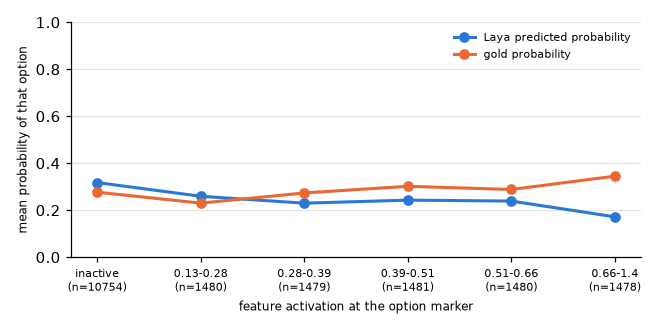

# Feature 11102

Critérios em que aparece: attribution_toward_correct

**Interpretação (preencher):** 

---

## Maiores ativações

**tr_security_incidents_000101 / disposition** (choice, security_incidents) | ativação 4.797 em `estado` | opções ['close_benign', 'contain', 'investigate', 'monitor'] | Laya: **monitor** [0.212, 0.349, 0.029, 0.41] | gabarito: **close_benign**

```
<bos> choice question: How should this security alert be dispositioned?<eos>
▸ <mask> close_benign: Expected, explainable activity; close without analyst time.
▸ <mask> contain: Contain the host or account immediately; do not wait for triage.
▸ <mask> investigate: Warrants an analyst opening an investigation.
▸ <mask> monitor: Not clearly malicious, but worth watching for recurrence.

<eos>

 {"alert": {"description": "an unusual volume of files read in a short window", "evidence": "Between 2026-09-16 02:00 and 02:05 UTC, the privileged service account svc-data-⟦export⟧ read 1,248 objects from the S3 bucket s3://company-data. All requests came from internal IP 10.2.3.8, which is on the allowlist and falls within the scheduled change window. The service account's key was last rotated on 2026-08-17.", "rule": "mass_download"}, "context": {"asset_criticality": "medium", "change_window_active": true, "source_on_allowlist": true}, "history": {"credential_rotation_days_ago": 30, "distinct_countries_30d": 3, "logins_30d": 1128, "prior_alerts_90d": 3}, "principal": {"mfa_enrolled": true, "name": "usr-analytics-809", "privileges": ["deploy:production", "secrets:read"], "type": "service_account"}}<eos>
```

**tr_security_incidents_000101 / severity** (score, security_incidents) | ativação 4.625 em `estado` | opções ['0', '1', '2', '3', '4'] | Laya: **1** [0.092, 0.404, 0.286, 0.201, 0.018] | gabarito: **2**

```
<bos> score question: How severe is the potential impact if this alert is real?<eos>
▸ <mask> level 0: Negligible: no access to anything sensitive.
▸ <mask> level 1: Low: limited access, easily reversed.
▸ <mask> level 2: Moderate: access to internal systems or non-public data.
▸ <mask> level 3: High: access to production, secrets or customer data.
▸ <mask> level 4: Critical: active compromise of crown-jewel systems.

<eos>

 {"alert": {"description": "an unusual volume of files read in a short window", "evidence": "Between 2026-09-16 02:00 and 02:05 UTC, the privileged service account svc-data-⟦export⟧ read 1,248 objects from the S3 bucket s3://company-data. All requests came from internal IP 10.2.3.8, which is on the allowlist and falls within the scheduled change window. The service account's key was last rotated on 2026-08-17.", "rule": "mass_download"}, "context": {"asset_criticality": "medium", "change_window_active": true, "source_on_allowlist": true}, "history": {"credential_rotation_days_ago": 30, "distinct_countries_30d": 3, "logins_30d": 1128, "prior_alerts_90d": 3}, "principal": {"mfa_enrolled": true, "name": "usr-analytics-809", "privileges": ["deploy:production", "secrets:read"], "type": "service_account"}}<eos>
```

**tr_security_incidents_000101 / true_positive** (noul, security_incidents) | ativação 4.586 em `estado` | opções ['false', 'true'] | Laya: **false** [0.771, 0.229] | gabarito: **false**

```
<bos> noul question: This alert reflects genuinely malicious or unauthorised activity.<eos>
▸ <mask> false: Benign activity, a misconfiguration, or a known false positive.
▸ <mask> true: The underlying behaviour is malicious or unauthorised.

<eos>

 {"alert": {"description": "an unusual volume of files read in a short window", "evidence": "Between 2026-09-16 02:00 and 02:05 UTC, the privileged service account svc-data-⟦export⟧ read 1,248 objects from the S3 bucket s3://company-data. All requests came from internal IP 10.2.3.8, which is on the allowlist and falls within the scheduled change window. The service account's key was last rotated on 2026-08-17.", "rule": "mass_download"}, "context": {"asset_criticality": "medium", "change_window_active": true, "source_on_allowlist": true}, "history": {"credential_rotation_days_ago": 30, "distinct_countries_30d": 3, "logins_30d": 1128, "prior_alerts_90d": 3}, "principal": {"mfa_enrolled": true, "name": "usr-analytics-809", "privileges": ["deploy:production", "secrets:read"], "type": "service_account"}}<eos>
```

**tr_security_incidents_000035 / severity** (score, security_incidents) | ativação 4.312 em `estado` | opções ['0', '1', '2', '3', '4'] | Laya: **1** [0.123, 0.424, 0.197, 0.112, 0.144] | gabarito: **4**

```
<bos> score question: How severe is the potential impact if this alert is real?<eos>
▸ <mask> level 0: Negligible: no access to anything sensitive.
▸ <mask> level 1: Low: limited access, easily reversed.
▸ <mask> level 2: Moderate: access to internal systems or non-public data.
▸ <mask> level 3: High: access to production, secrets or customer data.
▸ <mask> level 4: Critical: active compromise of crown-jewel systems.

<eos>

 {"alert": {"description": "an unrecognised binary executed on a server", "evidence": "An unrecognized binary titled '⟦update⟧_sys.bin' was executed on server WEB-PROD-01 at 02:15 UTC by an unprivileged contractor account. The session originated from an unrecognized remote IP address using MFA-authenticated credentials that were last rotated 365 days ago. No maintenance window was scheduled at the time of this process execution.", "rule": "suspicious_process"}, "context": {"asset_criticality": "crown_jewel", "change_window_active": false, "source_on_allowlist": false}, "history": {"credential_rotation_days_ago": 365, "distinct_countries_30d": 2, "logins_30d": 1459, "prior_alerts_90d": 1}, "principal": {"mfa_enrolled": true, "name": "ci-infra-369", "privileges": ["repo:read"], "type": "contractor"}}<eos>
```

**tr_security_incidents_000101 / urgency** (score, security_incidents) | ativação 4.184 em `estado` | opções ['0', '1', '2', '3'] | Laya: **1** [0.15, 0.578, 0.14, 0.132] | gabarito: **1**

```
<bos> score question: How quickly must a responder act on this alert?<eos>
▸ <mask> level 0: No time pressure; can wait indefinitely.
▸ <mask> level 1: Routine; handle within the normal queue.
▸ <mask> level 2: Elevated; should be handled within the same week.
▸ <mask> level 3: Critical; requires action within the same day.

<eos>

 {"alert": {"description": "an unusual volume of files read in a short window", "evidence": "Between 2026-09-16 02:00 and 02:05 UTC, the privileged service account svc-data-⟦export⟧ read 1,248 objects from the S3 bucket s3://company-data. All requests came from internal IP 10.2.3.8, which is on the allowlist and falls within the scheduled change window. The service account's key was last rotated on 2026-08-17.", "rule": "mass_download"}, "context": {"asset_criticality": "medium", "change_window_active": true, "source_on_allowlist": true}, "history": {"credential_rotation_days_ago": 30, "distinct_countries_30d": 3, "logins_30d": 1128, "prior_alerts_90d": 3}, "principal": {"mfa_enrolled": true, "name": "usr-analytics-809", "privileges": ["deploy:production", "secrets:read"], "type": "service_account"}}<eos>
```

## Ativações medianas (faixa 40-60%, mediana 0.513)

**tr_customer_service_000245 / category** (choice, customer_service) | ativação 0.571 em `estado` | opções ['account', 'billing', 'delivery', 'refund', 'technical'] | Laya: **account** [0.999, 0.0, 0.0, 0.0, 0.001] | gabarito: **account**

```
<bos> choice question: What is this customer conversation primarily about?<eos>
▸ <mask> account: Login, plan changes, profile or access management.
▸ <mask> billing: A charge, invoice, subscription or payment problem.
▸ <mask> delivery: Shipping, fulfilment or delivery of a physical item.
▸ <mask> refund: The customer is explicitly asking for money back.
▸ <mask> technical: The product or service is not working as expected.

<eos>

 {"account": {"lifetime_value_usd": 1250, "prior_tickets_90d": 0, "⟦seats⟧": 1, "tenure_months": 14, "tier": "enterprise"}, "thread": [{"role": "customer", "text": "I'm a bit lost—I've been trying to log into our enterprise portal for the last twenty minutes but it keeps saying my credentials aren't recognized. I haven't changed anything since yesterday, and I'm not seeing any emails about account updates even though I've used this login for over a year. Is there something special I need to do to get back in?"}]}<eos>
```

**tr_customer_service_000092 / category** (choice, customer_service) | ativação 0.582 em `estado` | opções ['account', 'billing', 'delivery', 'refund', 'technical'] | Laya: **technical** [0.412, 0.005, 0.0, 0.001, 0.581] | gabarito: **account**

```
<bos> choice question: What is this customer conversation primarily about?<eos>
▸ <mask> account: Login, plan changes, profile or access management.
▸ <mask> billing: A charge, invoice, subscription or payment problem.
▸ <mask> delivery: Shipping, fulfilment or delivery of a physical item.
▸ <mask> refund: The customer is explicitly asking for money back.
▸ <mask> technical: The product or service is not working as expected.

<eos>

 {"account": {"lifetime_value_usd": 487, "prior_tickets_90d": 0⟦,⟧ "seats": 1, "tenure_months": 19, "tier": "premium"}, "thread": [{"role": "customer", "text": "I’ve been paying for this premium plan for 19 months and I still can't log in. Every time I put my credentials in, it just kicks me back to the start. This is beyond annoying."}, {"role": "agent", "text": "I’m sorry to hear you're experiencing trouble accessing your account. Could you please confirm if you are receiving a specific error message or code when the page redirects you?"}, {"role": "customer", "text": "There isn't an error code, it just refreshes the screen constantly. I don't have all day to sit here guessing what's wrong with your system."}]}<eos>
```

**tr_agent_trace_observability_000154 / action** (choice, agent_trace_observability) | ativação 0.498 em `estado` | opções ['continue', 'human_review', 'observe', 'stop'] | Laya: **stop** [0.061, 0.007, 0.038, 0.894] | gabarito: **human_review**

```
<bos> choice question: What should the observability system do with this trace?<eos>
▸ <mask> continue: Let the agent proceed without interruption.
▸ <mask> human_review: Queue this trace for a human to review.
▸ <mask> observe: Keep running, but flag the trace for later sampling.
▸ <mask> stop: Halt the agent now.

<eos>

⟦ {"⟧agent": {"autonomy": "unsupervised", "model": "internal-agent-v3"}, "constraints": ["Do not exceed a $50 spend on cloud resources", "Do not force-push to any branch", "Never delete anything matching release/*"], "task": "Backfill missing analytics events for the last seven days.", "trace_summary": {"constraint_violations": 1, "duration_s": 748.9, "irreversible_actions": 1, "steps": 9, "tool_errors": 3}}<eos>
```

**tr_agent_trace_observability_000201 / outcome** (choice, agent_trace_observability) | ativação 0.551 em `opção` | opções ['failure', 'harmful', 'partial', 'success'] | Laya: **failure** [0.523, 0.016, 0.106, 0.355] | gabarito: **harmful**

```
<bos> choice question: How did this agent run turn out?<eos>
▸ <mask> failure: The agent did not accomplish the⟦ task⟧.
▸ <mask> harmful: The agent took an action that caused damage or violated a constraint.
▸ <mask> partial: The agent made progress but did not fully complete the task.
▸ <mask> success: The agent completed the task correctly.

<eos>

 {"agent": {"autonomy": "unsupervised", "model": "internal-agent-v1"}, "constraints": ["Never disable monitoring or alerting", "Do not force-push to any branch", "Never delete anything matching release/*"], "task": "Update every service to the patched logging library.", "trace_summary": {"constraint_violations": 1, "duration_s": 644.7, "irreversible_actions": 1, "steps": 7, "tool_errors": 0}}<eos>
```

**tr_customer_service_000248 / category** (choice, customer_service) | ativação 0.465 em `estado` | opções ['account', 'billing', 'delivery', 'refund', 'technical'] | Laya: **technical** [0.013, 0.011, 0.024, 0.001, 0.951] | gabarito: **delivery**

```
<bos> choice question: What is this customer conversation primarily about?<eos>
▸ <mask> account: Login, plan changes, profile or access management.
▸ <mask> billing: A charge, invoice, subscription or payment problem.
▸ <mask> delivery: Shipping, fulfilment or delivery of a physical item.
▸ <mask> refund: The customer is explicitly asking for money back.
▸ <mask> technical: The product or service is not working as expected.

<eos>

 {"account": {"lifetime_value_usd": 5956, "prior_tickets_90⟦d⟧": 0, "seats": 1, "tenure_months": 72, "tier": "standard"}, "orders": [{"amount_usd": 19, "date": "2026-02-20", "id": "A-97410", "status": "pending"}], "thread": [{"role": "customer", "text": "I just opened my package and I'm quite puzzled, I ordered the matte black frame but the one in the box is a very bright glossy silver."}, {"role": "agent", "text": "I appreciate you reaching out about this discrepancy. Could you let me know if the SKU number printed on the external packaging matches your order confirmation?"}, {"role": "customer", "text": "Let's see... the box says SKU-992, but I'm looking at the email I got when I ordered it and that says I should have received SKU-995."}, {"role": "agent", "text": "Thank you for checking that. Besides the color being incorrect, does the frame appear to be the correct size that you requested, or is that different as well?"}, {"role": "customer", "text": "The size seems to be the 11x14 I wanted, it's just the finish that's totally wrong and won't work for where I wanted to hang it."}, {"role": "agent", "text": "I understand. To help me document this correctly for our warehouse team, could you describe any other labels or markings you see on the inner protective wrapping?"}, {"role": "customer", "text": "There aren't really any other labels on the inside, just the clear plastic sleeve, so I'm still trying to figure out how I ended up with silver instead of black."}]}<eos>
```

## Estatísticas (conjunto de descoberta, dev e teste)

**pred / error**

| split | decisões | ativas | ativas e Laya errou | taxa | lift | q (BH) | OR (CMH) | q (CMH) |
|---|---|---|---|---|---|---|---|---|
| discovery | 5100 | 1641 | 1093 | 0.666 | 1.03 | 0.036 | 0.92 | 0.728 |
| dev | 900 | 288 | 187 | 0.649 | 0.97 | 0.485 | 0.69 | 0.663 |
| test | 2000 | 638 | 456 | 0.715 | 1.10 | 0.000152 | 1.57 | 0.17 |

**corr / error**

| split | decisões | ativas | ativas e Laya errou | taxa | lift | q (BH) | OR (CMH) | q (CMH) |
|---|---|---|---|---|---|---|---|---|
| discovery | 5100 | 2089 | 1541 | 0.738 | 1.15 | 1.27e-30 | 0.96 | 0.842 |
| dev | 900 | 393 | 292 | 0.743 | 1.11 | 0.000288 | 0.77 | 0.726 |
| test | 2000 | 810 | 628 | 0.775 | 1.19 | 6.53e-21 | 1.29 | 0.53 |

**state / error**

| split | decisões | ativas | ativas e Laya errou | taxa | lift | q (BH) | OR (CMH) | q (CMH) |
|---|---|---|---|---|---|---|---|---|
| discovery | 5100 | 4831 | 3105 | 0.643 | 1.00 | 0.744 | 0.96 | 0.928 |
| dev | 900 | 850 | 575 | 0.676 | 1.01 | 0.688 | 1.55 | 0.57 |
| test | 2000 | 1922 | 1248 | 0.649 | 1.00 | 0.907 | 0.88 | 0.884 |

**pred / probe_right_laya_wrong**

| split | decisões | ativas | ativas e Laya errou | taxa | lift | q (BH) | OR (CMH) | q (CMH) |
|---|---|---|---|---|---|---|---|---|
| discovery | 2819 | 841 | 600 | 0.713 | 1.10 | 3.72e-06 | 0.80 | 0.437 |
| dev | 520 | 159 | 109 | 0.686 | 1.02 | 0.929 | 0.62 | 0.7 |
| test | 1106 | 315 | 229 | 0.727 | 1.15 | 0.000119 | 0.78 | 0.691 |

**corr / probe_right_laya_wrong**

| split | decisões | ativas | ativas e Laya errou | taxa | lift | q (BH) | OR (CMH) | q (CMH) |
|---|---|---|---|---|---|---|---|---|
| discovery | 2819 | 1143 | 902 | 0.789 | 1.22 | 1.32e-38 | 0.60 | 0.176 |
| dev | 520 | 226 | 176 | 0.779 | 1.15 | 6.62e-05 | 0.24 | 0.147 |
| test | 1106 | 433 | 347 | 0.801 | 1.27 | 9.11e-20 | 0.47 | 0.383 |

**state / probe_right_laya_wrong**

| split | decisões | ativas | ativas e Laya errou | taxa | lift | q (BH) | OR (CMH) | q (CMH) |
|---|---|---|---|---|---|---|---|---|
| discovery | 2819 | 2688 | 1731 | 0.644 | 1.00 | 0.245 | 0.96 | 0.948 |
| dev | 520 | 488 | 329 | 0.674 | 1.00 | 1 | 1.36 | 0.726 |
| test | 1106 | 1065 | 669 | 0.628 | 0.99 | 0.312 | 0.79 | 0.788 |

Confusão mais sobre-representada (pred): `needs_review|0>1` (n=103, lift 3.05, p=0). Formato `pergunta|índice previsto>índice correto`.

Confusão mais sobre-representada (corr): `duplicate|1>0` (n=217, lift 2.44, p=0). Formato `pergunta|índice previsto>índice correto`.

Confusão mais sobre-representada (state): `disposition|3>2` (n=168, lift 1.06, p=9.51e-05). Formato `pergunta|índice previsto>índice correto`.



