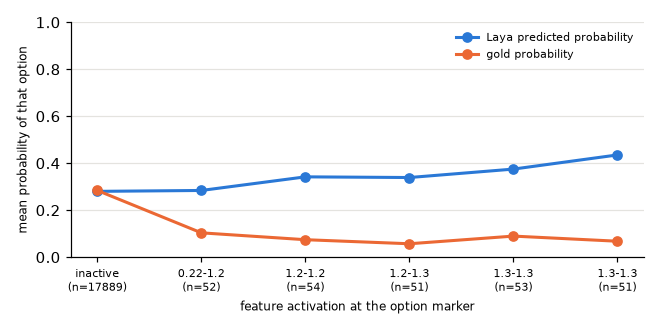

# Feature 11200

Critérios em que aparece: pred_error, pred_probe_right_laya_wrong, attribution_toward_wrong

**Interpretação (preencher):** 

---

## Maiores ativações

**tr_security_incidents_000148 / true_positive** (noul, security_incidents) | ativação 3.062 em `estado` | opções ['false', 'true'] | Laya: **true** [0.018, 0.982] | gabarito: **true**

```
<bos> noul question: This alert reflects genuinely malicious or unauthorised activity.<eos>
▸ <mask> false: Benign activity, a misconfiguration, or a known false positive.
▸ <mask> true: The underlying behaviour is malicious or unauthorised.

<eos>

 {"alert": {"description": "an unrecognised binary executed on a server", "evidence": "On 2026-09-15 22:45:33 UTC, the executable \"C:\\Temp\\sv⟦cho⟧st64.exe\" was launched on server \"app-prod-02\" with PID 5472. The binary is not present in the approved software inventory, the run was performed by a contractor user without privileged access, MFA was turned off, and the account's password was last changed 14 days ago; the originating host is on the allowlist and no change window was in effect.", "rule": "suspicious_process"}, "context": {"asset_criticality": "medium", "change_window_active": false, "source_on_allowlist": true}, "history": {"credential_rotation_days_ago": 14, "distinct_countries_30d": 3, "logins_30d": 557, "prior_alerts_90d": 0}, "principal": {"mfa_enrolled": false, "name": "adm-billing-238", "privileges": ["repo:read"], "type": "contractor"}}<eos>
```

**tr_security_incidents_000261 / true_positive** (noul, security_incidents) | ativação 3.061 em `estado` | opções ['false', 'true'] | Laya: **true** [0.02, 0.98] | gabarito: **true**

```
<bos> noul question: This alert reflects genuinely malicious or unauthorised activity.<eos>
▸ <mask> false: Benign activity, a misconfiguration, or a known false positive.
▸ <mask> true: The underlying behaviour is malicious or unauthorised.

<eos>

 {"alert": {"description": "an unrecognised binary executed on a server", "evidence": "At 02:14 UTC on 2026-09-15, a process named \"c:\\temp\\sv⟦cho⟧st.exe\" was launched on server APP01 by contractor user jdoe (ID C12345). The binary’s SHA‑256 hash (a1b2c3d4e5…) does not appear in the approved software inventory. MFA authentication succeeded and no maintenance window was active.", "rule": "suspicious_process"}, "context": {"asset_criticality": "medium", "change_window_active": false, "source_on_allowlist": true}, "history": {"credential_rotation_days_ago": 700, "distinct_countries_30d": 1, "logins_30d": 1197, "prior_alerts_90d": 0}, "principal": {"mfa_enrolled": true, "name": "svc-billing-358", "privileges": ["repo:read"], "type": "contractor"}}<eos>
```

**tr_security_incidents_000148 / disposition** (choice, security_incidents) | ativação 3.000 em `estado` | opções ['close_benign', 'contain', 'investigate', 'monitor'] | Laya: **investigate** [0.23, 0.158, 0.382, 0.23] | gabarito: **investigate**

```
<bos> choice question: How should this security alert be dispositioned?<eos>
▸ <mask> close_benign: Expected, explainable activity; close without analyst time.
▸ <mask> contain: Contain the host or account immediately; do not wait for triage.
▸ <mask> investigate: Warrants an analyst opening an investigation.
▸ <mask> monitor: Not clearly malicious, but worth watching for recurrence.

<eos>

 {"alert": {"description": "an unrecognised binary executed on a server", "evidence": "On 2026-09-15 22:45:33 UTC, the executable \"C:\\Temp\\sv⟦cho⟧st64.exe\" was launched on server \"app-prod-02\" with PID 5472. The binary is not present in the approved software inventory, the run was performed by a contractor user without privileged access, MFA was turned off, and the account's password was last changed 14 days ago; the originating host is on the allowlist and no change window was in effect.", "rule": "suspicious_process"}, "context": {"asset_criticality": "medium", "change_window_active": false, "source_on_allowlist": true}, "history": {"credential_rotation_days_ago": 14, "distinct_countries_30d": 3, "logins_30d": 557, "prior_alerts_90d": 0}, "principal": {"mfa_enrolled": false, "name": "adm-billing-238", "privileges": ["repo:read"], "type": "contractor"}}<eos>
```

**tr_security_incidents_000261 / credential_compromise** (noul, security_incidents) | ativação 2.963 em `estado` | opções ['false', 'true'] | Laya: **true** [0.005, 0.995] | gabarito: **true**

```
<bos> noul question: The evidence indicates a credential or account has been compromised.<eos>
▸ <mask> false: no, the statement does not hold
▸ <mask> true: yes, the statement holds

<eos>

 {"alert": {"description": "an unrecognised binary executed on a server", "evidence": "At 02:14 UTC on 2026-09-15, a process named \"c:\\temp\\sv⟦cho⟧st.exe\" was launched on server APP01 by contractor user jdoe (ID C12345). The binary’s SHA‑256 hash (a1b2c3d4e5…) does not appear in the approved software inventory. MFA authentication succeeded and no maintenance window was active.", "rule": "suspicious_process"}, "context": {"asset_criticality": "medium", "change_window_active": false, "source_on_allowlist": true}, "history": {"credential_rotation_days_ago": 700, "distinct_countries_30d": 1, "logins_30d": 1197, "prior_alerts_90d": 0}, "principal": {"mfa_enrolled": true, "name": "svc-billing-358", "privileges": ["repo:read"], "type": "contractor"}}<eos>
```

**tr_security_incidents_000148 / urgency** (score, security_incidents) | ativação 2.957 em `estado` | opções ['0', '1', '2', '3'] | Laya: **3** [0.193, 0.256, 0.212, 0.339] | gabarito: **3**

```
<bos> score question: How quickly must a responder act on this alert?<eos>
▸ <mask> level 0: No time pressure; can wait indefinitely.
▸ <mask> level 1: Routine; handle within the normal queue.
▸ <mask> level 2: Elevated; should be handled within the same week.
▸ <mask> level 3: Critical; requires action within the same day.

<eos>

 {"alert": {"description": "an unrecognised binary executed on a server", "evidence": "On 2026-09-15 22:45:33 UTC, the executable \"C:\\Temp\\sv⟦cho⟧st64.exe\" was launched on server \"app-prod-02\" with PID 5472. The binary is not present in the approved software inventory, the run was performed by a contractor user without privileged access, MFA was turned off, and the account's password was last changed 14 days ago; the originating host is on the allowlist and no change window was in effect.", "rule": "suspicious_process"}, "context": {"asset_criticality": "medium", "change_window_active": false, "source_on_allowlist": true}, "history": {"credential_rotation_days_ago": 14, "distinct_countries_30d": 3, "logins_30d": 557, "prior_alerts_90d": 0}, "principal": {"mfa_enrolled": false, "name": "adm-billing-238", "privileges": ["repo:read"], "type": "contractor"}}<eos>
```

## Ativações medianas (faixa 40-60%, mediana 1.248)

**tr_invoice_processing_000235 / disposition** (choice, invoice_processing) | ativação 1.253 em `marcador` | opções ['approve', 'hold', 'manual_review', 'reject'] | Laya: **reject** [0.248, 0.231, 0.027, 0.494] | gabarito: **manual_review**

```
<bos> choice question: How should this vendor invoice be dispositioned?<eos>
▸ <mask> approve: Matches the order and delivery; approve for payment.
▸ <mask> hold: Something needs confirming before payment; hold pending clarification.
▸ <mask> manual_review: A human in finance must review the discrepancy.
▸ ⟦<mask>⟧ reject: Should not be paid: duplicate, unauthorised or materially wrong.

<eos>

 {"delivery": {"condition": "accepted", "date": "2026-03-02", "received_qty": 400}, "invoice": {"currency": "USD", "id": "INV-2026-5490", "lines": [{"qty": 400, "sku": "SKU-582", "total_usd": 38948.0, "unit_usd": 97.37}], "total_usd": 38948.0, "vendor": "Pallas Industrial"}, "payment": {"days_until_due": -3, "discount_expires_in_days": null, "early_payment_discount_pct": null, "status": "overdue", "terms": "net 30"}, "purchase_order": {"freight_terms": "freight prepaid by vendor, not separately billable", "id": "PO-1506", "lines": [{"qty": 400, "unit_usd": 94.53}], "total_usd": 37812.0}, "vendor_history": {"disputes_12m": 5, "invoices_12m": 1, "prior_invoice_ids": ["INV-2026-9347"]}}<eos>
```

**tr_invoice_processing_000123 / disposition** (choice, invoice_processing) | ativação 1.247 em `marcador` | opções ['approve', 'hold', 'manual_review', 'reject'] | Laya: **reject** [0.381, 0.035, 0.012, 0.572] | gabarito: **manual_review**

```
<bos> choice question: How should this vendor invoice be dispositioned?<eos>
▸ <mask> approve: Matches the order and delivery; approve for payment.
▸ <mask> hold: Something needs confirming before payment; hold pending clarification.
▸ <mask> manual_review: A human in finance must review the discrepancy.
▸ ⟦<mask>⟧ reject: Should not be paid: duplicate, unauthorised or materially wrong.

<eos>

 {"delivery": {"condition": "accepted with exceptions", "date": "2026-03-08", "received_qty": 50}, "invoice": {"currency": "USD", "id": "INV-2026-5267", "lines": [{"qty": 50, "sku": "SKU-916", "total_usd": 22219.0, "unit_usd": 444.38}, {"qty": 1, "sku": "FREIGHT", "total_usd": 1147.63, "unit_usd": 1147.63}], "total_usd": 23366.63, "vendor": "Acme Fabrication"}, "payment": {"days_until_due": 18, "discount_expires_in_days": 2, "early_payment_discount_pct": 2.0, "status": "scheduled", "terms": "net 30"}, "purchase_order": {"freight_terms": "freight prepaid by vendor, not separately billable", "id": "PO-2802", "lines": [{"qty": 50, "unit_usd": 444.38}], "total_usd": 22219.0}, "vendor_history": {"disputes_12m": 0, "invoices_12m": 22, "prior_invoice_ids": ["INV-2026-3885", "INV-2026-7284"]}}<eos>
```

**tr_invoice_processing_000203 / disposition** (choice, invoice_processing) | ativação 1.244 em `marcador` | opções ['approve', 'hold', 'manual_review', 'reject'] | Laya: **reject** [0.308, 0.109, 0.024, 0.559] | gabarito: **approve**

```
<bos> choice question: How should this vendor invoice be dispositioned?<eos>
▸ <mask> approve: Matches the order and delivery; approve for payment.
▸ <mask> hold: Something needs confirming before payment; hold pending clarification.
▸ <mask> manual_review: A human in finance must review the discrepancy.
▸ ⟦<mask>⟧ reject: Should not be paid: duplicate, unauthorised or materially wrong.

<eos>

 {"delivery": {"condition": "accepted with exceptions", "date": "2026-03-03", "received_qty": 400}, "invoice": {"currency": "USD", "id": "INV-2026-9253", "lines": [{"qty": 400, "sku": "SKU-819", "total_usd": 174572.0, "unit_usd": 436.43}], "total_usd": 174572.0, "vendor": "Pallas Industrial"}, "payment": {"days_until_due": 18, "discount_expires_in_days": null, "early_payment_discount_pct": null, "status": "scheduled", "terms": "net 45"}, "purchase_order": {"freight_terms": "freight prepaid by vendor, not separately billable", "id": "PO-6326", "lines": [{"qty": 400, "unit_usd": 436.43}], "total_usd": 174572.0}, "vendor_history": {"disputes_12m": 0, "invoices_12m": 48, "prior_invoice_ids": ["INV-2026-9253", "INV-2026-8406", "INV-2026-6481"]}}<eos>
```

**tr_invoice_processing_000284 / disposition** (choice, invoice_processing) | ativação 1.245 em `marcador` | opções ['approve', 'hold', 'manual_review', 'reject'] | Laya: **approve** [0.462, 0.202, 0.028, 0.308] | gabarito: **approve**

```
<bos> choice question: How should this vendor invoice be dispositioned?<eos>
▸ <mask> approve: Matches the order and delivery; approve for payment.
▸ <mask> hold: Something needs confirming before payment; hold pending clarification.
▸ <mask> manual_review: A human in finance must review the discrepancy.
▸ ⟦<mask>⟧ reject: Should not be paid: duplicate, unauthorised or materially wrong.

<eos>

 {"delivery": {"condition": "accepted", "date": "2026-03-20", "received_qty": 1000}, "invoice": {"currency": "USD", "id": "INV-2026-7786", "lines": [{"qty": 1000, "sku": "SKU-874", "total_usd": 320730.0, "unit_usd": 320.73}], "total_usd": 320730.0, "vendor": "Kestrel Supply"}, "payment": {"days_until_due": 11, "discount_expires_in_days": null, "early_payment_discount_pct": null, "status": "scheduled", "terms": "net 15"}, "purchase_order": {"freight_terms": "freight prepaid by vendor, not separately billable", "id": "PO-7733", "lines": [{"qty": 1000, "unit_usd": 320.73}], "total_usd": 320730.0}, "vendor_history": {"disputes_12m": 1, "invoices_12m": 31, "prior_invoice_ids": ["INV-2026-3295", "INV-2026-5889", "INV-2026-7594"]}}<eos>
```

**tr_invoice_processing_000231 / disposition** (choice, invoice_processing) | ativação 1.247 em `marcador` | opções ['approve', 'hold', 'manual_review', 'reject'] | Laya: **approve** [0.604, 0.148, 0.016, 0.232] | gabarito: **approve**

```
<bos> choice question: How should this vendor invoice be dispositioned?<eos>
▸ <mask> approve: Matches the order and delivery; approve for payment.
▸ <mask> hold: Something needs confirming before payment; hold pending clarification.
▸ <mask> manual_review: A human in finance must review the discrepancy.
▸ ⟦<mask>⟧ reject: Should not be paid: duplicate, unauthorised or materially wrong.

<eos>

 {"delivery": {"condition": "accepted", "date": "2026-03-09", "received_qty": 1000}, "invoice": {"currency": "USD", "id": "INV-2026-9015", "lines": [{"qty": 1000, "sku": "SKU-432", "total_usd": 32720.0, "unit_usd": 32.72}], "total_usd": 32720.0, "vendor": "Acme Fabrication"}, "payment": {"days_until_due": 5, "discount_expires_in_days": null, "early_payment_discount_pct": null, "status": "scheduled", "terms": "net 30"}, "purchase_order": {"freight_terms": "freight prepaid by vendor, not separately billable", "id": "PO-9916", "lines": [{"qty": 1000, "unit_usd": 32.72}], "total_usd": 32720.0}, "vendor_history": {"disputes_12m": 0, "invoices_12m": 11, "prior_invoice_ids": ["INV-2026-5519", "INV-2026-4133", "INV-2026-6013", "INV-2026-5468"]}}<eos>
```

## Estatísticas (conjunto de descoberta, dev e teste)

**pred / error**

| split | decisões | ativas | ativas e Laya errou | taxa | lift | q (BH) | OR (CMH) | q (CMH) |
|---|---|---|---|---|---|---|---|---|
| discovery | 5100 | 85 | 81 | 0.953 | 1.48 | 1.07e-10 | 2.03 | 0.507 |
| dev | 900 | 23 | 23 | 1.000 | 1.49 | 0.000903 | inf | 0.729 |
| test | 2000 | 31 | 29 | 0.935 | 1.44 | 0.00128 | 0.87 | 0.964 |

**corr / error**

| split | decisões | ativas | ativas e Laya errou | taxa | lift | q (BH) | OR (CMH) | q (CMH) |
|---|---|---|---|---|---|---|---|---|
| discovery | 5100 | 14 | 10 | 0.714 | 1.11 | nan | nan | nan |
| dev | 900 | 1 | 1 | 1.000 | 1.49 | nan | nan | nan |
| test | 2000 | 6 | 4 | 0.667 | 1.02 | nan | nan | nan |

**state / error**

| split | decisões | ativas | ativas e Laya errou | taxa | lift | q (BH) | OR (CMH) | q (CMH) |
|---|---|---|---|---|---|---|---|---|
| discovery | 5100 | 31 | 13 | 0.419 | 0.65 | 0.0543 | 0.39 | 0.174 |
| dev | 900 | 7 | 3 | 0.429 | 0.64 | nan | nan | nan |
| test | 2000 | 12 | 6 | 0.500 | 0.77 | nan | nan | nan |

**pred / probe_right_laya_wrong**

| split | decisões | ativas | ativas e Laya errou | taxa | lift | q (BH) | OR (CMH) | q (CMH) |
|---|---|---|---|---|---|---|---|---|
| discovery | 2819 | 26 | 26 | 1.000 | 1.55 | 4.64e-05 | nan | nan |
| dev | 520 | 11 | 11 | 1.000 | 1.48 | nan | nan | nan |
| test | 1106 | 14 | 14 | 1.000 | 1.58 | nan | nan | nan |

**corr / probe_right_laya_wrong**

| split | decisões | ativas | ativas e Laya errou | taxa | lift | q (BH) | OR (CMH) | q (CMH) |
|---|---|---|---|---|---|---|---|---|
| discovery | 2819 | 0 | 0 | nan | nan | nan | nan | nan |
| dev | 520 | 1 | 1 | 1.000 | 1.48 | nan | nan | nan |
| test | 1106 | 0 | 0 | nan | nan | nan | nan | nan |

**state / probe_right_laya_wrong**

| split | decisões | ativas | ativas e Laya errou | taxa | lift | q (BH) | OR (CMH) | q (CMH) |
|---|---|---|---|---|---|---|---|---|
| discovery | 2819 | 19 | 8 | 0.421 | 0.65 | nan | nan | nan |
| dev | 520 | 4 | 2 | 0.500 | 0.74 | nan | nan | nan |
| test | 1106 | 7 | 3 | 0.429 | 0.68 | nan | nan | nan |

Confusão mais sobre-representada (pred): `disposition|3>1` (n=27, lift 34.47, p=7.89e-38). Formato `pergunta|índice previsto>índice correto`.

Confusão mais sobre-representada (corr): `disposition|0>3` (n=8, lift 364.29, p=nan). Formato `pergunta|índice previsto>índice correto`.

Confusão mais sobre-representada (state): `urgency|2>1` (n=2, lift 9.14, p=0.0198). Formato `pergunta|índice previsto>índice correto`.



