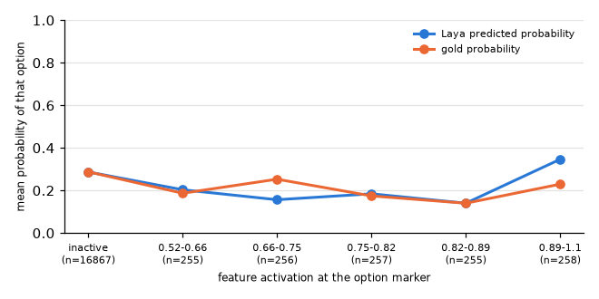

# Feature 11344

Critérios em que aparece: attribution_toward_wrong

**Interpretação (preencher):** 

---

## Maiores ativações

**tr_customer_service_000210 / needs_human** (noul, customer_service) | ativação 2.943 em `estado` | opções ['false', 'true'] | Laya: **false** [0.852, 0.148] | gabarito: **true**

```
<bos> noul question: This conversation requires a human agent rather than automated handling.<eos>
▸ <mask> false: Automation can carry this to resolution.
▸ <mask> true: A human must take over: judgement, authority or empathy is required.

<eos>

 {"account": {"lifetime_value_usd": 459, "prior_tickets_90d": 5, "seats": 1, "tenure_months": 14, "tier": "free"}, "orders": [{"amount_usd": 299, "date": "2026-03-18", "id": "A-97738", "status": "failed"}, {"amount_usd": 299, "date": "2026-02-26", "id": "A-91369", "status": "refunded"}, {"amount_usd": 299, "date": "2026-03-24", "id": "A-52614", "status": "settled"}], "thread": [{"role": "customer", "text": "Hello, I’d like to downgrade my account to the Free plan. I’ve been with you for over a year and have $299 worth⟦ of⟧ credits, but I need this change by the end of the month."}, {"role": "agent", "text": "Thank you for reaching out. Just to confirm, you’re currently on a paid tier and want to move to the Free plan. May I ask which features you rely on most so we can ensure the downgrade won’t impact your workflow?"}, {"role": "customer", "text": "I mainly use the analytics dashboard and the API access; I’m okay losing the advanced reporting, but I can’t lose API keys."}, {"role": "agent", "text": "Got it. Could you also let me know if there are any pending invoices or credit adjustments that need to be addressed before we proceed?"}, {"role": "customer", "text": "No pending invoices—just the $299 credit I’ve accumulated, which I’d like applied before the downgrade takes effect."}]}<eos>
```

**tr_customer_service_000210 / churn_risk** (score, customer_service) | ativação 2.918 em `estado` | opções ['0', '1', '2', '3'] | Laya: **1** [0.398, 0.453, 0.084, 0.065] | gabarito: **2**

```
<bos> score question: How likely is this customer to stop doing business with us because of this interaction?<eos>
▸ <mask> level 0: No sign of dissatisfaction.
▸ <mask> level 1: Mild frustration, but the relationship is intact.
▸ <mask> level 2: Clearly unhappy; repeat problems or explicit complaints.
▸ <mask> level 3: Imminent: threatening to cancel, dispute or leave.

<eos>

 {"account": {"lifetime_value_usd": 459, "prior_tickets_90d": 5, "seats": 1, "tenure_months": 14, "tier": "free"}, "orders": [{"amount_usd": 299, "date": "2026-03-18", "id": "A-97738", "status": "failed"}, {"amount_usd": 299, "date": "2026-02-26", "id": "A-91369", "status": "refunded"}, {"amount_usd": 299, "date": "2026-03-24", "id": "A-52614", "status": "settled"}], "thread": [{"role": "customer", "text": "Hello, I’d like to downgrade my account to the Free plan. I’ve been with you for over a year and have $299 worth⟦ of⟧ credits, but I need this change by the end of the month."}, {"role": "agent", "text": "Thank you for reaching out. Just to confirm, you’re currently on a paid tier and want to move to the Free plan. May I ask which features you rely on most so we can ensure the downgrade won’t impact your workflow?"}, {"role": "customer", "text": "I mainly use the analytics dashboard and the API access; I’m okay losing the advanced reporting, but I can’t lose API keys."}, {"role": "agent", "text": "Got it. Could you also let me know if there are any pending invoices or credit adjustments that need to be addressed before we proceed?"}, {"role": "customer", "text": "No pending invoices—just the $299 credit I’ve accumulated, which I’d like applied before the downgrade takes effect."}]}<eos>
```

**tr_customer_service_000210 / urgency** (score, customer_service) | ativação 2.859 em `estado` | opções ['0', '1', '2', '3'] | Laya: **1** [0.076, 0.423, 0.203, 0.298] | gabarito: **2**

```
<bos> score question: How time-sensitive is this conversation?<eos>
▸ <mask> level 0: No time pressure; can wait indefinitely.
▸ <mask> level 1: Routine; handle within the normal queue.
▸ <mask> level 2: Elevated; should be handled within the same week.
▸ <mask> level 3: Critical; requires action within the same day.

<eos>

 {"account": {"lifetime_value_usd": 459, "prior_tickets_90d": 5, "seats": 1, "tenure_months": 14, "tier": "free"}, "orders": [{"amount_usd": 299, "date": "2026-03-18", "id": "A-97738", "status": "failed"}, {"amount_usd": 299, "date": "2026-02-26", "id": "A-91369", "status": "refunded"}, {"amount_usd": 299, "date": "2026-03-24", "id": "A-52614", "status": "settled"}], "thread": [{"role": "customer", "text": "Hello, I’d like to downgrade my account to the Free plan. I’ve been with you for over a year and have $299 worth⟦ of⟧ credits, but I need this change by the end of the month."}, {"role": "agent", "text": "Thank you for reaching out. Just to confirm, you’re currently on a paid tier and want to move to the Free plan. May I ask which features you rely on most so we can ensure the downgrade won’t impact your workflow?"}, {"role": "customer", "text": "I mainly use the analytics dashboard and the API access; I’m okay losing the advanced reporting, but I can’t lose API keys."}, {"role": "agent", "text": "Got it. Could you also let me know if there are any pending invoices or credit adjustments that need to be addressed before we proceed?"}, {"role": "customer", "text": "No pending invoices—just the $299 credit I’ve accumulated, which I’d like applied before the downgrade takes effect."}]}<eos>
```

**tr_customer_service_000210 / category** (choice, customer_service) | ativação 2.855 em `estado` | opções ['account', 'billing', 'delivery', 'refund', 'technical'] | Laya: **account** [0.6, 0.05, 0.007, 0.035, 0.309] | gabarito: **account**

```
<bos> choice question: What is this customer conversation primarily about?<eos>
▸ <mask> account: Login, plan changes, profile or access management.
▸ <mask> billing: A charge, invoice, subscription or payment problem.
▸ <mask> delivery: Shipping, fulfilment or delivery of a physical item.
▸ <mask> refund: The customer is explicitly asking for money back.
▸ <mask> technical: The product or service is not working as expected.

<eos>

 {"account": {"lifetime_value_usd": 459, "prior_tickets_90d": 5, "seats": 1, "tenure_months": 14, "tier": "free"}, "orders": [{"amount_usd": 299, "date": "2026-03-18", "id": "A-97738", "status": "failed"}, {"amount_usd": 299, "date": "2026-02-26", "id": "A-91369", "status": "refunded"}, {"amount_usd": 299, "date": "2026-03-24", "id": "A-52614", "status": "settled"}], "thread": [{"role": "customer", "text": "Hello, I’d like to downgrade my account to the Free plan. I’ve been with you for over a year and have $299 worth⟦ of⟧ credits, but I need this change by the end of the month."}, {"role": "agent", "text": "Thank you for reaching out. Just to confirm, you’re currently on a paid tier and want to move to the Free plan. May I ask which features you rely on most so we can ensure the downgrade won’t impact your workflow?"}, {"role": "customer", "text": "I mainly use the analytics dashboard and the API access; I’m okay losing the advanced reporting, but I can’t lose API keys."}, {"role": "agent", "text": "Got it. Could you also let me know if there are any pending invoices or credit adjustments that need to be addressed before we proceed?"}, {"role": "customer", "text": "No pending invoices—just the $299 credit I’ve accumulated, which I’d like applied before the downgrade takes effect."}]}<eos>
```

**tr_customer_service_000210 / action** (choice, customer_service) | ativação 2.848 em `estado` | opções ['answer_directly', 'close_no_action', 'escalate_to_human', 'execute_refund', 'request_information'] | Laya: **answer_directly** [0.76, 0.142, 0.012, 0.074, 0.012] | gabarito: **escalate_to_human**

```
<bos> choice question: What should the assistant do next with this conversation?<eos>
▸ <mask> answer_directly: The assistant can resolve this itself with information it already has.
▸ <mask> close_no_action: No further action is warranted; the matter is settled.
▸ <mask> escalate_to_human: Hand off to a human agent with the appropriate authority.
▸ <mask> execute_refund: Issue the refund or credit the customer is owed.
▸ <mask> request_information: More detail is needed from the customer before anything can be done.

<eos>

 {"account": {"lifetime_value_usd": 459, "prior_tickets_90d": 5, "seats": 1, "tenure_months": 14, "tier": "free"}, "orders": [{"amount_usd": 299, "date": "2026-03-18", "id": "A-97738", "status": "failed"}, {"amount_usd": 299, "date": "2026-02-26", "id": "A-91369", "status": "refunded"}, {"amount_usd": 299, "date": "2026-03-24", "id": "A-52614", "status": "settled"}], "thread": [{"role": "customer", "text": "Hello, I’d like to downgrade my account to the Free plan. I’ve been with you for over a year and have $299 worth⟦ of⟧ credits, but I need this change by the end of the month."}, {"role": "agent", "text": "Thank you for reaching out. Just to confirm, you’re currently on a paid tier and want to move to the Free plan. May I ask which features you rely on most so we can ensure the downgrade won’t impact your workflow?"}, {"role": "customer", "text": "I mainly use the analytics dashboard and the API access; I’m okay losing the advanced reporting, but I can’t lose API keys."}, {"role": "agent", "text": "Got it. Could you also let me know if there are any pending invoices or credit adjustments that need to be addressed before we proceed?"}, {"role": "customer", "text": "No pending invoices—just the $299 credit I’ve accumulated, which I’d like applied before the downgrade takes effect."}]}<eos>
```

## Ativações medianas (faixa 40-60%, mediana 0.530)

**tr_customer_service_000252 / category** (choice, customer_service) | ativação 0.470 em `opção` | opções ['account', 'billing', 'delivery', 'refund', 'technical'] | Laya: **account** [0.993, 0.0, 0.0, 0.0, 0.007] | gabarito: **account**

```
<bos> choice question: What is this customer conversation primarily about?<eos>
▸ <mask> account: Login, plan changes⟦,⟧ profile or access management.
▸ <mask> billing: A charge, invoice, subscription or payment problem.
▸ <mask> delivery: Shipping, fulfilment or delivery of a physical item.
▸ <mask> refund: The customer is explicitly asking for money back.
▸ <mask> technical: The product or service is not working as expected.

<eos>

 {"account": {"lifetime_value_usd": 3228, "prior_tickets_90d": 2, "seats": 1, "tenure_months": 49, "tier": "enterprise"}, "thread": [{"role": "customer", "text": "I’ve been paying for this enterprise account for 49 months, and now I’m locked out again. This is the third time this keeps happening, and I’m sick of wasting my time on these recurring login errors."}, {"role": "agent", "text": "I am sorry to hear you're experiencing this issue again. Could you please confirm if you are receiving a specific error code when you attempt to sign in?"}, {"role": "customer", "text": "There is no code, it just kicks me back to the landing page every single time I hit submit. Figure it out."}]}<eos>
```

**tr_security_incidents_000076 / disposition** (choice, security_incidents) | ativação 0.491 em `estado` | opções ['close_benign', 'contain', 'investigate', 'monitor'] | Laya: **monitor** [0.42, 0.07, 0.064, 0.446] | gabarito: **investigate**

```
<bos> choice question: How should this security alert be dispositioned?<eos>
▸ <mask> close_benign: Expected, explainable activity; close without analyst time.
▸ <mask> contain: Contain the host or account immediately; do not wait for triage.
▸ <mask> investigate: Warrants an analyst opening an investigation.
▸ <mask> monitor: Not clearly malicious, but worth watching for recurrence.

<eos>

 {"alert": {"description": "an unusual volume of files read in a short window", "evidence": "Between 2026-09-15 02:00:00 and 02:05:12 UTC, the privileged admin account performed 3,842 file‑read operations on files under /var/www/html/ using the process \"wget\". The activity originated from an unrecognised source IP 192.0.2.77, the credentials for this account have not been rotated for 700 days, and no change window was defined.", "rule": "mass_download"}, "context": {"asset_criticality": "medium", "change_window_active": false, "source_on_allowlist": false}, "history": {"credential_rotation_days_ago": 700, "distinct_countries_30d": 1, "logins_30d": 282, "prior_alerts_90d": 0}, "principal": {"mfa_enrolled⟦":⟧ true, "name": "svc-support-350", "privileges": ["deploy:production", "secrets:read"], "type": "admin"}}<eos>
```

**tr_invoice_processing_000002 / discrepancy_severity** (score, invoice_processing) | ativação 0.531 em `opção` | opções ['0', '1', '2', '3'] | Laya: **2** [0.061, 0.282, 0.574, 0.083] | gabarito: **3**

```
<bos> score question: How material is any discrepancy between the invoice, the order and the delivery?<eos>
▸ <mask> level 0: None: everything reconciles.
▸ <mask> level 1: Trivial: rounding⟦ or⟧ a cosmetic difference.
▸ <mask> level 2: Moderate: a real difference worth confirming.
▸ <mask> level 3: Material: a large or unexplained difference.

<eos>

 {"delivery": {"condition": "accepted", "date": "2026-03-21", "received_qty": 100}, "invoice": {"currency": "USD", "id": "INV-2026-2905", "lines": [{"qty": 100, "sku": "SKU-389", "total_usd": 2517.0, "unit_usd": 25.17}], "total_usd": 2517.0, "vendor": "Northwind Components"}, "payment": {"days_until_due": 0, "discount_expires_in_days": null, "early_payment_discount_pct": null, "status": "scheduled", "terms": "net 30"}, "purchase_order": {"freight_terms": "freight prepaid by vendor, not separately billable", "id": "PO-2756", "lines": [{"qty": 100, "unit_usd": 25.17}], "total_usd": 2517.0}, "vendor_history": {"disputes_12m": 1, "invoices_12m": 51, "prior_invoice_ids": ["INV-2026-2905"]}}<eos>
```

**tr_customer_service_000085 / needs_human** (noul, customer_service) | ativação 0.517 em `opção` | opções ['false', 'true'] | Laya: **false** [0.64, 0.36] | gabarito: **false**

```
<bos> noul question: This conversation requires a human agent rather than automated handling.<eos>
▸ <mask> false: Automation can carry this to resolution.
▸ <mask> true: A human must take over: judgement⟦,⟧ authority or empathy is required.

<eos>

 {"account": {"lifetime_value_usd": 62, "prior_tickets_90d": 3, "seats": 1, "tenure_months": 1, "tier": "standard"}, "thread": [{"role": "customer", "text": "I still haven't gotten a copy of my invoice for this month, even after three tickets. I need it by Friday for my accounting."}, {"role": "agent", "text": "I understand how inconvenient that is. Could you confirm the email address linked to your account so I can verify where the invoice was sent?"}, {"role": "customer", "text": "It's the same john.doe@example.com you have on file. Please just send the PDF; I can't wait any longer."}, {"role": "agent", "text": "Thanks for confirming. I’ll check the sending logs and resend the document. Is there any specific format you prefer, or will a standard PDF work?"}, {"role": "customer", "text": "A standard PDF is fine, but make sure it actually arrives this time—my deadline is this Friday and I can’t afford another delay."}]}<eos>
```

**tr_security_incidents_000153 / true_positive** (noul, security_incidents) | ativação 0.495 em `estado` | opções ['false', 'true'] | Laya: **true** [0.067, 0.933] | gabarito: **true**

```
<bos> noul question: This alert reflects genuinely malicious or unauthorised activity.<eos>
▸ <mask> false: Benign activity, a misconfiguration, or a known false positive.
▸ <mask> true: The underlying behaviour is malicious or unauthorised.

<eos>

 {"alert": {"description": "an unusual volume of files read in a short window", "evidence": "The user account accessed 450 files within a two-minute window, significantly exceeding the baseline for this principal. The activity originated from an unrecognized IP address at 03:14 UTC, outside of any scheduled change management window.", "rule": "mass_download"}, "context": {"asset_criticality": "low", "change_window_active": false, "source_on⟦_⟧allowlist": false}, "history": {"credential_rotation_days_ago": 3, "distinct_countries_30d": 1, "logins_30d": 415, "prior_alerts_90d": 0}, "principal": {"mfa_enrolled": true, "name": "adm-analytics-872", "privileges": ["repo:read"], "type": "employee"}}<eos>
```

## Estatísticas (conjunto de descoberta, dev e teste)

**pred / error**

| split | decisões | ativas | ativas e Laya errou | taxa | lift | q (BH) | OR (CMH) | q (CMH) |
|---|---|---|---|---|---|---|---|---|
| discovery | 5100 | 192 | 132 | 0.688 | 1.07 | 0.275 | 0.05 | 0.0944 |
| dev | 900 | 24 | 18 | 0.750 | 1.12 | 0.702 | nan | nan |
| test | 2000 | 71 | 58 | 0.817 | 1.26 | 0.00636 | 1.03 | 0.996 |

**corr / error**

| split | decisões | ativas | ativas e Laya errou | taxa | lift | q (BH) | OR (CMH) | q (CMH) |
|---|---|---|---|---|---|---|---|---|
| discovery | 5100 | 187 | 127 | 0.679 | 1.06 | 0.393 | 0.04 | 0.0387 |
| dev | 900 | 34 | 28 | 0.824 | 1.23 | 0.119 | 0.00 | 0.849 |
| test | 2000 | 74 | 61 | 0.824 | 1.27 | 0.00243 | 0.00 | 0.587 |

**state / error**

| split | decisões | ativas | ativas e Laya errou | taxa | lift | q (BH) | OR (CMH) | q (CMH) |
|---|---|---|---|---|---|---|---|---|
| discovery | 5100 | 4347 | 2727 | 0.627 | 0.97 | 4.86e-08 | 0.97 | 0.923 |
| dev | 900 | 786 | 515 | 0.655 | 0.97 | 0.124 | 0.55 | 0.339 |
| test | 2000 | 1718 | 1097 | 0.639 | 0.98 | 0.0611 | 0.88 | 0.794 |

**pred / probe_right_laya_wrong**

| split | decisões | ativas | ativas e Laya errou | taxa | lift | q (BH) | OR (CMH) | q (CMH) |
|---|---|---|---|---|---|---|---|---|
| discovery | 2819 | 91 | 74 | 0.813 | 1.26 | 0.0011 | 0.00 | 0.644 |
| dev | 520 | 15 | 13 | 0.867 | 1.28 | nan | nan | nan |
| test | 1106 | 33 | 30 | 0.909 | 1.44 | 0.00127 | nan | nan |

**corr / probe_right_laya_wrong**

| split | decisões | ativas | ativas e Laya errou | taxa | lift | q (BH) | OR (CMH) | q (CMH) |
|---|---|---|---|---|---|---|---|---|
| discovery | 2819 | 36 | 19 | 0.528 | 0.82 | 0.221 | 0.00 | 0.817 |
| dev | 520 | 4 | 2 | 0.500 | 0.74 | nan | nan | nan |
| test | 1106 | 8 | 5 | 0.625 | 0.99 | nan | nan | nan |

**state / probe_right_laya_wrong**

| split | decisões | ativas | ativas e Laya errou | taxa | lift | q (BH) | OR (CMH) | q (CMH) |
|---|---|---|---|---|---|---|---|---|
| discovery | 2819 | 2485 | 1565 | 0.630 | 0.97 | 9.99e-07 | 0.95 | 0.893 |
| dev | 520 | 467 | 307 | 0.657 | 0.97 | 0.132 | 0.53 | 0.426 |
| test | 1106 | 996 | 616 | 0.618 | 0.98 | 0.022 | 0.78 | 0.664 |

Confusão mais sobre-representada (pred): `action|0>2` (n=61, lift 26.13, p=0). Formato `pergunta|índice previsto>índice correto`.

Confusão mais sobre-representada (corr): `disposition|3>1` (n=47, lift 27.27, p=0). Formato `pergunta|índice previsto>índice correto`.

Confusão mais sobre-representada (state): `duplicate|1>0` (n=217, lift 1.17, p=3.87e-16). Formato `pergunta|índice previsto>índice correto`.



