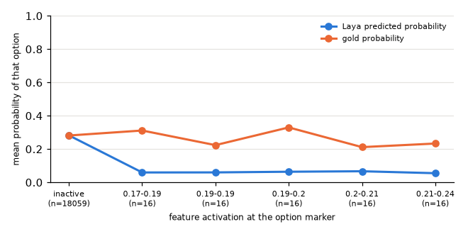

# Feature 11671

Critérios em que aparece: corr_error

**Interpretação (preencher):** 

---

## Maiores ativações

**tr_invoice_processing_000015 / disposition** (choice, invoice_processing) | ativação 3.297 em `estado` | opções ['approve', 'hold', 'manual_review', 'reject'] | Laya: **reject** [0.275, 0.043, 0.012, 0.671] | gabarito: **manual_review**

```
<bos> choice question: How should this vendor invoice be dispositioned?<eos>
▸ <mask> approve: Matches the order and delivery; approve for payment.
▸ <mask> hold: Something needs confirming before payment; hold pending clarification.
▸ <mask> manual_review: A human in finance must review the discrepancy.
▸ <mask> reject: Should not be paid: duplicate, unauthorised or materially wrong.

<eos>

 {"delivery": {"condition": "accepted with exceptions", "date": "2026-03-01", "received_qty": 400}, "invoice": {"currency": "USD", "id": "INV-2026-7138", "lines": [{"qty": 400, "sku": "SKU-998", "total_usd": 151584.0, "unit_usd": 378.96}, {"qty": 1, "⟦sku⟧": "FREIGHT", "total_usd": 1231.43, "unit_usd": 1231.43}], "total_usd": 152815.43, "vendor": "Kestrel Supply"}, "payment": {"days_until_due": 2, "discount_expires_in_days": 7, "early_payment_discount_pct": 2.0, "status": "scheduled", "terms": "net 45"}, "purchase_order": {"freight_terms": "freight prepaid by vendor, not separately billable", "id": "PO-5300", "lines": [{"qty": 400, "unit_usd": 378.96}], "total_usd": 151584.0}, "vendor_history": {"disputes_12m": 0, "invoices_12m": 11, "prior_invoice_ids": ["INV-2026-3511", "INV-2026-4299"]}}<eos>
```

**tr_invoice_processing_000087 / urgency** (score, invoice_processing) | ativação 3.271 em `estado` | opções ['0', '1', '2', '3'] | Laya: **1** [0.102, 0.445, 0.311, 0.142] | gabarito: **3**

```
<bos> score question: How time-sensitive is processing this invoice?<eos>
▸ <mask> level 0: No time pressure; can wait indefinitely.
▸ <mask> level 1: Routine; handle within the normal queue.
▸ <mask> level 2: Elevated; should be handled within the same week.
▸ <mask> level 3: Critical; requires action within the same day.

<eos>

 {"delivery": {"condition": "accepted", "date": "2026-03-14", "received_qty": 10}, "invoice": {"currency": "USD", "id": "INV-2026-8813", "lines": [{"qty": 10, "sku": "SKU-990", "total_usd": 2939.4, "unit_usd": 293.94}, {"qty": 1, "⟦sku⟧": "FREIGHT", "total_usd": 993.06, "unit_usd": 993.06}], "total_usd": 3932.46, "vendor": "Kestrel Supply"}, "payment": {"days_until_due": -21, "discount_expires_in_days": null, "early_payment_discount_pct": null, "status": "overdue", "terms": "net 15"}, "purchase_order": {"freight_terms": "freight prepaid by vendor, not separately billable", "id": "PO-1536", "lines": [{"qty": 10, "unit_usd": 293.94}], "total_usd": 2939.4}, "vendor_history": {"disputes_12m": 2, "invoices_12m": 30, "prior_invoice_ids": ["INV-2026-3053"]}}<eos>
```

**tr_invoice_processing_000036 / discrepancy_severity** (score, invoice_processing) | ativação 3.246 em `estado` | opções ['0', '1', '2', '3'] | Laya: **2** [0.066, 0.337, 0.552, 0.045] | gabarito: **2**

```
<bos> score question: How material is any discrepancy between the invoice, the order and the delivery?<eos>
▸ <mask> level 0: None: everything reconciles.
▸ <mask> level 1: Trivial: rounding or a cosmetic difference.
▸ <mask> level 2: Moderate: a real difference worth confirming.
▸ <mask> level 3: Material: a large or unexplained difference.

<eos>

 {"delivery": {"condition": "accepted", "date": "2026-03-15", "received_qty": 250}, "invoice": {"currency": "USD", "id": "INV-2026-5401", "lines": [{"qty": 250, "sku": "SKU-440", "total_usd": 12045.0, "unit_usd": 48.18}, {"qty": 1, "⟦sku⟧": "FREIGHT", "total_usd": 646.19, "unit_usd": 646.19}], "total_usd": 12691.19, "vendor": "Orbit Logistics"}, "payment": {"days_until_due": 27, "discount_expires_in_days": 7, "early_payment_discount_pct": 2.0, "status": "scheduled", "terms": "net 30"}, "purchase_order": {"freight_terms": "freight prepaid by vendor, not separately billable", "id": "PO-4489", "lines": [{"qty": 250, "unit_usd": 48.18}], "total_usd": 12045.0}, "vendor_history": {"disputes_12m": 1, "invoices_12m": 53, "prior_invoice_ids": ["INV-2026-1271", "INV-2026-5652", "INV-2026-6719", "INV-2026-7885"]}}<eos>
```

**tr_invoice_processing_000015 / urgency** (score, invoice_processing) | ativação 3.244 em `estado` | opções ['0', '1', '2', '3'] | Laya: **1** [0.114, 0.488, 0.27, 0.127] | gabarito: **2**

```
<bos> score question: How time-sensitive is processing this invoice?<eos>
▸ <mask> level 0: No time pressure; can wait indefinitely.
▸ <mask> level 1: Routine; handle within the normal queue.
▸ <mask> level 2: Elevated; should be handled within the same week.
▸ <mask> level 3: Critical; requires action within the same day.

<eos>

 {"delivery": {"condition": "accepted with exceptions", "date": "2026-03-01", "received_qty": 400}, "invoice": {"currency": "USD", "id": "INV-2026-7138", "lines": [{"qty": 400, "sku": "SKU-998", "total_usd": 151584.0, "unit_usd": 378.96}, {"qty": 1, "⟦sku⟧": "FREIGHT", "total_usd": 1231.43, "unit_usd": 1231.43}], "total_usd": 152815.43, "vendor": "Kestrel Supply"}, "payment": {"days_until_due": 2, "discount_expires_in_days": 7, "early_payment_discount_pct": 2.0, "status": "scheduled", "terms": "net 45"}, "purchase_order": {"freight_terms": "freight prepaid by vendor, not separately billable", "id": "PO-5300", "lines": [{"qty": 400, "unit_usd": 378.96}], "total_usd": 151584.0}, "vendor_history": {"disputes_12m": 0, "invoices_12m": 11, "prior_invoice_ids": ["INV-2026-3511", "INV-2026-4299"]}}<eos>
```

**tr_invoice_processing_000036 / disposition** (choice, invoice_processing) | ativação 3.234 em `estado` | opções ['approve', 'hold', 'manual_review', 'reject'] | Laya: **approve** [0.703, 0.062, 0.018, 0.217] | gabarito: **manual_review**

```
<bos> choice question: How should this vendor invoice be dispositioned?<eos>
▸ <mask> approve: Matches the order and delivery; approve for payment.
▸ <mask> hold: Something needs confirming before payment; hold pending clarification.
▸ <mask> manual_review: A human in finance must review the discrepancy.
▸ <mask> reject: Should not be paid: duplicate, unauthorised or materially wrong.

<eos>

 {"delivery": {"condition": "accepted", "date": "2026-03-15", "received_qty": 250}, "invoice": {"currency": "USD", "id": "INV-2026-5401", "lines": [{"qty": 250, "sku": "SKU-440", "total_usd": 12045.0, "unit_usd": 48.18}, {"qty": 1, "⟦sku⟧": "FREIGHT", "total_usd": 646.19, "unit_usd": 646.19}], "total_usd": 12691.19, "vendor": "Orbit Logistics"}, "payment": {"days_until_due": 27, "discount_expires_in_days": 7, "early_payment_discount_pct": 2.0, "status": "scheduled", "terms": "net 30"}, "purchase_order": {"freight_terms": "freight prepaid by vendor, not separately billable", "id": "PO-4489", "lines": [{"qty": 250, "unit_usd": 48.18}], "total_usd": 12045.0}, "vendor_history": {"disputes_12m": 1, "invoices_12m": 53, "prior_invoice_ids": ["INV-2026-1271", "INV-2026-5652", "INV-2026-6719", "INV-2026-7885"]}}<eos>
```

## Ativações medianas (faixa 40-60%, mediana 2.811)

**tr_invoice_processing_000065 / matches_order** (noul, invoice_processing) | ativação 2.781 em `estado` | opções ['false', 'true'] | Laya: **true** [0.032, 0.968] | gabarito: **true**

```
<bos> noul question: The invoice reconciles with the purchase order and the recorded delivery.<eos>
▸ <mask> false: There is a discrepancy against the order or the delivery.
▸ <mask> true: Line items, quantities and amounts reconcile.

<eos>

 {"delivery": {"condition": "accepted", "date": "2026-03-22", "received_qty": 250}, "invoice": {"currency": "USD", "id": "INV-2026-7887", "lines": [{"qty": 250, "⟦sku⟧": "SKU-490", "total_usd": 31982.5, "unit_usd": 127.93}], "total_usd": 31982.5, "vendor": "Orbit Logistics"}, "payment": {"days_until_due": 0, "discount_expires_in_days": 5, "early_payment_discount_pct": 2.0, "status": "scheduled", "terms": "net 15"}, "purchase_order": {"freight_terms": "freight prepaid by vendor, not separately billable", "id": "PO-8246", "lines": [{"qty": 250, "unit_usd": 127.93}], "total_usd": 31982.5}, "vendor_history": {"disputes_12m": 1, "invoices_12m": 17, "prior_invoice_ids": ["INV-2026-4688", "INV-2026-4365", "INV-2026-2955"]}}<eos>
```

**tr_invoice_processing_000032 / disposition** (choice, invoice_processing) | ativação 2.785 em `estado` | opções ['approve', 'hold', 'manual_review', 'reject'] | Laya: **approve** [0.43, 0.34, 0.033, 0.197] | gabarito: **approve**

```
<bos> choice question: How should this vendor invoice be dispositioned?<eos>
▸ <mask> approve: Matches the order and delivery; approve for payment.
▸ <mask> hold: Something needs confirming before payment; hold pending clarification.
▸ <mask> manual_review: A human in finance must review the discrepancy.
▸ <mask> reject: Should not be paid: duplicate, unauthorised or materially wrong.

<eos>

 {"delivery": {"condition": "accepted", "date": "2026-03-05", "received_qty": 100}, "invoice": {"currency": "USD", "id": "INV-2026-2226", "lines": [{"qty": 100, "⟦sku⟧": "SKU-343", "total_usd": 18967.0, "unit_usd": 189.67}], "total_usd": 18967.0, "vendor": "Acme Fabrication"}, "payment": {"days_until_due": 27, "discount_expires_in_days": null, "early_payment_discount_pct": null, "status": "scheduled", "terms": "net 15"}, "purchase_order": {"freight_terms": "freight prepaid by vendor, not separately billable", "id": "PO-8529", "lines": [{"qty": 100, "unit_usd": 189.67}], "total_usd": 18967.0}, "vendor_history": {"disputes_12m": 0, "invoices_12m": 4, "prior_invoice_ids": ["INV-2026-8783"]}}<eos>
```

**tr_invoice_processing_000058 / disposition** (choice, invoice_processing) | ativação 2.834 em `estado` | opções ['approve', 'hold', 'manual_review', 'reject'] | Laya: **approve** [0.612, 0.165, 0.024, 0.2] | gabarito: **approve**

```
<bos> choice question: How should this vendor invoice be dispositioned?<eos>
▸ <mask> approve: Matches the order and delivery; approve for payment.
▸ <mask> hold: Something needs confirming before payment; hold pending clarification.
▸ <mask> manual_review: A human in finance must review the discrepancy.
▸ <mask> reject: Should not be paid: duplicate, unauthorised or materially wrong.

<eos>

 {"delivery": {"condition": "accepted", "date": "2026-03-07", "received_qty": 250}, "invoice": {"currency": "USD", "id": "INV-2026-7113", "lines": [{"qty": 250, "⟦sku⟧": "SKU-199", "total_usd": 67787.5, "unit_usd": 271.15}], "total_usd": 67787.5, "vendor": "Kestrel Supply"}, "payment": {"days_until_due": 0, "discount_expires_in_days": null, "early_payment_discount_pct": null, "status": "scheduled", "terms": "net 15"}, "purchase_order": {"freight_terms": "freight prepaid by vendor, not separately billable", "id": "PO-4520", "lines": [{"qty": 250, "unit_usd": 271.15}], "total_usd": 67787.5}, "vendor_history": {"disputes_12m": 0, "invoices_12m": 28, "prior_invoice_ids": ["INV-2026-9814", "INV-2026-4904", "INV-2026-6678", "INV-2026-8738"]}}<eos>
```

**tr_invoice_processing_000006 / duplicate** (noul, invoice_processing) | ativação 2.812 em `estado` | opções ['false', 'true'] | Laya: **true** [0.017, 0.983] | gabarito: **false**

```
<bos> noul question: This invoice appears to duplicate an invoice already submitted.<eos>
▸ <mask> false: no, the statement does not hold
▸ <mask> true: yes, the statement holds

<eos>

 {"delivery": {"condition": "accepted", "date": "2026-03-27", "received_qty": 400}, "invoice": {"currency": "EUR", "id": "INV-2026-6011", "lines": [{"qty": 400, "⟦sku⟧": "SKU-685", "total_usd": 137068.0, "unit_usd": 342.67}], "total_usd": 137068.0, "vendor": "Orbit Logistics"}, "payment": {"days_until_due": 11, "discount_expires_in_days": 3, "early_payment_discount_pct": 2.0, "status": "scheduled", "terms": "net 30"}, "purchase_order": {"freight_terms": "freight prepaid by vendor, not separately billable", "id": "PO-3621", "lines": [{"qty": 400, "unit_usd": 342.67}], "total_usd": 137068.0}, "vendor_history": {"disputes_12m": 0, "invoices_12m": 4, "prior_invoice_ids": ["INV-2026-7803", "INV-2026-5940"]}}<eos>
```

**tr_invoice_processing_000172 / disposition** (choice, invoice_processing) | ativação 2.795 em `estado` | opções ['approve', 'hold', 'manual_review', 'reject'] | Laya: **approve** [0.511, 0.293, 0.037, 0.159] | gabarito: **reject**

```
<bos> choice question: How should this vendor invoice be dispositioned?<eos>
▸ <mask> approve: Matches the order and delivery; approve for payment.
▸ <mask> hold: Something needs confirming before payment; hold pending clarification.
▸ <mask> manual_review: A human in finance must review the discrepancy.
▸ <mask> reject: Should not be paid: duplicate, unauthorised or materially wrong.

<eos>

 {"delivery": {"condition": "accepted", "date": "2026-03-23", "received_qty": 250}, "invoice": {"currency": "USD", "id": "INV-2026-5713", "lines": [{"qty": 250, "⟦sku⟧": "SKU-100", "total_usd": 57532.5, "unit_usd": 230.13}], "total_usd": 57532.5, "vendor": "Orbit Logistics"}, "payment": {"days_until_due": 2, "discount_expires_in_days": 4, "early_payment_discount_pct": 2.0, "status": "scheduled", "terms": "net 30"}, "purchase_order": {"freight_terms": "freight prepaid by vendor, not separately billable", "id": "PO-3277", "lines": [{"qty": 250, "unit_usd": 230.13}], "total_usd": 57532.5}, "vendor_history": {"disputes_12m": 1, "invoices_12m": 60, "prior_invoice_ids": ["INV-2026-5713"]}}<eos>
```

## Estatísticas (conjunto de descoberta, dev e teste)

**pred / error**

| split | decisões | ativas | ativas e Laya errou | taxa | lift | q (BH) | OR (CMH) | q (CMH) |
|---|---|---|---|---|---|---|---|---|
| discovery | 5100 | 0 | 0 | nan | nan | nan | nan | nan |
| dev | 900 | 0 | 0 | nan | nan | nan | nan | nan |
| test | 2000 | 0 | 0 | nan | nan | nan | nan | nan |

**corr / error**

| split | decisões | ativas | ativas e Laya errou | taxa | lift | q (BH) | OR (CMH) | q (CMH) |
|---|---|---|---|---|---|---|---|---|
| discovery | 5100 | 21 | 21 | 1.000 | 1.55 | 0.000326 | nan | nan |
| dev | 900 | 7 | 7 | 1.000 | 1.49 | nan | nan | nan |
| test | 2000 | 11 | 11 | 1.000 | 1.54 | nan | nan | nan |

**state / error**

| split | decisões | ativas | ativas e Laya errou | taxa | lift | q (BH) | OR (CMH) | q (CMH) |
|---|---|---|---|---|---|---|---|---|
| discovery | 5100 | 1342 | 888 | 0.662 | 1.03 | 0.237 | 0.66 | 0.00223 |
| dev | 900 | 322 | 222 | 0.689 | 1.03 | 0.796 | 0.39 | 0.0806 |
| test | 2000 | 538 | 372 | 0.691 | 1.06 | 0.136 | 0.77 | 0.506 |

**pred / probe_right_laya_wrong**

| split | decisões | ativas | ativas e Laya errou | taxa | lift | q (BH) | OR (CMH) | q (CMH) |
|---|---|---|---|---|---|---|---|---|
| discovery | 2819 | 0 | 0 | nan | nan | nan | nan | nan |
| dev | 520 | 0 | 0 | nan | nan | nan | nan | nan |
| test | 1106 | 0 | 0 | nan | nan | nan | nan | nan |

**corr / probe_right_laya_wrong**

| split | decisões | ativas | ativas e Laya errou | taxa | lift | q (BH) | OR (CMH) | q (CMH) |
|---|---|---|---|---|---|---|---|---|
| discovery | 2819 | 5 | 5 | 1.000 | 1.55 | nan | nan | nan |
| dev | 520 | 0 | 0 | nan | nan | nan | nan | nan |
| test | 1106 | 1 | 1 | 1.000 | 1.58 | nan | nan | nan |

**state / probe_right_laya_wrong**

| split | decisões | ativas | ativas e Laya errou | taxa | lift | q (BH) | OR (CMH) | q (CMH) |
|---|---|---|---|---|---|---|---|---|
| discovery | 2819 | 802 | 556 | 0.693 | 1.07 | 0.00498 | 0.44 | 1.42e-07 |
| dev | 520 | 197 | 135 | 0.685 | 1.02 | 0.998 | 0.20 | 0.000667 |
| test | 1106 | 318 | 225 | 0.708 | 1.12 | 0.0123 | 0.45 | 0.0196 |

Confusão mais sobre-representada (corr): `discrepancy_severity|2>3` (n=19, lift 78.21, p=1.31e-36). Formato `pergunta|índice previsto>índice correto`.

Confusão mais sobre-representada (state): `discrepancy_severity|2>0` (n=108, lift 3.80, p=0). Formato `pergunta|índice previsto>índice correto`.



