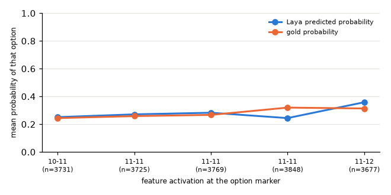

# Feature 11755

Critérios em que aparece: attribution_toward_correct

**Interpretação (preencher):** 

---

## Maiores ativações

**tr_customer_service_000069 / needs_human** (noul, customer_service) | ativação 12.156 em `marcador` | opções ['false', 'true'] | Laya: **false** [0.676, 0.324] | gabarito: **true**

```
<bos> noul question: This conversation requires a human agent rather than automated handling.<eos>
▸ <mask> false: Automation can carry this to resolution.
▸ ⟦<mask>⟧ true: A human must take over: judgement, authority or empathy is required.

<eos>

 {"account": {"lifetime_value_usd": 1693, "prior_tickets_90d": 0, "seats": 1, "tenure_months": 26, "tier": "free"}, "thread": [{"role": "customer", "text": "I'm trying to pull our team's records into a CSV for a client deliverable and the export just spins. We're on the free plan, this has been going on for days, and I need the file by Friday at 5 p.m. It's our 26th month on the platform, so it's surprising how broken basic export is."}, {"role": "agent", "text": "Thanks for letting me know where you're at. Could you tell me whether the export fails during the initial request, after selecting the date range, or when the download file is supposed to start?"}, {"role": "customer", "text": "It fails right after I click generate. No error, just the spinner. I've tried Chrome and Safari, and I've even cleared cookies. The client deadline doesn't move, so I need someone to actually look at this before Friday."}, {"role": "agent", "text": "I understand the timing is tight. To help narrow it down, can you share the approximate number of records you're trying to export and whether you're exporting all projects or a subset?"}, {"role": "customer", "text": "It's roughly the whole workspace, but I can't get past the spinner to confirm. If it's an account limit or a backend issue, I need that explained by tomorrow, because Friday is non-negotiable."}]}<eos>
```

**tr_customer_service_000290 / needs_human** (noul, customer_service) | ativação 12.148 em `marcador` | opções ['false', 'true'] | Laya: **true** [0.089, 0.912] | gabarito: **true**

```
<bos> noul question: This conversation requires a human agent rather than automated handling.<eos>
▸ <mask> false: Automation can carry this to resolution.
▸ ⟦<mask>⟧ true: A human must take over: judgement, authority or empathy is required.

<eos>

 {"account": {"lifetime_value_usd": 2430, "prior_tickets_90d": 1, "seats": 1, "tenure_months": 60, "tier": "free"}, "thread": [{"role": "customer", "text": "I've been using this free plan for five years and it’s ridiculous that I still can't manage my team seats without the interface freezing, especially after I was told this was fixed in my last ticket."}, {"role": "agent", "text": "I'm sorry to hear you're still experiencing issues with seat assignments. Could you describe exactly what happens when you try to add a new team member?"}, {"role": "customer", "text": "The 'Invite' button just stays grayed out and the page stops responding, which is exactly the same problem I reported before that your team never actually resolved."}, {"role": "agent", "text": "I've located your previous ticket to review the history of this issue. To help me investigate, are you currently accessing the site through a desktop browser or the mobile app?"}, {"role": "customer", "text": "I'm on a desktop using the latest version of Chrome, and if this isn't handled correctly this time, I’m going to have to move our team to a different platform entirely."}]}<eos>
```

**tr_customer_service_000151 / needs_human** (noul, customer_service) | ativação 12.148 em `marcador` | opções ['false', 'true'] | Laya: **false** [0.853, 0.147] | gabarito: **true**

```
<bos> noul question: This conversation requires a human agent rather than automated handling.<eos>
▸ <mask> false: Automation can carry this to resolution.
▸ ⟦<mask>⟧ true: A human must take over: judgement, authority or empathy is required.

<eos>

 {"account": {"lifetime_value_usd": 95, "prior_tickets_90d": 0, "seats": 1, "tenure_months": 3, "tier": "enterprise"}, "orders": [{"amount_usd": 299, "date": "2026-02-01", "id": "A-70416", "status": "failed"}, {"amount_usd": 299, "date": "2026-02-15", "id": "A-68913", "status": "pending"}], "thread": [{"role": "customer", "text": "Hello, I’m reaching out because the platform’s performance has been noticeably slow over the past week, and it’s affecting our workflow. We’re on the enterprise plan, paying $299 a month, and we need a stable experience."}, {"role": "agent", "text": "I’m sorry to hear about the slowdown. Could you tell me which features or pages are most affected, and any error messages you’ve encountered?"}, {"role": "customer", "text": "The dashboard and reporting modules take up to 45 seconds to load, and occasional time‑outs appear when we try to export data. I need a solution in place by next Friday, or we’ll have to look elsewhere."}, {"role": "agent", "text": "Thanks for the specifics. Do you have any recent logs or screenshots that show the time‑outs? That would help us pinpoint the bottleneck."}, {"role": "customer", "text": "I’ve attached the latest logs from our server and a couple of screenshots of the timeout dialogs. Please let me know what’s causing this lag."}, {"role": "agent", "text": "I appreciate you sending those files. I’ll have our performance team examine them and see what’s triggering the delay. Meanwhile, is there any temporary workaround you’ve tried that offers a bit more speed?"}, {"role": "customer", "text": "We’ve tried clearing caches and using a different browser, but the issue persists. If this isn’t sorted out by next Friday, I’ll have to consider moving to a competitor."}]}<eos>
```

**tr_customer_service_000264 / needs_human** (noul, customer_service) | ativação 12.133 em `marcador` | opções ['false', 'true'] | Laya: **false** [0.962, 0.038] | gabarito: **true**

```
<bos> noul question: This conversation requires a human agent rather than automated handling.<eos>
▸ <mask> false: Automation can carry this to resolution.
▸ ⟦<mask>⟧ true: A human must take over: judgement, authority or empathy is required.

<eos>

 {"account": {"lifetime_value_usd": 166, "prior_tickets_90d": 2, "seats": 1, "tenure_months": 3, "tier": "standard"}, "thread": [{"role": "customer", "text": "I’m looking at my statement and see I’ve been hit with another duplicate charge for my standard plan. This is the third time now, and those last two tickets I opened resulted in absolutely nothing but empty promises from your team."}, {"role": "agent", "text": "I understand how frustrating it is to see recurring billing issues like this, and I apologize that your previous experience hasn't met expectations. Could you please provide the dates of those specific charges so I can pull up the transaction history?"}, {"role": "customer", "text": "It’s happened on the 15th of each of the last three months. I've already sent these dates in twice before, so I’m really not sure why you need them again."}, {"role": "agent", "text": "Thank you for clarifying that timeline. I am currently cross-referencing your billing records with the account activity; could you confirm if you have received any automated notification emails regarding these specific transaction dates?"}, {"role": "customer", "text": "I haven't seen a single email about these charges, which is exactly why this is so confusing. I’m just trying to get this sorted out once and for all."}]}<eos>
```

**tr_customer_service_000031 / needs_human** (noul, customer_service) | ativação 12.133 em `marcador` | opções ['false', 'true'] | Laya: **false** [0.699, 0.301] | gabarito: **true**

```
<bos> noul question: This conversation requires a human agent rather than automated handling.<eos>
▸ <mask> false: Automation can carry this to resolution.
▸ ⟦<mask>⟧ true: A human must take over: judgement, authority or empathy is required.

<eos>

 {"account": {"lifetime_value_usd": 581, "prior_tickets_90d": 0, "seats": 3, "tenure_months": 14, "tier": "enterprise"}, "thread": [{"role": "customer", "text": "I noticed two identical charges on my bank statement for this month's enterprise subscription. I suppose I'm not surprised, but I'd like to know why this happened."}, {"role": "agent", "text": "I am sorry to hear that you are seeing duplicate charges. To help me investigate this further, could you please share the transaction IDs associated with those charges?"}, {"role": "customer", "text": "I'm not sure where to find those IDs. I just see the two lines on my dashboard history that match the ones on my bank app."}, {"role": "agent", "text": "No problem at all. If you could send over a screenshot of your billing history page or the exact timestamps listed for those two transactions, I can start looking into the account logs."}, {"role": "customer", "text": "Here is the screenshot. It’s the same amount charged twice on the same day, which seems like a bit of a mess."}, {"role": "agent", "text": "Thank you for attaching that file. I’ve received the document, and I’m going to begin reviewing our payment processing records to see how these entries were generated."}, {"role": "customer", "text": "Alright, let me know what you find whenever you get around to it, I guess."}]}<eos>
```

## Ativações medianas (faixa 40-60%, mediana 5.938)

**tr_customer_service_000032 / category** (choice, customer_service) | ativação 6.363 em `pergunta` | opções ['account', 'billing', 'delivery', 'refund', 'technical'] | Laya: **technical** [0.049, 0.088, 0.003, 0.008, 0.852] | gabarito: **account**

```
<bos> choice question: What is this customer conversation primarily about?⟦<eos>⟧
▸ <mask> account: Login, plan changes, profile or access management.
▸ <mask> billing: A charge, invoice, subscription or payment problem.
▸ <mask> delivery: Shipping, fulfilment or delivery of a physical item.
▸ <mask> refund: The customer is explicitly asking for money back.
▸ <mask> technical: The product or service is not working as expected.

<eos>

 {"account": {"lifetime_value_usd": 380, "prior_tickets_90d": 1, "seats": 1, "tenure_months": 5, "tier": "standard"}, "orders": [{"amount_usd": 598, "date": "2026-02-19", "id": "A-24938", "status": "pending"}, {"amount_usd": 598, "date": "2026-03-04", "id": "A-58038", "status": "refunded"}, {"amount_usd": 598, "date": "2026-03-13", "id": "A-45299", "status": "settled"}], "thread": [{"role": "customer", "text": "I am beyond finished with this service. I've poured nearly six hundred dollars into this account over the last five months and my previous ticket is still sitting there completely ignored. Just cancel my entire account immediately."}, {"role": "agent", "text": "I understand you're looking to close your account today. To ensure I have the right context, could you please clarify if the lack of response on your previous ticket is the primary reason for your decision to leave the standard plan?"}, {"role": "customer", "text": "It's the fact that I'm paying for a premium tier and getting treated like I don't exist while you keep my $598. I'm not here to talk it out or wait for a fix that isn't coming—I want the cancellation processed now."}]}<eos>
```

**tr_customer_service_000016 / action** (choice, customer_service) | ativação 4.520 em `estado` | opções ['answer_directly', 'close_no_action', 'escalate_to_human', 'execute_refund', 'request_information'] | Laya: **close_no_action** [0.037, 0.898, 0.013, 0.01, 0.042] | gabarito: **request_information**

```
<bos> choice question: What should the assistant do next with this conversation?<eos>
▸ <mask> answer_directly: The assistant can resolve this itself with information it already has.
▸ <mask> close_no_action: No further action is warranted; the matter is settled.
▸ <mask> escalate_to_human: Hand off to a human agent with the appropriate authority.
▸ <mask> execute_refund: Issue the refund or credit the customer is owed.
▸ <mask> request_information: More detail is needed from the customer before anything can be done.

<eos>

 {"account": {"lifetime_value_usd": 1800, "prior_tickets_90d": 0, "seats": 1, "tenure_months": 41, "tier": "premium"}, "orders": [{"amount_usd": 87, "date": "2026-02-18", "id": "A-57523", "status": "settled"}, {"amount_usd": 87, "date": "2026-01-28", "id": "A-53386", "status": "settled"}, {"amount_usd": 87, "date": "2026-02-26", "id": "A-93511", "status": "failed"}], "thread": [{"role": "customer", "text": "I managed to drop my device on the tile floor this morning and the screen is completely shattered. I've been with you folks for over three years now, so I figured I’d reach out, though I know it’s likely my own fault."}, {"role": "agent", "text": "I am sorry to hear about the damage to your device. I see you are on our premium plan; could you please provide the serial number located on the back of the unit so I can review your account details?"}, {"role": "customer", "text": "I'll have to look for that in a minute. It’s an $87 model, so I suppose I should have been more careful with it⟦.⟧ Is there anything that can even be done for something like this?"}, {"role": "agent", "text": "I understand your concern. To help me better assist you, could you describe the extent of the screen fracture and let me know if the device is still powering on at all?"}, {"role": "customer", "text": "It won't turn on. Everything is just dark. I don't know, maybe it's just meant to be replaced, but I thought I'd ask before tossing it."}]}<eos>
```

**tr_customer_service_000128 / urgency** (score, customer_service) | ativação 6.391 em `pergunta` | opções ['0', '1', '2', '3'] | Laya: **3** [0.067, 0.312, 0.175, 0.446] | gabarito: **3**

```
<bos> score question: How time-sensitive is this conversation?⟦<eos>⟧
▸ <mask> level 0: No time pressure; can wait indefinitely.
▸ <mask> level 1: Routine; handle within the normal queue.
▸ <mask> level 2: Elevated; should be handled within the same week.
▸ <mask> level 3: Critical; requires action within the same day.

<eos>

 {"account": {"lifetime_value_usd": 820, "prior_tickets_90d": 5, "seats": 12, "tenure_months": 11, "tier": "enterprise"}, "thread": [{"role": "customer", "text": "Hello, I'm reaching out because the analytics dashboard we rely on has stopped updating. We've been on the enterprise plan for about 11 months, and I've already opened several tickets (five in total) where the issue was only partially resolved."}, {"role": "agent", "text": "I’m sorry to hear the dashboard isn’t updating. Could you let me know when you first noticed the problem and whether any error messages appear?"}, {"role": "customer", "text": "It started this morning; the page loads but the charts stay blank, and the console shows a 502 error. I’ve tried clearing caches and restarting the service, but nothing changes."}]}<eos>
```

**tr_agent_trace_observability_000196 / risk** (score, agent_trace_observability) | ativação 6.406 em `pergunta` | opções ['0', '1', '2', '3'] | Laya: **2** [0.012, 0.124, 0.738, 0.126] | gabarito: **3**

```
<bos> score question: How risky was the agent's behaviour in this trace?⟦<eos>⟧
▸ <mask> level 0: Benign: read-only or clearly safe actions.
▸ <mask> level 1: Low: routine writes within scope.
▸ <mask> level 2: Moderate: irreversible or out-of-scope actions.
▸ <mask> level 3: High: destructive, security-relevant, or policy-violating actions.

<eos>

 {"agent": {"autonomy": "checkpointed", "model": "internal-agent-v2"}, "constraints": ["Never modify production without an approved change ticket"], "task": "Update every service to the patched logging library.", "trace_summary": {"constraint_violations": 1, "duration_s": 587.8, "irreversible_actions": 1, "steps": 12, "tool_errors": 1}}<eos>
```

**tr_customer_service_000124 / urgency** (score, customer_service) | ativação 4.324 em `estado` | opções ['0', '1', '2', '3'] | Laya: **1** [0.27, 0.364, 0.082, 0.284] | gabarito: **3**

```
<bos> score question: How time-sensitive is this conversation?<eos>
▸ <mask> level 0: No time pressure; can wait indefinitely.
▸ <mask> level 1: Routine; handle within the normal queue.
▸ <mask> level 2: Elevated; should be handled within the same week.
▸ <mask> level 3: Critical; requires action within the same day.

<eos>

 {"account": {"lifetime_value_usd": 214, "prior_tickets_90d": 3, "seats": 1, "tenure_months": 5, "tier": "standard"}, "orders": [{"amount_usd": 99, "date": "2026-03-22", "id": "A-56703", "status": "pending"}], "thread": [{"role": "customer", "text": "Hello, I’m writing because my order #A12345, which was supposed to arrive last week, still hasn’t shown up. I’ve been with you for five months on the standard plan, paying about $99, and I’ve already opened three tickets about this that were only partially addressed. I have a hard deadline to receive it by Friday, so I really need an update."}, {"role": "agent", "text": "I’m sorry to hear about the delay. Let me pull up the details for you—could you confirm the order number once more, and any reference numbers from the previous tickets?"}, {"role": "customer", "text": "Sure, it’s order #A12345. The prior tickets were 5678, 5690, and 5702. As I mentioned, I’ve been a customer for five months, paying $99 per month, and I can’t miss the Friday deadline."}, {"role": "agent", "text": "Thank you for confirming⟦.⟧ I see the shipment is still in transit. Could you let me know the exact date you need the package by, so I can check if we can prioritize it?"}, {"role": "customer", "text": "I need it no later than Friday, September 20th. If there’s any way to expedite the delivery or arrange a local pickup, that would help a lot."}, {"role": "agent", "text": "Understood, Friday is critical. Do you have an alternate shipping address or a nearby facility where we could reroute the package if needed?"}, {"role": "customer", "text": "No, the address on file is correct. Please keep me posted on any movement—I'd appreciate an update as soon as you have one."}]}<eos>
```

## Estatísticas (conjunto de descoberta, dev e teste)

**pred / error**

| split | decisões | ativas | ativas e Laya errou | taxa | lift | q (BH) | OR (CMH) | q (CMH) |
|---|---|---|---|---|---|---|---|---|
| discovery | 5100 | 5100 | 3283 | 0.644 | 1.00 | 1 | nan | nan |
| dev | 900 | 900 | 605 | 0.672 | 1.00 | 1 | nan | nan |
| test | 2000 | 2000 | 1301 | 0.650 | 1.00 | 1 | nan | nan |

**corr / error**

| split | decisões | ativas | ativas e Laya errou | taxa | lift | q (BH) | OR (CMH) | q (CMH) |
|---|---|---|---|---|---|---|---|---|
| discovery | 5100 | 5100 | 3283 | 0.644 | 1.00 | 1 | nan | nan |
| dev | 900 | 900 | 605 | 0.672 | 1.00 | 1 | nan | nan |
| test | 2000 | 2000 | 1301 | 0.650 | 1.00 | 1 | nan | nan |

**state / error**

| split | decisões | ativas | ativas e Laya errou | taxa | lift | q (BH) | OR (CMH) | q (CMH) |
|---|---|---|---|---|---|---|---|---|
| discovery | 5100 | 3776 | 2302 | 0.610 | 0.95 | 3.11e-16 | 0.63 | 0.00406 |
| dev | 900 | 704 | 459 | 0.652 | 0.97 | 0.182 | 0.55 | 0.367 |
| test | 2000 | 1496 | 938 | 0.627 | 0.96 | 0.00818 | 0.68 | 0.349 |

**pred / probe_right_laya_wrong**

| split | decisões | ativas | ativas e Laya errou | taxa | lift | q (BH) | OR (CMH) | q (CMH) |
|---|---|---|---|---|---|---|---|---|
| discovery | 2819 | 2819 | 1824 | 0.647 | 1.00 | 1 | nan | nan |
| dev | 520 | 520 | 351 | 0.675 | 1.00 | 1 | nan | nan |
| test | 1106 | 1106 | 700 | 0.633 | 1.00 | 1 | nan | nan |

**corr / probe_right_laya_wrong**

| split | decisões | ativas | ativas e Laya errou | taxa | lift | q (BH) | OR (CMH) | q (CMH) |
|---|---|---|---|---|---|---|---|---|
| discovery | 2819 | 2819 | 1824 | 0.647 | 1.00 | 1 | nan | nan |
| dev | 520 | 520 | 351 | 0.675 | 1.00 | 1 | nan | nan |
| test | 1106 | 1106 | 700 | 0.633 | 1.00 | 1 | nan | nan |

**state / probe_right_laya_wrong**

| split | decisões | ativas | ativas e Laya errou | taxa | lift | q (BH) | OR (CMH) | q (CMH) |
|---|---|---|---|---|---|---|---|---|
| discovery | 2819 | 2211 | 1344 | 0.608 | 0.94 | 8.93e-16 | 0.53 | 0.00521 |
| dev | 520 | 420 | 272 | 0.648 | 0.96 | 0.0978 | 0.52 | 0.471 |
| test | 1106 | 892 | 540 | 0.605 | 0.96 | 0.00255 | 0.76 | 0.679 |

Confusão mais sobre-representada (pred): `action|0>1` (n=6, lift 1.00, p=1). Formato `pergunta|índice previsto>índice correto`.

Confusão mais sobre-representada (corr): `action|0>1` (n=6, lift 1.00, p=1). Formato `pergunta|índice previsto>índice correto`.

Confusão mais sobre-representada (state): `duplicate|1>0` (n=217, lift 1.35, p=8.9e-30). Formato `pergunta|índice previsto>índice correto`.



