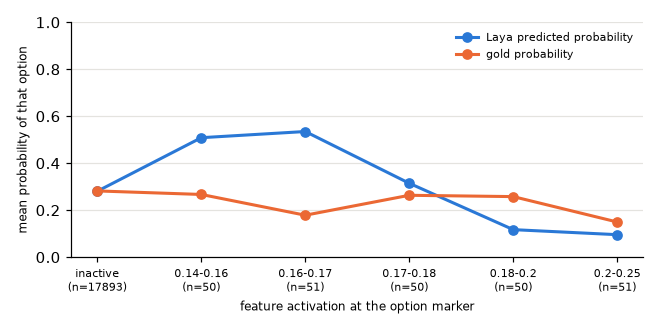

# Feature 11785

Critérios em que aparece: pred_probe_right_laya_wrong

**Interpretação (preencher):** 

---

## Maiores ativações

**tr_security_incidents_000299 / disposition** (choice, security_incidents) | ativação 9.805 em `estado` | opções ['close_benign', 'contain', 'investigate', 'monitor'] | Laya: **monitor** [0.113, 0.115, 0.126, 0.645] | gabarito: **investigate**

```
<bos> choice question: How should this security alert be dispositioned?<eos>
▸ <mask> close_benign: Expected, explainable activity; close without analyst time.
▸ <mask> contain: Contain the host or account immediately; do not wait for triage.
▸ <mask> investigate: Warrants an analyst opening an investigation.
▸ <mask> monitor: Not clearly malicious, but worth watching for recurrence.

<eos>

 {"alert": {"description": "an unusual volume of files read in a short window", "evidence": "A privileged administrator account without MFA enabled initiated an unusually⟦ high⟧ volume of file read operations from an unrecognized source. This activity took place during a non-change window, exactly 30 days after the principal's credentials were last updated.", "rule": "mass_download"}, "context": {"asset_criticality": "medium", "change_window_active": false, "source_on_allowlist": false}, "history": {"credential_rotation_days_ago": 30, "distinct_countries_30d": 4, "logins_30d": 1329, "prior_alerts_90d": 0}, "principal": {"mfa_enrolled": false, "name": "svc-analytics-679", "privileges": ["deploy:production", "secrets:read"], "type": "admin"}}<eos>
```

**tr_security_incidents_000299 / true_positive** (noul, security_incidents) | ativação 9.250 em `estado` | opções ['false', 'true'] | Laya: **true** [0.053, 0.947] | gabarito: **true**

```
<bos> noul question: This alert reflects genuinely malicious or unauthorised activity.<eos>
▸ <mask> false: Benign activity, a misconfiguration, or a known false positive.
▸ <mask> true: The underlying behaviour is malicious or unauthorised.

<eos>

 {"alert": {"description": "an unusual volume of files read in a short window", "evidence": "A privileged administrator account without MFA enabled initiated an unusually⟦ high⟧ volume of file read operations from an unrecognized source. This activity took place during a non-change window, exactly 30 days after the principal's credentials were last updated.", "rule": "mass_download"}, "context": {"asset_criticality": "medium", "change_window_active": false, "source_on_allowlist": false}, "history": {"credential_rotation_days_ago": 30, "distinct_countries_30d": 4, "logins_30d": 1329, "prior_alerts_90d": 0}, "principal": {"mfa_enrolled": false, "name": "svc-analytics-679", "privileges": ["deploy:production", "secrets:read"], "type": "admin"}}<eos>
```

**tr_security_incidents_000299 / credential_compromise** (noul, security_incidents) | ativação 9.078 em `estado` | opções ['false', 'true'] | Laya: **true** [0.334, 0.666] | gabarito: **true**

```
<bos> noul question: The evidence indicates a credential or account has been compromised.<eos>
▸ <mask> false: no, the statement does not hold
▸ <mask> true: yes, the statement holds

<eos>

 {"alert": {"description": "an unusual volume of files read in a short window", "evidence": "A privileged administrator account without MFA enabled initiated an unusually⟦ high⟧ volume of file read operations from an unrecognized source. This activity took place during a non-change window, exactly 30 days after the principal's credentials were last updated.", "rule": "mass_download"}, "context": {"asset_criticality": "medium", "change_window_active": false, "source_on_allowlist": false}, "history": {"credential_rotation_days_ago": 30, "distinct_countries_30d": 4, "logins_30d": 1329, "prior_alerts_90d": 0}, "principal": {"mfa_enrolled": false, "name": "svc-analytics-679", "privileges": ["deploy:production", "secrets:read"], "type": "admin"}}<eos>
```

**tr_security_incidents_000299 / urgency** (score, security_incidents) | ativação 8.461 em `estado` | opções ['0', '1', '2', '3'] | Laya: **1** [0.144, 0.291, 0.291, 0.274] | gabarito: **3**

```
<bos> score question: How quickly must a responder act on this alert?<eos>
▸ <mask> level 0: No time pressure; can wait indefinitely.
▸ <mask> level 1: Routine; handle within the normal queue.
▸ <mask> level 2: Elevated; should be handled within the same week.
▸ <mask> level 3: Critical; requires action within the same day.

<eos>

 {"alert": {"description": "an unusual volume of files read in a short window", "evidence": "A privileged administrator account without MFA enabled initiated an unusually⟦ high⟧ volume of file read operations from an unrecognized source. This activity took place during a non-change window, exactly 30 days after the principal's credentials were last updated.", "rule": "mass_download"}, "context": {"asset_criticality": "medium", "change_window_active": false, "source_on_allowlist": false}, "history": {"credential_rotation_days_ago": 30, "distinct_countries_30d": 4, "logins_30d": 1329, "prior_alerts_90d": 0}, "principal": {"mfa_enrolled": false, "name": "svc-analytics-679", "privileges": ["deploy:production", "secrets:read"], "type": "admin"}}<eos>
```

**tr_security_incidents_000052 / disposition** (choice, security_incidents) | ativação 8.078 em `estado` | opções ['close_benign', 'contain', 'investigate', 'monitor'] | Laya: **monitor** [0.031, 0.077, 0.103, 0.789] | gabarito: **investigate**

```
<bos> choice question: How should this security alert be dispositioned?<eos>
▸ <mask> close_benign: Expected, explainable activity; close without analyst time.
▸ <mask> contain: Contain the host or account immediately; do not wait for triage.
▸ <mask> investigate: Warrants an analyst opening an investigation.
▸ <mask> monitor: Not clearly malicious, but worth watching for recurrence.

<eos>

 {"alert": {"description": "an unusual volume of files read in a short window", "evidence": "An administrative account with multi-factor authentication enabled performed a⟦ high⟧ volume of file read operations from an unrecognized source address. This activity occurred outside of any established change window using credentials that have remained unchanged for 412 days.", "rule": "mass_download"}, "context": {"asset_criticality": "medium", "change_window_active": false, "source_on_allowlist": false}, "history": {"credential_rotation_days_ago": 412, "distinct_countries_30d": 2, "logins_30d": 1820, "prior_alerts_90d": 25}, "principal": {"mfa_enrolled": true, "name": "svc-billing-706", "privileges": ["deploy:production", "secrets:read"], "type": "admin"}}<eos>
```

## Ativações medianas (faixa 40-60%, mediana 0.953)

**tr_security_incidents_000202 / credential_compromise** (noul, security_incidents) | ativação 1.278 em `estado` | opções ['false', 'true'] | Laya: **true** [0.018, 0.982] | gabarito: **false**

```
<bos> noul question: The evidence indicates a credential or account has been compromised.<eos>
▸ <mask> false: no, the statement does not hold
▸ <mask> true: yes, the statement holds

<eos>

 {"alert": {"description": "a⟦ long⟧-unused account became active", "evidence": "A shared mailbox account that has been dormant for an extended period performed an authentication request. The account currently has MFA disabled, is not within a change window, and the credentials have not been updated for 700 days.", "rule": "dormant_account_use"}, "context": {"asset_criticality": "medium", "change_window_active": false, "source_on_allowlist": true}, "history": {"credential_rotation_days_ago": 700, "distinct_countries_30d": 3, "logins_30d": 251, "prior_alerts_90d": 25}, "principal": {"mfa_enrolled": false, "name": "adm-support-872", "privileges": ["repo:read"], "type": "shared_mailbox"}}<eos>
```

**tr_security_incidents_000251 / severity** (score, security_incidents) | ativação 1.336 em `pergunta` | opções ['0', '1', '2', '3', '4'] | Laya: **2** [0.199, 0.247, 0.333, 0.16, 0.062] | gabarito: **3**

```
<bos> score question: How⟦ severe⟧ is the potential impact if this alert is real?<eos>
▸ <mask> level 0: Negligible: no access to anything sensitive.
▸ <mask> level 1: Low: limited access, easily reversed.
▸ <mask> level 2: Moderate: access to internal systems or non-public data.
▸ <mask> level 3: High: access to production, secrets or customer data.
▸ <mask> level 4: Critical: active compromise of crown-jewel systems.

<eos>

 {"alert": {"description": "an unusual volume of files read in a short window", "evidence": "A privileged service account read 4,500 files within a five-minute window starting at 14:00 UTC. The account lacks MFA and has not undergone a credential rotation in the past 365 days, although the activity originated from an allowlisted network range.", "rule": "mass_download"}, "context": {"asset_criticality": "low", "change_window_active": false, "source_on_allowlist": true}, "history": {"credential_rotation_days_ago": 365, "distinct_countries_30d": 3, "logins_30d": 1531, "prior_alerts_90d": 1}, "principal": {"mfa_enrolled": false, "name": "adm-billing-460", "privileges": ["deploy:production", "secrets:read"], "type": "service_account"}}<eos>
```

**tr_customer_service_000203 / churn_risk** (score, customer_service) | ativação 0.961 em `estado` | opções ['0', '1', '2', '3'] | Laya: **1** [0.124, 0.512, 0.307, 0.058] | gabarito: **1**

```
<bos> score question: How likely is this customer to stop doing business with us because of this interaction?<eos>
▸ <mask> level 0: No sign of dissatisfaction.
▸ <mask> level 1: Mild frustration, but the relationship is intact.
▸ <mask> level 2: Clearly unhappy; repeat problems or explicit complaints.
▸ <mask> level 3: Imminent: threatening to cancel, dispute or leave.

<eos>

 {"account": {"lifetime_value_usd": 303, "prior_tickets_90d": 1, "seats": 12, "tenure_months": 5, "tier": "premium"}, "thread": [{"role": "customer", "text": "Since the last update, the sync process has been taking around 15 minutes for a few megabytes, which is⟦ much⟧ slower than before."}]}<eos>
```

**tr_security_incidents_000263 / disposition** (choice, security_incidents) | ativação 0.852 em `estado` | opções ['close_benign', 'contain', 'investigate', 'monitor'] | Laya: **monitor** [0.056, 0.17, 0.048, 0.726] | gabarito: **investigate**

```
<bos> choice question: How should this security alert be dispositioned?<eos>
▸ <mask> close_benign: Expected, explainable activity; close without analyst time.
▸ <mask> contain: Contain the host or account immediately; do not wait for triage.
▸ <mask> investigate: Warrants an analyst opening an investigation.
▸ <mask> monitor: Not clearly malicious, but worth watching for recurrence.

<eos>

 {"alert": {"description": "a large transfer to an external destination", "evidence": "At 14:22⟦ ⟧UTC on 2026-09-15, the shared mailbox finance_shared transferred 2.4 GB of data to external IP 203.0.113.45 over HTTPS from host WIN02. The transfer was initiated by an unprivileged account using MFA, and no change window was defined at that time.", "rule": "data_egress"}, "context": {"asset_criticality": "crown_jewel", "change_window_active": false, "source_on_allowlist": true}, "history": {"credential_rotation_days_ago": 90, "distinct_countries_30d": 3, "logins_30d": 714, "prior_alerts_90d": 8}, "principal": {"mfa_enrolled": true, "name": "adm-infra-592", "privileges": ["repo:read"], "type": "shared_mailbox"}}<eos>
```

**tr_customer_service_000249 / urgency** (score, customer_service) | ativação 0.760 em `estado` | opções ['0', '1', '2', '3'] | Laya: **3** [0.076, 0.338, 0.128, 0.458] | gabarito: **3**

```
<bos> score question: How time-sensitive is this conversation?<eos>
▸ <mask> level 0: No time pressure; can wait indefinitely.
▸ <mask> level 1: Routine; handle within the normal queue.
▸ <mask> level 2: Elevated; should be handled within the same week.
▸ <mask> level 3: Critical; requires action within the same day.

<eos>

 {"account": {"lifetime_value_usd": 1754, "prior_tickets_90d": 0, "seats": 1, "tenure_months": 72, "tier": "enterprise"}, "orders": [{"amount_usd": 149, "date": "2026-03-28", "id": "A-39092", "status": "failed"}, {"amount_usd": 149, "date": "2026-03-23", "id": "A-25972", "status": "failed"}, {"amount_usd": 149, "date": "2026-01-10", "id": "A-78104", "status": "failed"}], "thread": [{"role": "customer", "text": "We've been trying to pull a full export of our account data for weeks now, and the portal keeps timing out—our deadline is this Friday and we can't afford any more delays."}, {"role": "agent", "text": "I’m sorry to hear you’re experiencing this; could you let me know which export format you selected and whether you’re using the bulk download option?"}, {"role": "customer", "text": "It’s⟦ the⟧ CSV export from the admin console, and I’ve tried both the single‑file and the zip‑bundle options, but each attempt aborts after about 10 minutes."}, {"role": "agent", "text": "Thanks for confirming that. Do you see any error codes or messages in the download dialog when it stops?"}, {"role": "customer", "text": "Just a generic “download failed” notice—no error code, and it happens regardless of browser or network, which is why I’m stuck."}]}<eos>
```

## Estatísticas (conjunto de descoberta, dev e teste)

**pred / error**

| split | decisões | ativas | ativas e Laya errou | taxa | lift | q (BH) | OR (CMH) | q (CMH) |
|---|---|---|---|---|---|---|---|---|
| discovery | 5100 | 109 | 82 | 0.752 | 1.17 | 0.0306 | 1.31 | 0.665 |
| dev | 900 | 32 | 24 | 0.750 | 1.12 | 0.59 | 0.71 | 0.834 |
| test | 2000 | 48 | 39 | 0.812 | 1.25 | 0.0345 | 0.69 | 0.837 |

**corr / error**

| split | decisões | ativas | ativas e Laya errou | taxa | lift | q (BH) | OR (CMH) | q (CMH) |
|---|---|---|---|---|---|---|---|---|
| discovery | 5100 | 53 | 26 | 0.491 | 0.76 | 0.0405 | 3.02 | 0.569 |
| dev | 900 | 20 | 12 | 0.600 | 0.89 | 0.746 | 1.02 | 0.991 |
| test | 2000 | 26 | 17 | 0.654 | 1.01 | 1 | inf | 0.431 |

**state / error**

| split | decisões | ativas | ativas e Laya errou | taxa | lift | q (BH) | OR (CMH) | q (CMH) |
|---|---|---|---|---|---|---|---|---|
| discovery | 5100 | 2042 | 1257 | 0.616 | 0.96 | 0.00347 | 0.97 | 0.874 |
| dev | 900 | 357 | 231 | 0.647 | 0.96 | 0.549 | 0.96 | 0.943 |
| test | 2000 | 813 | 523 | 0.643 | 0.99 | 0.86 | 1.18 | 0.488 |

**pred / probe_right_laya_wrong**

| split | decisões | ativas | ativas e Laya errou | taxa | lift | q (BH) | OR (CMH) | q (CMH) |
|---|---|---|---|---|---|---|---|---|
| discovery | 2819 | 59 | 59 | 1.000 | 1.55 | 3.96e-11 | inf | 0.111 |
| dev | 520 | 17 | 16 | 0.941 | 1.39 | nan | nan | nan |
| test | 1106 | 25 | 24 | 0.960 | 1.52 | 0.000679 | 0.00 | 0.605 |

**corr / probe_right_laya_wrong**

| split | decisões | ativas | ativas e Laya errou | taxa | lift | q (BH) | OR (CMH) | q (CMH) |
|---|---|---|---|---|---|---|---|---|
| discovery | 2819 | 7 | 7 | 1.000 | 1.55 | nan | nan | nan |
| dev | 520 | 3 | 2 | 0.667 | 0.99 | nan | nan | nan |
| test | 1106 | 3 | 2 | 0.667 | 1.05 | nan | nan | nan |

**state / probe_right_laya_wrong**

| split | decisões | ativas | ativas e Laya errou | taxa | lift | q (BH) | OR (CMH) | q (CMH) |
|---|---|---|---|---|---|---|---|---|
| discovery | 2819 | 1211 | 754 | 0.623 | 0.96 | 0.0506 | 1.15 | 0.343 |
| dev | 520 | 212 | 143 | 0.675 | 1.00 | 1 | 1.34 | 0.48 |
| test | 1106 | 484 | 311 | 0.643 | 1.02 | 0.827 | 1.44 | 0.138 |

Confusão mais sobre-representada (pred): `discrepancy_severity|2>0` (n=50, lift 21.66, p=0). Formato `pergunta|índice previsto>índice correto`.

Confusão mais sobre-representada (corr): `discrepancy_severity|2>3` (n=17, lift 27.73, p=2.31e-21). Formato `pergunta|índice previsto>índice correto`.

Confusão mais sobre-representada (state): `severity|1>3` (n=52, lift 1.83, p=1.16e-08). Formato `pergunta|índice previsto>índice correto`.



