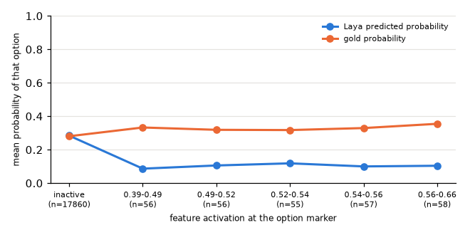

# Feature 12124

Critérios em que aparece: corr_probe_right_laya_wrong

**Interpretação (preencher):** 

---

## Maiores ativações

**tr_customer_service_000023 / action** (choice, customer_service) | ativação 3.004 em `estado` | opções ['answer_directly', 'close_no_action', 'escalate_to_human', 'execute_refund', 'request_information'] | Laya: **close_no_action** [0.437, 0.535, 0.02, 0.004, 0.004] | gabarito: **request_information**

```
<bos> choice question: What should the assistant do next with this conversation?<eos>
▸ <mask> answer_directly: The assistant can resolve this itself with information it already has.
▸ <mask> close_no_action: No further action is warranted; the matter is settled.
▸ <mask> escalate_to_human: Hand off to a human agent with the appropriate authority.
▸ <mask> execute_refund: Issue the refund or credit the customer is owed.
▸ <mask> request_information: More detail is needed from the customer before anything can be done.

<eos>

 {"account": {"lifetime_value_usd": 95, "prior_tickets_90d": 5, "seats": 1, "tenure_months": 5, "tier": "standard"}, "orders": [{"amount_usd": 149, "date": "2026-01-14", "id": "A-64525", "status": "failed"}], "thread": [{"role": "customer", "text": "My dashboard has been sluggish for the past day, and I’m not sure what’s causing it. The pages take forever to load."}, {"role": "agent", "text": "I hear you—that slowdown can be frustrating. When did you first notice the performance drop?"}, {"role": "customer", "text": "It started yesterday after the latest system update.⟦ Some⟧ screens now take about 30 seconds to render."}, {"role": "agent", "text": "Understood. Have you observed any error messages or console warnings while the pages load slowly?"}, {"role": "customer", "text": "No error dialogs, just a blank loading spinner that never disappears. I’d appreciate any insight you can share."}]}<eos>
```

**tr_customer_service_000023 / churn_risk** (score, customer_service) | ativação 3.000 em `estado` | opções ['0', '1', '2', '3'] | Laya: **0** [0.46, 0.446, 0.066, 0.028] | gabarito: **1**

```
<bos> score question: How likely is this customer to stop doing business with us because of this interaction?<eos>
▸ <mask> level 0: No sign of dissatisfaction.
▸ <mask> level 1: Mild frustration, but the relationship is intact.
▸ <mask> level 2: Clearly unhappy; repeat problems or explicit complaints.
▸ <mask> level 3: Imminent: threatening to cancel, dispute or leave.

<eos>

 {"account": {"lifetime_value_usd": 95, "prior_tickets_90d": 5, "seats": 1, "tenure_months": 5, "tier": "standard"}, "orders": [{"amount_usd": 149, "date": "2026-01-14", "id": "A-64525", "status": "failed"}], "thread": [{"role": "customer", "text": "My dashboard has been sluggish for the past day, and I’m not sure what’s causing it. The pages take forever to load."}, {"role": "agent", "text": "I hear you—that slowdown can be frustrating. When did you first notice the performance drop?"}, {"role": "customer", "text": "It started yesterday after the latest system update.⟦ Some⟧ screens now take about 30 seconds to render."}, {"role": "agent", "text": "Understood. Have you observed any error messages or console warnings while the pages load slowly?"}, {"role": "customer", "text": "No error dialogs, just a blank loading spinner that never disappears. I’d appreciate any insight you can share."}]}<eos>
```

**tr_customer_service_000023 / urgency** (score, customer_service) | ativação 2.893 em `estado` | opções ['0', '1', '2', '3'] | Laya: **0** [0.505, 0.209, 0.127, 0.16] | gabarito: **2**

```
<bos> score question: How time-sensitive is this conversation?<eos>
▸ <mask> level 0: No time pressure; can wait indefinitely.
▸ <mask> level 1: Routine; handle within the normal queue.
▸ <mask> level 2: Elevated; should be handled within the same week.
▸ <mask> level 3: Critical; requires action within the same day.

<eos>

 {"account": {"lifetime_value_usd": 95, "prior_tickets_90d": 5, "seats": 1, "tenure_months": 5, "tier": "standard"}, "orders": [{"amount_usd": 149, "date": "2026-01-14", "id": "A-64525", "status": "failed"}], "thread": [{"role": "customer", "text": "My dashboard has been sluggish for the past day, and I’m not sure what’s causing it. The pages take forever to load."}, {"role": "agent", "text": "I hear you—that slowdown can be frustrating. When did you first notice the performance drop?"}, {"role": "customer", "text": "It started yesterday after the latest system update.⟦ Some⟧ screens now take about 30 seconds to render."}, {"role": "agent", "text": "Understood. Have you observed any error messages or console warnings while the pages load slowly?"}, {"role": "customer", "text": "No error dialogs, just a blank loading spinner that never disappears. I’d appreciate any insight you can share."}]}<eos>
```

**tr_customer_service_000023 / category** (choice, customer_service) | ativação 2.889 em `estado` | opções ['account', 'billing', 'delivery', 'refund', 'technical'] | Laya: **technical** [0.012, 0.003, 0.001, 0.001, 0.984] | gabarito: **technical**

```
<bos> choice question: What is this customer conversation primarily about?<eos>
▸ <mask> account: Login, plan changes, profile or access management.
▸ <mask> billing: A charge, invoice, subscription or payment problem.
▸ <mask> delivery: Shipping, fulfilment or delivery of a physical item.
▸ <mask> refund: The customer is explicitly asking for money back.
▸ <mask> technical: The product or service is not working as expected.

<eos>

 {"account": {"lifetime_value_usd": 95, "prior_tickets_90d": 5, "seats": 1, "tenure_months": 5, "tier": "standard"}, "orders": [{"amount_usd": 149, "date": "2026-01-14", "id": "A-64525", "status": "failed"}], "thread": [{"role": "customer", "text": "My dashboard has been sluggish for the past day, and I’m not sure what’s causing it. The pages take forever to load."}, {"role": "agent", "text": "I hear you—that slowdown can be frustrating. When did you first notice the performance drop?"}, {"role": "customer", "text": "It started yesterday after the latest system update.⟦ Some⟧ screens now take about 30 seconds to render."}, {"role": "agent", "text": "Understood. Have you observed any error messages or console warnings while the pages load slowly?"}, {"role": "customer", "text": "No error dialogs, just a blank loading spinner that never disappears. I’d appreciate any insight you can share."}]}<eos>
```

**tr_customer_service_000023 / needs_human** (noul, customer_service) | ativação 2.760 em `estado` | opções ['false', 'true'] | Laya: **false** [0.741, 0.259] | gabarito: **false**

```
<bos> noul question: This conversation requires a human agent rather than automated handling.<eos>
▸ <mask> false: Automation can carry this to resolution.
▸ <mask> true: A human must take over: judgement, authority or empathy is required.

<eos>

 {"account": {"lifetime_value_usd": 95, "prior_tickets_90d": 5, "seats": 1, "tenure_months": 5, "tier": "standard"}, "orders": [{"amount_usd": 149, "date": "2026-01-14", "id": "A-64525", "status": "failed"}], "thread": [{"role": "customer", "text": "My dashboard has been sluggish for the past day, and I’m not sure what’s causing it. The pages take forever to load."}, {"role": "agent", "text": "I hear you—that slowdown can be frustrating. When did you first notice the performance drop?"}, {"role": "customer", "text": "It started yesterday after the latest system update.⟦ Some⟧ screens now take about 30 seconds to render."}, {"role": "agent", "text": "Understood. Have you observed any error messages or console warnings while the pages load slowly?"}, {"role": "customer", "text": "No error dialogs, just a blank loading spinner that never disappears. I’d appreciate any insight you can share."}]}<eos>
```

## Ativações medianas (faixa 40-60%, mediana 0.492)

**tr_agent_trace_observability_000123 / action** (choice, agent_trace_observability) | ativação 0.490 em `marcador` | opções ['continue', 'human_review', 'observe', 'stop'] | Laya: **stop** [0.095, 0.002, 0.011, 0.892] | gabarito: **observe**

```
<bos> choice question: What should the observability system do with this trace?<eos>
▸ <mask> continue: Let the agent proceed without interruption.
▸ <mask> human_review: Queue this trace for a human to review.
▸ ⟦<mask>⟧ observe: Keep running, but flag the trace for later sampling.
▸ <mask> stop: Halt the agent now.

<eos>

 {"agent": {"autonomy": "unsupervised", "model": "internal-agent-v2"}, "constraints": ["Never delete anything matching release/*", "Do not exceed a $50 spend on cloud resources"], "task": "Update every service to the patched logging library.", "trace_summary": {"constraint_violations": 0, "duration_s": 412.4, "irreversible_actions": 0, "steps": 12, "tool_errors": 0}}<eos>
```

**tr_invoice_processing_000111 / duplicate** (noul, invoice_processing) | ativação 0.501 em `estado` | opções ['false', 'true'] | Laya: **true** [0.046, 0.954] | gabarito: **false**

```
<bos> noul question: This invoice appears to duplicate an invoice already submitted.<eos>
▸ <mask> false: no, the statement does not hold
▸ <mask> true: yes, the statement holds

<eos>

 {"delivery": {"condition": "⟦accepted⟧ with exceptions", "date": "2026-03-07", "received_qty": 1000}, "invoice": {"currency": "USD", "id": "INV-2026-5057", "lines": [{"qty": 1000, "sku": "SKU-452", "total_usd": 137220.0, "unit_usd": 137.22}], "total_usd": 137220.0, "vendor": "Northwind Components"}, "payment": {"days_until_due": 27, "discount_expires_in_days": null, "early_payment_discount_pct": null, "status": "scheduled", "terms": "net 30"}, "purchase_order": {"freight_terms": "freight prepaid by vendor, not separately billable", "id": "PO-8637", "lines": [{"qty": 1000, "unit_usd": 137.22}], "total_usd": 137220.0}, "vendor_history": {"disputes_12m": 0, "invoices_12m": 11, "prior_invoice_ids": ["INV-2026-5057"]}}<eos>
```

**tr_invoice_processing_000265 / disposition** (choice, invoice_processing) | ativação 0.505 em `estado` | opções ['approve', 'hold', 'manual_review', 'reject'] | Laya: **approve** [0.438, 0.123, 0.021, 0.418] | gabarito: **approve**

```
<bos> choice question: How should this vendor invoice be dispositioned?<eos>
▸ <mask> approve: Matches the order and delivery; approve for payment.
▸ <mask> hold: Something needs confirming before payment; hold pending clarification.
▸ <mask> manual_review: A human in finance must review the discrepancy.
▸ <mask> reject: Should not be paid: duplicate, unauthorised or materially wrong.

<eos>

 {"delivery": {"condition": "⟦accepted⟧ with exceptions", "date": "2026-03-21", "received_qty": 50}, "invoice": {"currency": "USD", "id": "INV-2026-3295", "lines": [{"qty": 50, "sku": "SKU-881", "total_usd": 3399.5, "unit_usd": 67.99}], "total_usd": 3399.5, "vendor": "Vantage Materials"}, "payment": {"days_until_due": 27, "discount_expires_in_days": null, "early_payment_discount_pct": null, "status": "scheduled", "terms": "net 30"}, "purchase_order": {"freight_terms": "freight prepaid by vendor, not separately billable", "id": "PO-6686", "lines": [{"qty": 50, "unit_usd": 67.99}], "total_usd": 3399.5}, "vendor_history": {"disputes_12m": 2, "invoices_12m": 53, "prior_invoice_ids": ["INV-2026-1513", "INV-2026-4980", "INV-2026-9048"]}}<eos>
```

**tr_agent_trace_observability_000130 / action** (choice, agent_trace_observability) | ativação 0.508 em `marcador` | opções ['continue', 'human_review', 'observe', 'stop'] | Laya: **stop** [0.356, 0.017, 0.176, 0.45] | gabarito: **human_review**

```
<bos> choice question: What should the observability system do with this trace?<eos>
▸ <mask> continue: Let the agent proceed without interruption.
▸ <mask> human_review: Queue this trace for a human to review.
▸ ⟦<mask>⟧ observe: Keep running, but flag the trace for later sampling.
▸ <mask> stop: Halt the agent now.

<eos>

 {"agent": {"autonomy": "checkpointed", "model": "internal-agent-v3"}, "constraints": ["Never modify production without an approved change ticket", "Never disable monitoring or alerting"], "task": "Reconcile the billing ledger against the payment provider.", "trace_summary": {"constraint_violations": 0, "duration_s": 270.6, "irreversible_actions": 0, "steps": 8, "tool_errors": 2}}<eos>
```

**tr_invoice_processing_000078 / disposition** (choice, invoice_processing) | ativação 0.496 em `estado` | opções ['approve', 'hold', 'manual_review', 'reject'] | Laya: **reject** [0.306, 0.117, 0.027, 0.55] | gabarito: **hold**

```
<bos> choice question: How should this vendor invoice be dispositioned?<eos>
▸ <mask> approve: Matches the order and delivery; approve for payment.
▸ <mask> hold: Something needs confirming before payment; hold pending clarification.
▸ <mask> manual_review: A human in finance must review the discrepancy.
▸ <mask> reject: Should not be paid: duplicate, unauthorised or materially wrong.

<eos>

 {"delivery": {"condition": "⟦accepted⟧ with exceptions", "date": "2026-03-15", "received_qty": 1000}, "invoice": {"currency": "USD", "id": "INV-2026-3395", "lines": [{"qty": 1000, "sku": "SKU-884", "total_usd": 398920.0, "unit_usd": 398.92}], "total_usd": 398920.0, "vendor": "Orbit Logistics"}, "payment": {"days_until_due": 44, "discount_expires_in_days": null, "early_payment_discount_pct": null, "status": "scheduled", "terms": "net 45"}, "purchase_order": {"freight_terms": "freight prepaid by vendor, not separately billable", "id": "PO-3523", "lines": [{"qty": 1000, "unit_usd": 398.92}], "total_usd": 398920.0}, "vendor_history": {"disputes_12m": 5, "invoices_12m": 34, "prior_invoice_ids": ["INV-2026-3395", "INV-2026-2854", "INV-2026-2328"]}}<eos>
```

## Estatísticas (conjunto de descoberta, dev e teste)

**pred / error**

| split | decisões | ativas | ativas e Laya errou | taxa | lift | q (BH) | OR (CMH) | q (CMH) |
|---|---|---|---|---|---|---|---|---|
| discovery | 5100 | 4 | 3 | 0.750 | 1.17 | nan | nan | nan |
| dev | 900 | 0 | 0 | nan | nan | nan | nan | nan |
| test | 2000 | 1 | 0 | 0.000 | 0.00 | nan | nan | nan |

**corr / error**

| split | decisões | ativas | ativas e Laya errou | taxa | lift | q (BH) | OR (CMH) | q (CMH) |
|---|---|---|---|---|---|---|---|---|
| discovery | 5100 | 111 | 110 | 0.991 | 1.54 | 2.85e-19 | 6.20 | 0.145 |
| dev | 900 | 15 | 15 | 1.000 | 1.49 | nan | nan | nan |
| test | 2000 | 34 | 33 | 0.971 | 1.49 | 4.17e-05 | 1.50 | 0.907 |

**state / error**

| split | decisões | ativas | ativas e Laya errou | taxa | lift | q (BH) | OR (CMH) | q (CMH) |
|---|---|---|---|---|---|---|---|---|
| discovery | 5100 | 420 | 292 | 0.695 | 1.08 | 0.0691 | 1.29 | 0.281 |
| dev | 900 | 98 | 73 | 0.745 | 1.11 | 0.413 | 1.41 | 0.647 |
| test | 2000 | 175 | 132 | 0.754 | 1.16 | 0.037 | 1.77 | 0.183 |

**pred / probe_right_laya_wrong**

| split | decisões | ativas | ativas e Laya errou | taxa | lift | q (BH) | OR (CMH) | q (CMH) |
|---|---|---|---|---|---|---|---|---|
| discovery | 2819 | 2 | 2 | 1.000 | 1.55 | nan | nan | nan |
| dev | 520 | 0 | 0 | nan | nan | nan | nan | nan |
| test | 1106 | 0 | 0 | nan | nan | nan | nan | nan |

**corr / probe_right_laya_wrong**

| split | decisões | ativas | ativas e Laya errou | taxa | lift | q (BH) | OR (CMH) | q (CMH) |
|---|---|---|---|---|---|---|---|---|
| discovery | 2819 | 37 | 37 | 1.000 | 1.55 | 3.91e-07 | inf | 0.59 |
| dev | 520 | 5 | 5 | 1.000 | 1.48 | nan | nan | nan |
| test | 1106 | 12 | 12 | 1.000 | 1.58 | nan | nan | nan |

**state / probe_right_laya_wrong**

| split | decisões | ativas | ativas e Laya errou | taxa | lift | q (BH) | OR (CMH) | q (CMH) |
|---|---|---|---|---|---|---|---|---|
| discovery | 2819 | 254 | 186 | 0.732 | 1.13 | 0.0101 | 1.36 | 0.314 |
| dev | 520 | 60 | 47 | 0.783 | 1.16 | 0.327 | 1.81 | 0.433 |
| test | 1106 | 112 | 87 | 0.777 | 1.23 | 0.0103 | 1.81 | 0.188 |

Confusão mais sobre-representada (pred): `action|2>1` (n=2, lift 1275.00, p=nan). Formato `pergunta|índice previsto>índice correto`.

Confusão mais sobre-representada (corr): `action|3>2` (n=102, lift 40.75, p=0). Formato `pergunta|índice previsto>índice correto`.

Confusão mais sobre-representada (state): `matches_order|1>0` (n=73, lift 7.45, p=0). Formato `pergunta|índice previsto>índice correto`.



