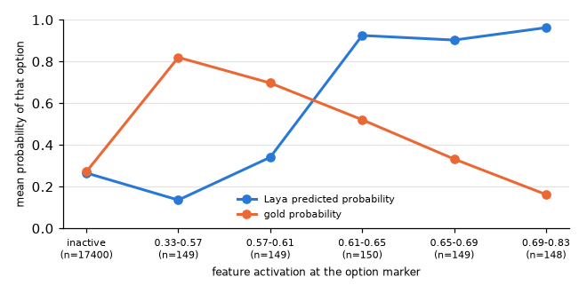

# Feature 12224

Critérios em que aparece: pred_probe_right_laya_wrong_stratified

**Interpretação (preencher):** 

---

## Maiores ativações

**tr_customer_service_000270 / churn_risk** (score, customer_service) | ativação 2.412 em `estado` | opções ['0', '1', '2', '3'] | Laya: **1** [0.14, 0.527, 0.228, 0.105] | gabarito: **2**

```
<bos> score question: How likely is this customer to stop doing business with us because of this interaction?<eos>
▸ <mask> level 0: No sign of dissatisfaction.
▸ <mask> level 1: Mild frustration, but the relationship is intact.
▸ <mask> level 2: Clearly unhappy; repeat problems or explicit complaints.
▸ <mask> level 3: Imminent: threatening to cancel, dispute or leave.

<eos>

 {"account": {"lifetime_value_usd": 1765, "prior_tickets_90d": 2, "seats": 1, "tenure_months": 19, "tier": "standard"}, "orders": [{"amount_usd": 149, "date": "2026-02-28", "id": "A-88466", "status": "settled"}, {"amount_usd": 149, "date": "2026-02-27", "id": "A-17979", "status": "settled"}], "thread": [{"role": "customer", "text": "Hello, I’m writing about the seat‑management issue we’ve been seeing on our account. We’re on the standard plan, have been a customer for 19 months, and the monthly charge is about $149. This is the third time I’m reaching out—two earlier tickets were only partially addressed, and I have a hard deadline next Friday to reassign a few seats for an upcoming project."}, {"role": "agent", "text": "Thank you for the details. I’m sorry the prior tickets didn’t fully resolve the problem. Could you let me know exactly how many seats are affected and what the current error looks like?"}, {"role": "customer", "text": "Sure. We have five seats that are stuck in “pending” status, and when I try to move them to a different team they bounce back with a generic “operation failed” message. It’s preventing us from finalizing the team roster before the Friday deadline."}, {"role": "agent", "text": "Got it, five pending seats with a generic failure notice. Are there any particular teams or roles involved that might help us narrow down the cause?"}, {"role": "customer", "text": "The seats belong to our Marketing and⟦ Sales⟧ groups. Both groups use custom role configurations we set up last quarter, and the issue started after we added a new role hierarchy."}, {"role": "agent", "text": "Understood. I’ll note the custom role configurations and the recent hierarchy change. Just to confirm, have you noticed any impact on your billing or subscription status while this is happening?"}, {"role": "customer", "text": "No billing issues so far, but I really need those seats moved before Friday. Please let me know what you need from me to keep this moving forward."}]}<eos>
```

**tr_customer_service_000270 / needs_human** (noul, customer_service) | ativação 2.332 em `estado` | opções ['false', 'true'] | Laya: **false** [0.806, 0.194] | gabarito: **true**

```
<bos> noul question: This conversation requires a human agent rather than automated handling.<eos>
▸ <mask> false: Automation can carry this to resolution.
▸ <mask> true: A human must take over: judgement, authority or empathy is required.

<eos>

 {"account": {"lifetime_value_usd": 1765, "prior_tickets_90d": 2, "seats": 1, "tenure_months": 19, "tier": "standard"}, "orders": [{"amount_usd": 149, "date": "2026-02-28", "id": "A-88466", "status": "settled"}, {"amount_usd": 149, "date": "2026-02-27", "id": "A-17979", "status": "settled"}], "thread": [{"role": "customer", "text": "Hello, I’m writing about the seat‑management issue we’ve been seeing on our account. We’re on the standard plan, have been a customer for 19 months, and the monthly charge is about $149. This is the third time I’m reaching out—two earlier tickets were only partially addressed, and I have a hard deadline next Friday to reassign a few seats for an upcoming project."}, {"role": "agent", "text": "Thank you for the details. I’m sorry the prior tickets didn’t fully resolve the problem. Could you let me know exactly how many seats are affected and what the current error looks like?"}, {"role": "customer", "text": "Sure. We have five seats that are stuck in “pending” status, and when I try to move them to a different team they bounce back with a generic “operation failed” message. It’s preventing us from finalizing the team roster before the Friday deadline."}, {"role": "agent", "text": "Got it, five pending seats with a generic failure notice. Are there any particular teams or roles involved that might help us narrow down the cause?"}, {"role": "customer", "text": "The seats belong to our Marketing and⟦ Sales⟧ groups. Both groups use custom role configurations we set up last quarter, and the issue started after we added a new role hierarchy."}, {"role": "agent", "text": "Understood. I’ll note the custom role configurations and the recent hierarchy change. Just to confirm, have you noticed any impact on your billing or subscription status while this is happening?"}, {"role": "customer", "text": "No billing issues so far, but I really need those seats moved before Friday. Please let me know what you need from me to keep this moving forward."}]}<eos>
```

**tr_customer_service_000270 / urgency** (score, customer_service) | ativação 2.322 em `estado` | opções ['0', '1', '2', '3'] | Laya: **1** [0.061, 0.836, 0.052, 0.051] | gabarito: **2**

```
<bos> score question: How time-sensitive is this conversation?<eos>
▸ <mask> level 0: No time pressure; can wait indefinitely.
▸ <mask> level 1: Routine; handle within the normal queue.
▸ <mask> level 2: Elevated; should be handled within the same week.
▸ <mask> level 3: Critical; requires action within the same day.

<eos>

 {"account": {"lifetime_value_usd": 1765, "prior_tickets_90d": 2, "seats": 1, "tenure_months": 19, "tier": "standard"}, "orders": [{"amount_usd": 149, "date": "2026-02-28", "id": "A-88466", "status": "settled"}, {"amount_usd": 149, "date": "2026-02-27", "id": "A-17979", "status": "settled"}], "thread": [{"role": "customer", "text": "Hello, I’m writing about the seat‑management issue we’ve been seeing on our account. We’re on the standard plan, have been a customer for 19 months, and the monthly charge is about $149. This is the third time I’m reaching out—two earlier tickets were only partially addressed, and I have a hard deadline next Friday to reassign a few seats for an upcoming project."}, {"role": "agent", "text": "Thank you for the details. I’m sorry the prior tickets didn’t fully resolve the problem. Could you let me know exactly how many seats are affected and what the current error looks like?"}, {"role": "customer", "text": "Sure. We have five seats that are stuck in “pending” status, and when I try to move them to a different team they bounce back with a generic “operation failed” message. It’s preventing us from finalizing the team roster before the Friday deadline."}, {"role": "agent", "text": "Got it, five pending seats with a generic failure notice. Are there any particular teams or roles involved that might help us narrow down the cause?"}, {"role": "customer", "text": "The seats belong to our Marketing and⟦ Sales⟧ groups. Both groups use custom role configurations we set up last quarter, and the issue started after we added a new role hierarchy."}, {"role": "agent", "text": "Understood. I’ll note the custom role configurations and the recent hierarchy change. Just to confirm, have you noticed any impact on your billing or subscription status while this is happening?"}, {"role": "customer", "text": "No billing issues so far, but I really need those seats moved before Friday. Please let me know what you need from me to keep this moving forward."}]}<eos>
```

**tr_customer_service_000270 / category** (choice, customer_service) | ativação 2.305 em `estado` | opções ['account', 'billing', 'delivery', 'refund', 'technical'] | Laya: **billing** [0.001, 0.991, 0.001, 0.0, 0.006] | gabarito: **technical**

```
<bos> choice question: What is this customer conversation primarily about?<eos>
▸ <mask> account: Login, plan changes, profile or access management.
▸ <mask> billing: A charge, invoice, subscription or payment problem.
▸ <mask> delivery: Shipping, fulfilment or delivery of a physical item.
▸ <mask> refund: The customer is explicitly asking for money back.
▸ <mask> technical: The product or service is not working as expected.

<eos>

 {"account": {"lifetime_value_usd": 1765, "prior_tickets_90d": 2, "seats": 1, "tenure_months": 19, "tier": "standard"}, "orders": [{"amount_usd": 149, "date": "2026-02-28", "id": "A-88466", "status": "settled"}, {"amount_usd": 149, "date": "2026-02-27", "id": "A-17979", "status": "settled"}], "thread": [{"role": "customer", "text": "Hello, I’m writing about the seat‑management issue we’ve been seeing on our account. We’re on the standard plan, have been a customer for 19 months, and the monthly charge is about $149. This is the third time I’m reaching out—two earlier tickets were only partially addressed, and I have a hard deadline next Friday to reassign a few seats for an upcoming project."}, {"role": "agent", "text": "Thank you for the details. I’m sorry the prior tickets didn’t fully resolve the problem. Could you let me know exactly how many seats are affected and what the current error looks like?"}, {"role": "customer", "text": "Sure. We have five seats that are stuck in “pending” status, and when I try to move them to a different team they bounce back with a generic “operation failed” message. It’s preventing us from finalizing the team roster before the Friday deadline."}, {"role": "agent", "text": "Got it, five pending seats with a generic failure notice. Are there any particular teams or roles involved that might help us narrow down the cause?"}, {"role": "customer", "text": "The seats belong to our Marketing and⟦ Sales⟧ groups. Both groups use custom role configurations we set up last quarter, and the issue started after we added a new role hierarchy."}, {"role": "agent", "text": "Understood. I’ll note the custom role configurations and the recent hierarchy change. Just to confirm, have you noticed any impact on your billing or subscription status while this is happening?"}, {"role": "customer", "text": "No billing issues so far, but I really need those seats moved before Friday. Please let me know what you need from me to keep this moving forward."}]}<eos>
```

**tr_customer_service_000270 / action** (choice, customer_service) | ativação 2.303 em `estado` | opções ['answer_directly', 'close_no_action', 'escalate_to_human', 'execute_refund', 'request_information'] | Laya: **close_no_action** [0.014, 0.979, 0.002, 0.002, 0.002] | gabarito: **escalate_to_human**

```
<bos> choice question: What should the assistant do next with this conversation?<eos>
▸ <mask> answer_directly: The assistant can resolve this itself with information it already has.
▸ <mask> close_no_action: No further action is warranted; the matter is settled.
▸ <mask> escalate_to_human: Hand off to a human agent with the appropriate authority.
▸ <mask> execute_refund: Issue the refund or credit the customer is owed.
▸ <mask> request_information: More detail is needed from the customer before anything can be done.

<eos>

 {"account": {"lifetime_value_usd": 1765, "prior_tickets_90d": 2, "seats": 1, "tenure_months": 19, "tier": "standard"}, "orders": [{"amount_usd": 149, "date": "2026-02-28", "id": "A-88466", "status": "settled"}, {"amount_usd": 149, "date": "2026-02-27", "id": "A-17979", "status": "settled"}], "thread": [{"role": "customer", "text": "Hello, I’m writing about the seat‑management issue we’ve been seeing on our account. We’re on the standard plan, have been a customer for 19 months, and the monthly charge is about $149. This is the third time I’m reaching out—two earlier tickets were only partially addressed, and I have a hard deadline next Friday to reassign a few seats for an upcoming project."}, {"role": "agent", "text": "Thank you for the details. I’m sorry the prior tickets didn’t fully resolve the problem. Could you let me know exactly how many seats are affected and what the current error looks like?"}, {"role": "customer", "text": "Sure. We have five seats that are stuck in “pending” status, and when I try to move them to a different team they bounce back with a generic “operation failed” message. It’s preventing us from finalizing the team roster before the Friday deadline."}, {"role": "agent", "text": "Got it, five pending seats with a generic failure notice. Are there any particular teams or roles involved that might help us narrow down the cause?"}, {"role": "customer", "text": "The seats belong to our Marketing and⟦ Sales⟧ groups. Both groups use custom role configurations we set up last quarter, and the issue started after we added a new role hierarchy."}, {"role": "agent", "text": "Understood. I’ll note the custom role configurations and the recent hierarchy change. Just to confirm, have you noticed any impact on your billing or subscription status while this is happening?"}, {"role": "customer", "text": "No billing issues so far, but I really need those seats moved before Friday. Please let me know what you need from me to keep this moving forward."}]}<eos>
```

## Ativações medianas (faixa 40-60%, mediana 0.651)

**tr_customer_service_000271 / urgency** (score, customer_service) | ativação 0.666 em `estado` | opções ['0', '1', '2', '3'] | Laya: **3** [0.053, 0.236, 0.269, 0.442] | gabarito: **2**

```
<bos> score question: How time-sensitive is this conversation?<eos>
▸ <mask> level 0: No time pressure; can wait indefinitely.
▸ <mask> level 1: Routine; handle within the normal queue.
▸ <mask> level 2: Elevated; should be handled within the same week.
▸ <mask> level 3: Critical; requires action within the same day.

<eos>

 {"account": {"lifetime_value_usd": 886, "prior_tickets_90d": 1, "seats": 1, "tenure_months": 33, "tier": "free"}, "thread": [{"role": "customer", "text": "Hi there, I’m trying to get a full export of my data from the platform. I’m on the free plan and have been with you for 33 months. I opened a ticket about this a few weeks ago and⟦ was⟧ told the export would be ready, but I still haven’t received anything."}, {"role": "agent", "text": "I’m sorry you haven’t received the export yet. Could you tell me the date range you need the data for, and whether you prefer a CSV or JSON file?"}, {"role": "customer", "text": "I need everything from January 2023 through September 2023, and a CSV would be best. Please let me know when I can expect the file."}]}<eos>
```

**tr_invoice_processing_000142 / matches_order** (noul, invoice_processing) | ativação 0.627 em `marcador` | opções ['false', 'true'] | Laya: **true** [0.101, 0.899] | gabarito: **false**

```
<bos> noul question: The invoice reconciles with the purchase order and the recorded delivery.<eos>
▸ <mask> false: There is a discrepancy against the order or the delivery.
▸ ⟦<mask>⟧ true: Line items, quantities and amounts reconcile.

<eos>

 {"delivery": {"condition": "accepted", "date": "2026-03-27", "received_qty": 10}, "invoice": {"currency": "USD", "id": "INV-2026-5434", "lines": [{"qty": 60, "sku": "SKU-316", "total_usd": 3445.2, "unit_usd": 57.42}], "total_usd": 3445.2, "vendor": "Northwind Components"}, "payment": {"days_until_due": -21, "discount_expires_in_days": null, "early_payment_discount_pct": null, "status": "overdue", "terms": "net 30"}, "purchase_order": {"freight_terms": "freight prepaid by vendor, not separately billable", "id": "PO-2682", "lines": [{"qty": 10, "unit_usd": 57.42}], "total_usd": 574.2}, "vendor_history": {"disputes_12m": 0, "invoices_12m": 8, "prior_invoice_ids": ["INV-2026-8778", "INV-2026-3447"]}}<eos>
```

**tr_invoice_processing_000188 / duplicate** (noul, invoice_processing) | ativação 0.667 em `marcador` | opções ['false', 'true'] | Laya: **true** [0.012, 0.988] | gabarito: **false**

```
<bos> noul question: This invoice appears to duplicate an invoice already submitted.<eos>
▸ <mask> false: no, the statement does not hold
▸ ⟦<mask>⟧ true: yes, the statement holds

<eos>

 {"delivery": {"condition": "accepted", "date": "2026-03-15", "received_qty": 100}, "invoice": {"currency": "USD", "id": "INV-2026-3653", "lines": [{"qty": 105, "sku": "SKU-202", "total_usd": 18433.8, "unit_usd": 175.56}], "total_usd": 18433.8, "vendor": "Vantage Materials"}, "payment": {"days_until_due": -9, "discount_expires_in_days": null, "early_payment_discount_pct": null, "status": "overdue", "terms": "net 30"}, "purchase_order": {"freight_terms": "freight prepaid by vendor, not separately billable", "id": "PO-4680", "lines": [{"qty": 100, "unit_usd": 175.56}], "total_usd": 17556.0}, "vendor_history": {"disputes_12m": 0, "invoices_12m": 13, "prior_invoice_ids": ["INV-2026-6119", "INV-2026-3195", "INV-2026-6893", "INV-2026-4761"]}}<eos>
```

**tr_invoice_processing_000200 / matches_order** (noul, invoice_processing) | ativação 0.642 em `marcador` | opções ['false', 'true'] | Laya: **true** [0.06, 0.94] | gabarito: **true**

```
<bos> noul question: The invoice reconciles with the purchase order and the recorded delivery.<eos>
▸ <mask> false: There is a discrepancy against the order or the delivery.
▸ ⟦<mask>⟧ true: Line items, quantities and amounts reconcile.

<eos>

 {"delivery": {"condition": "accepted", "date": "2026-03-02", "received_qty": 45}, "invoice": {"currency": "USD", "id": "INV-2026-4670", "lines": [{"qty": 45, "sku": "SKU-962", "total_usd": 760.05, "unit_usd": 16.89}], "total_usd": 760.05, "vendor": "Orbit Logistics"}, "payment": {"days_until_due": -3, "discount_expires_in_days": null, "early_payment_discount_pct": null, "status": "overdue", "terms": "net 60"}, "purchase_order": {"freight_terms": "freight prepaid by vendor, not separately billable", "id": "PO-7104", "lines": [{"qty": 50, "unit_usd": 16.89}], "total_usd": 844.5}, "vendor_history": {"disputes_12m": 2, "invoices_12m": 11, "prior_invoice_ids": ["INV-2026-9724", "INV-2026-3177", "INV-2026-6022", "INV-2026-4575"]}}<eos>
```

**tr_invoice_processing_000039 / duplicate** (noul, invoice_processing) | ativação 0.640 em `marcador` | opções ['false', 'true'] | Laya: **true** [0.103, 0.897] | gabarito: **false**

```
<bos> noul question: This invoice appears to duplicate an invoice already submitted.<eos>
▸ <mask> false: no, the statement does not hold
▸ ⟦<mask>⟧ true: yes, the statement holds

<eos>

 {"delivery": {"condition": "accepted", "date": "2026-03-25", "received_qty": 95}, "invoice": {"currency": "USD", "id": "INV-2026-8564", "lines": [{"qty": 95, "sku": "SKU-371", "total_usd": 16826.4, "unit_usd": 177.12}], "total_usd": 16826.4, "vendor": "Northwind Components"}, "payment": {"days_until_due": -21, "discount_expires_in_days": 6, "early_payment_discount_pct": 2.0, "status": "overdue", "terms": "net 30"}, "purchase_order": {"freight_terms": "freight prepaid by vendor, not separately billable", "id": "PO-5006", "lines": [{"qty": 100, "unit_usd": 177.12}], "total_usd": 17712.0}, "vendor_history": {"disputes_12m": 0, "invoices_12m": 12, "prior_invoice_ids": ["INV-2026-5684", "INV-2026-6924"]}}<eos>
```

## Estatísticas (conjunto de descoberta, dev e teste)

**pred / error**

| split | decisões | ativas | ativas e Laya errou | taxa | lift | q (BH) | OR (CMH) | q (CMH) |
|---|---|---|---|---|---|---|---|---|
| discovery | 5100 | 495 | 342 | 0.691 | 1.07 | 0.0355 | 2.60 | 0.428 |
| dev | 900 | 119 | 89 | 0.748 | 1.11 | 0.135 | 3.33 | 0.729 |
| test | 2000 | 210 | 141 | 0.671 | 1.03 | 0.623 | 2.93 | 0.423 |

**corr / error**

| split | decisões | ativas | ativas e Laya errou | taxa | lift | q (BH) | OR (CMH) | q (CMH) |
|---|---|---|---|---|---|---|---|---|
| discovery | 5100 | 372 | 219 | 0.589 | 0.91 | 0.0344 | 0.92 | 0.95 |
| dev | 900 | 85 | 55 | 0.647 | 0.96 | 0.782 | 0.00 | 0.815 |
| test | 2000 | 160 | 91 | 0.569 | 0.87 | 0.044 | 0.70 | 0.907 |

**state / error**

| split | decisões | ativas | ativas e Laya errou | taxa | lift | q (BH) | OR (CMH) | q (CMH) |
|---|---|---|---|---|---|---|---|---|
| discovery | 5100 | 195 | 124 | 0.636 | 0.99 | 0.976 | 1.28 | 0.431 |
| dev | 900 | 25 | 13 | 0.520 | 0.77 | 0.461 | 0.67 | 0.7 |
| test | 2000 | 68 | 44 | 0.647 | 0.99 | 1 | 1.09 | 0.932 |

**pred / probe_right_laya_wrong**

| split | decisões | ativas | ativas e Laya errou | taxa | lift | q (BH) | OR (CMH) | q (CMH) |
|---|---|---|---|---|---|---|---|---|
| discovery | 2819 | 376 | 285 | 0.758 | 1.17 | 2.59e-06 | 19.56 | 5.84e-05 |
| dev | 520 | 91 | 72 | 0.791 | 1.17 | 0.0286 | 4.33 | 0.523 |
| test | 1106 | 154 | 117 | 0.760 | 1.20 | 0.000987 | 18.00 | 0.0673 |

**corr / probe_right_laya_wrong**

| split | decisões | ativas | ativas e Laya errou | taxa | lift | q (BH) | OR (CMH) | q (CMH) |
|---|---|---|---|---|---|---|---|---|
| discovery | 2819 | 310 | 219 | 0.706 | 1.09 | 0.0296 | 1.43 | 0.829 |
| dev | 520 | 74 | 55 | 0.743 | 1.10 | 0.304 | 0.00 | 0.753 |
| test | 1106 | 127 | 90 | 0.709 | 1.12 | 0.094 | 0.63 | 0.978 |

**state / probe_right_laya_wrong**

| split | decisões | ativas | ativas e Laya errou | taxa | lift | q (BH) | OR (CMH) | q (CMH) |
|---|---|---|---|---|---|---|---|---|
| discovery | 2819 | 103 | 64 | 0.621 | 0.96 | 0.775 | 1.44 | 0.359 |
| dev | 520 | 10 | 5 | 0.500 | 0.74 | nan | nan | nan |
| test | 1106 | 38 | 26 | 0.684 | 1.08 | 0.851 | 1.86 | 0.366 |

Confusão mais sobre-representada (pred): `duplicate|1>0` (n=217, lift 10.30, p=0). Formato `pergunta|índice previsto>índice correto`.

Confusão mais sobre-representada (corr): `duplicate|1>0` (n=217, lift 13.71, p=0). Formato `pergunta|índice previsto>índice correto`.

Confusão mais sobre-representada (state): `needs_human|0>1` (n=9, lift 4.36, p=0.000173). Formato `pergunta|índice previsto>índice correto`.



