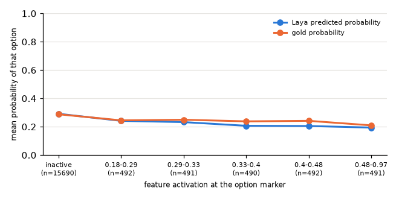

# Feature 13

Critérios em que aparece: corr_error_stratified, pred_probe_right_laya_wrong_stratified, corr_probe_right_laya_wrong_stratified

**Interpretação (preencher):** 

---

## Maiores ativações

**tr_customer_service_000079 / needs_human** (noul, customer_service) | ativação 2.533 em `estado` | opções ['false', 'true'] | Laya: **true** [0.034, 0.966] | gabarito: **false**

```
<bos> noul question: This conversation requires a human agent rather than automated handling.<eos>
▸ <mask> false: Automation can carry this to resolution.
▸ <mask> true: A human must take over: judgement, authority or empathy is required.

<eos>

 {"account": {"lifetime_value_usd": 621, "prior_tickets_90d": 0, "seats": 1, "tenure_months": 8, "tier": "standard"}, "thread": [{"role": "customer", "text": "I am checking on the status of a refund that was initiated last week. It has not appeared in my account yet."}, {"role": "agent", "text": "I can certainly look into that for you. Could you please provide the case number or the transaction ID associated with the refund?"}, {"role": "customer", "text": "The reference number⟦ is⟧ REF-88372-X. It was processed on the 12th according to your email."}, {"role": "agent", "text": "Thanks for providing that ID. I am currently pulling up the transaction details; could you verify the email address associated with your account?"}, {"role": "customer", "text": "It is j.smith@provider.com. Please let me know what you find."}]}<eos>
```

**tr_customer_service_000192 / category** (choice, customer_service) | ativação 2.455 em `estado` | opções ['account', 'billing', 'delivery', 'refund', 'technical'] | Laya: **technical** [0.226, 0.166, 0.017, 0.04, 0.549] | gabarito: **technical**

```
<bos> choice question: What is this customer conversation primarily about?<eos>
▸ <mask> account: Login, plan changes, profile or access management.
▸ <mask> billing: A charge, invoice, subscription or payment problem.
▸ <mask> delivery: Shipping, fulfilment or delivery of a physical item.
▸ <mask> refund: The customer is explicitly asking for money back.
▸ <mask> technical: The product or service is not working as expected.

<eos>

 {"account": {"lifetime_value_usd": 212, "prior_tickets_90d": 1, "seats": 1, "tenure_months": 5, "tier": "standard"}, "thread": [{"role": "customer", "text": "I got the replacement you mailed last month, but it showed up with a shattered screen again, and I have to have a working unit by next Friday or my deadline will be missed."}, {"role": "agent", "text": "I’m sorry to hear that. Could you let me know the serial number on the device and whether you still have the original packaging?"}, {"role": "customer", "text": "The serial is XJ‑2024‑B7,⟦ and⟧ yes, I kept the box. This is the second time this has happened after the ticket I opened last quarter."}, {"role": "agent", "text": "Thanks for the details. Would you be able to send us a photo of the damage so we can see exactly what went wrong?"}, {"role": "customer", "text": "I’ll attach a picture right after this message. I really need this sorted before Friday, otherwise my client walks."}]}<eos>
```

**tr_customer_service_000079 / action** (choice, customer_service) | ativação 2.406 em `estado` | opções ['answer_directly', 'close_no_action', 'escalate_to_human', 'execute_refund', 'request_information'] | Laya: **answer_directly** [0.619, 0.025, 0.177, 0.164, 0.015] | gabarito: **answer_directly**

```
<bos> choice question: What should the assistant do next with this conversation?<eos>
▸ <mask> answer_directly: The assistant can resolve this itself with information it already has.
▸ <mask> close_no_action: No further action is warranted; the matter is settled.
▸ <mask> escalate_to_human: Hand off to a human agent with the appropriate authority.
▸ <mask> execute_refund: Issue the refund or credit the customer is owed.
▸ <mask> request_information: More detail is needed from the customer before anything can be done.

<eos>

 {"account": {"lifetime_value_usd": 621, "prior_tickets_90d": 0, "seats": 1, "tenure_months": 8, "tier": "standard"}, "thread": [{"role": "customer", "text": "I am checking on the status of a refund that was initiated last week. It has not appeared in my account yet."}, {"role": "agent", "text": "I can certainly look into that for you. Could you please provide the case number or the transaction ID associated with the refund?"}, {"role": "customer", "text": "The reference number⟦ is⟧ REF-88372-X. It was processed on the 12th according to your email."}, {"role": "agent", "text": "Thanks for providing that ID. I am currently pulling up the transaction details; could you verify the email address associated with your account?"}, {"role": "customer", "text": "It is j.smith@provider.com. Please let me know what you find."}]}<eos>
```

**tr_customer_service_000192 / churn_risk** (score, customer_service) | ativação 2.359 em `estado` | opções ['0', '1', '2', '3'] | Laya: **2** [0.085, 0.364, 0.494, 0.058] | gabarito: **2**

```
<bos> score question: How likely is this customer to stop doing business with us because of this interaction?<eos>
▸ <mask> level 0: No sign of dissatisfaction.
▸ <mask> level 1: Mild frustration, but the relationship is intact.
▸ <mask> level 2: Clearly unhappy; repeat problems or explicit complaints.
▸ <mask> level 3: Imminent: threatening to cancel, dispute or leave.

<eos>

 {"account": {"lifetime_value_usd": 212, "prior_tickets_90d": 1, "seats": 1, "tenure_months": 5, "tier": "standard"}, "thread": [{"role": "customer", "text": "I got the replacement you mailed last month, but it showed up with a shattered screen again, and I have to have a working unit by next Friday or my deadline will be missed."}, {"role": "agent", "text": "I’m sorry to hear that. Could you let me know the serial number on the device and whether you still have the original packaging?"}, {"role": "customer", "text": "The serial is XJ‑2024‑B7,⟦ and⟧ yes, I kept the box. This is the second time this has happened after the ticket I opened last quarter."}, {"role": "agent", "text": "Thanks for the details. Would you be able to send us a photo of the damage so we can see exactly what went wrong?"}, {"role": "customer", "text": "I’ll attach a picture right after this message. I really need this sorted before Friday, otherwise my client walks."}]}<eos>
```

**tr_customer_service_000024 / urgency** (score, customer_service) | ativação 2.352 em `estado` | opções ['0', '1', '2', '3'] | Laya: **3** [0.137, 0.264, 0.155, 0.444] | gabarito: **3**

```
<bos> score question: How time-sensitive is this conversation?<eos>
▸ <mask> level 0: No time pressure; can wait indefinitely.
▸ <mask> level 1: Routine; handle within the normal queue.
▸ <mask> level 2: Elevated; should be handled within the same week.
▸ <mask> level 3: Critical; requires action within the same day.

<eos>

 {"account": {"lifetime_value_usd": 635, "prior_tickets_90d": 0, "seats": 12, "tenure_months": 8, "tier": "enterprise"}, "thread": [{"role": "customer", "text": "I need the invoice for our Enterprise account immediately! We are in the middle of a major audit and I cannot find the records in the dashboard anywhere."}, {"role": "agent", "text": "I understand the urgency of this request for your audit. Could you please specify which billing periods you are looking for?"}, {"role": "customer", "text": "I need every single statement from the last eight months. We've been with you guys since the start of the year and I need these documents sent to my email right now."}, {"role": "agent", "text": "Thank you for clarifying the timeframe. To make sure I am accessing the right files, can you confirm the primary billing email address listed on the account?"}, {"role": "customer", "text": "It's the admin address I'm using to send this⟦!⟧ Please, just get me those PDFs, I'm under a lot of pressure to get this filed."}]}<eos>
```

## Ativações medianas (faixa 40-60%, mediana 0.501)

**tr_security_incidents_000087 / true_positive** (noul, security_incidents) | ativação 0.482 em `estado` | opções ['false', 'true'] | Laya: **true** [0.471, 0.529] | gabarito: **true**

```
<bos> noul question: This alert reflects genuinely malicious or unauthorised activity.<eos>
▸ <mask> false: Benign activity, a misconfiguration, or a known false positive.
▸ <mask> true: The underlying behaviour is malicious or unauthorised.

<eos>

 {"alert": {"description": "many failed authentications followed by a success", "evidence": "From IP 203.0.113.45, the CI runner service recorded 27 failed password attempts between 2026-09-15T02:10:12Z and 2026-09-15T02:12:45Z. A subsequent successful authentication from the same source occurred at 2026-09-15T02:13:03Z with MFA verification.", "rule": "brute_force"},⟦ "⟧context": {"asset_criticality": "low", "change_window_active": false, "source_on_allowlist": false}, "history": {"credential_rotation_days_ago": 700, "distinct_countries_30d": 4, "logins_30d": 1039, "prior_alerts_90d": 0}, "principal": {"mfa_enrolled": true, "name": "usr-deploy-415", "privileges": ["repo:read"], "type": "ci_runner"}}<eos>
```

**tr_security_incidents_000026 / urgency** (score, security_incidents) | ativação 0.511 em `opção` | opções ['0', '1', '2', '3'] | Laya: **3** [0.107, 0.294, 0.233, 0.366] | gabarito: **1**

```
<bos> score question: How quickly must a responder act on this alert?<eos>
▸ <mask> level 0: No time pressure; can wait indefinitely.
▸ <mask> level 1: Routine; handle within the normal queue⟦.⟧
▸ <mask> level 2: Elevated; should be handled within the same week.
▸ <mask> level 3: Critical; requires action within the same day.

<eos>

 {"alert": {"description": "a first-ever sign-in from an unfamiliar country", "evidence": "The CI runner account initiated a sign-in session from a country that has no prior history of authentication for this principal. This event was observed from an allowlisted source, following a credential rotation period of 700 days.", "rule": "new_country_login"}, "context": {"asset_criticality": "low", "change_window_active": false, "source_on_allowlist": true}, "history": {"credential_rotation_days_ago": 700, "distinct_countries_30d": 2, "logins_30d": 385, "prior_alerts_90d": 1}, "principal": {"mfa_enrolled": true, "name": "usr-infra-839", "privileges": ["repo:read"], "type": "ci_runner"}}<eos>
```

**tr_customer_service_000170 / urgency** (score, customer_service) | ativação 0.562 em `pergunta` | opções ['0', '1', '2', '3'] | Laya: **2** [0.093, 0.375, 0.419, 0.113] | gabarito: **2**

```
<bos> score⟦ question⟧: How time-sensitive is this conversation?<eos>
▸ <mask> level 0: No time pressure; can wait indefinitely.
▸ <mask> level 1: Routine; handle within the normal queue.
▸ <mask> level 2: Elevated; should be handled within the same week.
▸ <mask> level 3: Critical; requires action within the same day.

<eos>

 {"account": {"lifetime_value_usd": 918, "prior_tickets_90d": 1, "seats": 1, "tenure_months": 60, "tier": "free"}, "orders": [{"amount_usd": 49, "date": "2026-02-18", "id": "A-83731", "status": "settled"}], "thread": [{"role": "customer", "text": "I’m confused why my order, which should have been $49, is still not here. I’ve been on the free plan for five years and even opened a ticket before, but nothing’s changed."}]}<eos>
```

**tr_customer_service_000225 / action** (choice, customer_service) | ativação 0.559 em `estado` | opções ['answer_directly', 'close_no_action', 'escalate_to_human', 'execute_refund', 'request_information'] | Laya: **close_no_action** [0.095, 0.85, 0.008, 0.02, 0.028] | gabarito: **request_information**

```
<bos> choice question: What should the assistant do next with this conversation?<eos>
▸ <mask> answer_directly: The assistant can resolve this itself with information it already has.
▸ <mask> close_no_action: No further action is warranted; the matter is settled.
▸ <mask> escalate_to_human: Hand off to a human agent with the appropriate authority.
▸ <mask> execute_refund: Issue the refund or credit the customer is owed.
▸ <mask> request_information: More detail is needed from the customer before anything can be done.

<eos>

 {"account": {"lifetime_value_usd": 419, "prior_tickets_90d": 1, "seats": 1, "tenure_months": 5, "tier": "standard"}, "orders": [{"amount_usd": 99, "date": "2026-01-07", "id": "A-67520", "status": "settled"}, {"amount_usd": 99, "date": "2026-03-11", "id": "A-78780", "status": "settled"}, {"amount_usd": 99, "date": "2026-02-08", "id": "A-39325", "status": "settled"}], "thread": [{"role": "customer", "text": "Hello, I’m writing because I accidentally dropped the $99 device I bought five months ago, and the screen is now completely cracked."}, {"role": "agent", "text": "I’m sorry to hear that your device was damaged. Could you please provide your order number and a brief description of the current display functionality?"}, {"role": "customer", "text": "The order number is #88291⟦,⟧ and while the touch screen is unresponsive, the device still powers on."}, {"role": "agent", "text": "Thank you for providing those details. Just to ensure I have the full picture, could you tell me if there is any visible damage to the charging port or the frame?"}, {"role": "customer", "text": "No, the frame and charging port look perfectly fine, it is just the screen."}]}<eos>
```

**tr_security_incidents_000215 / severity** (score, security_incidents) | ativação 0.460 em `estado` | opções ['0', '1', '2', '3', '4'] | Laya: **1** [0.087, 0.581, 0.146, 0.049, 0.137] | gabarito: **3**

```
<bos> score question: How severe is the potential impact if this alert is real?<eos>
▸ <mask> level 0: Negligible: no access to anything sensitive.
▸ <mask> level 1: Low: limited access, easily reversed.
▸ <mask> level 2: Moderate: access to internal systems or non-public data.
▸ <mask> level 3: High: access to production, secrets or customer data.
▸ <mask> level 4: Critical: active compromise of crown-jewel systems.

<eos>

 {"alert": {"description": "audit logging was turned off on a host", "evidence": "System audit logging was deactivated on server PROD-DB-01 at 23:10 by a privileged administrator account. The action was performed from an unrecognized source using an account with a password age of 700 days during a period with no active change windows.", "rule": "disabled_logging"}, "context": {"asset_criticality": "low", "change_window_active": false, "source_on_allowlist": false⟦},⟧ "history": {"credential_rotation_days_ago": 700, "distinct_countries_30d": 2, "logins_30d": 633, "prior_alerts_90d": 0}, "principal": {"mfa_enrolled": true, "name": "usr-infra-797", "privileges": ["deploy:production", "secrets:read"], "type": "admin"}}<eos>
```

## Estatísticas (conjunto de descoberta, dev e teste)

**pred / error**

| split | decisões | ativas | ativas e Laya errou | taxa | lift | q (BH) | OR (CMH) | q (CMH) |
|---|---|---|---|---|---|---|---|---|
| discovery | 5100 | 426 | 278 | 0.653 | 1.01 | 0.835 | 1.22 | 0.399 |
| dev | 900 | 69 | 45 | 0.652 | 0.97 | 0.941 | 1.13 | 0.89 |
| test | 2000 | 145 | 91 | 0.628 | 0.96 | 0.718 | 0.83 | 0.771 |

**corr / error**

| split | decisões | ativas | ativas e Laya errou | taxa | lift | q (BH) | OR (CMH) | q (CMH) |
|---|---|---|---|---|---|---|---|---|
| discovery | 5100 | 583 | 435 | 0.746 | 1.16 | 7.65e-08 | 2.40 | 1.04e-08 |
| dev | 900 | 96 | 72 | 0.750 | 1.12 | 0.162 | 2.24 | 0.126 |
| test | 2000 | 231 | 177 | 0.766 | 1.18 | 0.000179 | 2.32 | 0.00318 |

**state / error**

| split | decisões | ativas | ativas e Laya errou | taxa | lift | q (BH) | OR (CMH) | q (CMH) |
|---|---|---|---|---|---|---|---|---|
| discovery | 5100 | 2966 | 1855 | 0.625 | 0.97 | 0.00653 | 1.05 | 0.765 |
| dev | 900 | 495 | 319 | 0.644 | 0.96 | 0.33 | 0.99 | 0.983 |
| test | 2000 | 1185 | 762 | 0.643 | 0.99 | 0.715 | 1.22 | 0.383 |

**pred / probe_right_laya_wrong**

| split | decisões | ativas | ativas e Laya errou | taxa | lift | q (BH) | OR (CMH) | q (CMH) |
|---|---|---|---|---|---|---|---|---|
| discovery | 2932 | 214 | 133 | 0.621 | 1.03 | 0.736 | 1.70 | 0.0236 |
| dev | 523 | 35 | 21 | 0.600 | 0.93 | 0.807 | 1.11 | 0.904 |
| test | 1149 | 68 | 34 | 0.500 | 0.82 | 0.124 | 0.77 | 0.717 |

**corr / probe_right_laya_wrong**

| split | decisões | ativas | ativas e Laya errou | taxa | lift | q (BH) | OR (CMH) | q (CMH) |
|---|---|---|---|---|---|---|---|---|
| discovery | 2932 | 260 | 179 | 0.688 | 1.14 | 0.00682 | 2.52 | 2.55e-05 |
| dev | 523 | 42 | 28 | 0.667 | 1.03 | 0.979 | 2.59 | 0.284 |
| test | 1149 | 101 | 67 | 0.663 | 1.09 | 0.372 | 2.12 | 0.127 |

**state / probe_right_laya_wrong**

| split | decisões | ativas | ativas e Laya errou | taxa | lift | q (BH) | OR (CMH) | q (CMH) |
|---|---|---|---|---|---|---|---|---|
| discovery | 2932 | 1743 | 1033 | 0.593 | 0.98 | 0.171 | 1.23 | 0.126 |
| dev | 523 | 302 | 193 | 0.639 | 0.99 | 0.967 | 1.32 | 0.534 |
| test | 1149 | 718 | 446 | 0.621 | 1.02 | 0.648 | 1.53 | 0.0594 |

Confusão mais sobre-representada (pred): `urgency|1>3` (n=72, lift 5.71, p=3.43e-39). Formato `pergunta|índice previsto>índice correto`.

Confusão mais sobre-representada (corr): `urgency|1>2` (n=114, lift 4.77, p=0). Formato `pergunta|índice previsto>índice correto`.

Confusão mais sobre-representada (state): `credential_compromise|1>0` (n=71, lift 1.49, p=1.89e-08). Formato `pergunta|índice previsto>índice correto`.



