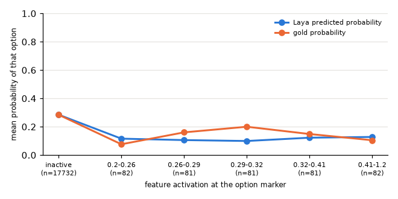

# Feature 42

Critérios em que aparece: corr_error, corr_probe_right_laya_wrong

**Interpretação (preencher):** 

---

## Maiores ativações

**tr_customer_service_000111 / urgency** (score, customer_service) | ativação 7.105 em `estado` | opções ['0', '1', '2', '3'] | Laya: **3** [0.128, 0.303, 0.248, 0.32] | gabarito: **3**

```
<bos> score question: How time-sensitive is this conversation?<eos>
▸ <mask> level 0: No time pressure; can wait indefinitely.
▸ <mask> level 1: Routine; handle within the normal queue.
▸ <mask> level 2: Elevated; should be handled within the same week.
▸ <mask> level 3: Critical; requires action within the same day.

<eos>

 {"account": {"lifetime_value_usd": 181, "prior_tickets_90d": 0, "seats": 1, "tenure_months": 2, "tier": "free"}, "thread": [{"role": "customer", "text": "We have to add three more seats to our team right now, or we can't meet our client deadline tomorrow⟦.⟧ If this isn't sorted immediately, we'll have to look for another service."}, {"role": "agent", "text": "Got it. Can you provide the account ID and let me know which usernames need the new seats?"}, {"role": "customer", "text": "We're on the free plan, account ID 98765. Please tell me what I need to do to get those seats added before 5 pm today."}]}<eos>
```

**tr_customer_service_000111 / category** (choice, customer_service) | ativação 6.918 em `estado` | opções ['account', 'billing', 'delivery', 'refund', 'technical'] | Laya: **account** [0.984, 0.002, 0.0, 0.001, 0.013] | gabarito: **account**

```
<bos> choice question: What is this customer conversation primarily about?<eos>
▸ <mask> account: Login, plan changes, profile or access management.
▸ <mask> billing: A charge, invoice, subscription or payment problem.
▸ <mask> delivery: Shipping, fulfilment or delivery of a physical item.
▸ <mask> refund: The customer is explicitly asking for money back.
▸ <mask> technical: The product or service is not working as expected.

<eos>

 {"account": {"lifetime_value_usd": 181, "prior_tickets_90d": 0, "seats": 1, "tenure_months": 2, "tier": "free"}, "thread": [{"role": "customer", "text": "We have to add three more seats to our team right now, or we can't meet our client deadline tomorrow⟦.⟧ If this isn't sorted immediately, we'll have to look for another service."}, {"role": "agent", "text": "Got it. Can you provide the account ID and let me know which usernames need the new seats?"}, {"role": "customer", "text": "We're on the free plan, account ID 98765. Please tell me what I need to do to get those seats added before 5 pm today."}]}<eos>
```

**tr_customer_service_000111 / needs_human** (noul, customer_service) | ativação 6.898 em `estado` | opções ['false', 'true'] | Laya: **true** [0.43, 0.57] | gabarito: **false**

```
<bos> noul question: This conversation requires a human agent rather than automated handling.<eos>
▸ <mask> false: Automation can carry this to resolution.
▸ <mask> true: A human must take over: judgement, authority or empathy is required.

<eos>

 {"account": {"lifetime_value_usd": 181, "prior_tickets_90d": 0, "seats": 1, "tenure_months": 2, "tier": "free"}, "thread": [{"role": "customer", "text": "We have to add three more seats to our team right now, or we can't meet our client deadline tomorrow⟦.⟧ If this isn't sorted immediately, we'll have to look for another service."}, {"role": "agent", "text": "Got it. Can you provide the account ID and let me know which usernames need the new seats?"}, {"role": "customer", "text": "We're on the free plan, account ID 98765. Please tell me what I need to do to get those seats added before 5 pm today."}]}<eos>
```

**tr_customer_service_000111 / action** (choice, customer_service) | ativação 6.645 em `estado` | opções ['answer_directly', 'close_no_action', 'escalate_to_human', 'execute_refund', 'request_information'] | Laya: **answer_directly** [0.639, 0.093, 0.081, 0.036, 0.151] | gabarito: **answer_directly**

```
<bos> choice question: What should the assistant do next with this conversation?<eos>
▸ <mask> answer_directly: The assistant can resolve this itself with information it already has.
▸ <mask> close_no_action: No further action is warranted; the matter is settled.
▸ <mask> escalate_to_human: Hand off to a human agent with the appropriate authority.
▸ <mask> execute_refund: Issue the refund or credit the customer is owed.
▸ <mask> request_information: More detail is needed from the customer before anything can be done.

<eos>

 {"account": {"lifetime_value_usd": 181, "prior_tickets_90d": 0, "seats": 1, "tenure_months": 2, "tier": "free"}, "thread": [{"role": "customer", "text": "We have to add three more seats to our team right now, or we can't meet our client deadline tomorrow⟦.⟧ If this isn't sorted immediately, we'll have to look for another service."}, {"role": "agent", "text": "Got it. Can you provide the account ID and let me know which usernames need the new seats?"}, {"role": "customer", "text": "We're on the free plan, account ID 98765. Please tell me what I need to do to get those seats added before 5 pm today."}]}<eos>
```

**tr_customer_service_000111 / churn_risk** (score, customer_service) | ativação 6.383 em `estado` | opções ['0', '1', '2', '3'] | Laya: **1** [0.088, 0.457, 0.313, 0.142] | gabarito: **3**

```
<bos> score question: How likely is this customer to stop doing business with us because of this interaction?<eos>
▸ <mask> level 0: No sign of dissatisfaction.
▸ <mask> level 1: Mild frustration, but the relationship is intact.
▸ <mask> level 2: Clearly unhappy; repeat problems or explicit complaints.
▸ <mask> level 3: Imminent: threatening to cancel, dispute or leave.

<eos>

 {"account": {"lifetime_value_usd": 181, "prior_tickets_90d": 0, "seats": 1, "tenure_months": 2, "tier": "free"}, "thread": [{"role": "customer", "text": "We have to add three more seats to our team right now, or we can't meet our client deadline tomorrow⟦.⟧ If this isn't sorted immediately, we'll have to look for another service."}, {"role": "agent", "text": "Got it. Can you provide the account ID and let me know which usernames need the new seats?"}, {"role": "customer", "text": "We're on the free plan, account ID 98765. Please tell me what I need to do to get those seats added before 5 pm today."}]}<eos>
```

## Ativações medianas (faixa 40-60%, mediana 0.973)

**tr_invoice_processing_000227 / matches_order** (noul, invoice_processing) | ativação 0.929 em `opção` | opções ['false', 'true'] | Laya: **true** [0.028, 0.972] | gabarito: **false**

```
<bos> noul question: The invoice reconciles with the purchase order and the recorded delivery.<eos>
▸ <mask> false: There is a discrepancy against the order or the delivery.
▸ <mask> true: Line items, quantities and amounts reconcile⟦.⟧

<eos>

 {"delivery": {"condition": "accepted with exceptions", "date": "2026-03-17", "received_qty": 1000}, "invoice": {"currency": "USD", "id": "INV-2026-8669", "lines": [{"qty": 1000, "sku": "SKU-950", "total_usd": 37210.0, "unit_usd": 37.21}], "total_usd": 37210.0, "vendor": "Orbit Logistics"}, "payment": {"days_until_due": -3, "discount_expires_in_days": null, "early_payment_discount_pct": null, "status": "overdue", "terms": "net 15"}, "purchase_order": {"freight_terms": "freight prepaid by vendor, not separately billable", "id": "PO-9424", "lines": [{"qty": 1000, "unit_usd": 37.21}], "total_usd": 37210.0}, "vendor_history": {"disputes_12m": 5, "invoices_12m": 27, "prior_invoice_ids": ["INV-2026-8669"]}}<eos>
```

**tr_invoice_processing_000284 / matches_order** (noul, invoice_processing) | ativação 1.050 em `pergunta` | opções ['false', 'true'] | Laya: **true** [0.032, 0.968] | gabarito: **true**

```
<bos> noul question: The invoice reconciles with the purchase order and the recorded delivery⟦.⟧<eos>
▸ <mask> false: There is a discrepancy against the order or the delivery.
▸ <mask> true: Line items, quantities and amounts reconcile.

<eos>

 {"delivery": {"condition": "accepted", "date": "2026-03-20", "received_qty": 1000}, "invoice": {"currency": "USD", "id": "INV-2026-7786", "lines": [{"qty": 1000, "sku": "SKU-874", "total_usd": 320730.0, "unit_usd": 320.73}], "total_usd": 320730.0, "vendor": "Kestrel Supply"}, "payment": {"days_until_due": 11, "discount_expires_in_days": null, "early_payment_discount_pct": null, "status": "scheduled", "terms": "net 15"}, "purchase_order": {"freight_terms": "freight prepaid by vendor, not separately billable", "id": "PO-7733", "lines": [{"qty": 1000, "unit_usd": 320.73}], "total_usd": 320730.0}, "vendor_history": {"disputes_12m": 1, "invoices_12m": 31, "prior_invoice_ids": ["INV-2026-3295", "INV-2026-5889", "INV-2026-7594"]}}<eos>
```

**tr_customer_service_000020 / action** (choice, customer_service) | ativação 0.877 em `estado` | opções ['answer_directly', 'close_no_action', 'escalate_to_human', 'execute_refund', 'request_information'] | Laya: **close_no_action** [0.304, 0.66, 0.02, 0.007, 0.009] | gabarito: **escalate_to_human**

```
<bos> choice question: What should the assistant do next with this conversation?<eos>
▸ <mask> answer_directly: The assistant can resolve this itself with information it already has.
▸ <mask> close_no_action: No further action is warranted; the matter is settled.
▸ <mask> escalate_to_human: Hand off to a human agent with the appropriate authority.
▸ <mask> execute_refund: Issue the refund or credit the customer is owed.
▸ <mask> request_information: More detail is needed from the customer before anything can be done.

<eos>

 {"account": {"lifetime_value_usd": 2714, "prior_tickets_90d": 0, "seats": 1, "tenure_months": 49, "tier": "standard"}, "orders": [{"amount_usd": 299, "date": "2026-02-07", "id": "A-58056", "status": "settled"}, {"amount_usd": 299, "date": "2026-02-07", "id": "A-95377", "status": "settled"}, {"amount_usd": 299, "date": "2026-03-25", "id": "A-65291", "status": "settled"}], "thread": [{"role": "customer", "text": "I need the full data export right now—my audit is tomorrow and I can't wait any longer. I've been on the standard plan for 49 months and this is unacceptable."}, {"role": "agent", "text": "I understand the pressure you’re under. Could you tell me exactly which data set you’re looking to export and the date range you need?"⟦},⟧ {"role": "customer", "text": "I need a CSV of every transaction and user action up through June 30th. If I don’t have it by end of day, my whole audit falls apart."}, {"role": "agent", "text": "Got it, I’ll look into the export queue for you. Are you seeing any error messages when you try to start the export yourself?"}, {"role": "customer", "text": "No errors, just a perpetual loading spinner. I can’t miss this deadline, so please let me know what’s happening."}]}<eos>
```

**tr_security_incidents_000090 / true_positive** (noul, security_incidents) | ativação 1.075 em `opção` | opções ['false', 'true'] | Laya: **false** [0.717, 0.283] | gabarito: **true**

```
<bos> noul question: This alert reflects genuinely malicious or unauthorised activity.<eos>
▸ <mask> false: Benign activity, a misconfiguration, or a known false positive.
▸ <mask> true: The underlying behaviour is malicious or unauthorised⟦.⟧

<eos>

 {"alert": {"description": "two successful logins from distant locations too close together", "evidence": "At 2026-09-14 03:12:04 UTC a successful authentication for the CI_Runner service was logged from IP 203.0.113.45 (Paris, FR). A second successful login for the same principal occurred 6 minutes later from IP 198.51.100.22 (Tokyo, JP), and the system flagged the source as not present in the allowlist. The change‑window flag was active and the associated credentials were last rotated on 2026-08-15.", "rule": "impossible_travel"}, "context": {"asset_criticality": "high", "change_window_active": true, "source_on_allowlist": false}, "history": {"credential_rotation_days_ago": 30, "distinct_countries_30d": 1, "logins_30d": 587, "prior_alerts_90d": 0}, "principal": {"mfa_enrolled": true, "name": "adm-billing-542", "privileges": ["deploy:production", "secrets:read"], "type": "ci_runner"}}<eos>
```

**tr_agent_trace_observability_000064 / outcome** (choice, agent_trace_observability) | ativação 0.959 em `opção` | opções ['failure', 'harmful', 'partial', 'success'] | Laya: **success** [0.332, 0.021, 0.182, 0.466] | gabarito: **success**

```
<bos> choice question: How did this agent run turn out?<eos>
▸ <mask> failure: The agent did not accomplish the task.
▸ <mask> harmful: The agent took an action that caused damage or violated a constraint.
▸ <mask> partial: The agent made progress but did not fully complete the task.
▸ <mask> success: The agent completed the task correctly⟦.⟧

<eos>

 {"agent": {"autonomy": "checkpointed", "model": "internal-agent-v3"}, "constraints": ["Never disable monitoring or alerting"], "task": "Triage and close duplicate issues in the support tracker.", "trace_summary": {"constraint_violations": 0, "duration_s": 804.7, "irreversible_actions": 0, "steps": 12, "tool_errors": 1}}<eos>
```

## Estatísticas (conjunto de descoberta, dev e teste)

**pred / error**

| split | decisões | ativas | ativas e Laya errou | taxa | lift | q (BH) | OR (CMH) | q (CMH) |
|---|---|---|---|---|---|---|---|---|
| discovery | 5100 | 7 | 7 | 1.000 | 1.55 | nan | nan | nan |
| dev | 900 | 2 | 2 | 1.000 | 1.49 | nan | nan | nan |
| test | 2000 | 0 | 0 | nan | nan | nan | nan | nan |

**corr / error**

| split | decisões | ativas | ativas e Laya errou | taxa | lift | q (BH) | OR (CMH) | q (CMH) |
|---|---|---|---|---|---|---|---|---|
| discovery | 5100 | 48 | 48 | 1.000 | 1.55 | 3.62e-09 | inf | 0.392 |
| dev | 900 | 6 | 6 | 1.000 | 1.49 | nan | nan | nan |
| test | 2000 | 17 | 17 | 1.000 | 1.54 | nan | nan | nan |

**state / error**

| split | decisões | ativas | ativas e Laya errou | taxa | lift | q (BH) | OR (CMH) | q (CMH) |
|---|---|---|---|---|---|---|---|---|
| discovery | 5100 | 3155 | 1923 | 0.610 | 0.95 | 3.29e-09 | 1.12 | 0.491 |
| dev | 900 | 550 | 367 | 0.667 | 0.99 | 0.984 | 1.83 | 0.115 |
| test | 2000 | 1231 | 767 | 0.623 | 0.96 | 0.0254 | 1.12 | 0.755 |

**pred / probe_right_laya_wrong**

| split | decisões | ativas | ativas e Laya errou | taxa | lift | q (BH) | OR (CMH) | q (CMH) |
|---|---|---|---|---|---|---|---|---|
| discovery | 2932 | 3 | 3 | 1.000 | 1.65 | nan | nan | nan |
| dev | 523 | 1 | 1 | 1.000 | 1.55 | nan | nan | nan |
| test | 1149 | 0 | 0 | nan | nan | nan | nan | nan |

**corr / probe_right_laya_wrong**

| split | decisões | ativas | ativas e Laya errou | taxa | lift | q (BH) | OR (CMH) | q (CMH) |
|---|---|---|---|---|---|---|---|---|
| discovery | 2932 | 36 | 36 | 1.000 | 1.65 | 6.35e-08 | inf | 0.853 |
| dev | 523 | 5 | 5 | 1.000 | 1.55 | nan | nan | nan |
| test | 1149 | 16 | 16 | 1.000 | 1.64 | nan | nan | nan |

**state / probe_right_laya_wrong**

| split | decisões | ativas | ativas e Laya errou | taxa | lift | q (BH) | OR (CMH) | q (CMH) |
|---|---|---|---|---|---|---|---|---|
| discovery | 2932 | 1877 | 1047 | 0.558 | 0.92 | 5.19e-11 | 1.30 | 0.0963 |
| dev | 523 | 322 | 203 | 0.630 | 0.98 | 0.701 | 2.55 | 0.0213 |
| test | 1149 | 737 | 418 | 0.567 | 0.93 | 0.00178 | 1.21 | 0.641 |

Confusão mais sobre-representada (pred): `churn_risk|0>1` (n=2, lift 291.43, p=nan). Formato `pergunta|índice previsto>índice correto`.

Confusão mais sobre-representada (corr): `discrepancy_severity|2>0` (n=41, lift 40.34, p=0). Formato `pergunta|índice previsto>índice correto`.

Confusão mais sobre-representada (state): `disposition|3>2` (n=166, lift 1.60, p=9.63e-33). Formato `pergunta|índice previsto>índice correto`.



