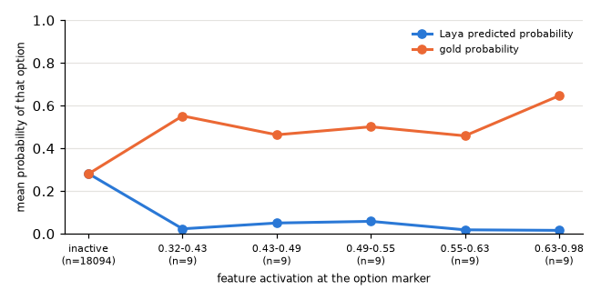

# Feature 141

Critérios em que aparece: corr_error, corr_probe_right_laya_wrong

**Interpretação (preencher):** 

---

## Maiores ativações

**tr_customer_service_000153 / action** (choice, customer_service) | ativação 5.605 em `estado` | opções ['answer_directly', 'close_no_action', 'escalate_to_human', 'execute_refund', 'request_information'] | Laya: **answer_directly** [0.428, 0.144, 0.218, 0.074, 0.135] | gabarito: **escalate_to_human**

```
<bos> choice question: What should the assistant do next with this conversation?<eos>
▸ <mask> answer_directly: The assistant can resolve this itself with information it already has.
▸ <mask> close_no_action: No further action is warranted; the matter is settled.
▸ <mask> escalate_to_human: Hand off to a human agent with the appropriate authority.
▸ <mask> execute_refund: Issue the refund or credit the customer is owed.
▸ <mask> request_information: More detail is needed from the customer before anything can be done.

<eos>

 {"account": {"lifetime_value_usd": 232, "prior_tickets_90d": 3, "seats": 1, "tenure_months": 8, "tier": "standard"}, "thread": [{"role": "customer", "text": "⟦We⟧'ve added three new team members and need to assign them seats in the admin portal. The current seat count shows six, but we should have nine."}, {"role": "agent", "text": "I see, thanks for the details. Could you confirm the email addresses of the new users?"}, {"role": "customer", "text": "Sure, they're alice@example.com, bob@example.com, and carol@example.com."}]}<eos>
```

**tr_customer_service_000153 / category** (choice, customer_service) | ativação 5.582 em `estado` | opções ['account', 'billing', 'delivery', 'refund', 'technical'] | Laya: **account** [0.995, 0.001, 0.0, 0.002, 0.001] | gabarito: **account**

```
<bos> choice question: What is this customer conversation primarily about?<eos>
▸ <mask> account: Login, plan changes, profile or access management.
▸ <mask> billing: A charge, invoice, subscription or payment problem.
▸ <mask> delivery: Shipping, fulfilment or delivery of a physical item.
▸ <mask> refund: The customer is explicitly asking for money back.
▸ <mask> technical: The product or service is not working as expected.

<eos>

 {"account": {"lifetime_value_usd": 232, "prior_tickets_90d": 3, "seats": 1, "tenure_months": 8, "tier": "standard"}, "thread": [{"role": "customer", "text": "⟦We⟧'ve added three new team members and need to assign them seats in the admin portal. The current seat count shows six, but we should have nine."}, {"role": "agent", "text": "I see, thanks for the details. Could you confirm the email addresses of the new users?"}, {"role": "customer", "text": "Sure, they're alice@example.com, bob@example.com, and carol@example.com."}]}<eos>
```

**tr_customer_service_000153 / needs_human** (noul, customer_service) | ativação 5.496 em `estado` | opções ['false', 'true'] | Laya: **true** [0.44, 0.56] | gabarito: **true**

```
<bos> noul question: This conversation requires a human agent rather than automated handling.<eos>
▸ <mask> false: Automation can carry this to resolution.
▸ <mask> true: A human must take over: judgement, authority or empathy is required.

<eos>

 {"account": {"lifetime_value_usd": 232, "prior_tickets_90d": 3, "seats": 1, "tenure_months": 8, "tier": "standard"}, "thread": [{"role": "customer", "text": "⟦We⟧'ve added three new team members and need to assign them seats in the admin portal. The current seat count shows six, but we should have nine."}, {"role": "agent", "text": "I see, thanks for the details. Could you confirm the email addresses of the new users?"}, {"role": "customer", "text": "Sure, they're alice@example.com, bob@example.com, and carol@example.com."}]}<eos>
```

**tr_customer_service_000153 / urgency** (score, customer_service) | ativação 5.438 em `estado` | opções ['0', '1', '2', '3'] | Laya: **1** [0.169, 0.512, 0.224, 0.094] | gabarito: **1**

```
<bos> score question: How time-sensitive is this conversation?<eos>
▸ <mask> level 0: No time pressure; can wait indefinitely.
▸ <mask> level 1: Routine; handle within the normal queue.
▸ <mask> level 2: Elevated; should be handled within the same week.
▸ <mask> level 3: Critical; requires action within the same day.

<eos>

 {"account": {"lifetime_value_usd": 232, "prior_tickets_90d": 3, "seats": 1, "tenure_months": 8, "tier": "standard"}, "thread": [{"role": "customer", "text": "⟦We⟧'ve added three new team members and need to assign them seats in the admin portal. The current seat count shows six, but we should have nine."}, {"role": "agent", "text": "I see, thanks for the details. Could you confirm the email addresses of the new users?"}, {"role": "customer", "text": "Sure, they're alice@example.com, bob@example.com, and carol@example.com."}]}<eos>
```

**tr_customer_service_000153 / churn_risk** (score, customer_service) | ativação 5.402 em `estado` | opções ['0', '1', '2', '3'] | Laya: **1** [0.1, 0.721, 0.125, 0.053] | gabarito: **0**

```
<bos> score question: How likely is this customer to stop doing business with us because of this interaction?<eos>
▸ <mask> level 0: No sign of dissatisfaction.
▸ <mask> level 1: Mild frustration, but the relationship is intact.
▸ <mask> level 2: Clearly unhappy; repeat problems or explicit complaints.
▸ <mask> level 3: Imminent: threatening to cancel, dispute or leave.

<eos>

 {"account": {"lifetime_value_usd": 232, "prior_tickets_90d": 3, "seats": 1, "tenure_months": 8, "tier": "standard"}, "thread": [{"role": "customer", "text": "⟦We⟧'ve added three new team members and need to assign them seats in the admin portal. The current seat count shows six, but we should have nine."}, {"role": "agent", "text": "I see, thanks for the details. Could you confirm the email addresses of the new users?"}, {"role": "customer", "text": "Sure, they're alice@example.com, bob@example.com, and carol@example.com."}]}<eos>
```

## Ativações medianas (faixa 40-60%, mediana 1.526)

**tr_customer_service_000215 / needs_human** (noul, customer_service) | ativação 1.688 em `estado` | opções ['false', 'true'] | Laya: **false** [0.551, 0.449] | gabarito: **false**

```
<bos> noul question: This conversation requires a human agent rather than automated handling.<eos>
▸ <mask> false: Automation can carry this to resolution.
▸ <mask> true: A human must take over: judgement, authority or empathy is required.

<eos>

 {"account": {"lifetime_value_usd": 182, "prior_tickets_90d": 1, "seats": 1, "tenure_months": 8, "tier": "free"}, "thread": [{"role": "customer", "text": "Managing seats on the free tier is a nightmare—every time I try to add or remove a user, the UI freezes and⟦ I⟧ lose my changes."}, {"role": "agent", "text": "That definitely isn’t the experience we want you to have. Could you let me know exactly where in the seat management page the freeze occurs?"}, {"role": "customer", "text": "It happens when I hit ‘Add new seat’ and also when I click the trash can icon to delete a user. The screen just spins and never updates."}, {"role": "agent", "text": "Thanks for the specifics. Are you seeing any error messages in the browser console, or does it just stay on the loading spinner?"}, {"role": "customer", "text": "No error pop‑ups, just the endless spinner. I’ve been on the free plan for eight months and this is the only time I’ve run into such a problem."}]}<eos>
```

**tr_customer_service_000192 / churn_risk** (score, customer_service) | ativação 1.723 em `estado` | opções ['0', '1', '2', '3'] | Laya: **2** [0.085, 0.364, 0.494, 0.058] | gabarito: **2**

```
<bos> score question: How likely is this customer to stop doing business with us because of this interaction?<eos>
▸ <mask> level 0: No sign of dissatisfaction.
▸ <mask> level 1: Mild frustration, but the relationship is intact.
▸ <mask> level 2: Clearly unhappy; repeat problems or explicit complaints.
▸ <mask> level 3: Imminent: threatening to cancel, dispute or leave.

<eos>

 {"account": {"lifetime_value_usd": 212, "prior_tickets_90d": 1, "seats": 1, "tenure_months": 5, "tier": "standard"}, "thread": [{"role": "customer", "text": "I got the replacement you mailed last month, but it showed up with a shattered screen again, and I have to have a working unit by next Friday or my deadline will be missed."}, {"role": "agent", "text": "I’m sorry to hear that. Could you let me know the serial number on the device and whether you still have the original packaging?"}, {"role": "customer", "text": "The serial is XJ‑2024‑B7, and yes, I kept the box. This is the second time this has happened after the ticket⟦ I⟧ opened last quarter."}, {"role": "agent", "text": "Thanks for the details. Would you be able to send us a photo of the damage so we can see exactly what went wrong?"}, {"role": "customer", "text": "I’ll attach a picture right after this message. I really need this sorted before Friday, otherwise my client walks."}]}<eos>
```

**tr_customer_service_000187 / needs_human** (noul, customer_service) | ativação 1.420 em `estado` | opções ['false', 'true'] | Laya: **false** [0.579, 0.421] | gabarito: **true**

```
<bos> noul question: This conversation requires a human agent rather than automated handling.<eos>
▸ <mask> false: Automation can carry this to resolution.
▸ <mask> true: A human must take over: judgement, authority or empathy is required.

<eos>

 {"account": {"lifetime_value_usd": 1666, "prior_tickets_90d": 0, "seats": 1, "tenure_months": 49, "tier": "standard"}, "orders": [{"amount_usd": 447, "date": "2026-01-13", "id": "A-73036", "status": "settled"}, {"amount_usd": 447, "date": "2026-01-14", "id": "A-19724", "status": "refunded"}], "thread": [{"role": "customer", "text": "The seat allocation tool is a joke—my team can’t add anyone new and you keep throwing error code 502 at us!"}, {"role": "agent", "text": "I’m sorry the seat manager is failing you. Can you tell me exactly which action triggers the 502 response, and if you see any additional message details?"}, {"role": "customer", "text": "Every time I click ‘Add seat’ after typing the email it just crashes; I’ve tried it on Chrome and Firefox, same garbage."}, {"role": "agent", "text": "Thanks for the specifics. To investigate further, could⟦ you⟧ share the email addresses you attempted to add and the timestamps of those attempts?"}, {"role": "customer", "text": "We tried john.smith@company.com at 10:15 AM and lisa.brown@company.com at 10:17 AM today, and both blew up. This is delaying a project worth thousands."}, {"role": "agent", "text": "I’ve noted those details. While I can’t fix it instantly, I’ll forward this to our engineering squad. Meanwhile, could you confirm whether any other admin users are experiencing the same issue?"}, {"role": "customer", "text": "All of our admins get the same error, so it’s clearly a system problem—not just my account."}]}<eos>
```

**tr_customer_service_000161 / needs_human** (noul, customer_service) | ativação 1.642 em `estado` | opções ['false', 'true'] | Laya: **false** [0.744, 0.256] | gabarito: **true**

```
<bos> noul question: This conversation requires a human agent rather than automated handling.<eos>
▸ <mask> false: Automation can carry this to resolution.
▸ <mask> true: A human must take over: judgement, authority or empathy is required.

<eos>

 {"account": {"lifetime_value_usd": 2849, "prior_tickets_90d": 0, "seats": 40, "tenure_months": 72, "tier": "enterprise"}, "thread": [{"role": "customer", "text": "I’m a bit lost on how to downgrade my enterprise account; everything⟦ I⟧ try just loops back to the same page."}, {"role": "agent", "text": "Sorry for the confusion—could you tell me which part of the portal is giving you trouble?"}, {"role": "customer", "text": "When I click “Change Plan” nothing happens, and I need the downgrade done before Friday, so I’m not sure what to do next."}]}<eos>
```

**tr_customer_service_000082 / churn_risk** (score, customer_service) | ativação 1.508 em `estado` | opções ['0', '1', '2', '3'] | Laya: **3** [0.01, 0.026, 0.037, 0.926] | gabarito: **2**

```
<bos> score question: How likely is this customer to stop doing business with us because of this interaction?<eos>
▸ <mask> level 0: No sign of dissatisfaction.
▸ <mask> level 1: Mild frustration, but the relationship is intact.
▸ <mask> level 2: Clearly unhappy; repeat problems or explicit complaints.
▸ <mask> level 3: Imminent: threatening to cancel, dispute or leave.

<eos>

 {"account": {"lifetime_value_usd": 2703, "prior_tickets_90d": 2, "seats": 40, "tenure_months": 49, "tier": "premium"}, "thread": [{"role": "customer", "text": "I need an update on my refund now!⟦ You⟧ promised it after my last ticket and it’s been weeks—this is urgent."}, {"role": "agent", "text": "I’m sorry for the delay. Could you provide the transaction date or reference number so I can locate the refund request?"}, {"role": "customer", "text": "The purchase was on February 14th, reference #A1B2C3. I’ve been waiting far too long and need the money back immediately."}, {"role": "agent", "text": "Thank you for the details. I’ll check the status right away and get back to you as soon as I have more information."}, {"role": "customer", "text": "Please expedite this – I expect a resolution today."}]}<eos>
```

## Estatísticas (conjunto de descoberta, dev e teste)

**pred / error**

| split | decisões | ativas | ativas e Laya errou | taxa | lift | q (BH) | OR (CMH) | q (CMH) |
|---|---|---|---|---|---|---|---|---|
| discovery | 5100 | 0 | 0 | nan | nan | nan | nan | nan |
| dev | 900 | 0 | 0 | nan | nan | nan | nan | nan |
| test | 2000 | 0 | 0 | nan | nan | nan | nan | nan |

**corr / error**

| split | decisões | ativas | ativas e Laya errou | taxa | lift | q (BH) | OR (CMH) | q (CMH) |
|---|---|---|---|---|---|---|---|---|
| discovery | 5100 | 31 | 31 | 1.000 | 1.55 | 5.17e-06 | inf | 0.495 |
| dev | 900 | 5 | 5 | 1.000 | 1.49 | nan | nan | nan |
| test | 2000 | 13 | 13 | 1.000 | 1.54 | nan | nan | nan |

**state / error**

| split | decisões | ativas | ativas e Laya errou | taxa | lift | q (BH) | OR (CMH) | q (CMH) |
|---|---|---|---|---|---|---|---|---|
| discovery | 5100 | 1366 | 794 | 0.581 | 0.90 | 5.94e-07 | 1.12 | 0.567 |
| dev | 900 | 214 | 126 | 0.589 | 0.88 | 0.142 | 0.91 | 0.895 |
| test | 2000 | 529 | 311 | 0.588 | 0.90 | 0.017 | 0.93 | 0.878 |

**pred / probe_right_laya_wrong**

| split | decisões | ativas | ativas e Laya errou | taxa | lift | q (BH) | OR (CMH) | q (CMH) |
|---|---|---|---|---|---|---|---|---|
| discovery | 2932 | 0 | 0 | nan | nan | nan | nan | nan |
| dev | 523 | 0 | 0 | nan | nan | nan | nan | nan |
| test | 1149 | 0 | 0 | nan | nan | nan | nan | nan |

**corr / probe_right_laya_wrong**

| split | decisões | ativas | ativas e Laya errou | taxa | lift | q (BH) | OR (CMH) | q (CMH) |
|---|---|---|---|---|---|---|---|---|
| discovery | 2932 | 21 | 21 | 1.000 | 1.65 | 9.44e-05 | inf | 0.68 |
| dev | 523 | 2 | 2 | 1.000 | 1.55 | nan | nan | nan |
| test | 1149 | 11 | 11 | 1.000 | 1.64 | nan | nan | nan |

**state / probe_right_laya_wrong**

| split | decisões | ativas | ativas e Laya errou | taxa | lift | q (BH) | OR (CMH) | q (CMH) |
|---|---|---|---|---|---|---|---|---|
| discovery | 2932 | 737 | 351 | 0.476 | 0.79 | 1.56e-14 | 1.05 | 0.866 |
| dev | 523 | 119 | 57 | 0.479 | 0.74 | 0.00536 | 0.92 | 0.921 |
| test | 1149 | 315 | 155 | 0.492 | 0.81 | 7.33e-05 | 0.92 | 0.871 |

Confusão mais sobre-representada (corr): `action|1>2` (n=19, lift 44.03, p=4.92e-29). Formato `pergunta|índice previsto>índice correto`.

Confusão mais sobre-representada (state): `action|1>2` (n=65, lift 3.42, p=5.11e-31). Formato `pergunta|índice previsto>índice correto`.



