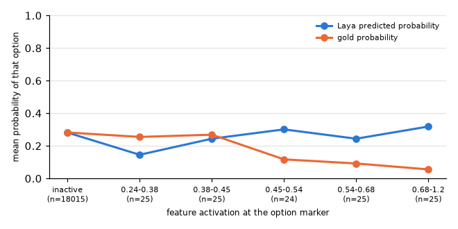

# Feature 216

Critérios em que aparece: pred_error

**Interpretação (preencher):** 

---

## Maiores ativações

**tr_customer_service_000176 / needs_human** (noul, customer_service) | ativação 7.824 em `estado` | opções ['false', 'true'] | Laya: **true** [0.156, 0.844] | gabarito: **true**

```
<bos> noul question: This conversation requires a human agent rather than automated handling.<eos>
▸ <mask> false: Automation can carry this to resolution.
▸ <mask> true: A human must take over: judgement, authority or empathy is required.

<eos>

 {"account": {"lifetime_value_usd": 389, "prior_tickets_90d": 0, "seats": 1, "tenure_months": 8, "tier": "standard"}, "orders": [{"amount_usd": 447, "date": "2026-03-17", "id": "A-79887", "status": "pending"}, {"amount_usd": 447, "date": "2026-02-17", "id": "A-28475", "status": "refunded"}], "thread": [{"role": "customer", "text": "I've been on the standard plan for eight months now, paying about $447, and I still can't get into my account."}, {"role": "agent", "text": "I’m sorry you’re experiencing this. Could you tell me what error message appears, or share the username you’re trying to sign in with?"}, {"role": "customer", "text": "It just says “invalid credentials” no matter what I type."}, {"role": "agent", "text": "Thanks for letting me know. Have you attempted a password reset, and if so, did you receive the reset email?"}, {"role": "customer", "text": "I tried resetting,⟦ but⟧ the reset email never arrives."}]}<eos>
```

**tr_customer_service_000176 / urgency** (score, customer_service) | ativação 7.703 em `estado` | opções ['0', '1', '2', '3'] | Laya: **1** [0.199, 0.48, 0.106, 0.215] | gabarito: **2**

```
<bos> score question: How time-sensitive is this conversation?<eos>
▸ <mask> level 0: No time pressure; can wait indefinitely.
▸ <mask> level 1: Routine; handle within the normal queue.
▸ <mask> level 2: Elevated; should be handled within the same week.
▸ <mask> level 3: Critical; requires action within the same day.

<eos>

 {"account": {"lifetime_value_usd": 389, "prior_tickets_90d": 0, "seats": 1, "tenure_months": 8, "tier": "standard"}, "orders": [{"amount_usd": 447, "date": "2026-03-17", "id": "A-79887", "status": "pending"}, {"amount_usd": 447, "date": "2026-02-17", "id": "A-28475", "status": "refunded"}], "thread": [{"role": "customer", "text": "I've been on the standard plan for eight months now, paying about $447, and I still can't get into my account."}, {"role": "agent", "text": "I’m sorry you’re experiencing this. Could you tell me what error message appears, or share the username you’re trying to sign in with?"}, {"role": "customer", "text": "It just says “invalid credentials” no matter what I type."}, {"role": "agent", "text": "Thanks for letting me know. Have you attempted a password reset, and if so, did you receive the reset email?"}, {"role": "customer", "text": "I tried resetting,⟦ but⟧ the reset email never arrives."}]}<eos>
```

**tr_customer_service_000176 / churn_risk** (score, customer_service) | ativação 7.699 em `estado` | opções ['0', '1', '2', '3'] | Laya: **2** [0.084, 0.342, 0.492, 0.082] | gabarito: **2**

```
<bos> score question: How likely is this customer to stop doing business with us because of this interaction?<eos>
▸ <mask> level 0: No sign of dissatisfaction.
▸ <mask> level 1: Mild frustration, but the relationship is intact.
▸ <mask> level 2: Clearly unhappy; repeat problems or explicit complaints.
▸ <mask> level 3: Imminent: threatening to cancel, dispute or leave.

<eos>

 {"account": {"lifetime_value_usd": 389, "prior_tickets_90d": 0, "seats": 1, "tenure_months": 8, "tier": "standard"}, "orders": [{"amount_usd": 447, "date": "2026-03-17", "id": "A-79887", "status": "pending"}, {"amount_usd": 447, "date": "2026-02-17", "id": "A-28475", "status": "refunded"}], "thread": [{"role": "customer", "text": "I've been on the standard plan for eight months now, paying about $447, and I still can't get into my account."}, {"role": "agent", "text": "I’m sorry you’re experiencing this. Could you tell me what error message appears, or share the username you’re trying to sign in with?"}, {"role": "customer", "text": "It just says “invalid credentials” no matter what I type."}, {"role": "agent", "text": "Thanks for letting me know. Have you attempted a password reset, and if so, did you receive the reset email?"}, {"role": "customer", "text": "I tried resetting,⟦ but⟧ the reset email never arrives."}]}<eos>
```

**tr_customer_service_000176 / action** (choice, customer_service) | ativação 7.484 em `estado` | opções ['answer_directly', 'close_no_action', 'escalate_to_human', 'execute_refund', 'request_information'] | Laya: **answer_directly** [0.696, 0.26, 0.006, 0.031, 0.008] | gabarito: **request_information**

```
<bos> choice question: What should the assistant do next with this conversation?<eos>
▸ <mask> answer_directly: The assistant can resolve this itself with information it already has.
▸ <mask> close_no_action: No further action is warranted; the matter is settled.
▸ <mask> escalate_to_human: Hand off to a human agent with the appropriate authority.
▸ <mask> execute_refund: Issue the refund or credit the customer is owed.
▸ <mask> request_information: More detail is needed from the customer before anything can be done.

<eos>

 {"account": {"lifetime_value_usd": 389, "prior_tickets_90d": 0, "seats": 1, "tenure_months": 8, "tier": "standard"}, "orders": [{"amount_usd": 447, "date": "2026-03-17", "id": "A-79887", "status": "pending"}, {"amount_usd": 447, "date": "2026-02-17", "id": "A-28475", "status": "refunded"}], "thread": [{"role": "customer", "text": "I've been on the standard plan for eight months now, paying about $447, and I still can't get into my account."}, {"role": "agent", "text": "I’m sorry you’re experiencing this. Could you tell me what error message appears, or share the username you’re trying to sign in with?"}, {"role": "customer", "text": "It just says “invalid credentials” no matter what I type."}, {"role": "agent", "text": "Thanks for letting me know. Have you attempted a password reset, and if so, did you receive the reset email?"}, {"role": "customer", "text": "I tried resetting,⟦ but⟧ the reset email never arrives."}]}<eos>
```

**tr_customer_service_000217 / action** (choice, customer_service) | ativação 7.332 em `estado` | opções ['answer_directly', 'close_no_action', 'escalate_to_human', 'execute_refund', 'request_information'] | Laya: **close_no_action** [0.048, 0.911, 0.014, 0.013, 0.014] | gabarito: **request_information**

```
<bos> choice question: What should the assistant do next with this conversation?<eos>
▸ <mask> answer_directly: The assistant can resolve this itself with information it already has.
▸ <mask> close_no_action: No further action is warranted; the matter is settled.
▸ <mask> escalate_to_human: Hand off to a human agent with the appropriate authority.
▸ <mask> execute_refund: Issue the refund or credit the customer is owed.
▸ <mask> request_information: More detail is needed from the customer before anything can be done.

<eos>

 {"account": {"lifetime_value_usd": 835, "prior_tickets_90d": 0, "seats": 1, "tenure_months": 33, "tier": "free"}, "thread": [{"role": "customer", "text": "I've been using this account for nearly three years without an issue, but now I'm locked out⟦ and⟧ the reset emails just aren't arriving. I suppose this is just how it goes sometimes; I'm not sure what else to try."}]}<eos>
```

## Ativações medianas (faixa 40-60%, mediana 1.526)

**tr_customer_service_000218 / category** (choice, customer_service) | ativação 1.639 em `estado` | opções ['account', 'billing', 'delivery', 'refund', 'technical'] | Laya: **billing** [0.0, 0.998, 0.0, 0.0, 0.002] | gabarito: **billing**

```
<bos> choice question: What is this customer conversation primarily about?<eos>
▸ <mask> account: Login, plan changes, profile or access management.
▸ <mask> billing: A charge, invoice, subscription or payment problem.
▸ <mask> delivery: Shipping, fulfilment or delivery of a physical item.
▸ <mask> refund: The customer is explicitly asking for money back.
▸ <mask> technical: The product or service is not working as expected.

<eos>

 {"account": {"lifetime_value_usd": 1493, "prior_tickets_90d": 0, "seats": 1, "tenure_months": 26, "tier": "enterprise"}, "orders": [{"amount_usd": 87, "date": "2026-02-14", "id": "A-33952", "status": "settled"}, {"amount_usd": 87, "date": "2026-02-17", "id": "A-46877", "status": "pending"}], "thread": [{"role": "customer", "text": "I just looked at my statement⟦ and⟧ you've charged me twice for the same subscription! This is completely unacceptable for an enterprise account."}, {"role": "agent", "text": "I understand your concern regarding the duplicate billing. To help me investigate, could you clarify if both charges show the same transaction ID or different ones?"}, {"role": "customer", "text": "They are both for $87 and they hit my account on the same day. Fix this immediately, I don't have time to play detective for your billing errors."}, {"role": "agent", "text": "I see the two entries for $87 you're referring to. Are there any other unexpected line items on your recent invoice that I should be aware of?"}, {"role": "customer", "text": "No, just these two. It's ridiculous that a company of your size can't manage basic accounting. I want my money back now."}, {"role": "agent", "text": "I am currently reviewing the ledger for the past 26 months of your service. Could you confirm the date the charges first appeared on your bank statement?"}, {"role": "customer", "text": "It was the 14th. Just look at the records, it's clear as day that I've been overcharged and I shouldn't have to keep explaining this to you."}]}<eos>
```

**tr_customer_service_000145 / churn_risk** (score, customer_service) | ativação 1.438 em `estado` | opções ['0', '1', '2', '3'] | Laya: **2** [0.047, 0.345, 0.572, 0.035] | gabarito: **3**

```
<bos> score question: How likely is this customer to stop doing business with us because of this interaction?<eos>
▸ <mask> level 0: No sign of dissatisfaction.
▸ <mask> level 1: Mild frustration, but the relationship is intact.
▸ <mask> level 2: Clearly unhappy; repeat problems or explicit complaints.
▸ <mask> level 3: Imminent: threatening to cancel, dispute or leave.

<eos>

 {"account": {"lifetime_value_usd": 1881, "prior_tickets_90d": 1, "seats": 1, "tenure_months": 41, "tier": "free"}, "orders": [{"amount_usd": 29, "date": "2026-03-03", "id": "A-31049", "status": "settled"}, {"amount_usd": 29, "date": "2026-03-09", "id": "A-25889", "status": "settled"}, {"amount_usd": 29, "date": "2026-03-23", "id": "A-16677", "status": "settled"}], "thread": [{"role": "customer", "text": "Hi, I’m writing again because the “Export to CSV” button on my dashboard has been broken for a few days now. I’ve been on the Free plan for 41 months, paying about $29 annually, and I already opened Ticket #2098 which never got resolved. If this can’t be fixed soon, I’ll have to look elsewhere."}, {"role": "agent", "text": "I understand how frustrating that must be, especially after waiting on Ticket #2098. Could you tell me exactly what happens when you click the export button—any error messages or just no response?"}, {"role": "customer", "text": "When I click it, the page just spins⟦ for⟧ a while and then nothing happens. There’s no error pop‑up, just silence."}, {"role": "agent", "text": "Thanks for the detail. Are you seeing this issue on all browsers, or have you tried a different one to see if the behavior changes?"}, {"role": "customer", "text": "I tried Chrome and Firefox, same result on both. I also cleared my cache, but the button still does nothing."}]}<eos>
```

**tr_customer_service_000261 / needs_human** (noul, customer_service) | ativação 1.489 em `estado` | opções ['false', 'true'] | Laya: **true** [0.125, 0.875] | gabarito: **true**

```
<bos> noul question: This conversation requires a human agent rather than automated handling.<eos>
▸ <mask> false: Automation can carry this to resolution.
▸ <mask> true: A human must take over: judgement, authority or empathy is required.

<eos>

 {"account": {"lifetime_value_usd": 244, "prior_tickets_90d": 1, "seats": 40, "tenure_months": 5, "tier": "premium"}, "orders": [{"amount_usd": 57, "date": "2026-02-23", "id": "A-35156", "status": "refunded"}, {"amount_usd": 57, "date": "2026-01-11", "id": "A-26925", "status": "pending"}, {"amount_usd": 57, "date": "2026-01-04", "id": "A-63187", "status": "failed"}], "thread": [{"role": "customer", "text": "I’ve been paying for⟦ the⟧ $57 Premium plan for five months now, and the reporting feature is still completely broken. I opened a ticket about this weeks ago and was told it’d be fixed, but nothing has changed. If this isn't working by my presentation tomorrow morning, I’m canceling my subscription and moving to a competitor."}, {"role": "agent", "text": "I understand how critical that reporting feature is for your upcoming presentation. To help me look into this further, could you please clarify if you're seeing a specific error message or if the data simply isn't loading when you attempt to run the report?"}, {"role": "customer", "text": "It just hangs on a white screen every single time. I don't have time for more 'clarifications'—I need someone to actually look at why my account is failing before I lose my client."}]}<eos>
```

**tr_customer_service_000061 / action** (choice, customer_service) | ativação 1.572 em `estado` | opções ['answer_directly', 'close_no_action', 'escalate_to_human', 'execute_refund', 'request_information'] | Laya: **escalate_to_human** [0.041, 0.138, 0.817, 0.002, 0.001] | gabarito: **request_information**

```
<bos> choice question: What should the assistant do next with this conversation?<eos>
▸ <mask> answer_directly: The assistant can resolve this itself with information it already has.
▸ <mask> close_no_action: No further action is warranted; the matter is settled.
▸ <mask> escalate_to_human: Hand off to a human agent with the appropriate authority.
▸ <mask> execute_refund: Issue the refund or credit the customer is owed.
▸ <mask> request_information: More detail is needed from the customer before anything can be done.

<eos>

 {"account": {"lifetime_value_usd": 1585, "prior_tickets_90d": 2, "seats": 1, "tenure_months": 41, "tier": "premium"}, "thread": [{"role": "customer", "text": "I'm trying to adjust my seat count again,⟦ but⟧ the dashboard is just giving me the same greyed-out error as last time."}, {"role": "agent", "text": "I apologize for the frustration; could you confirm if you are seeing this error on the billing page or the team management tab?"}, {"role": "customer", "text": "It's on the team management tab. Honestly, I'm used to this by now."}, {"role": "agent", "text": "Thank you for clarifying. Are you currently logged in as the primary account administrator when accessing that specific tab?"}, {"role": "customer", "text": "Yes, I am the admin. Nothing ever seems to change with these permissions."}, {"role": "agent", "text": "I appreciate your patience while we look into this. Could you please send me a screenshot of the specific error message you see?"}, {"role": "customer", "text": "I'll try to get that over later, but I don't really expect it to make a difference."}]}<eos>
```

**tr_customer_service_000206 / urgency** (score, customer_service) | ativação 1.410 em `estado` | opções ['0', '1', '2', '3'] | Laya: **1** [0.106, 0.512, 0.28, 0.102] | gabarito: **2**

```
<bos> score question: How time-sensitive is this conversation?<eos>
▸ <mask> level 0: No time pressure; can wait indefinitely.
▸ <mask> level 1: Routine; handle within the normal queue.
▸ <mask> level 2: Elevated; should be handled within the same week.
▸ <mask> level 3: Critical; requires action within the same day.

<eos>

 {"account": {"lifetime_value_usd": 152, "prior_tickets_90d": 3, "seats": 1, "tenure_months": 5, "tier": "standard"}, "orders": [{"amount_usd": 297, "date": "2026-03-11", "id": "A-35334", "status": "settled"}], "thread": [{"role": "customer", "text": "I just got an email saying my $297 payment failed, but I don't understand why because I haven't changed any of my bank settings."}, {"role": "agent", "text": "I can certainly look into that billing notification for you. Have you recently updated any of the security features on your credit card, such as a new expiration date or CVV?"}, {"role": "customer", "text": "No, everything is exactly the same as it was when it worked two months ago. This same thing happened back in June and then it just started working again for no reason."}, {"role": "agent", "text": "I see that we've had a few intermittent issues with this account in the past. Are you getting a specific error message when you try to manually process the payment through the 'Pay Now' button?"}, {"role": "customer", "text": "It just gives⟦ me⟧ a red box that says 'Transaction Denied' and tells me to contact my administrator, but I am the administrator."}, {"role": "agent", "text": "That is definitely confusing. Could you tell me if you are trying to process this through a VPN or a restricted corporate network, as that can sometimes trigger a decline?"}, {"role": "customer", "text": "I'm just using my home Wi-Fi like I always do, so I don't think it's a network problem on my end."}]}<eos>
```

## Estatísticas (conjunto de descoberta, dev e teste)

**pred / error**

| split | decisões | ativas | ativas e Laya errou | taxa | lift | q (BH) | OR (CMH) | q (CMH) |
|---|---|---|---|---|---|---|---|---|
| discovery | 5100 | 30 | 28 | 0.933 | 1.45 | 0.00154 | 4.19 | 0.261 |
| dev | 900 | 8 | 8 | 1.000 | 1.49 | nan | nan | nan |
| test | 2000 | 16 | 16 | 1.000 | 1.54 | nan | nan | nan |

**corr / error**

| split | decisões | ativas | ativas e Laya errou | taxa | lift | q (BH) | OR (CMH) | q (CMH) |
|---|---|---|---|---|---|---|---|---|
| discovery | 5100 | 17 | 15 | 0.882 | 1.37 | nan | nan | nan |
| dev | 900 | 1 | 1 | 1.000 | 1.49 | nan | nan | nan |
| test | 2000 | 6 | 6 | 1.000 | 1.54 | nan | nan | nan |

**state / error**

| split | decisões | ativas | ativas e Laya errou | taxa | lift | q (BH) | OR (CMH) | q (CMH) |
|---|---|---|---|---|---|---|---|---|
| discovery | 5100 | 1357 | 786 | 0.579 | 0.90 | 2.68e-07 | 0.94 | 0.762 |
| dev | 900 | 211 | 131 | 0.621 | 0.92 | 0.38 | 1.17 | 0.81 |
| test | 2000 | 586 | 366 | 0.625 | 0.96 | 0.375 | 1.23 | 0.502 |

**pred / probe_right_laya_wrong**

| split | decisões | ativas | ativas e Laya errou | taxa | lift | q (BH) | OR (CMH) | q (CMH) |
|---|---|---|---|---|---|---|---|---|
| discovery | 2932 | 16 | 14 | 0.875 | 1.45 | nan | nan | nan |
| dev | 523 | 1 | 1 | 1.000 | 1.55 | nan | nan | nan |
| test | 1149 | 9 | 9 | 1.000 | 1.64 | nan | nan | nan |

**corr / probe_right_laya_wrong**

| split | decisões | ativas | ativas e Laya errou | taxa | lift | q (BH) | OR (CMH) | q (CMH) |
|---|---|---|---|---|---|---|---|---|
| discovery | 2932 | 9 | 7 | 0.778 | 1.28 | nan | nan | nan |
| dev | 523 | 0 | 0 | nan | nan | nan | nan | nan |
| test | 1149 | 1 | 1 | 1.000 | 1.64 | nan | nan | nan |

**state / probe_right_laya_wrong**

| split | decisões | ativas | ativas e Laya errou | taxa | lift | q (BH) | OR (CMH) | q (CMH) |
|---|---|---|---|---|---|---|---|---|
| discovery | 2932 | 774 | 382 | 0.494 | 0.82 | 8.23e-12 | 0.91 | 0.687 |
| dev | 523 | 120 | 65 | 0.542 | 0.84 | 0.0874 | 1.40 | 0.571 |
| test | 1149 | 337 | 181 | 0.537 | 0.88 | 0.0156 | 1.24 | 0.603 |

Confusão mais sobre-representada (pred): `action|1>2` (n=8, lift 19.15, p=4.32e-09). Formato `pergunta|índice previsto>índice correto`.

Confusão mais sobre-representada (corr): `urgency|3>0` (n=8, lift 60.00, p=nan). Formato `pergunta|índice previsto>índice correto`.

Confusão mais sobre-representada (state): `action|1>2` (n=62, lift 3.28, p=4.26e-27). Formato `pergunta|índice previsto>índice correto`.



