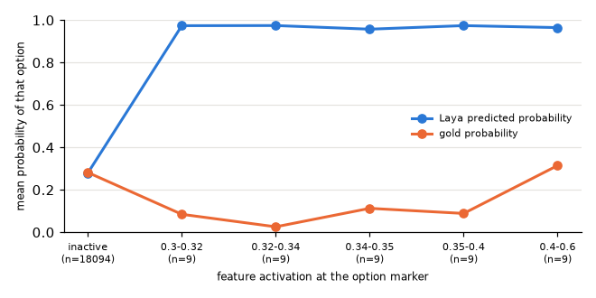

# Feature 415

Critérios em que aparece: pred_probe_right_laya_wrong

**Interpretação (preencher):** 

---

## Maiores ativações

**tr_security_incidents_000039 / severity** (score, security_incidents) | ativação 5.000 em `estado` | opções ['0', '1', '2', '3', '4'] | Laya: **1** [0.063, 0.688, 0.122, 0.046, 0.081] | gabarito: **3**

```
<bos> score question: How severe is the potential impact if this alert is real?<eos>
▸ <mask> level 0: Negligible: no access to anything sensitive.
▸ <mask> level 1: Low: limited access, easily reversed.
▸ <mask> level 2: Moderate: access to internal systems or non-public data.
▸ <mask> level 3: High: access to production, secrets or customer data.
▸ <mask> level 4: Critical: active compromise of crown-jewel systems.

<eos>

 {"alert": {"description": "an endpoint agent matched a known signature", "evidence": "At 2026-09-15 14:23:07 UTC the endpoint agent on host WIN-01 flagged the file C:\\Temp\\malware.exe (SHA1=3a5b7c9d4e)⟦ as⟧ matching the known malware_signature. The detection was logged under the privileged service account svc_backup, which has MFA disabled and whose password was last rotated 14 days prior. The source identifier for the event is on the allowlist.", "rule": "malware_signature"}, "context": {"asset_criticality": "high", "change_window_active": false, "source_on_allowlist": true}, "history": {"credential_rotation_days_ago": 14, "distinct_countries_30d": 3, "logins_30d": 304, "prior_alerts_90d": 8}, "principal": {"mfa_enrolled": false, "name": "adm-infra-473", "privileges": ["deploy:production", "secrets:read"], "type": "service_account"}}<eos>
```

**tr_security_incidents_000097 / disposition** (choice, security_incidents) | ativação 4.695 em `estado` | opções ['close_benign', 'contain', 'investigate', 'monitor'] | Laya: **investigate** [0.028, 0.099, 0.605, 0.268] | gabarito: **contain**

```
<bos> choice question: How should this security alert be dispositioned?<eos>
▸ <mask> close_benign: Expected, explainable activity; close without analyst time.
▸ <mask> contain: Contain the host or account immediately; do not wait for triage.
▸ <mask> investigate: Warrants an analyst opening an investigation.
▸ <mask> monitor: Not clearly malicious, but worth watching for recurrence.

<eos>

 {"alert": {"description": "an endpoint agent matched a known signature", "evidence": "On 2026-09-16 09:45 UTC the endpoint agent on host WIN-01 flagged C:\\Windows\\Temp\\malicious.dll⟦ as⟧ matching MalwareSignatureID 0x7A9C. The file was executed by powershell.exe (PID 1122) under the service account svc_backup, whose password was changed three days ago, and the source of the execution could not be correlated to a known device.", "rule": "malware_signature"}, "context": {"asset_criticality": "high", "change_window_active": false, "source_on_allowlist": false}, "history": {"credential_rotation_days_ago": 3, "distinct_countries_30d": 3, "logins_30d": 1772, "prior_alerts_90d": 3}, "principal": {"mfa_enrolled": false, "name": "svc-support-209", "privileges": ["repo:read"], "type": "service_account"}}<eos>
```

**tr_security_incidents_000039 / disposition** (choice, security_incidents) | ativação 4.406 em `estado` | opções ['close_benign', 'contain', 'investigate', 'monitor'] | Laya: **investigate** [0.021, 0.01, 0.502, 0.467] | gabarito: **contain**

```
<bos> choice question: How should this security alert be dispositioned?<eos>
▸ <mask> close_benign: Expected, explainable activity; close without analyst time.
▸ <mask> contain: Contain the host or account immediately; do not wait for triage.
▸ <mask> investigate: Warrants an analyst opening an investigation.
▸ <mask> monitor: Not clearly malicious, but worth watching for recurrence.

<eos>

 {"alert": {"description": "an endpoint agent matched a known signature", "evidence": "At 2026-09-15 14:23:07 UTC the endpoint agent on host WIN-01 flagged the file C:\\Temp\\malware.exe (SHA1=3a5b7c9d4e)⟦ as⟧ matching the known malware_signature. The detection was logged under the privileged service account svc_backup, which has MFA disabled and whose password was last rotated 14 days prior. The source identifier for the event is on the allowlist.", "rule": "malware_signature"}, "context": {"asset_criticality": "high", "change_window_active": false, "source_on_allowlist": true}, "history": {"credential_rotation_days_ago": 14, "distinct_countries_30d": 3, "logins_30d": 304, "prior_alerts_90d": 8}, "principal": {"mfa_enrolled": false, "name": "adm-infra-473", "privileges": ["deploy:production", "secrets:read"], "type": "service_account"}}<eos>
```

**tr_security_incidents_000097 / severity** (score, security_incidents) | ativação 4.293 em `estado` | opções ['0', '1', '2', '3', '4'] | Laya: **1** [0.076, 0.527, 0.213, 0.074, 0.11] | gabarito: **3**

```
<bos> score question: How severe is the potential impact if this alert is real?<eos>
▸ <mask> level 0: Negligible: no access to anything sensitive.
▸ <mask> level 1: Low: limited access, easily reversed.
▸ <mask> level 2: Moderate: access to internal systems or non-public data.
▸ <mask> level 3: High: access to production, secrets or customer data.
▸ <mask> level 4: Critical: active compromise of crown-jewel systems.

<eos>

 {"alert": {"description": "an endpoint agent matched a known signature", "evidence": "On 2026-09-16 09:45 UTC the endpoint agent on host WIN-01 flagged C:\\Windows\\Temp\\malicious.dll⟦ as⟧ matching MalwareSignatureID 0x7A9C. The file was executed by powershell.exe (PID 1122) under the service account svc_backup, whose password was changed three days ago, and the source of the execution could not be correlated to a known device.", "rule": "malware_signature"}, "context": {"asset_criticality": "high", "change_window_active": false, "source_on_allowlist": false}, "history": {"credential_rotation_days_ago": 3, "distinct_countries_30d": 3, "logins_30d": 1772, "prior_alerts_90d": 3}, "principal": {"mfa_enrolled": false, "name": "svc-support-209", "privileges": ["repo:read"], "type": "service_account"}}<eos>
```

**tr_security_incidents_000062 / severity** (score, security_incidents) | ativação 4.211 em `estado` | opções ['0', '1', '2', '3', '4'] | Laya: **1** [0.099, 0.45, 0.261, 0.075, 0.116] | gabarito: **0**

```
<bos> score question: How severe is the potential impact if this alert is real?<eos>
▸ <mask> level 0: Negligible: no access to anything sensitive.
▸ <mask> level 1: Low: limited access, easily reversed.
▸ <mask> level 2: Moderate: access to internal systems or non-public data.
▸ <mask> level 3: High: access to production, secrets or customer data.
▸ <mask> level 4: Critical: active compromise of crown-jewel systems.

<eos>

 {"alert": {"description": "an endpoint agent matched a known signature", "evidence": "At 2026-09-13 08:27:55 UTC the endpoint agent on host WIN-5F7A3B9C flagged the file C:\\Windows\\Temp\\malicious.exe⟦ as⟧ matching malware signature \"EICAR-Test-File\". The detection was associated with user \"admin_jdoe\" (admin role, unprivileged access) who has MFA enabled and whose credentials were last rotated 180 days ago. The source of the file could not be correlated to any known trusted location.", "rule": "malware_signature"}, "context": {"asset_criticality": "low", "change_window_active": false, "source_on_allowlist": false}, "history": {"credential_rotation_days_ago": 180, "distinct_countries_30d": 2, "logins_30d": 1336, "prior_alerts_90d": 3}, "principal": {"mfa_enrolled": true, "name": "svc-analytics-924", "privileges": ["repo:read"], "type": "admin"}}<eos>
```

## Ativações medianas (faixa 40-60%, mediana 0.951)

**tr_security_incidents_000170 / severity** (score, security_incidents) | ativação 0.951 em `estado` | opções ['0', '1', '2', '3', '4'] | Laya: **1** [0.14, 0.336, 0.296, 0.116, 0.112] | gabarito: **3**

```
<bos> score question: How severe is the potential impact if this alert is real?<eos>
▸ <mask> level 0: Negligible: no access to anything sensitive.
▸ <mask> level 1: Low: limited access, easily reversed.
▸ <mask> level 2: Moderate: access to internal systems or non-public data.
▸ <mask> level 3: High: access to production, secrets or customer data.
▸ <mask> level 4: Critical: active compromise of crown-jewel systems.

<eos>

 {"alert": {"description": "a first-ever sign-in from an unfamiliar country", "evidence": "Service account svc_backup logged in from IP 45.77.22.9 (Russia) at 2026-09-16 08:45 UTC⟦,⟧ representing the first sign‑in from that nation for this privileged service account. The authentication included MFA, and the source IP is not present in the allowlist. Credential rotation for the account occurred three days earlier.", "rule": "new_country_login"}, "context": {"asset_criticality": "low", "change_window_active": false, "source_on_allowlist": false}, "history": {"credential_rotation_days_ago": 3, "distinct_countries_30d": 1, "logins_30d": 744, "prior_alerts_90d": 1}, "principal": {"mfa_enrolled": true, "name": "adm-infra-676", "privileges": ["deploy:production", "secrets:read"], "type": "service_account"}}<eos>
```

**tr_customer_service_000229 / category** (choice, customer_service) | ativação 0.944 em `estado` | opções ['account', 'billing', 'delivery', 'refund', 'technical'] | Laya: **billing** [0.0, 1.0, 0.0, 0.0, 0.0] | gabarito: **billing**

```
<bos> choice question: What is this customer conversation primarily about?<eos>
▸ <mask> account: Login, plan changes, profile or access management.
▸ <mask> billing: A charge, invoice, subscription or payment problem.
▸ <mask> delivery: Shipping, fulfilment or delivery of a physical item.
▸ <mask> refund: The customer is explicitly asking for money back.
▸ <mask> technical: The product or service is not working as expected.

<eos>

 {"account": {"lifetime_value_usd": 926, "prior_tickets_90d": 3, "seats": 1, "tenure_months": 19, "tier": "standard"}, "orders": [{"amount_usd": 147, "date": "2026-01-24", "id": "A-70530", "status": "settled"}, {"amount_usd": 147, "date": "2026-02-11", "id": "A-96734", "status": "pending"}], "thread": [{"role": "customer", "text": "⟦Hello⟧, I hope you’re doing well. I recently noticed a charge of about $147 on my statement that I wasn’t expecting."}, {"role": "agent", "text": "Thank you for reaching out. I can look into that for you. Could you let me know which billing period this charge appears on, or share the invoice number?"}, {"role": "customer", "text": "The charge is on the March invoice, number INV-2023-03-019. I’ve opened a few tickets about billing inconsistencies over the past months—three in total—but the explanations never quite matched the amounts."}, {"role": "agent", "text": "I appreciate you sharing that. To make sure I’m looking at the right record, could you confirm the email address tied to the standard plan account you’ve had for 19 months?"}, {"role": "customer", "text": "It’s mike.smith@example.com. I’m just hoping we can figure out why this $147 appeared, as it’s higher than what I’ve been paying."}]}<eos>
```

**tr_security_incidents_000039 / credential_compromise** (noul, security_incidents) | ativação 0.988 em `estado` | opções ['false', 'true'] | Laya: **true** [0.009, 0.991] | gabarito: **true**

```
<bos> noul question: The evidence indicates a credential or account has been compromised.<eos>
▸ <mask> false: no, the statement does not hold
▸ <mask> true: yes, the statement holds

<eos>

 {"alert": {"description": "an endpoint agent matched a known signature", "evidence": "At 2026-09-15 14:23:07 UTC the endpoint agent on host WIN-01 flagged the file C:\\Temp\\malware.exe (SHA1=3a5b7c9d4e) as matching the known malware_signature. The detection was logged under the privileged service account svc_backup, which has MFA disabled and whose password was last rotated 14 days prior.⟦ The⟧ source identifier for the event is on the allowlist.", "rule": "malware_signature"}, "context": {"asset_criticality": "high", "change_window_active": false, "source_on_allowlist": true}, "history": {"credential_rotation_days_ago": 14, "distinct_countries_30d": 3, "logins_30d": 304, "prior_alerts_90d": 8}, "principal": {"mfa_enrolled": false, "name": "adm-infra-473", "privileges": ["deploy:production", "secrets:read"], "type": "service_account"}}<eos>
```

**tr_customer_service_000205 / urgency** (score, customer_service) | ativação 0.837 em `estado` | opções ['0', '1', '2', '3'] | Laya: **3** [0.133, 0.291, 0.133, 0.443] | gabarito: **2**

```
<bos> score question: How time-sensitive is this conversation?<eos>
▸ <mask> level 0: No time pressure; can wait indefinitely.
▸ <mask> level 1: Routine; handle within the normal queue.
▸ <mask> level 2: Elevated; should be handled within the same week.
▸ <mask> level 3: Critical; requires action within the same day.

<eos>

 {"account": {"lifetime_value_usd": 264, "prior_tickets_90d": 5, "seats": 1, "tenure_months": 3, "tier": "free"}, "orders": [{"amount_usd": 897, "date": "2026-02-17", "id": "A-64161", "status": "refunded"}, {"amount_usd": 897, "date": "2026-02-28", "id": "A-55118",⟦ "⟧status": "settled"}], "thread": [{"role": "customer", "text": "I'm looking for the invoice for the $897 charge again. It isn't in my inbox or the dashboard, which seems to happen every time there is a billing cycle."}, {"role": "agent", "text": "I understand you're looking for a missing invoice. To ensure I'm looking at the right record, could you confirm the date the transaction appeared on your statement?"}, {"role": "customer", "text": "It was processed on the 12th. This is the fifth time I've had to reach out for the same basic document, and I just don't know why the automated system won't send it to me."}, {"role": "agent", "text": "I see the history of your previous inquiries regarding this. When you check your billing tab, does the invoice show as 'Paid' or is the entry missing entirely from the list?"}, {"role": "customer", "text": "The entry is there and says paid, but when I click the link to download the PDF, it just opens a blank page and nothing happens."}]}<eos>
```

**tr_customer_service_000210 / category** (choice, customer_service) | ativação 1.034 em `estado` | opções ['account', 'billing', 'delivery', 'refund', 'technical'] | Laya: **account** [0.6, 0.05, 0.007, 0.035, 0.309] | gabarito: **account**

```
<bos> choice question: What is this customer conversation primarily about?<eos>
▸ <mask> account: Login, plan changes, profile or access management.
▸ <mask> billing: A charge, invoice, subscription or payment problem.
▸ <mask> delivery: Shipping, fulfilment or delivery of a physical item.
▸ <mask> refund: The customer is explicitly asking for money back.
▸ <mask> technical: The product or service is not working as expected.

<eos>

 {"account": {"lifetime_value_usd": 459, "prior_tickets_90d": 5, "seats": 1, "tenure_months": 14, "tier": "free"}, "orders": [{"amount_usd": 299, "date": "2026-03-18", "id": "A-97738", "status": "failed"}, {"amount_usd": 299, "date": "2026-02-26", "id": "A-91369", "status": "refunded"}, {"amount_usd": 299, "date": "2026-03-24", "id": "A-52614", "status": "settled"}], "thread": [{"role": "customer", "text": "Hello, I’d like to downgrade my account to the Free plan. I’ve been with you for over a year and have $299 worth of credits, but I need this change by the end of the month."}, {"role": "agent", "text": "Thank you for reaching out. Just to confirm, you’re currently on a paid tier and want to move to the Free plan. May I ask which features you rely on most so we can ensure the downgrade won’t impact your workflow?"}, {"role": "customer", "text": "I mainly use the analytics dashboard and the API access; I’m okay losing the advanced reporting, but I can’t lose API keys."}, {"role": "agent", "text": "Got it. Could you also let me⟦ know⟧ if there are any pending invoices or credit adjustments that need to be addressed before we proceed?"}, {"role": "customer", "text": "No pending invoices—just the $299 credit I’ve accumulated, which I’d like applied before the downgrade takes effect."}]}<eos>
```

## Estatísticas (conjunto de descoberta, dev e teste)

**pred / error**

| split | decisões | ativas | ativas e Laya errou | taxa | lift | q (BH) | OR (CMH) | q (CMH) |
|---|---|---|---|---|---|---|---|---|
| discovery | 5100 | 45 | 39 | 0.867 | 1.35 | 0.00385 | 1.37 | 0.796 |
| dev | 900 | 14 | 14 | 1.000 | 1.49 | nan | nan | nan |
| test | 2000 | 18 | 16 | 0.889 | 1.37 | nan | nan | nan |

**corr / error**

| split | decisões | ativas | ativas e Laya errou | taxa | lift | q (BH) | OR (CMH) | q (CMH) |
|---|---|---|---|---|---|---|---|---|
| discovery | 5100 | 6 | 0 | 0.000 | 0.00 | nan | nan | nan |
| dev | 900 | 0 | 0 | nan | nan | nan | nan | nan |
| test | 2000 | 2 | 0 | 0.000 | 0.00 | nan | nan | nan |

**state / error**

| split | decisões | ativas | ativas e Laya errou | taxa | lift | q (BH) | OR (CMH) | q (CMH) |
|---|---|---|---|---|---|---|---|---|
| discovery | 5100 | 1365 | 855 | 0.626 | 0.97 | 0.244 | 0.98 | 0.915 |
| dev | 900 | 230 | 144 | 0.626 | 0.93 | 0.408 | 0.81 | 0.615 |
| test | 2000 | 551 | 347 | 0.630 | 0.97 | 0.539 | 0.89 | 0.698 |

**pred / probe_right_laya_wrong**

| split | decisões | ativas | ativas e Laya errou | taxa | lift | q (BH) | OR (CMH) | q (CMH) |
|---|---|---|---|---|---|---|---|---|
| discovery | 2932 | 40 | 39 | 0.975 | 1.61 | 4.07e-07 | 1.29 | 0.948 |
| dev | 523 | 14 | 14 | 1.000 | 1.55 | nan | nan | nan |
| test | 1149 | 16 | 16 | 1.000 | 1.64 | nan | nan | nan |

**corr / probe_right_laya_wrong**

| split | decisões | ativas | ativas e Laya errou | taxa | lift | q (BH) | OR (CMH) | q (CMH) |
|---|---|---|---|---|---|---|---|---|
| discovery | 2932 | 1 | 0 | 0.000 | 0.00 | nan | nan | nan |
| dev | 523 | 0 | 0 | nan | nan | nan | nan | nan |
| test | 1149 | 0 | 0 | nan | nan | nan | nan | nan |

**state / probe_right_laya_wrong**

| split | decisões | ativas | ativas e Laya errou | taxa | lift | q (BH) | OR (CMH) | q (CMH) |
|---|---|---|---|---|---|---|---|---|
| discovery | 2932 | 810 | 477 | 0.589 | 0.97 | 0.401 | 0.98 | 0.936 |
| dev | 523 | 136 | 88 | 0.647 | 1.00 | 1 | 1.13 | 0.845 |
| test | 1149 | 345 | 205 | 0.594 | 0.97 | 0.732 | 0.86 | 0.672 |

Confusão mais sobre-representada (pred): `duplicate|1>0` (n=38, lift 19.85, p=0). Formato `pergunta|índice previsto>índice correto`.

Confusão mais sobre-representada (state): `duplicate|1>0` (n=89, lift 1.53, p=2.3e-06). Formato `pergunta|índice previsto>índice correto`.



