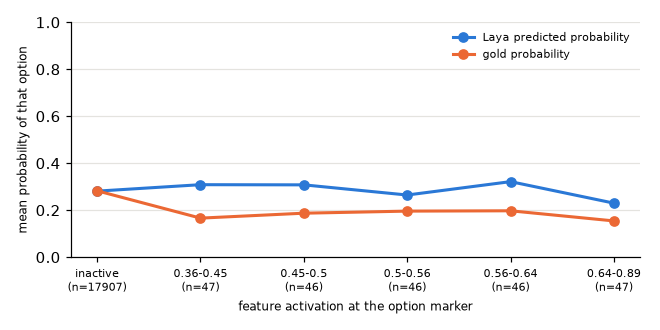

# Feature 462

Critérios em que aparece: pred_error, pred_probe_right_laya_wrong

**Interpretação (preencher):** 

---

## Maiores ativações

**tr_customer_service_000072 / action** (choice, customer_service) | ativação 2.793 em `estado` | opções ['answer_directly', 'close_no_action', 'escalate_to_human', 'execute_refund', 'request_information'] | Laya: **answer_directly** [0.913, 0.028, 0.018, 0.012, 0.029] | gabarito: **answer_directly**

```
<bos> choice question: What should the assistant do next with this conversation?<eos>
▸ <mask> answer_directly: The assistant can resolve this itself with information it already has.
▸ <mask> close_no_action: No further action is warranted; the matter is settled.
▸ <mask> escalate_to_human: Hand off to a human agent with the appropriate authority.
▸ <mask> execute_refund: Issue the refund or credit the customer is owed.
▸ <mask> request_information: More detail is needed from the customer before anything can be done.

<eos>

 {"account": {"lifetime_value_usd": 904, "prior_tickets_90d": 0, "seats": 1, "tenure_months": 14, "tier": "standard"}, "orders": [{"amount_usd": 297, "date": "2026-02-26", "id": "A-16027", "status": "pending"}], "thread": [{"role": "customer", "text": "I'm looking through my account and the invoice for my last payment of $297 is nowhere to be found, and I need it right now for my records."}, {"role": "agent", "text": "I can certainly look into your billing history for you. To make sure I'm looking at the right account, could you please confirm the email address associated with your standard plan?"}, {"role": "customer", "text": "It's the same one I'm writing from, I've been a customer for over a year and I've never had to hunt for a receipt like this before, please hurry."}, {"role": "agent", "text": "Thank you for confirming. I'm checking the 14-month history now; are you looking for the most recent transaction specifically, or a range of dates?"}, {"role": "customer", "text": "I need⟦ the⟧ one from this month for the full amount, it's extremely urgent that I get this PDF in my inbox immediately."}]}<eos>
```

**tr_customer_service_000072 / needs_human** (noul, customer_service) | ativação 2.760 em `estado` | opções ['false', 'true'] | Laya: **true** [0.26, 0.74] | gabarito: **false**

```
<bos> noul question: This conversation requires a human agent rather than automated handling.<eos>
▸ <mask> false: Automation can carry this to resolution.
▸ <mask> true: A human must take over: judgement, authority or empathy is required.

<eos>

 {"account": {"lifetime_value_usd": 904, "prior_tickets_90d": 0, "seats": 1, "tenure_months": 14, "tier": "standard"}, "orders": [{"amount_usd": 297, "date": "2026-02-26", "id": "A-16027", "status": "pending"}], "thread": [{"role": "customer", "text": "I'm looking through my account and the invoice for my last payment of $297 is nowhere to be found, and I need it right now for my records."}, {"role": "agent", "text": "I can certainly look into your billing history for you. To make sure I'm looking at the right account, could you please confirm the email address associated with your standard plan?"}, {"role": "customer", "text": "It's the same one I'm writing from, I've been a customer for over a year and I've never had to hunt for a receipt like this before, please hurry."}, {"role": "agent", "text": "Thank you for confirming. I'm checking the 14-month history now; are you looking for the most recent transaction specifically, or a range of dates?"}, {"role": "customer", "text": "I need⟦ the⟧ one from this month for the full amount, it's extremely urgent that I get this PDF in my inbox immediately."}]}<eos>
```

**tr_security_incidents_000046 / urgency** (score, security_incidents) | ativação 2.736 em `estado` | opções ['0', '1', '2', '3'] | Laya: **1** [0.098, 0.342, 0.235, 0.326] | gabarito: **3**

```
<bos> score question: How quickly must a responder act on this alert?<eos>
▸ <mask> level 0: No time pressure; can wait indefinitely.
▸ <mask> level 1: Routine; handle within the normal queue.
▸ <mask> level 2: Elevated; should be handled within the same week.
▸ <mask> level 3: Critical; requires action within the same day.

<eos>

 {"alert": {"description": "a large transfer to an external destination", "evidence": "On 2026-09-15 09:22:03 UTC, a shared mailbox⟦ credential⟧ \"svc_mailbox\" initiated an outbound TCP session to 203.0.113.45:443, transferring approximately 1.3 TB of data over 38 minutes. The connection originated from the allowlisted IP 192.168.10.55, MFA was off for the account, and its password was last changed 14 days ago.", "rule": "data_egress"}, "context": {"asset_criticality": "medium", "change_window_active": false, "source_on_allowlist": true}, "history": {"credential_rotation_days_ago": 14, "distinct_countries_30d": 3, "logins_30d": 1058, "prior_alerts_90d": 8}, "principal": {"mfa_enrolled": false, "name": "svc-support-440", "privileges": ["deploy:production", "secrets:read"], "type": "shared_mailbox"}}<eos>
```

**tr_security_incidents_000046 / credential_compromise** (noul, security_incidents) | ativação 2.730 em `estado` | opções ['false', 'true'] | Laya: **false** [0.656, 0.344] | gabarito: **true**

```
<bos> noul question: The evidence indicates a credential or account has been compromised.<eos>
▸ <mask> false: no, the statement does not hold
▸ <mask> true: yes, the statement holds

<eos>

 {"alert": {"description": "a large transfer to an external destination", "evidence": "On 2026-09-15 09:22:03 UTC, a shared mailbox⟦ credential⟧ \"svc_mailbox\" initiated an outbound TCP session to 203.0.113.45:443, transferring approximately 1.3 TB of data over 38 minutes. The connection originated from the allowlisted IP 192.168.10.55, MFA was off for the account, and its password was last changed 14 days ago.", "rule": "data_egress"}, "context": {"asset_criticality": "medium", "change_window_active": false, "source_on_allowlist": true}, "history": {"credential_rotation_days_ago": 14, "distinct_countries_30d": 3, "logins_30d": 1058, "prior_alerts_90d": 8}, "principal": {"mfa_enrolled": false, "name": "svc-support-440", "privileges": ["deploy:production", "secrets:read"], "type": "shared_mailbox"}}<eos>
```

**tr_security_incidents_000046 / severity** (score, security_incidents) | ativação 2.676 em `estado` | opções ['0', '1', '2', '3', '4'] | Laya: **1** [0.116, 0.316, 0.316, 0.132, 0.12] | gabarito: **3**

```
<bos> score question: How severe is the potential impact if this alert is real?<eos>
▸ <mask> level 0: Negligible: no access to anything sensitive.
▸ <mask> level 1: Low: limited access, easily reversed.
▸ <mask> level 2: Moderate: access to internal systems or non-public data.
▸ <mask> level 3: High: access to production, secrets or customer data.
▸ <mask> level 4: Critical: active compromise of crown-jewel systems.

<eos>

 {"alert": {"description": "a large transfer to an external destination", "evidence": "On 2026-09-15 09:22:03 UTC, a shared mailbox⟦ credential⟧ \"svc_mailbox\" initiated an outbound TCP session to 203.0.113.45:443, transferring approximately 1.3 TB of data over 38 minutes. The connection originated from the allowlisted IP 192.168.10.55, MFA was off for the account, and its password was last changed 14 days ago.", "rule": "data_egress"}, "context": {"asset_criticality": "medium", "change_window_active": false, "source_on_allowlist": true}, "history": {"credential_rotation_days_ago": 14, "distinct_countries_30d": 3, "logins_30d": 1058, "prior_alerts_90d": 8}, "principal": {"mfa_enrolled": false, "name": "svc-support-440", "privileges": ["deploy:production", "secrets:read"], "type": "shared_mailbox"}}<eos>
```

## Ativações medianas (faixa 40-60%, mediana 0.721)

**tr_customer_service_000183 / urgency** (score, customer_service) | ativação 0.657 em `estado` | opções ['0', '1', '2', '3'] | Laya: **1** [0.316, 0.496, 0.132, 0.056] | gabarito: **3**

```
<bos> score question: How time-sensitive is this conversation?<eos>
▸ <mask> level 0: No time pressure; can wait indefinitely.
▸ <mask> level 1: Routine; handle within the normal queue.
▸ <mask> level 2: Elevated; should be handled within the same week.
▸ <mask> level 3: Critical; requires action within the same day.

<eos>

 {"account": {"lifetime_value_usd": 455, "prior_tickets_90d": 0, "seats": 1, "tenure_months": 5, "tier": "free"}, "orders": [{"amount_usd": 98, "date": "2026-03-24", "id": "A-16754", "status": "settled"}], "thread": [{"role": "customer", "text": "My payment just failed again and I have a hard deadline tomorrow to keep my account active – this is getting ridiculous."}, {"role": "agent", "text": "I’m really sorry you’re experiencing this. Could you tell me which payment method you’re trying to use?"}, {"role⟦":⟧ "customer", "text": "I’m using the Visa ending in 4321. Every time I hit submit I get an error code 502 and the charge never goes through."}, {"role": "agent", "text": "Got it, thank you. Do you see any additional message on the screen besides the error code, like a declined notice or a timeout?"}, {"role": "customer", "text": "Just the generic “payment could not be processed” line. I need a solution right now, otherwise my free‑plan account will be suspended."}, {"role": "agent", "text": "I understand the urgency. Do you have an alternative payment option available, such as a different card or PayPal?"}, {"role": "customer", "text": "Yes, I have a PayPal account I can use. How do I switch to that quickly?"}]}<eos>
```

**tr_security_incidents_000080 / credential_compromise** (noul, security_incidents) | ativação 0.654 em `estado` | opções ['false', 'true'] | Laya: **true** [0.139, 0.861] | gabarito: **false**

```
<bos> noul question: The evidence indicates a credential or account has been compromised.<eos>
▸ <mask> false: no, the statement does not hold
▸ <mask> true: yes, the statement holds

<eos>

 {"alert": {"description": "a first-ever sign-in from an unfamiliar country", "evidence": "A privileged shared mailbox \"admin@corp.com\" logged in from IP 200.150.10.77 (São Paulo, Brazil) at 2026-09-16T01:22:10Z, marking the first login from that country for this principal. MFA was enabled, and the credential's last rotation date is recorded as 700 days ago.", "⟦rule⟧": "new_country_login"}, "context": {"asset_criticality": "low", "change_window_active": false, "source_on_allowlist": false}, "history": {"credential_rotation_days_ago": 700, "distinct_countries_30d": 2, "logins_30d": 721, "prior_alerts_90d": 8}, "principal": {"mfa_enrolled": true, "name": "ci-analytics-358", "privileges": ["deploy:production", "secrets:read"], "type": "shared_mailbox"}}<eos>
```

**tr_security_incidents_000127 / disposition** (choice, security_incidents) | ativação 0.753 em `estado` | opções ['close_benign', 'contain', 'investigate', 'monitor'] | Laya: **monitor** [0.134, 0.122, 0.098, 0.647] | gabarito: **investigate**

```
<bos> choice question: How should this security alert be dispositioned?<eos>
▸ <mask> close_benign: Expected, explainable activity; close without analyst time.
▸ <mask> contain: Contain the host or account immediately; do not wait for triage.
▸ <mask> investigate: Warrants an analyst opening an investigation.
▸ <mask> monitor: Not clearly malicious, but worth watching for recurrence.

<eos>

 {"alert": {"description": "a security group was opened to the public internet", "evidence": "On 2026‑09‑14 at 10:07 UTC, security group sg-0a1b2c3d was modified to allow inbound traffic from 0.0.0.0/0, exposing the associated resources publicly. The change was applied by an admin account with privileged access, MFA enabled, from an unknown source IP, and the account’s password last rotation occurred 180 days ago.", "rule": "config_drift"}, "context": {"asset_⟦critical⟧ity": "low", "change_window_active": false, "source_on_allowlist": false}, "history": {"credential_rotation_days_ago": 180, "distinct_countries_30d": 1, "logins_30d": 1581, "prior_alerts_90d": 0}, "principal": {"mfa_enrolled": true, "name": "adm-analytics-822", "privileges": ["deploy:production", "secrets:read"], "type": "admin"}}<eos>
```

**tr_agent_trace_observability_000272 / outcome** (choice, agent_trace_observability) | ativação 0.711 em `marcador` | opções ['failure', 'harmful', 'partial', 'success'] | Laya: **success** [0.094, 0.031, 0.296, 0.58] | gabarito: **partial**

```
<bos> choice question: How did this agent run turn out?<eos>
▸ ⟦<mask>⟧ failure: The agent did not accomplish the task.
▸ <mask> harmful: The agent took an action that caused damage or violated a constraint.
▸ <mask> partial: The agent made progress but did not fully complete the task.
▸ <mask> success: The agent completed the task correctly.

<eos>

 {"agent": {"autonomy": "unsupervised", "model": "internal-agent-v3"}, "constraints": ["Do not force-push to any branch", "Do not exceed a $50 spend on cloud resources"], "task": "Provision a read replica for the reporting database.", "trace_summary": {"constraint_violations": 0, "duration_s": 357.1, "irreversible_actions": 1, "steps": 8, "tool_errors": 3}}<eos>
```

**tr_customer_service_000105 / category** (choice, customer_service) | ativação 0.698 em `estado` | opções ['account', 'billing', 'delivery', 'refund', 'technical'] | Laya: **account** [0.995, 0.0, 0.0, 0.0, 0.005] | gabarito: **account**

```
<bos> choice question: What is this customer conversation primarily about?<eos>
▸ <mask> account: Login, plan changes, profile or access management.
▸ <mask> billing: A charge, invoice, subscription or payment problem.
▸ <mask> delivery: Shipping, fulfilment or delivery of a physical item.
▸ <mask> refund: The customer is explicitly asking for money back.
▸ <mask> technical: The product or service is not working as expected.

<eos>

 {"account": {"lifetime_value_usd": 521, "prior_tickets_90d": 1, "seats": 1, "tenure_months": 33, "tier": "standard"}, "⟦thread⟧": [{"role": "customer", "text": "I've been waiting over two years on this standard plan, and now I can’t log in at all! This is unacceptable after the last ticket you left hanging."}]}<eos>
```

## Estatísticas (conjunto de descoberta, dev e teste)

**pred / error**

| split | decisões | ativas | ativas e Laya errou | taxa | lift | q (BH) | OR (CMH) | q (CMH) |
|---|---|---|---|---|---|---|---|---|
| discovery | 5100 | 69 | 65 | 0.942 | 1.46 | 6.8e-08 | 0.00 | 0.7 |
| dev | 900 | 11 | 11 | 1.000 | 1.49 | nan | nan | nan |
| test | 2000 | 22 | 21 | 0.955 | 1.47 | 0.00569 | 0.00 | 0.921 |

**corr / error**

| split | decisões | ativas | ativas e Laya errou | taxa | lift | q (BH) | OR (CMH) | q (CMH) |
|---|---|---|---|---|---|---|---|---|
| discovery | 5100 | 14 | 10 | 0.714 | 1.11 | nan | nan | nan |
| dev | 900 | 1 | 1 | 1.000 | 1.49 | nan | nan | nan |
| test | 2000 | 5 | 4 | 0.800 | 1.23 | nan | nan | nan |

**state / error**

| split | decisões | ativas | ativas e Laya errou | taxa | lift | q (BH) | OR (CMH) | q (CMH) |
|---|---|---|---|---|---|---|---|---|
| discovery | 5100 | 3058 | 1932 | 0.632 | 0.98 | 0.0847 | 0.84 | 0.102 |
| dev | 900 | 512 | 326 | 0.637 | 0.95 | 0.182 | 0.65 | 0.149 |
| test | 2000 | 1241 | 785 | 0.633 | 0.97 | 0.177 | 0.78 | 0.228 |

**pred / probe_right_laya_wrong**

| split | decisões | ativas | ativas e Laya errou | taxa | lift | q (BH) | OR (CMH) | q (CMH) |
|---|---|---|---|---|---|---|---|---|
| discovery | 2932 | 26 | 26 | 1.000 | 1.65 | 1.38e-05 | nan | nan |
| dev | 523 | 6 | 6 | 1.000 | 1.55 | nan | nan | nan |
| test | 1149 | 8 | 8 | 1.000 | 1.64 | nan | nan | nan |

**corr / probe_right_laya_wrong**

| split | decisões | ativas | ativas e Laya errou | taxa | lift | q (BH) | OR (CMH) | q (CMH) |
|---|---|---|---|---|---|---|---|---|
| discovery | 2932 | 0 | 0 | nan | nan | nan | nan | nan |
| dev | 523 | 0 | 0 | nan | nan | nan | nan | nan |
| test | 1149 | 0 | 0 | nan | nan | nan | nan | nan |

**state / probe_right_laya_wrong**

| split | decisões | ativas | ativas e Laya errou | taxa | lift | q (BH) | OR (CMH) | q (CMH) |
|---|---|---|---|---|---|---|---|---|
| discovery | 2932 | 1775 | 1047 | 0.590 | 0.97 | 0.0778 | 0.77 | 0.0365 |
| dev | 523 | 306 | 187 | 0.611 | 0.95 | 0.247 | 0.57 | 0.0986 |
| test | 1149 | 725 | 433 | 0.597 | 0.98 | 0.48 | 0.80 | 0.402 |

Confusão mais sobre-representada (pred): `outcome|0>2` (n=27, lift 62.36, p=0). Formato `pergunta|índice previsto>índice correto`.

Confusão mais sobre-representada (corr): `outcome|3>0` (n=9, lift 364.29, p=nan). Formato `pergunta|índice previsto>índice correto`.

Confusão mais sobre-representada (state): `disposition|3>2` (n=128, lift 1.27, p=4.95e-06). Formato `pergunta|índice previsto>índice correto`.



