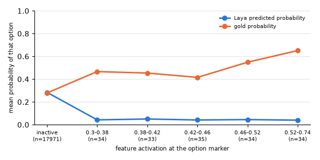

# Feature 497

Critérios em que aparece: corr_probe_right_laya_wrong

**Interpretação (preencher):** 

---

## Maiores ativações

**tr_customer_service_000177 / needs_human** (noul, customer_service) | ativação 1.928 em `estado` | opções ['false', 'true'] | Laya: **true** [0.398, 0.602] | gabarito: **true**

```
<bos> noul question: This conversation requires a human agent rather than automated handling.<eos>
▸ <mask> false: Automation can carry this to resolution.
▸ <mask> true: A human must take over: judgement, authority or empathy is required.

<eos>

 {"account": {"lifetime_value_usd": 1494, "prior_tickets_90d": 3, "seats": 1, "tenure_months": 26, "tier": "enterprise"}, "orders": [{"amount_usd": 49, "date": "2026-01-07", "id": "A-11099", "status": "failed"}, {"amount_usd": 49, "date": "2026-02-23", "id": "A-83844", "status": "refunded"}], "thread": [{"role": "customer", "text": "I'm furious that my data export still isn't ready. My deadline is tomorrow and I've been waiting for weeks!"}, {"role": "agent", "text": "I understand how frustrating this is. Could you provide your enterprise account ID and specify the exact export format you need?"}, {"⟦role⟧": "customer", "text": "My account is the enterprise one, 26 months with you, and I need the full CSV of all transactions, not this half‑baked JSON you sent before."}, {"role": "agent", "text": "Got it. Please confirm the date range for the export and the email address where you’d like us to send it."}, {"role": "customer", "text": "Send it to my corporate email now; I don't have time for more back‑and‑forth."}]}<eos>
```

**tr_customer_service_000177 / urgency** (score, customer_service) | ativação 1.924 em `estado` | opções ['0', '1', '2', '3'] | Laya: **0** [0.528, 0.198, 0.185, 0.089] | gabarito: **3**

```
<bos> score question: How time-sensitive is this conversation?<eos>
▸ <mask> level 0: No time pressure; can wait indefinitely.
▸ <mask> level 1: Routine; handle within the normal queue.
▸ <mask> level 2: Elevated; should be handled within the same week.
▸ <mask> level 3: Critical; requires action within the same day.

<eos>

 {"account": {"lifetime_value_usd": 1494, "prior_tickets_90d": 3, "seats": 1, "tenure_months": 26, "tier": "enterprise"}, "orders": [{"amount_usd": 49, "date": "2026-01-07", "id": "A-11099", "status": "failed"}, {"amount_usd": 49, "date": "2026-02-23", "id": "A-83844", "status": "refunded"}], "thread": [{"role": "customer", "text": "I'm furious that my data export still isn't ready. My deadline is tomorrow and I've been waiting for weeks!"}, {"role": "agent", "text": "I understand how frustrating this is. Could you provide your enterprise account ID and specify the exact export format you need?"}, {"⟦role⟧": "customer", "text": "My account is the enterprise one, 26 months with you, and I need the full CSV of all transactions, not this half‑baked JSON you sent before."}, {"role": "agent", "text": "Got it. Please confirm the date range for the export and the email address where you’d like us to send it."}, {"role": "customer", "text": "Send it to my corporate email now; I don't have time for more back‑and‑forth."}]}<eos>
```

**tr_customer_service_000177 / urgency** (score, customer_service) | ativação 1.915 em `estado` | opções ['0', '1', '2', '3'] | Laya: **0** [0.528, 0.198, 0.185, 0.089] | gabarito: **3**

```
<bos> score question: How time-sensitive is this conversation?<eos>
▸ <mask> level 0: No time pressure; can wait indefinitely.
▸ <mask> level 1: Routine; handle within the normal queue.
▸ <mask> level 2: Elevated; should be handled within the same week.
▸ <mask> level 3: Critical; requires action within the same day.

<eos>

 {"account": {"lifetime_value_usd": 1494, "prior_tickets_90d": 3, "seats": 1, "tenure_months": 26, "tier": "enterprise"}, "orders": [{"amount_usd": 49, "date": "2026-01-07", "id": "A-11099", "status": "failed"}, {"amount_usd": 49, "date": "2026-02-23", "id": "A-83844", "status": "refunded"}], "thread": [{"role": "customer", "text": "I'm furious that my data export still isn't ready. My deadline is tomorrow and I've been waiting for weeks!"}, {"role": "agent", "text": "I understand how frustrating this is. Could you provide your enterprise account ID and specify the exact export format you need?"}, {"role": "⟦customer⟧", "text": "My account is the enterprise one, 26 months with you, and I need the full CSV of all transactions, not this half‑baked JSON you sent before."}, {"role": "agent", "text": "Got it. Please confirm the date range for the export and the email address where you’d like us to send it."}, {"role": "customer", "text": "Send it to my corporate email now; I don't have time for more back‑and‑forth."}]}<eos>
```

**tr_customer_service_000103 / needs_human** (noul, customer_service) | ativação 1.911 em `estado` | opções ['false', 'true'] | Laya: **true** [0.069, 0.931] | gabarito: **true**

```
<bos> noul question: This conversation requires a human agent rather than automated handling.<eos>
▸ <mask> false: Automation can carry this to resolution.
▸ <mask> true: A human must take over: judgement, authority or empathy is required.

<eos>

 {"account": {"lifetime_value_usd": 3711, "prior_tickets_90d": ⟦0⟧, "seats": 1, "tenure_months": 41, "tier": "standard"}, "thread": [{"role": "customer", "text": "Your new analytics dashboard is completely broken – every time I click the export button the whole page crashes. I’ve been on the standard plan for over three years (41 months), and this is getting ridiculous. If it isn’t fixed soon I’ll have to cancel."}, {"role": "agent", "text": "I’m really sorry you’re experiencing that. Could you let me know which browser you’re using and whether you see any error messages when it crashes?"}, {"role": "customer", "text": "I’m on Chrome 115, and the console just says ‘Uncaught TypeError’. I need a fix ASAP, otherwise I’m leaving."}]}<eos>
```

**tr_customer_service_000177 / needs_human** (noul, customer_service) | ativação 1.859 em `estado` | opções ['false', 'true'] | Laya: **true** [0.398, 0.602] | gabarito: **true**

```
<bos> noul question: This conversation requires a human agent rather than automated handling.<eos>
▸ <mask> false: Automation can carry this to resolution.
▸ <mask> true: A human must take over: judgement, authority or empathy is required.

<eos>

 {"account": {"lifetime_value_usd": 1494, "prior_tickets_90d": 3, "seats": 1, "tenure_months": 26, "tier": "enterprise"}, "orders": [{"amount_usd": 49, "date": "2026-01-07", "id": "A-11099", "status": "failed"}, {"amount_usd": 49, "date": "2026-02-23", "id": "A-83844", "status": "refunded"}], "thread": [{"role": "customer", "text": "I'm furious that my data export still isn't ready. My deadline is tomorrow and I've been waiting for weeks!"}, {"role": "agent", "text": "I understand how frustrating this is. Could you provide your enterprise account ID and specify the exact export format you need?"}, {"role": "⟦customer⟧", "text": "My account is the enterprise one, 26 months with you, and I need the full CSV of all transactions, not this half‑baked JSON you sent before."}, {"role": "agent", "text": "Got it. Please confirm the date range for the export and the email address where you’d like us to send it."}, {"role": "customer", "text": "Send it to my corporate email now; I don't have time for more back‑and‑forth."}]}<eos>
```

## Ativações medianas (faixa 40-60%, mediana 0.623)

**tr_invoice_processing_000215 / discrepancy_severity** (score, invoice_processing) | ativação 0.592 em `estado` | opções ['0', '1', '2', '3'] | Laya: **2** [0.045, 0.204, 0.686, 0.066] | gabarito: **2**

```
<bos> score question: How material is any discrepancy between the invoice, the order and the delivery?<eos>
▸ <mask> level 0: None: everything reconciles.
▸ <mask> level 1: Trivial: rounding or a cosmetic difference.
▸ <mask> level 2: Moderate: a real difference worth confirming.
▸ <mask> level 3: Material: a large or unexplained difference.

<eos>

 {"delivery": {"condition": "accepted", "date": "2026-03-25", "received_qty": 400}, "invoice": {"currency": "USD", "id": "INV-2026-4820", "lines": [{"qty": 405, "sku": "SKU-586", "total_usd": 6787.8, "unit_usd": 16.76}],⟦ "⟧total_usd": 6787.8, "vendor": "Kestrel Supply"}, "payment": {"days_until_due": -21, "discount_expires_in_days": null, "early_payment_discount_pct": null, "status": "overdue", "terms": "net 30"}, "purchase_order": {"freight_terms": "freight prepaid by vendor, not separately billable", "id": "PO-2440", "lines": [{"qty": 400, "unit_usd": 16.76}], "total_usd": 6704.0}, "vendor_history": {"disputes_12m": 0, "invoices_12m": 26, "prior_invoice_ids": ["INV-2026-6115"]}}<eos>
```

**tr_customer_service_000119 / action** (choice, customer_service) | ativação 0.656 em `estado` | opções ['answer_directly', 'close_no_action', 'escalate_to_human', 'execute_refund', 'request_information'] | Laya: **execute_refund** [0.256, 0.08, 0.105, 0.555, 0.003] | gabarito: **escalate_to_human**

```
<bos> choice question: What should the assistant do next with this conversation?<eos>
▸ <mask> answer_directly: The assistant can resolve this itself with information it already has.
▸ <mask> close_no_action: No further action is warranted; the matter is settled.
▸ <mask> escalate_to_human: Hand off to a human agent with the appropriate authority.
▸ <mask> execute_refund: Issue the refund or credit the customer is owed.
▸ <mask> request_information: More detail is needed from the customer before anything can be done.

<eos>

 {"account": {"lifetime_value_usd": 613, "prior_tickets_90d": 1, "seats": 1, "tenure_months": 11, "tier": "standard"}, "orders": [{"amount_usd": 299, "date": "2026-01-13", "id": "A-16098", "status": "failed"}], "thread": [{"role": "customer", "text": "I just received my delivery and it's completely wrong. I paid $299 for the standard plan upgrade equipment, but what arrived in the box is the basic version. I’m seriously considering canceling my subscription over this."}, {"role": "agent", "text": "I am very sorry to hear that the incorrect item was delivered. Could you please provide your order number and a photo of the item you received so I can review this?"}, {"role": "⟦customer⟧", "text": "I’ve attached the photo to this ticket. This is the second time I've had issues like this, and frankly, my patience is wearing thin."}]}<eos>
```

**tr_security_incidents_000148 / credential_compromise** (noul, security_incidents) | ativação 0.640 em `estado` | opções ['false', 'true'] | Laya: **true** [0.01, 0.99] | gabarito: **true**

```
<bos> noul question: The evidence indicates a credential or account has been compromised.<eos>
▸ <mask> false: no, the statement does not hold
▸ <mask> true: yes, the statement holds

<eos>

 {"alert": {"description": "an unrecognised binary executed on a server", "evidence": "On 2026-09-15 22:45:33 UTC, the executable \"C:\\Temp\\svchost64.exe\" was launched on server \"app-prod-02\" with PID 5472. The binary is not present in the approved software inventory, the run was performed by a contractor user without privileged access, MFA was turned off, and the account's password was last changed 14 days ago; the originating host is on the allowlist and no change window was in effect.", "rule": "suspicious_process"}, "context": {"asset_criticality": "medium", "change_window_active": false, "source_on_allowlist": true}, "history": {"credential_⟦rotation⟧_days_ago": 14, "distinct_countries_30d": 3, "logins_30d": 557, "prior_alerts_90d": 0}, "principal": {"mfa_enrolled": false, "name": "adm-billing-238", "privileges": ["repo:read"], "type": "contractor"}}<eos>
```

**tr_agent_trace_observability_000224 / needs_review** (noul, agent_trace_observability) | ativação 0.598 em `estado` | opções ['false', 'true'] | Laya: **false** [0.866, 0.134] | gabarito: **false**

```
<bos> noul question: This trace requires human review.<eos>
▸ <mask> false: No human attention is warranted.
▸ <mask> true: A human should inspect this run.

<eos>

 {"agent": {"autonomy": "checkpointed", "model": "internal-agent-v3"}, "constraints": ["Never disable monitoring or alerting", "Never modify production without an approved change ticket"], "task": "Reconcile the billing ledger against the payment provider.", "trace_summary": {"constraint_violations": 0, "duration_s": 678.5, "irreversible_actions": 0⟦,⟧ "steps": 6, "tool_errors": 2}}<eos>
```

**tr_invoice_processing_000015 / discrepancy_severity** (score, invoice_processing) | ativação 0.642 em `opção` | opções ['0', '1', '2', '3'] | Laya: **2** [0.097, 0.357, 0.493, 0.053] | gabarito: **2**

```
<bos> score question: How material is any discrepancy between the invoice, the order and the delivery?<eos>
▸ <mask> level 0: None: everything reconciles.
▸ <mask> level ⟦1⟧: Trivial: rounding or a cosmetic difference.
▸ <mask> level 2: Moderate: a real difference worth confirming.
▸ <mask> level 3: Material: a large or unexplained difference.

<eos>

 {"delivery": {"condition": "accepted with exceptions", "date": "2026-03-01", "received_qty": 400}, "invoice": {"currency": "USD", "id": "INV-2026-7138", "lines": [{"qty": 400, "sku": "SKU-998", "total_usd": 151584.0, "unit_usd": 378.96}, {"qty": 1, "sku": "FREIGHT", "total_usd": 1231.43, "unit_usd": 1231.43}], "total_usd": 152815.43, "vendor": "Kestrel Supply"}, "payment": {"days_until_due": 2, "discount_expires_in_days": 7, "early_payment_discount_pct": 2.0, "status": "scheduled", "terms": "net 45"}, "purchase_order": {"freight_terms": "freight prepaid by vendor, not separately billable", "id": "PO-5300", "lines": [{"qty": 400, "unit_usd": 378.96}], "total_usd": 151584.0}, "vendor_history": {"disputes_12m": 0, "invoices_12m": 11, "prior_invoice_ids": ["INV-2026-3511", "INV-2026-4299"]}}<eos>
```

## Estatísticas (conjunto de descoberta, dev e teste)

**pred / error**

| split | decisões | ativas | ativas e Laya errou | taxa | lift | q (BH) | OR (CMH) | q (CMH) |
|---|---|---|---|---|---|---|---|---|
| discovery | 5100 | 0 | 0 | nan | nan | nan | nan | nan |
| dev | 900 | 0 | 0 | nan | nan | nan | nan | nan |
| test | 2000 | 1 | 0 | 0.000 | 0.00 | nan | nan | nan |

**corr / error**

| split | decisões | ativas | ativas e Laya errou | taxa | lift | q (BH) | OR (CMH) | q (CMH) |
|---|---|---|---|---|---|---|---|---|
| discovery | 5100 | 89 | 89 | 1.000 | 1.55 | 7.06e-17 | nan | nan |
| dev | 900 | 24 | 24 | 1.000 | 1.49 | 0.000433 | nan | nan |
| test | 2000 | 34 | 33 | 0.971 | 1.49 | 4.02e-05 | 0.00 | 0.132 |

**state / error**

| split | decisões | ativas | ativas e Laya errou | taxa | lift | q (BH) | OR (CMH) | q (CMH) |
|---|---|---|---|---|---|---|---|---|
| discovery | 5100 | 1766 | 1076 | 0.609 | 0.95 | 0.00136 | 1.04 | 0.804 |
| dev | 900 | 300 | 192 | 0.640 | 0.95 | 0.512 | 1.02 | 0.979 |
| test | 2000 | 681 | 415 | 0.609 | 0.94 | 0.072 | 0.91 | 0.726 |

**pred / probe_right_laya_wrong**

| split | decisões | ativas | ativas e Laya errou | taxa | lift | q (BH) | OR (CMH) | q (CMH) |
|---|---|---|---|---|---|---|---|---|
| discovery | 2932 | 0 | 0 | nan | nan | nan | nan | nan |
| dev | 523 | 0 | 0 | nan | nan | nan | nan | nan |
| test | 1149 | 0 | 0 | nan | nan | nan | nan | nan |

**corr / probe_right_laya_wrong**

| split | decisões | ativas | ativas e Laya errou | taxa | lift | q (BH) | OR (CMH) | q (CMH) |
|---|---|---|---|---|---|---|---|---|
| discovery | 2932 | 69 | 69 | 1.000 | 1.65 | 5.3e-15 | nan | nan |
| dev | 523 | 20 | 20 | 1.000 | 1.55 | 0.000621 | nan | nan |
| test | 1149 | 22 | 22 | 1.000 | 1.64 | 8.13e-05 | nan | nan |

**state / probe_right_laya_wrong**

| split | decisões | ativas | ativas e Laya errou | taxa | lift | q (BH) | OR (CMH) | q (CMH) |
|---|---|---|---|---|---|---|---|---|
| discovery | 2932 | 1022 | 576 | 0.564 | 0.93 | 0.00321 | 1.07 | 0.71 |
| dev | 523 | 165 | 103 | 0.624 | 0.97 | 0.823 | 1.20 | 0.73 |
| test | 1149 | 396 | 237 | 0.598 | 0.98 | 0.799 | 1.05 | 0.89 |

Confusão mais sobre-representada (corr): `matches_order|1>0` (n=89, lift 42.86, p=0). Formato `pergunta|índice previsto>índice correto`.

Confusão mais sobre-representada (state): `needs_review|0>1` (n=72, lift 1.98, p=8.5e-13). Formato `pergunta|índice previsto>índice correto`.



