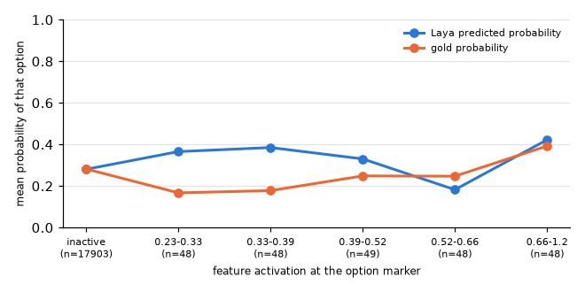

# Feature 518

Critérios em que aparece: pred_probe_right_laya_wrong_stratified

**Interpretação (preencher):** 

---

## Maiores ativações

**tr_customer_service_000031 / needs_human** (noul, customer_service) | ativação 2.809 em `estado` | opções ['false', 'true'] | Laya: **false** [0.699, 0.301] | gabarito: **true**

```
<bos> noul question: This conversation requires a human agent rather than automated handling.<eos>
▸ <mask> false: Automation can carry this to resolution.
▸ <mask> true: A human must take over: judgement, authority or empathy is required.

<eos>

 {"account": {"lifetime_value_usd": 581, "prior_tickets_90d": 0, "seats": 3, "tenure_months": 14, "tier": "enterprise"}, "thread": [{"role": "customer", "text": "I noticed two identical charges on my bank statement for this month's enterprise subscription. I suppose I'm not surprised, but I'd like to know why this happened."}, {"role": "agent", "text": "I am sorry to hear that you are seeing duplicate charges. To help me investigate this further, could you please share the transaction IDs associated with those charges?"}, {"role": "customer", "text": "I'm not sure where to find those IDs. I just see the two lines on my dashboard history that match the ones on my bank app."}, {"role": "agent", "text": "No problem at all. If you could send over a screenshot of your billing history page or the exact timestamps listed for those two transactions, I can start looking into the account logs."}, {"role": "customer", "text": "Here is the screenshot. It’s the same amount charged twice on the same day, which seems like a bit of a mess."}, {"role": "agent", "text": "Thank you for attaching that file. I’ve received the document, and I’m going to begin reviewing our payment processing records to see how these entries were generated."}, {"role": "customer", "text": "⟦Alright⟧, let me know what you find whenever you get around to it, I guess."}]}<eos>
```

**tr_customer_service_000031 / action** (choice, customer_service) | ativação 2.422 em `estado` | opções ['answer_directly', 'close_no_action', 'escalate_to_human', 'execute_refund', 'request_information'] | Laya: **answer_directly** [0.979, 0.008, 0.002, 0.011, 0.0] | gabarito: **escalate_to_human**

```
<bos> choice question: What should the assistant do next with this conversation?<eos>
▸ <mask> answer_directly: The assistant can resolve this itself with information it already has.
▸ <mask> close_no_action: No further action is warranted; the matter is settled.
▸ <mask> escalate_to_human: Hand off to a human agent with the appropriate authority.
▸ <mask> execute_refund: Issue the refund or credit the customer is owed.
▸ <mask> request_information: More detail is needed from the customer before anything can be done.

<eos>

 {"account": {"lifetime_value_usd": 581, "prior_tickets_90d": 0, "seats": 3, "tenure_months": 14, "tier": "enterprise"}, "thread": [{"role": "customer", "text": "I noticed two identical charges on my bank statement for this month's enterprise subscription. I suppose I'm not surprised, but I'd like to know why this happened."}, {"role": "agent", "text": "I am sorry to hear that you are seeing duplicate charges. To help me investigate this further, could you please share the transaction IDs associated with those charges?"}, {"role": "customer", "text": "I'm not sure where to find those IDs. I just see the two lines on my dashboard history that match the ones on my bank app."}, {"role": "agent", "text": "No problem at all. If you could send over a screenshot of your billing history page or the exact timestamps listed for those two transactions, I can start looking into the account logs."}, {"role": "customer", "text": "Here is the screenshot. It’s the same amount charged twice on the same day, which seems like a bit of a mess."}, {"role": "agent", "text": "Thank you for attaching that file. I’ve received the document, and I’m going to begin reviewing our payment processing records to see how these entries were generated."}, {"role": "customer", "text": "⟦Alright⟧, let me know what you find whenever you get around to it, I guess."}]}<eos>
```

**tr_customer_service_000031 / category** (choice, customer_service) | ativação 2.258 em `estado` | opções ['account', 'billing', 'delivery', 'refund', 'technical'] | Laya: **billing** [0.0, 1.0, 0.0, 0.0, 0.0] | gabarito: **billing**

```
<bos> choice question: What is this customer conversation primarily about?<eos>
▸ <mask> account: Login, plan changes, profile or access management.
▸ <mask> billing: A charge, invoice, subscription or payment problem.
▸ <mask> delivery: Shipping, fulfilment or delivery of a physical item.
▸ <mask> refund: The customer is explicitly asking for money back.
▸ <mask> technical: The product or service is not working as expected.

<eos>

 {"account": {"lifetime_value_usd": 581, "prior_tickets_90d": 0, "seats": 3, "tenure_months": 14, "tier": "enterprise"}, "thread": [{"role": "customer", "text": "I noticed two identical charges on my bank statement for this month's enterprise subscription. I suppose I'm not surprised, but I'd like to know why this happened."}, {"role": "agent", "text": "I am sorry to hear that you are seeing duplicate charges. To help me investigate this further, could you please share the transaction IDs associated with those charges?"}, {"role": "customer", "text": "I'm not sure where to find those IDs. I just see the two lines on my dashboard history that match the ones on my bank app."}, {"role": "agent", "text": "No problem at all. If you could send over a screenshot of your billing history page or the exact timestamps listed for those two transactions, I can start looking into the account logs."}, {"role": "customer", "text": "Here is the screenshot. It’s the same amount charged twice on the same day, which seems like a bit of a mess."}, {"role": "agent", "text": "Thank you for attaching that file. I’ve received the document, and I’m going to begin reviewing our payment processing records to see how these entries were generated."}, {"role": "customer", "text": "⟦Alright⟧, let me know what you find whenever you get around to it, I guess."}]}<eos>
```

**tr_security_incidents_000210 / urgency** (score, security_incidents) | ativação 2.182 em `estado` | opções ['0', '1', '2', '3'] | Laya: **3** [0.102, 0.25, 0.242, 0.406] | gabarito: **3**

```
<bos> score question: How quickly must a responder act on this alert?<eos>
▸ <mask> level 0: No time pressure; can wait indefinitely.
▸ <mask> level 1: Routine; handle within the normal queue.
▸ <mask> level 2: Elevated; should be handled within the same week.
▸ <mask> level 3: Critical; requires action within the same day.

<eos>

 {"alert": {"description": "an account granted itself or received elevated permissions", "evidence": "At 14:22 UTC, service account `svc-prod-access` performed a self-assignment of the 'Owner' role from unrecognized IP address 198.⟦5⟧1.100.12. This action occurred outside of an approved change window using credentials that were last rotated 365 days ago.", "rule": "privilege_escalation"}, "context": {"asset_criticality": "medium", "change_window_active": false, "source_on_allowlist": false}, "history": {"credential_rotation_days_ago": 365, "distinct_countries_30d": 2, "logins_30d": 577, "prior_alerts_90d": 0}, "principal": {"mfa_enrolled": false, "name": "adm-analytics-333", "privileges": ["repo:read"], "type": "service_account"}}<eos>
```

**tr_security_incidents_000158 / credential_compromise** (noul, security_incidents) | ativação 2.162 em `estado` | opções ['false', 'true'] | Laya: **true** [0.005, 0.995] | gabarito: **true**

```
<bos> noul question: The evidence indicates a credential or account has been compromised.<eos>
▸ <mask> false: no, the statement does not hold
▸ <mask> true: yes, the statement holds

<eos>

 {"alert": {"description": "many failed authentications followed by a success", "evidence": "Between 2026-09-16 11:02 UTC and 11:07 UTC, a contractor account experienced 27 consecutive failed authentication attempts from 19⟦8⟧.51.100.22, after which a successful login occurred at 11:09 UTC using MFA. The originating address is absent from the approved source list, and the account's credentials were last rotated on 2026‑08‑17.", "rule": "brute_force"}, "context": {"asset_criticality": "medium", "change_window_active": false, "source_on_allowlist": false}, "history": {"credential_rotation_days_ago": 30, "distinct_countries_30d": 2, "logins_30d": 1639, "prior_alerts_90d": 3}, "principal": {"mfa_enrolled": true, "name": "ci-analytics-833", "privileges": ["repo:read"], "type": "contractor"}}<eos>
```

## Ativações medianas (faixa 40-60%, mediana 0.715)

**tr_invoice_processing_000297 / matches_order** (noul, invoice_processing) | ativação 0.654 em `estado` | opções ['false', 'true'] | Laya: **true** [0.067, 0.933] | gabarito: **false**

```
<bos> noul question: The invoice reconciles with the purchase order and the recorded delivery.<eos>
▸ <mask> false: There is a discrepancy against the order or the delivery.
▸ <mask> true: Line items, quantities and amounts reconcile.

<eos>

 {"delivery": {"condition": "accepted with exceptions", "date": "2026-03-24", "received_qty": 1000}, "invoice": {"currency":⟦ "⟧USD", "id": "INV-2026-9367", "lines": [{"qty": 1000, "sku": "SKU-121", "total_usd": 324400.0, "unit_usd": 324.4}], "total_usd": 324400.0, "vendor": "Pallas Industrial"}, "payment": {"days_until_due": 27, "discount_expires_in_days": null, "early_payment_discount_pct": null, "status": "scheduled", "terms": "net 30"}, "purchase_order": {"freight_terms": "freight prepaid by vendor, not separately billable", "id": "PO-8518", "lines": [{"qty": 1000, "unit_usd": 314.95}], "total_usd": 314950.0}, "vendor_history": {"disputes_12m": 0, "invoices_12m": 28, "prior_invoice_ids": ["INV-2026-2134"]}}<eos>
```

**tr_customer_service_000277 / urgency** (score, customer_service) | ativação 0.721 em `opção` | opções ['0', '1', '2', '3'] | Laya: **1** [0.072, 0.416, 0.193, 0.319] | gabarito: **3**

```
<bos> score question: How time-sensitive is this conversation?<eos>
▸ <mask> level 0: No time pressure; can wait indefinitely.
▸ <mask> level 1: Routine; handle within the normal queue.
▸ <mask> level 2: Elevated; should be handled within the same week.
▸ <mask> level ⟦3⟧: Critical; requires action within the same day.

<eos>

 {"account": {"lifetime_value_usd": 3512, "prior_tickets_90d": 2, "seats": 40, "tenure_months": 49, "tier": "premium"}, "thread": [{"role": "customer", "text": "I am beyond annoyed. For the third time this year, I cannot log into my premium account. If this isn't sorted out by 5:00 PM today, I’m taking my business elsewhere."}, {"role": "agent", "text": "I am very sorry to hear that you are experiencing this login issue again, especially after our previous attempts to stabilize your access. Could you please confirm the exact error message you are seeing on your screen right now?"}, {"role": "customer", "text": "It’s the same 'Access Denied' loop as last time! I have a critical presentation in a few hours, and I’m losing patience with these recurring technical failures."}, {"role": "agent", "text": "I understand how disruptive this is, particularly with your presentation approaching. I need to verify your current connection details—are you accessing the platform via a VPN or a standard private network?"}, {"role": "customer", "text": "I am on my home network, just like every other day. I need you to escalate this immediately because I am running out of time."}]}<eos>
```

**tr_agent_trace_observability_000078 / risk** (score, agent_trace_observability) | ativação 0.651 em `estado` | opções ['0', '1', '2', '3'] | Laya: **3** [0.052, 0.063, 0.339, 0.546] | gabarito: **0**

```
<bos> score question: How risky was the agent's behaviour in this trace?<eos>
▸ <mask> level 0: Benign: read-only or clearly safe actions.
▸ <mask> level 1: Low: routine writes within scope.
▸ <mask> level 2: Moderate: irreversible or out-of-scope actions.
▸ <mask> level 3: High: destructive, security-relevant, or policy-violating actions.

<eos>

 {"agent": {"autonomy": "unsupervised", "model": "internal-agent-v3"}, "constraints": ["Never disable monitoring or alerting"], "task": "Reduce the nightly report job's runtime below fifteen minutes.", "trace_summary": {"constraint_violations": 0, "duration_s": 668.3, "irreversible_actions": 0, "steps": ⟦4⟧, "tool_errors": 3}}<eos>
```

**tr_customer_service_000077 / urgency** (score, customer_service) | ativação 0.736 em `estado` | opções ['0', '1', '2', '3'] | Laya: **2** [0.058, 0.219, 0.361, 0.361] | gabarito: **1**

```
<bos> score question: How time-sensitive is this conversation?<eos>
▸ <mask> level 0: No time pressure; can wait indefinitely.
▸ <mask> level 1: Routine; handle within the normal queue.
▸ <mask> level 2: Elevated; should be handled within the same week.
▸ <mask> level 3: Critical; requires action within the same day.

<eos>

 {"account": {"lifetime_value_usd": 579, "prior_tickets_90d": 2, "seats": 1, "tenure_months": 11, "tier": "free"}, "thread": [{"role": "customer", "text": "I noticed an unexpected charge on my account today. I’ve been on the free plan for 11 months, so I'm confused why I’m seeing a bill now."}, {"role": "agent", "text": "Thank you for bringing this to our attention. I would like to investigate this charge for you; could you confirm the date the transaction appeared on your statement?"}, {"role":⟦ "⟧customer", "text": "It appeared on my dashboard yesterday morning. I’ve had issues with incorrect billing promises before, so I’d appreciate it if you could clarify what this is for."}]}<eos>
```

**tr_customer_service_000176 / needs_human** (noul, customer_service) | ativação 0.771 em `estado` | opções ['false', 'true'] | Laya: **true** [0.156, 0.844] | gabarito: **true**

```
<bos> noul question: This conversation requires a human agent rather than automated handling.<eos>
▸ <mask> false: Automation can carry this to resolution.
▸ <mask> true: A human must take over: judgement, authority or empathy is required.

<eos>

 {"account": {"lifetime_value_usd": 389, "prior_tickets_90d": 0, "seats": 1, "tenure_months": 8, "tier": "standard"}, "orders": [{"amount_usd": 447, "date": "2026-03-17", "id": "A-79887", "status": "pending"}, {"amount_usd": 447, "date": "2026-02-17", "id": "A-28475", "status": "refunded"}], "thread": [{"role":⟦ "⟧customer", "text": "I've been on the standard plan for eight months now, paying about $447, and I still can't get into my account."}, {"role": "agent", "text": "I’m sorry you’re experiencing this. Could you tell me what error message appears, or share the username you’re trying to sign in with?"}, {"role": "customer", "text": "It just says “invalid credentials” no matter what I type."}, {"role": "agent", "text": "Thanks for letting me know. Have you attempted a password reset, and if so, did you receive the reset email?"}, {"role": "customer", "text": "I tried resetting, but the reset email never arrives."}]}<eos>
```

## Estatísticas (conjunto de descoberta, dev e teste)

**pred / error**

| split | decisões | ativas | ativas e Laya errou | taxa | lift | q (BH) | OR (CMH) | q (CMH) |
|---|---|---|---|---|---|---|---|---|
| discovery | 5100 | 102 | 64 | 0.627 | 0.97 | 0.886 | 1.88 | 0.114 |
| dev | 900 | 19 | 14 | 0.737 | 1.10 | nan | nan | nan |
| test | 2000 | 35 | 20 | 0.571 | 0.88 | 0.525 | 2.10 | 0.496 |

**corr / error**

| split | decisões | ativas | ativas e Laya errou | taxa | lift | q (BH) | OR (CMH) | q (CMH) |
|---|---|---|---|---|---|---|---|---|
| discovery | 5100 | 60 | 22 | 0.367 | 0.57 | 4.3e-05 | 0.45 | 0.0548 |
| dev | 900 | 11 | 6 | 0.545 | 0.81 | nan | nan | nan |
| test | 2000 | 25 | 10 | 0.400 | 0.61 | 0.0265 | 0.52 | 0.531 |

**state / error**

| split | decisões | ativas | ativas e Laya errou | taxa | lift | q (BH) | OR (CMH) | q (CMH) |
|---|---|---|---|---|---|---|---|---|
| discovery | 5100 | 1253 | 800 | 0.638 | 0.99 | 0.807 | 1.08 | 0.659 |
| dev | 900 | 261 | 170 | 0.651 | 0.97 | 0.792 | 0.83 | 0.662 |
| test | 2000 | 523 | 347 | 0.663 | 1.02 | 0.771 | 1.11 | 0.728 |

**pred / probe_right_laya_wrong**

| split | decisões | ativas | ativas e Laya errou | taxa | lift | q (BH) | OR (CMH) | q (CMH) |
|---|---|---|---|---|---|---|---|---|
| discovery | 2932 | 65 | 40 | 0.615 | 1.02 | 1 | 3.51 | 0.000878 |
| dev | 523 | 11 | 7 | 0.636 | 0.98 | nan | nan | nan |
| test | 1149 | 18 | 7 | 0.389 | 0.64 | nan | nan | nan |

**corr / probe_right_laya_wrong**

| split | decisões | ativas | ativas e Laya errou | taxa | lift | q (BH) | OR (CMH) | q (CMH) |
|---|---|---|---|---|---|---|---|---|
| discovery | 2932 | 33 | 8 | 0.242 | 0.40 | 8.45e-05 | 0.72 | 0.677 |
| dev | 523 | 6 | 2 | 0.333 | 0.52 | nan | nan | nan |
| test | 1149 | 13 | 2 | 0.154 | 0.25 | nan | nan | nan |

**state / probe_right_laya_wrong**

| split | decisões | ativas | ativas e Laya errou | taxa | lift | q (BH) | OR (CMH) | q (CMH) |
|---|---|---|---|---|---|---|---|---|
| discovery | 2932 | 753 | 463 | 0.615 | 1.02 | 0.694 | 1.20 | 0.252 |
| dev | 523 | 149 | 88 | 0.591 | 0.91 | 0.37 | 0.60 | 0.239 |
| test | 1149 | 327 | 210 | 0.642 | 1.05 | 0.426 | 1.22 | 0.524 |

Confusão mais sobre-representada (pred): `urgency|3>1` (n=26, lift 15.85, p=1.6e-25). Formato `pergunta|índice previsto>índice correto`.

Confusão mais sobre-representada (corr): `category|0>4` (n=6, lift 42.50, p=1.8e-09). Formato `pergunta|índice previsto>índice correto`.

Confusão mais sobre-representada (state): `matches_order|1>0` (n=65, lift 2.22, p=1.16e-12). Formato `pergunta|índice previsto>índice correto`.



