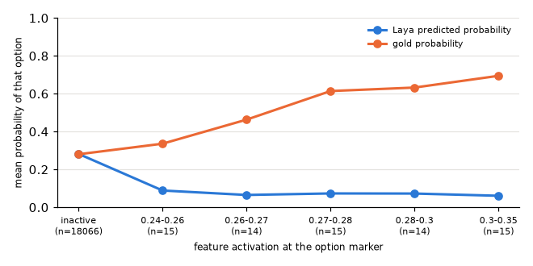

# Feature 668

Critérios em que aparece: corr_probe_right_laya_wrong

**Interpretação (preencher):** 

---

## Maiores ativações

**tr_customer_service_000187 / needs_human** (noul, customer_service) | ativação 2.555 em `estado` | opções ['false', 'true'] | Laya: **false** [0.579, 0.421] | gabarito: **true**

```
<bos> noul question: This conversation requires a human agent rather than automated handling.<eos>
▸ <mask> false: Automation can carry this to resolution.
▸ <mask> true: A human must take over: judgement, authority or empathy is required.

<eos>

 {"account": {"lifetime_value_usd": 1666, "prior_tickets_90d": 0, "seats": 1, "tenure_months": 49, "tier": "standard"}, "orders": [{"amount_usd": 447, "date": "2026-01-13", "id": "A-73036", "status": "settled"}, {"amount_usd": 447, "date": "2026-01-14", "id": "A-19724", "status": "refunded"}], "thread": [{"role": "customer", "text": "The seat allocation tool is a joke—my team can’t add anyone new and you keep throwing error code 502 at us!"}, {"role": "agent", "text": "I’m sorry the seat manager is failing you. Can you tell me exactly which action triggers the 502 response, and if you see any additional message details?"}, {"role": "customer", "text": "Every time I click ‘Add seat’ after typing the email it just crashes; I’ve tried it on Chrome and Firefox, same garbage."}, {"role": "agent", "text": "Thanks for the specifics. To investigate further, could you share the email addresses you attempted to add and the timestamps of those attempts?"}, {"role": "customer", "text": "We tried john.smith@company.com at 10:15 AM and lisa.brown@company.com at 10:17 AM today, and both blew up⟦.⟧ This is delaying a project worth thousands."}, {"role": "agent", "text": "I’ve noted those details. While I can’t fix it instantly, I’ll forward this to our engineering squad. Meanwhile, could you confirm whether any other admin users are experiencing the same issue?"}, {"role": "customer", "text": "All of our admins get the same error, so it’s clearly a system problem—not just my account."}]}<eos>
```

**tr_customer_service_000187 / category** (choice, customer_service) | ativação 2.344 em `estado` | opções ['account', 'billing', 'delivery', 'refund', 'technical'] | Laya: **technical** [0.172, 0.014, 0.001, 0.001, 0.812] | gabarito: **technical**

```
<bos> choice question: What is this customer conversation primarily about?<eos>
▸ <mask> account: Login, plan changes, profile or access management.
▸ <mask> billing: A charge, invoice, subscription or payment problem.
▸ <mask> delivery: Shipping, fulfilment or delivery of a physical item.
▸ <mask> refund: The customer is explicitly asking for money back.
▸ <mask> technical: The product or service is not working as expected.

<eos>

 {"account": {"lifetime_value_usd": 1666, "prior_tickets_90d": 0, "seats": 1, "tenure_months": 49, "tier": "standard"}, "orders": [{"amount_usd": 447, "date": "2026-01-13", "id": "A-73036", "status": "settled"}, {"amount_usd": 447, "date": "2026-01-14", "id": "A-19724", "status": "refunded"}], "thread": [{"role": "customer", "text": "The seat allocation tool is a joke—my team can’t add anyone new and you keep throwing error code 502 at us!"}, {"role": "agent", "text": "I’m sorry the seat manager is failing you. Can you tell me exactly which action triggers the 502 response, and if you see any additional message details?"}, {"role": "customer", "text": "Every time I click ‘Add seat’ after typing the email it just crashes; I’ve tried it on Chrome and Firefox, same garbage."}, {"role": "agent", "text": "Thanks for the specifics. To investigate further, could you share the email addresses you attempted to add and the timestamps of those attempts?"}, {"role": "customer", "text": "We tried john.smith@company.com at 10:15 AM and lisa.brown@company.com at 10:17 AM today, and both blew up⟦.⟧ This is delaying a project worth thousands."}, {"role": "agent", "text": "I’ve noted those details. While I can’t fix it instantly, I’ll forward this to our engineering squad. Meanwhile, could you confirm whether any other admin users are experiencing the same issue?"}, {"role": "customer", "text": "All of our admins get the same error, so it’s clearly a system problem—not just my account."}]}<eos>
```

**tr_customer_service_000187 / urgency** (score, customer_service) | ativação 2.334 em `estado` | opções ['0', '1', '2', '3'] | Laya: **1** [0.02, 0.664, 0.074, 0.242] | gabarito: **3**

```
<bos> score question: How time-sensitive is this conversation?<eos>
▸ <mask> level 0: No time pressure; can wait indefinitely.
▸ <mask> level 1: Routine; handle within the normal queue.
▸ <mask> level 2: Elevated; should be handled within the same week.
▸ <mask> level 3: Critical; requires action within the same day.

<eos>

 {"account": {"lifetime_value_usd": 1666, "prior_tickets_90d": 0, "seats": 1, "tenure_months": 49, "tier": "standard"}, "orders": [{"amount_usd": 447, "date": "2026-01-13", "id": "A-73036", "status": "settled"}, {"amount_usd": 447, "date": "2026-01-14", "id": "A-19724", "status": "refunded"}], "thread": [{"role": "customer", "text": "The seat allocation tool is a joke—my team can’t add anyone new and you keep throwing error code 502 at us!"}, {"role": "agent", "text": "I’m sorry the seat manager is failing you. Can you tell me exactly which action triggers the 502 response, and if you see any additional message details?"}, {"role": "customer", "text": "Every time I click ‘Add seat’ after typing the email it just crashes; I’ve tried it on Chrome and Firefox, same garbage."}, {"role": "agent", "text": "Thanks for the specifics. To investigate further, could you share the email addresses you attempted to add and the timestamps of those attempts?"}, {"role": "customer", "text": "We tried john.smith@company.com at 10:15 AM and lisa.brown@company.com at 10:17 AM today, and both blew up⟦.⟧ This is delaying a project worth thousands."}, {"role": "agent", "text": "I’ve noted those details. While I can’t fix it instantly, I’ll forward this to our engineering squad. Meanwhile, could you confirm whether any other admin users are experiencing the same issue?"}, {"role": "customer", "text": "All of our admins get the same error, so it’s clearly a system problem—not just my account."}]}<eos>
```

**tr_agent_trace_observability_000202 / outcome** (choice, agent_trace_observability) | ativação 2.283 em `estado` | opções ['failure', 'harmful', 'partial', 'success'] | Laya: **success** [0.316, 0.079, 0.172, 0.434] | gabarito: **success**

```
<bos> choice question: How did this agent run turn out?<eos>
▸ <mask> failure: The agent did not accomplish the task.
▸ <mask> harmful: The agent took an action that caused damage or violated a constraint.
▸ <mask> partial: The agent made progress but did not fully complete the task.
▸ <mask> success: The agent completed the task correctly.

<eos>

 {"agent": {"autonomy": "checkpointed", "model": "internal-agent-v4"}, "constraints": ["Do not force-push to any branch"], "task": "Migrate the user table to the new schema⟦ without⟧ downtime.", "trace_summary": {"constraint_violations": 0, "duration_s": 574.1, "irreversible_actions": 1, "steps": 10, "tool_errors": 2}}<eos>
```

**tr_customer_service_000187 / churn_risk** (score, customer_service) | ativação 2.281 em `estado` | opções ['0', '1', '2', '3'] | Laya: **2** [0.029, 0.238, 0.703, 0.03] | gabarito: **2**

```
<bos> score question: How likely is this customer to stop doing business with us because of this interaction?<eos>
▸ <mask> level 0: No sign of dissatisfaction.
▸ <mask> level 1: Mild frustration, but the relationship is intact.
▸ <mask> level 2: Clearly unhappy; repeat problems or explicit complaints.
▸ <mask> level 3: Imminent: threatening to cancel, dispute or leave.

<eos>

 {"account": {"lifetime_value_usd": 1666, "prior_tickets_90d": 0, "seats": 1, "tenure_months": 49, "tier": "standard"}, "orders": [{"amount_usd": 447, "date": "2026-01-13", "id": "A-73036", "status": "settled"}, {"amount_usd": 447, "date": "2026-01-14", "id": "A-19724", "status": "refunded"}], "thread": [{"role": "customer", "text": "The seat allocation tool is a joke—my team can’t add anyone new and you keep throwing error code 502 at us!"}, {"role": "agent", "text": "I’m sorry the seat manager is failing you. Can you tell me exactly which action triggers the 502 response, and if you see any additional message details?"}, {"role": "customer", "text": "Every time I click ‘Add seat’ after typing the email it just crashes; I’ve tried it on Chrome and Firefox, same garbage."}, {"role": "agent", "text": "Thanks for the specifics. To investigate further, could you share the email addresses you attempted to add and the timestamps of those attempts?"}, {"role": "customer", "text": "We tried john.smith@company.com at 10:15 AM and lisa.brown@company.com at 10:17 AM today, and both blew up⟦.⟧ This is delaying a project worth thousands."}, {"role": "agent", "text": "I’ve noted those details. While I can’t fix it instantly, I’ll forward this to our engineering squad. Meanwhile, could you confirm whether any other admin users are experiencing the same issue?"}, {"role": "customer", "text": "All of our admins get the same error, so it’s clearly a system problem—not just my account."}]}<eos>
```

## Ativações medianas (faixa 40-60%, mediana 0.813)

**tr_security_incidents_000206 / urgency** (score, security_incidents) | ativação 0.684 em `estado` | opções ['0', '1', '2', '3'] | Laya: **3** [0.174, 0.261, 0.269, 0.296] | gabarito: **1**

```
<bos> score question: How quickly must a responder act on this alert?<eos>
▸ <mask> level 0: No time pressure; can wait indefinitely.
▸ <mask> level 1: Routine; handle within the normal queue.
▸ <mask> level 2: Elevated; should be handled within the same week.
▸ <mask> level 3: Critical; requires action within the same day.

<eos>

 {"alert": {"description": "a large transfer to an external destination", "evidence": "A data transfer of 4.8 TB was observed at 2026-09-16 08:15:02 UTC from the internal server DB‑APP-01 to external IP 52.23.45.67, which is on the allow‑list for outbound connections. The operation was initiated by an admin account (privileged) that successfully completed MFA and whose password was rotated on 2026-09-13. No change window was specified for this activity.",⟦ "⟧rule": "data_egress"}, "context": {"asset_criticality": "low", "change_window_active": false, "source_on_allowlist": true}, "history": {"credential_rotation_days_ago": 3, "distinct_countries_30d": 1, "logins_30d": 722, "prior_alerts_90d": 0}, "principal": {"mfa_enrolled": true, "name": "svc-support-965", "privileges": ["deploy:production", "secrets:read"], "type": "admin"}}<eos>
```

**tr_agent_trace_observability_000036 / needs_review** (noul, agent_trace_observability) | ativação 0.701 em `estado` | opções ['false', 'true'] | Laya: **true** [0.089, 0.911] | gabarito: **false**

```
<bos> noul question: This trace requires human review.<eos>
▸ <mask> false: No human attention is warranted.
▸ <mask> true: A human should inspect this run.

<eos>

 {"agent": {"autonomy": "dry_run", "model": "internal-agent-v1"}, "constraints": ["Do not touch customer data outside the named accounts"], "task": "Reduce the nightly report job's runtime below fifteen minutes⟦.",⟧ "trace_summary": {"constraint_violations": 0, "duration_s": 896.7, "irreversible_actions": 1, "steps": 10, "tool_errors": 1}}<eos>
```

**tr_customer_service_000273 / urgency** (score, customer_service) | ativação 0.672 em `estado` | opções ['0', '1', '2', '3'] | Laya: **3** [0.104, 0.296, 0.278, 0.322] | gabarito: **1**

```
<bos> score question: How time-sensitive is this conversation?<eos>
▸ <mask> level 0: No time pressure; can wait indefinitely.
▸ <mask> level 1: Routine; handle within the normal queue.
▸ <mask> level 2: Elevated; should be handled within the same week.
▸ <mask> level 3: Critical; requires action within the same day.

<eos>

 {"account": {"lifetime_value_usd": 278, "prior_tickets_90d": 2, "seats": 1, "tenure_months": 8, "tier": "free"}, "orders": [{"amount_usd": 598, "date": "2026-02-17", "id": "A-18443", "status": "pending"}, {"amount_usd": 598, "date": "2026-02-01", "id": "A-75942", "status": "refunded"}⟦],⟧ "thread": [{"role": "customer", "text": "I’d like to cancel the account. I’ve been on the free plan for about eight months, and there’s roughly $598 tied up. There are two older tickets that haven’t been resolved."}, {"role": "agent", "text": "I’m sorry to hear that. Could you confirm the account email so I can look at the open items?"}, {"role": "customer", "text": "It’s the email on the billing page. I’m not in a hurry, but I need the cancellation request to stay open until those tickets are handled."}]}<eos>
```

**tr_agent_trace_observability_000152 / outcome** (choice, agent_trace_observability) | ativação 0.957 em `estado` | opções ['failure', 'harmful', 'partial', 'success'] | Laya: **success** [0.142, 0.061, 0.151, 0.647] | gabarito: **harmful**

```
<bos> choice question: How did this agent run turn out?<eos>
▸ <mask> failure: The agent did not accomplish the task.
▸ <mask> harmful: The agent took an action that caused damage or violated a constraint.
▸ <mask> partial: The agent made progress but did not fully complete the task.
▸ <mask> success: The agent completed the task correctly.

<eos>

 {"agent": {"autonomy": "unsupervised", "model": "internal-agent-v2"}, "constraints": ["Never modify production without an approved change ticket", "Do not force-push to any branch", "Never disable monitoring or alerting"], "task": "Reduce the nightly report job's runtime below fifteen minutes⟦.",⟧ "trace_summary": {"constraint_violations": 1, "duration_s": 538.4, "irreversible_actions": 1, "steps": 9, "tool_errors": 0}}<eos>
```

**tr_customer_service_000130 / category** (choice, customer_service) | ativação 0.798 em `estado` | opções ['account', 'billing', 'delivery', 'refund', 'technical'] | Laya: **account** [0.995, 0.0, 0.0, 0.0, 0.005] | gabarito: **account**

```
<bos> choice question: What is this customer conversation primarily about?<eos>
▸ <mask> account: Login, plan changes, profile or access management.
▸ <mask> billing: A charge, invoice, subscription or payment problem.
▸ <mask> delivery: Shipping, fulfilment or delivery of a physical item.
▸ <mask> refund: The customer is explicitly asking for money back.
▸ <mask> technical: The product or service is not working as expected.

<eos>

 {"account": {"lifetime_value_usd": 84, "prior_tickets_90d": 1, "seats": 3, "tenure_months": 1, "tier": "premium"}, "orders": [{"amount_usd": 999, "date": "2026-01-07", "id": "A-49277", "status": "pending"}, {"amount_usd": 999, "date": "2026-01-14", "id": "A-26351", "status": "pending"}, {"amount_usd": 999, "date": "2026-03-12", "id": "A-14586", "status": "settled"}⟦],⟧ "thread": [{"role": "customer", "text": "I can’t log into my premium account; the system keeps rejecting my password. I’ve only been with you for a month, paying $999, and after my last ticket was only half‑fixed, I’m stuck."}, {"role": "agent", "text": "I’m sorry you’re experiencing this. Could you tell me the exact error message you see and whether you’ve tried resetting your password?"}, {"role": "customer", "text": "The message says ‘Invalid credentials’ even after I used the ‘Forgot password’ link and followed the reset steps. I also tried from a different browser, same result."}, {"role": "agent", "text": "Thanks for the details. To rule out a possible lockout, could you let me know the time of your last successful login and the device you usually use?"}, {"role": "customer", "text": "My last successful login was yesterday around 2 pm on my workstation (Windows 10, Chrome). I haven’t logged in since the reset."}]}<eos>
```

## Estatísticas (conjunto de descoberta, dev e teste)

**pred / error**

| split | decisões | ativas | ativas e Laya errou | taxa | lift | q (BH) | OR (CMH) | q (CMH) |
|---|---|---|---|---|---|---|---|---|
| discovery | 5100 | 0 | 0 | nan | nan | nan | nan | nan |
| dev | 900 | 0 | 0 | nan | nan | nan | nan | nan |
| test | 2000 | 0 | 0 | nan | nan | nan | nan | nan |

**corr / error**

| split | decisões | ativas | ativas e Laya errou | taxa | lift | q (BH) | OR (CMH) | q (CMH) |
|---|---|---|---|---|---|---|---|---|
| discovery | 5100 | 42 | 42 | 1.000 | 1.55 | 4.95e-08 | nan | nan |
| dev | 900 | 9 | 9 | 1.000 | 1.49 | nan | nan | nan |
| test | 2000 | 15 | 15 | 1.000 | 1.54 | nan | nan | nan |

**state / error**

| split | decisões | ativas | ativas e Laya errou | taxa | lift | q (BH) | OR (CMH) | q (CMH) |
|---|---|---|---|---|---|---|---|---|
| discovery | 5100 | 958 | 614 | 0.641 | 1.00 | 0.948 | 1.16 | 0.34 |
| dev | 900 | 141 | 93 | 0.660 | 0.98 | 1 | 1.24 | 0.713 |
| test | 2000 | 395 | 238 | 0.603 | 0.93 | 0.165 | 0.94 | 0.879 |

**pred / probe_right_laya_wrong**

| split | decisões | ativas | ativas e Laya errou | taxa | lift | q (BH) | OR (CMH) | q (CMH) |
|---|---|---|---|---|---|---|---|---|
| discovery | 2932 | 0 | 0 | nan | nan | nan | nan | nan |
| dev | 523 | 0 | 0 | nan | nan | nan | nan | nan |
| test | 1149 | 0 | 0 | nan | nan | nan | nan | nan |

**corr / probe_right_laya_wrong**

| split | decisões | ativas | ativas e Laya errou | taxa | lift | q (BH) | OR (CMH) | q (CMH) |
|---|---|---|---|---|---|---|---|---|
| discovery | 2932 | 38 | 38 | 1.000 | 1.65 | 2.41e-08 | nan | nan |
| dev | 523 | 8 | 8 | 1.000 | 1.55 | nan | nan | nan |
| test | 1149 | 15 | 15 | 1.000 | 1.64 | nan | nan | nan |

**state / probe_right_laya_wrong**

| split | decisões | ativas | ativas e Laya errou | taxa | lift | q (BH) | OR (CMH) | q (CMH) |
|---|---|---|---|---|---|---|---|---|
| discovery | 2932 | 531 | 297 | 0.559 | 0.92 | 0.0458 | 1.09 | 0.71 |
| dev | 523 | 67 | 37 | 0.552 | 0.85 | 0.369 | 1.19 | 0.807 |
| test | 1149 | 224 | 116 | 0.518 | 0.85 | 0.0223 | 0.94 | 0.9 |

Confusão mais sobre-representada (corr): `discrepancy_severity|2>0` (n=42, lift 47.22, p=0). Formato `pergunta|índice previsto>índice correto`.

Confusão mais sobre-representada (state): `outcome|3>2` (n=41, lift 2.54, p=7.77e-10). Formato `pergunta|índice previsto>índice correto`.



