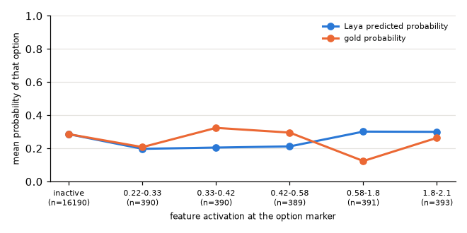

# Feature 675

Critérios em que aparece: attribution_toward_wrong

**Interpretação (preencher):** 

---

## Maiores ativações

**tr_invoice_processing_000110 / discrepancy_severity** (score, invoice_processing) | ativação 7.535 em `opção` | opções ['0', '1', '2', '3'] | Laya: **2** [0.046, 0.215, 0.678, 0.06] | gabarito: **0**

```
<bos> score question: How material is any discrepancy between the invoice, the order and the delivery?<eos>
▸ <mask> level 0: None: everything reconciles.
▸ <mask> level 1: Trivial: rounding or a cosmetic difference.
▸ <mask> level 2: Moderate⟦:⟧ a real difference worth confirming.
▸ <mask> level 3: Material: a large or unexplained difference.

<eos>

 {"delivery": {"condition": "accepted", "date": "2026-03-01", "received_qty": 400}, "invoice": {"currency": "USD", "id": "INV-2026-3749", "lines": [{"qty": 400, "sku": "SKU-775", "total_usd": 98092.0, "unit_usd": 245.23}], "total_usd": 98092.0, "vendor": "Pallas Industrial"}, "payment": {"days_until_due": -3, "discount_expires_in_days": null, "early_payment_discount_pct": null, "status": "overdue", "terms": "net 45"}, "purchase_order": {"freight_terms": "freight prepaid by vendor, not separately billable", "id": "PO-4329", "lines": [{"qty": 400, "unit_usd": 245.23}], "total_usd": 98092.0}, "vendor_history": {"disputes_12m": 0, "invoices_12m": 48, "prior_invoice_ids": ["INV-2026-9469", "INV-2026-8195", "INV-2026-6930", "INV-2026-5533"]}}<eos>
```

**tr_invoice_processing_000280 / discrepancy_severity** (score, invoice_processing) | ativação 7.531 em `opção` | opções ['0', '1', '2', '3'] | Laya: **2** [0.074, 0.278, 0.58, 0.067] | gabarito: **0**

```
<bos> score question: How material is any discrepancy between the invoice, the order and the delivery?<eos>
▸ <mask> level 0: None: everything reconciles.
▸ <mask> level 1: Trivial: rounding or a cosmetic difference.
▸ <mask> level 2: Moderate⟦:⟧ a real difference worth confirming.
▸ <mask> level 3: Material: a large or unexplained difference.

<eos>

 {"delivery": {"condition": "accepted with exceptions", "date": "2026-03-21", "received_qty": 100}, "invoice": {"currency": "USD", "id": "INV-2026-9833", "lines": [{"qty": 100, "sku": "SKU-256", "total_usd": 6456.0, "unit_usd": 64.56}], "total_usd": 6456.0, "vendor": "Orbit Logistics"}, "payment": {"days_until_due": -9, "discount_expires_in_days": null, "early_payment_discount_pct": null, "status": "overdue", "terms": "net 30"}, "purchase_order": {"freight_terms": "freight prepaid by vendor, not separately billable", "id": "PO-1714", "lines": [{"qty": 100, "unit_usd": 64.56}], "total_usd": 6456.0}, "vendor_history": {"disputes_12m": 0, "invoices_12m": 53, "prior_invoice_ids": ["INV-2026-1203", "INV-2026-3021", "INV-2026-1676"]}}<eos>
```

**tr_invoice_processing_000249 / discrepancy_severity** (score, invoice_processing) | ativação 7.516 em `opção` | opções ['0', '1', '2', '3'] | Laya: **2** [0.062, 0.2, 0.679, 0.059] | gabarito: **2**

```
<bos> score question: How material is any discrepancy between the invoice, the order and the delivery?<eos>
▸ <mask> level 0: None: everything reconciles.
▸ <mask> level 1: Trivial: rounding or a cosmetic difference.
▸ <mask> level 2: Moderate⟦:⟧ a real difference worth confirming.
▸ <mask> level 3: Material: a large or unexplained difference.

<eos>

 {"delivery": {"condition": "accepted with exceptions", "date": "2026-03-28", "received_qty": 50}, "invoice": {"currency": "USD", "id": "INV-2026-7945", "lines": [{"qty": 50, "sku": "SKU-204", "total_usd": 7926.5, "unit_usd": 158.53}], "total_usd": 7926.5, "vendor": "Acme Fabrication"}, "payment": {"days_until_due": 11, "discount_expires_in_days": null, "early_payment_discount_pct": null, "status": "scheduled", "terms": "net 15"}, "purchase_order": {"freight_terms": "freight prepaid by vendor, not separately billable", "id": null, "lines": [{"qty": 50, "unit_usd": 158.53}], "total_usd": 7926.5}, "vendor_history": {"disputes_12m": 0, "invoices_12m": 20, "prior_invoice_ids": ["INV-2026-7636", "INV-2026-3392", "INV-2026-4291"]}}<eos>
```

**tr_invoice_processing_000079 / discrepancy_severity** (score, invoice_processing) | ativação 7.504 em `opção` | opções ['0', '1', '2', '3'] | Laya: **2** [0.05, 0.231, 0.639, 0.08] | gabarito: **2**

```
<bos> score question: How material is any discrepancy between the invoice, the order and the delivery?<eos>
▸ <mask> level 0: None: everything reconciles.
▸ <mask> level 1: Trivial: rounding or a cosmetic difference.
▸ <mask> level 2: Moderate⟦:⟧ a real difference worth confirming.
▸ <mask> level 3: Material: a large or unexplained difference.

<eos>

 {"delivery": {"condition": "accepted", "date": "2026-03-16", "received_qty": 380}, "invoice": {"currency": "USD", "id": "INV-2026-7833", "lines": [{"qty": 380, "sku": "SKU-873", "total_usd": 103420.8, "unit_usd": 272.16}], "total_usd": 103420.8, "vendor": "Pallas Industrial"}, "payment": {"days_until_due": 2, "discount_expires_in_days": null, "early_payment_discount_pct": null, "status": "scheduled", "terms": "net 30"}, "purchase_order": {"freight_terms": "freight prepaid by vendor, not separately billable", "id": "PO-8346", "lines": [{"qty": 400, "unit_usd": 272.16}], "total_usd": 108864.0}, "vendor_history": {"disputes_12m": 0, "invoices_12m": 43, "prior_invoice_ids": ["INV-2026-8967", "INV-2026-2028", "INV-2026-4787", "INV-2026-5782"]}}<eos>
```

**tr_invoice_processing_000128 / discrepancy_severity** (score, invoice_processing) | ativação 7.504 em `opção` | opções ['0', '1', '2', '3'] | Laya: **2** [0.062, 0.213, 0.665, 0.06] | gabarito: **0**

```
<bos> score question: How material is any discrepancy between the invoice, the order and the delivery?<eos>
▸ <mask> level 0: None: everything reconciles.
▸ <mask> level 1: Trivial: rounding or a cosmetic difference.
▸ <mask> level 2: Moderate⟦:⟧ a real difference worth confirming.
▸ <mask> level 3: Material: a large or unexplained difference.

<eos>

 {"delivery": {"condition": "accepted", "date": "2026-03-03", "received_qty": 10}, "invoice": {"currency": "USD", "id": "INV-2026-1573", "lines": [{"qty": 10, "sku": "SKU-688", "total_usd": 4081.5, "unit_usd": 408.15}], "total_usd": 4081.5, "vendor": "Acme Fabrication"}, "payment": {"days_until_due": -9, "discount_expires_in_days": null, "early_payment_discount_pct": null, "status": "overdue", "terms": "net 45"}, "purchase_order": {"freight_terms": "freight prepaid by vendor, not separately billable", "id": "PO-6996", "lines": [{"qty": 10, "unit_usd": 408.15}], "total_usd": 4081.5}, "vendor_history": {"disputes_12m": 0, "invoices_12m": 27, "prior_invoice_ids": ["INV-2026-1107", "INV-2026-4586", "INV-2026-5918"]}}<eos>
```

## Ativações medianas (faixa 40-60%, mediana 1.193)

**tr_invoice_processing_000297 / discrepancy_severity** (score, invoice_processing) | ativação 1.153 em `pergunta` | opções ['0', '1', '2', '3'] | Laya: **2** [0.093, 0.329, 0.533, 0.045] | gabarito: **2**

```
<bos> score question: How material⟦ is⟧ any discrepancy between the invoice, the order and the delivery?<eos>
▸ <mask> level 0: None: everything reconciles.
▸ <mask> level 1: Trivial: rounding or a cosmetic difference.
▸ <mask> level 2: Moderate: a real difference worth confirming.
▸ <mask> level 3: Material: a large or unexplained difference.

<eos>

 {"delivery": {"condition": "accepted with exceptions", "date": "2026-03-24", "received_qty": 1000}, "invoice": {"currency": "USD", "id": "INV-2026-9367", "lines": [{"qty": 1000, "sku": "SKU-121", "total_usd": 324400.0, "unit_usd": 324.4}], "total_usd": 324400.0, "vendor": "Pallas Industrial"}, "payment": {"days_until_due": 27, "discount_expires_in_days": null, "early_payment_discount_pct": null, "status": "scheduled", "terms": "net 30"}, "purchase_order": {"freight_terms": "freight prepaid by vendor, not separately billable", "id": "PO-8518", "lines": [{"qty": 1000, "unit_usd": 314.95}], "total_usd": 314950.0}, "vendor_history": {"disputes_12m": 0, "invoices_12m": 28, "prior_invoice_ids": ["INV-2026-2134"]}}<eos>
```

**tr_invoice_processing_000023 / discrepancy_severity** (score, invoice_processing) | ativação 1.400 em `opção` | opções ['0', '1', '2', '3'] | Laya: **2** [0.077, 0.416, 0.466, 0.041] | gabarito: **0**

```
<bos> score question: How material is any discrepancy between the invoice, the order and the delivery?<eos>
▸ <mask> level 0: None: everything reconciles.
▸ <mask> level 1: Trivial: rounding or a cosmetic difference.
▸ <mask> level 2: Moderate: a real difference worth confirming.
▸ <mask> level ⟦3⟧: Material: a large or unexplained difference.

<eos>

 {"delivery": {"condition": "accepted with exceptions", "date": "2026-03-25", "received_qty": 250}, "invoice": {"currency": "USD", "id": "INV-2026-8598", "lines": [{"qty": 250, "sku": "SKU-575", "total_usd": 31660.0, "unit_usd": 126.64}], "total_usd": 31660.0, "vendor": "Northwind Components"}, "payment": {"days_until_due": 5, "discount_expires_in_days": null, "early_payment_discount_pct": null, "status": "scheduled", "terms": "net 60"}, "purchase_order": {"freight_terms": "freight prepaid by vendor, not separately billable", "id": "PO-4453", "lines": [{"qty": 250, "unit_usd": 126.64}], "total_usd": 31660.0}, "vendor_history": {"disputes_12m": 0, "invoices_12m": 12, "prior_invoice_ids": ["INV-2026-3394", "INV-2026-7717", "INV-2026-6892", "INV-2026-2732"]}}<eos>
```

**tr_invoice_processing_000113 / discrepancy_severity** (score, invoice_processing) | ativação 1.175 em `opção` | opções ['0', '1', '2', '3'] | Laya: **2** [0.054, 0.229, 0.683, 0.034] | gabarito: **3**

```
<bos> score question: How material is any discrepancy between the invoice, the order and the delivery?<eos>
▸ <mask> level 0: None: everything reconciles.
▸ <mask> level 1: Trivial: rounding or a cosmetic difference.
▸ <mask> level ⟦2⟧: Moderate: a real difference worth confirming.
▸ <mask> level 3: Material: a large or unexplained difference.

<eos>

 {"delivery": {"condition": "accepted", "date": "2026-03-13", "received_qty": 25}, "invoice": {"currency": "USD", "id": "INV-2026-5107", "lines": [{"qty": 25, "sku": "SKU-215", "total_usd": 7696.5, "unit_usd": 307.86}], "total_usd": 7696.5, "vendor": "Kestrel Supply"}, "payment": {"days_until_due": 11, "discount_expires_in_days": null, "early_payment_discount_pct": null, "status": "scheduled", "terms": "net 30"}, "purchase_order": {"freight_terms": "freight prepaid by vendor, not separately billable", "id": "PO-3793", "lines": [{"qty": 25, "unit_usd": 219.9}], "total_usd": 5497.5}, "vendor_history": {"disputes_12m": 0, "invoices_12m": 20, "prior_invoice_ids": ["INV-2026-8132", "INV-2026-8642"]}}<eos>
```

**tr_invoice_processing_000100 / discrepancy_severity** (score, invoice_processing) | ativação 1.248 em `pergunta` | opções ['0', '1', '2', '3'] | Laya: **2** [0.058, 0.238, 0.648, 0.057] | gabarito: **0**

```
<bos> score question: How material⟦ is⟧ any discrepancy between the invoice, the order and the delivery?<eos>
▸ <mask> level 0: None: everything reconciles.
▸ <mask> level 1: Trivial: rounding or a cosmetic difference.
▸ <mask> level 2: Moderate: a real difference worth confirming.
▸ <mask> level 3: Material: a large or unexplained difference.

<eos>

 {"delivery": {"condition": "accepted", "date": "2026-03-06", "received_qty": 25}, "invoice": {"currency": "USD", "id": "INV-2026-3933", "lines": [{"qty": 25, "sku": "SKU-346", "total_usd": 5973.25, "unit_usd": 238.93}], "total_usd": 5973.25, "vendor": "Acme Fabrication"}, "payment": {"days_until_due": 44, "discount_expires_in_days": 3, "early_payment_discount_pct": 2.0, "status": "scheduled", "terms": "net 30"}, "purchase_order": {"freight_terms": "freight prepaid by vendor, not separately billable", "id": null, "lines": [{"qty": 25, "unit_usd": 238.93}], "total_usd": 5973.25}, "vendor_history": {"disputes_12m": 1, "invoices_12m": 6, "prior_invoice_ids": ["INV-2026-7649"]}}<eos>
```

**tr_invoice_processing_000124 / discrepancy_severity** (score, invoice_processing) | ativação 1.406 em `pergunta` | opções ['0', '1', '2', '3'] | Laya: **2** [0.072, 0.4, 0.488, 0.04] | gabarito: **2**

```
<bos> score question:⟦ How⟧ material is any discrepancy between the invoice, the order and the delivery?<eos>
▸ <mask> level 0: None: everything reconciles.
▸ <mask> level 1: Trivial: rounding or a cosmetic difference.
▸ <mask> level 2: Moderate: a real difference worth confirming.
▸ <mask> level 3: Material: a large or unexplained difference.

<eos>

 {"delivery": {"condition": "accepted", "date": "2026-03-17", "received_qty": 10}, "invoice": {"currency": "USD", "id": "INV-2026-6789", "lines": [{"qty": 10, "sku": "SKU-692", "total_usd": 2272.9, "unit_usd": 227.29}], "total_usd": 2272.9, "vendor": "Orbit Logistics"}, "payment": {"days_until_due": 5, "discount_expires_in_days": null, "early_payment_discount_pct": null, "status": "scheduled", "terms": "net 30"}, "purchase_order": {"freight_terms": "freight prepaid by vendor, not separately billable", "id": "PO-2113", "lines": [{"qty": 10, "unit_usd": 220.67}], "total_usd": 2206.7}, "vendor_history": {"disputes_12m": 0, "invoices_12m": 1, "prior_invoice_ids": ["INV-2026-5780", "INV-2026-1144"]}}<eos>
```

## Estatísticas (conjunto de descoberta, dev e teste)

**pred / error**

| split | decisões | ativas | ativas e Laya errou | taxa | lift | q (BH) | OR (CMH) | q (CMH) |
|---|---|---|---|---|---|---|---|---|
| discovery | 5100 | 455 | 292 | 0.642 | 1.00 | 1 | 0.61 | 0.0645 |
| dev | 900 | 109 | 77 | 0.706 | 1.05 | 0.681 | 0.81 | 0.839 |
| test | 2000 | 189 | 141 | 0.746 | 1.15 | 0.0111 | 0.73 | 0.721 |

**corr / error**

| split | decisões | ativas | ativas e Laya errou | taxa | lift | q (BH) | OR (CMH) | q (CMH) |
|---|---|---|---|---|---|---|---|---|
| discovery | 5100 | 475 | 312 | 0.657 | 1.02 | 0.622 | 0.77 | 0.26 |
| dev | 900 | 108 | 76 | 0.704 | 1.05 | 0.618 | 0.82 | 0.841 |
| test | 2000 | 201 | 153 | 0.761 | 1.17 | 0.000996 | 1.39 | 0.417 |

**state / error**

| split | decisões | ativas | ativas e Laya errou | taxa | lift | q (BH) | OR (CMH) | q (CMH) |
|---|---|---|---|---|---|---|---|---|
| discovery | 5100 | 53 | 31 | 0.585 | 0.91 | 0.61 | 1.25 | 0.777 |
| dev | 900 | 13 | 8 | 0.615 | 0.92 | nan | nan | nan |
| test | 2000 | 6 | 3 | 0.500 | 0.77 | nan | nan | nan |

**pred / probe_right_laya_wrong**

| split | decisões | ativas | ativas e Laya errou | taxa | lift | q (BH) | OR (CMH) | q (CMH) |
|---|---|---|---|---|---|---|---|---|
| discovery | 2932 | 234 | 155 | 0.662 | 1.09 | 0.107 | 0.58 | 0.122 |
| dev | 523 | 58 | 42 | 0.724 | 1.12 | 0.387 | 0.42 | 0.541 |
| test | 1149 | 101 | 76 | 0.752 | 1.23 | 0.00614 | 0.58 | 0.433 |

**corr / probe_right_laya_wrong**

| split | decisões | ativas | ativas e Laya errou | taxa | lift | q (BH) | OR (CMH) | q (CMH) |
|---|---|---|---|---|---|---|---|---|
| discovery | 2932 | 241 | 162 | 0.672 | 1.11 | 0.0404 | 0.30 | 0.00195 |
| dev | 523 | 58 | 42 | 0.724 | 1.12 | 0.309 | 0.17 | 0.263 |
| test | 1149 | 103 | 78 | 0.757 | 1.24 | 0.00288 | 0.54 | 0.48 |

**state / probe_right_laya_wrong**

| split | decisões | ativas | ativas e Laya errou | taxa | lift | q (BH) | OR (CMH) | q (CMH) |
|---|---|---|---|---|---|---|---|---|
| discovery | 2932 | 38 | 18 | 0.474 | 0.78 | 0.227 | 1.20 | 0.824 |
| dev | 523 | 8 | 4 | 0.500 | 0.77 | nan | nan | nan |
| test | 1149 | 5 | 3 | 0.600 | 0.98 | nan | nan | nan |

Confusão mais sobre-representada (pred): `discrepancy_severity|2>0` (n=108, lift 11.21, p=0). Formato `pergunta|índice previsto>índice correto`.

Confusão mais sobre-representada (corr): `discrepancy_severity|2>0` (n=100, lift 9.94, p=0). Formato `pergunta|índice previsto>índice correto`.

Confusão mais sobre-representada (state): `urgency|0>2` (n=2, lift 21.38, p=0.00364). Formato `pergunta|índice previsto>índice correto`.



