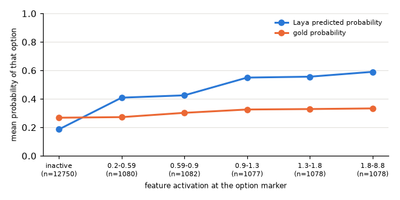

# Feature 723

Critérios em que aparece: attribution_toward_wrong

**Interpretação (preencher):** 

---

## Maiores ativações

**tr_customer_service_000202 / category** (choice, customer_service) | ativação 8.766 em `marcador` | opções ['account', 'billing', 'delivery', 'refund', 'technical'] | Laya: **technical** [0.002, 0.0, 0.0, 0.0, 0.998] | gabarito: **technical**

```
<bos> choice question: What is this customer conversation primarily about?<eos>
▸ <mask> account: Login, plan changes, profile or access management.
▸ <mask> billing: A charge, invoice, subscription or payment problem.
▸ <mask> delivery: Shipping, fulfilment or delivery of a physical item.
▸ <mask> refund: The customer is explicitly asking for money back.
▸ ⟦<mask>⟧ technical: The product or service is not working as expected.

<eos>

 {"account": {"lifetime_value_usd": 271, "prior_tickets_90d": 1, "seats": 1, "tenure_months": 11, "tier": "free"}, "thread": [{"role": "customer", "text": "Your new analytics dashboard stopped updating two hours ago, and I’ve been trying to get this fixed all day—this is unacceptable!"}, {"role": "agent", "text": "I understand your frustration. Can you tell me which browser and version you’re using, and whether you see any error messages?"}, {"role": "customer", "text": "I’m on Chrome 115, and the page just shows a blank screen with a 500 error. I need this working by tomorrow’s reporting deadline, so I expect a quick response."}]}<eos>
```

**tr_customer_service_000044 / category** (choice, customer_service) | ativação 8.609 em `marcador` | opções ['account', 'billing', 'delivery', 'refund', 'technical'] | Laya: **technical** [0.025, 0.019, 0.0, 0.001, 0.955] | gabarito: **account**

```
<bos> choice question: What is this customer conversation primarily about?<eos>
▸ <mask> account: Login, plan changes, profile or access management.
▸ <mask> billing: A charge, invoice, subscription or payment problem.
▸ <mask> delivery: Shipping, fulfilment or delivery of a physical item.
▸ <mask> refund: The customer is explicitly asking for money back.
▸ ⟦<mask>⟧ technical: The product or service is not working as expected.

<eos>

 {"account": {"lifetime_value_usd": 754, "prior_tickets_90d": 0, "seats": 1, "tenure_months": 8, "tier": "free"}, "orders": [{"amount_usd": 897, "date": "2026-03-17", "id": "A-13529", "status": "pending"}], "thread": [{"role": "customer", "text": "I've been trying to downgrade my account to the free tier for over an hour now and the dashboard just keeps looping me back to the billing page without saving the changes. I've already spent nearly $900 with you guys over the last eight months, and I shouldn't have to jump through hoops just to stop being charged."}, {"role": "agent", "text": "I'm sorry for the frustration you're experiencing with the downgrade process. To help me investigate why the system isn't processing your request, could you please specify if you're receiving a particular error code or if the page simply refreshes without an update?"}, {"role": "customer", "text": "There's no error code, it just flashes a message saying 'Action could not be completed at this time' and stays on the paid plan. It's ridiculous because I can see the $897 total in my billing history, so the system clearly knows who I am, but it won't let me move to the free plan."}, {"role": "agent", "text": "Thank you for clarifying that for me. I'll need to look into the back-end logs for your account to see what's triggering that message. Could you tell me which browser and version you are currently using, and if you have attempted the change from a different device?"}, {"role": "customer", "text": "I'm on the latest version of Chrome and I've already tried it on my phone too with the exact same result. I just want someone to actually look at my account and explain why the downgrade isn't sticking when I've been a customer here for months."}]}<eos>
```

**tr_customer_service_000243 / category** (choice, customer_service) | ativação 8.406 em `marcador` | opções ['account', 'billing', 'delivery', 'refund', 'technical'] | Laya: **technical** [0.0, 0.136, 0.0, 0.0, 0.864] | gabarito: **technical**

```
<bos> choice question: What is this customer conversation primarily about?<eos>
▸ <mask> account: Login, plan changes, profile or access management.
▸ <mask> billing: A charge, invoice, subscription or payment problem.
▸ <mask> delivery: Shipping, fulfilment or delivery of a physical item.
▸ <mask> refund: The customer is explicitly asking for money back.
▸ ⟦<mask>⟧ technical: The product or service is not working as expected.

<eos>

 {"account": {"lifetime_value_usd": 2942, "prior_tickets_90d": 0, "seats": 1, "tenure_months": 49, "tier": "standard"}, "orders": [{"amount_usd": 299, "date": "2026-01-20", "id": "A-16271", "status": "pending"}], "thread": [{"role": "customer", "text": "Look, I've been using this service for over four years now and I have never seen it this slow. Every time I try to load a report, the screen just hangs for nearly a minute. It’s making it impossible to get through my daily tasks."}, {"role": "agent", "text": "I understand how frustrating it is when the system isn't responsive. To better assist you, are you noticing this lag on all pages of the dashboard or just when running specific reports?"}, {"role": "customer", "text": "It’s pretty much everywhere, but the billing section is particularly painful. I spent almost $300 this month and I can't even view my own data without a massive delay. I've already tried restarting my router and it didn't help one bit."}, {"role": "agent", "text": "Thank you for that information. Could you please let me know if you are using a VPN or any specific browser extensions that might be active while you're accessing the site?"}, {"role": "customer", "text": "No VPN, just standard Chrome. I've even tried incognito mode and the performance is still abysmal. What are the next steps to get this actually looked at?"}]}<eos>
```

**tr_customer_service_000171 / category** (choice, customer_service) | ativação 8.234 em `marcador` | opções ['account', 'billing', 'delivery', 'refund', 'technical'] | Laya: **technical** [0.001, 0.0, 0.0, 0.0, 0.998] | gabarito: **technical**

```
<bos> choice question: What is this customer conversation primarily about?<eos>
▸ <mask> account: Login, plan changes, profile or access management.
▸ <mask> billing: A charge, invoice, subscription or payment problem.
▸ <mask> delivery: Shipping, fulfilment or delivery of a physical item.
▸ <mask> refund: The customer is explicitly asking for money back.
▸ ⟦<mask>⟧ technical: The product or service is not working as expected.

<eos>

 {"account": {"lifetime_value_usd": 2300, "prior_tickets_90d": 0, "seats": 1, "tenure_months": 26, "tier": "standard"}, "orders": [{"amount_usd": 49, "date": "2026-02-14", "id": "A-88180", "status": "refunded"}, {"amount_usd": 49, "date": "2026-02-22", "id": "A-79800", "status": "settled"}, {"amount_usd": 49, "date": "2026-02-08", "id": "A-91927", "status": "refunded"}], "thread": [{"role": "customer", "text": "The service is painfully slow right now—I'm on a deadline and can't get anything done."}, {"role": "agent", "text": "I hear the urgency. Can you tell me which device and operating system you’re using?"}, {"role": "customer", "text": "It’s a Windows 10 desktop, and the slowdown started after the latest update."}, {"role": "agent", "text": "Thanks for the details. Have you tried clearing the application cache or restarting the app?"}, {"role": "customer", "text": "Yes, I cleared everything and rebooted, but it’s still crawling. I need this resolved quickly."}]}<eos>
```

**tr_customer_service_000103 / category** (choice, customer_service) | ativação 8.195 em `marcador` | opções ['account', 'billing', 'delivery', 'refund', 'technical'] | Laya: **technical** [0.003, 0.0, 0.0, 0.0, 0.996] | gabarito: **technical**

```
<bos> choice question: What is this customer conversation primarily about?<eos>
▸ <mask> account: Login, plan changes, profile or access management.
▸ <mask> billing: A charge, invoice, subscription or payment problem.
▸ <mask> delivery: Shipping, fulfilment or delivery of a physical item.
▸ <mask> refund: The customer is explicitly asking for money back.
▸ ⟦<mask>⟧ technical: The product or service is not working as expected.

<eos>

 {"account": {"lifetime_value_usd": 3711, "prior_tickets_90d": 0, "seats": 1, "tenure_months": 41, "tier": "standard"}, "thread": [{"role": "customer", "text": "Your new analytics dashboard is completely broken – every time I click the export button the whole page crashes. I’ve been on the standard plan for over three years (41 months), and this is getting ridiculous. If it isn’t fixed soon I’ll have to cancel."}, {"role": "agent", "text": "I’m really sorry you’re experiencing that. Could you let me know which browser you’re using and whether you see any error messages when it crashes?"}, {"role": "customer", "text": "I’m on Chrome 115, and the console just says ‘Uncaught TypeError’. I need a fix ASAP, otherwise I’m leaving."}]}<eos>
```

## Ativações medianas (faixa 40-60%, mediana 1.134)

**tr_security_incidents_000227 / urgency** (score, security_incidents) | ativação 1.173 em `estado` | opções ['0', '1', '2', '3'] | Laya: **3** [0.157, 0.259, 0.267, 0.317] | gabarito: **3**

```
<bos> score question: How quickly must a responder act on this alert?<eos>
▸ <mask> level 0: No time pressure; can wait indefinitely.
▸ <mask> level 1: Routine; handle within the normal queue.
▸ <mask> level 2: Elevated; should be handled within the same week.
▸ <mask> level 3: Critical; requires action within the same day.

<eos>

 {"alert": {"description": "a large transfer to an external destination", "evidence": "A transfer of 4.2 GB of data was initiated to an unrecognized external IP address at 03:40 UTC. This activity was performed by a shared mailbox account that currently has MFA disabled.", "rule⟦":⟧ "data_egress"}, "context": {"asset_criticality": "low", "change_window_active": false, "source_on_allowlist": false}, "history": {"credential_rotation_days_ago": 30, "distinct_countries_30d": 4, "logins_30d": 1619, "prior_alerts_90d": 1}, "principal": {"mfa_enrolled": false, "name": "svc-support-910", "privileges": ["repo:read"], "type": "shared_mailbox"}}<eos>
```

**tr_invoice_processing_000000 / disposition** (choice, invoice_processing) | ativação 1.217 em `estado` | opções ['approve', 'hold', 'manual_review', 'reject'] | Laya: **reject** [0.237, 0.105, 0.016, 0.642] | gabarito: **manual_review**

```
<bos> choice question: How should this vendor invoice be dispositioned?<eos>
▸ <mask> approve: Matches the order and delivery; approve for payment.
▸ <mask> hold: Something needs confirming before payment; hold pending clarification.
▸ <mask> manual_review: A human in finance must review the discrepancy.
▸ <mask> reject: Should not be paid: duplicate, unauthorised or materially wrong.

<eos>

 {"delivery": {"condition": "accepted with exceptions", "date": "2026-03-18", "received_qty": 1000}, "invoice": {"currency": "USD", "id": "INV-2026-7551", "lines": [{"qty": 1000, "sku": "SKU-940", "total_usd": 300020.0, "unit_usd": 300.02}], "total_usd": 300020.0, "vendor": "Acme Fabrication"}, "payment": {"days_until_due": -3, "discount_expires_in_days": null, "early_payment_discount_pct": null, "status⟦":⟧ "overdue", "terms": "net 45"}, "purchase_order": {"freight_terms": "freight prepaid by vendor, not separately billable", "id": "PO-3392", "lines": [{"qty": 1000, "unit_usd": 214.3}], "total_usd": 214300.0}, "vendor_history": {"disputes_12m": 0, "invoices_12m": 40, "prior_invoice_ids": ["INV-2026-6633", "INV-2026-9563", "INV-2026-7939"]}}<eos>
```

**tr_security_incidents_000293 / disposition** (choice, security_incidents) | ativação 1.059 em `opção` | opções ['close_benign', 'contain', 'investigate', 'monitor'] | Laya: **monitor** [0.092, 0.202, 0.045, 0.661] | gabarito: **investigate**

```
<bos> choice question: How should this security alert be dispositioned?<eos>
▸ <mask> close_benign: Expected,⟦ explain⟧able activity; close without analyst time.
▸ <mask> contain: Contain the host or account immediately; do not wait for triage.
▸ <mask> investigate: Warrants an analyst opening an investigation.
▸ <mask> monitor: Not clearly malicious, but worth watching for recurrence.

<eos>

 {"alert": {"description": "a session token was presented from a second address", "evidence": "A single session token was used to access resources from two distinct, unrecognized IP addresses within a 15-minute span. While the user is a contractor currently operating within an active change window, the second connection originated from an unknown network source.", "rule": "token_reuse"}, "context": {"asset_criticality": "medium", "change_window_active": true, "source_on_allowlist": false}, "history": {"credential_rotation_days_ago": 30, "distinct_countries_30d": 2, "logins_30d": 1286, "prior_alerts_90d": 0}, "principal": {"mfa_enrolled": true, "name": "adm-deploy-459", "privileges": ["repo:read"], "type": "contractor"}}<eos>
```

**tr_customer_service_000130 / churn_risk** (score, customer_service) | ativação 0.986 em `opção` | opções ['0', '1', '2', '3'] | Laya: **2** [0.11, 0.239, 0.387, 0.264] | gabarito: **2**

```
<bos> score question: How likely is this customer to stop doing business with us because of this interaction?<eos>
▸ <mask> level 0: No sign of dissatisfaction.
▸ <mask> level 1: Mild frustration, but the relationship is intact.
▸ <mask> level 2⟦:⟧ Clearly unhappy; repeat problems or explicit complaints.
▸ <mask> level 3: Imminent: threatening to cancel, dispute or leave.

<eos>

 {"account": {"lifetime_value_usd": 84, "prior_tickets_90d": 1, "seats": 3, "tenure_months": 1, "tier": "premium"}, "orders": [{"amount_usd": 999, "date": "2026-01-07", "id": "A-49277", "status": "pending"}, {"amount_usd": 999, "date": "2026-01-14", "id": "A-26351", "status": "pending"}, {"amount_usd": 999, "date": "2026-03-12", "id": "A-14586", "status": "settled"}], "thread": [{"role": "customer", "text": "I can’t log into my premium account; the system keeps rejecting my password. I’ve only been with you for a month, paying $999, and after my last ticket was only half‑fixed, I’m stuck."}, {"role": "agent", "text": "I’m sorry you’re experiencing this. Could you tell me the exact error message you see and whether you’ve tried resetting your password?"}, {"role": "customer", "text": "The message says ‘Invalid credentials’ even after I used the ‘Forgot password’ link and followed the reset steps. I also tried from a different browser, same result."}, {"role": "agent", "text": "Thanks for the details. To rule out a possible lockout, could you let me know the time of your last successful login and the device you usually use?"}, {"role": "customer", "text": "My last successful login was yesterday around 2 pm on my workstation (Windows 10, Chrome). I haven’t logged in since the reset."}]}<eos>
```

**tr_invoice_processing_000022 / disposition** (choice, invoice_processing) | ativação 1.057 em `opção` | opções ['approve', 'hold', 'manual_review', 'reject'] | Laya: **reject** [0.359, 0.088, 0.023, 0.53] | gabarito: **hold**

```
<bos> choice question: How should this vendor invoice be dispositioned?<eos>
▸ <mask> approve: Matches the order⟦ and⟧ delivery; approve for payment.
▸ <mask> hold: Something needs confirming before payment; hold pending clarification.
▸ <mask> manual_review: A human in finance must review the discrepancy.
▸ <mask> reject: Should not be paid: duplicate, unauthorised or materially wrong.

<eos>

 {"delivery": {"condition": "accepted with exceptions", "date": "2026-03-26", "received_qty": 100}, "invoice": {"currency": "USD", "id": "INV-2026-5675", "lines": [{"qty": 100, "sku": "SKU-963", "total_usd": 36305.0, "unit_usd": 363.05}], "total_usd": 36305.0, "vendor": "Orbit Logistics"}, "payment": {"days_until_due": 0, "discount_expires_in_days": null, "early_payment_discount_pct": null, "status": "scheduled", "terms": "net 30"}, "purchase_order": {"freight_terms": "freight prepaid by vendor, not separately billable", "id": null, "lines": [{"qty": 100, "unit_usd": 363.05}], "total_usd": 36305.0}, "vendor_history": {"disputes_12m": 2, "invoices_12m": 56, "prior_invoice_ids": ["INV-2026-1608", "INV-2026-9071", "INV-2026-7901", "INV-2026-3913"]}}<eos>
```

## Estatísticas (conjunto de descoberta, dev e teste)

**pred / error**

| split | decisões | ativas | ativas e Laya errou | taxa | lift | q (BH) | OR (CMH) | q (CMH) |
|---|---|---|---|---|---|---|---|---|
| discovery | 5100 | 3182 | 2042 | 0.642 | 1.00 | 0.828 | 0.82 | 0.151 |
| dev | 900 | 586 | 407 | 0.695 | 1.03 | 0.165 | 1.12 | 0.839 |
| test | 2000 | 1247 | 804 | 0.645 | 0.99 | 0.633 | 1.06 | 0.911 |

**corr / error**

| split | decisões | ativas | ativas e Laya errou | taxa | lift | q (BH) | OR (CMH) | q (CMH) |
|---|---|---|---|---|---|---|---|---|
| discovery | 5100 | 1713 | 573 | 0.335 | 0.52 | 1.57e-231 | 0.19 | 7.14e-63 |
| dev | 900 | 271 | 92 | 0.339 | 0.51 | 2.41e-40 | 0.26 | 1.6e-05 |
| test | 2000 | 667 | 224 | 0.336 | 0.52 | 4.67e-93 | 0.20 | 1.1e-19 |

**state / error**

| split | decisões | ativas | ativas e Laya errou | taxa | lift | q (BH) | OR (CMH) | q (CMH) |
|---|---|---|---|---|---|---|---|---|
| discovery | 5100 | 5094 | 3279 | 0.644 | 1.00 | 1 | 0.80 | 0.931 |
| dev | 900 | 900 | 605 | 0.672 | 1.00 | 1 | nan | nan |
| test | 2000 | 1997 | 1298 | 0.650 | 1.00 | 0.805 | 0.00 | 0.667 |

**pred / probe_right_laya_wrong**

| split | decisões | ativas | ativas e Laya errou | taxa | lift | q (BH) | OR (CMH) | q (CMH) |
|---|---|---|---|---|---|---|---|---|
| discovery | 2932 | 1913 | 1135 | 0.593 | 0.98 | 0.108 | 0.60 | 0.000369 |
| dev | 523 | 362 | 239 | 0.660 | 1.02 | 0.538 | 0.91 | 0.87 |
| test | 1149 | 766 | 459 | 0.599 | 0.98 | 0.399 | 0.84 | 0.684 |

**corr / probe_right_laya_wrong**

| split | decisões | ativas | ativas e Laya errou | taxa | lift | q (BH) | OR (CMH) | q (CMH) |
|---|---|---|---|---|---|---|---|---|
| discovery | 2932 | 1076 | 298 | 0.277 | 0.46 | 1.93e-169 | 0.18 | 7.66e-32 |
| dev | 523 | 164 | 41 | 0.250 | 0.39 | 6.6e-35 | 0.24 | 0.011 |
| test | 1149 | 425 | 118 | 0.278 | 0.45 | 4.18e-69 | 0.21 | 4.3e-08 |

**state / probe_right_laya_wrong**

| split | decisões | ativas | ativas e Laya errou | taxa | lift | q (BH) | OR (CMH) | q (CMH) |
|---|---|---|---|---|---|---|---|---|
| discovery | 2932 | 2927 | 1772 | 0.605 | 1.00 | 1 | 0.97 | 0.987 |
| dev | 523 | 523 | 338 | 0.646 | 1.00 | 1 | nan | nan |
| test | 1149 | 1147 | 700 | 0.610 | 1.00 | 0.917 | 0.00 | 0.694 |

Confusão mais sobre-representada (pred): `duplicate|1>0` (n=213, lift 1.57, p=3.17e-39). Formato `pergunta|índice previsto>índice correto`.

Confusão mais sobre-representada (corr): `needs_review|0>1` (n=103, lift 2.92, p=0). Formato `pergunta|índice previsto>índice correto`.

Confusão mais sobre-representada (state): `duplicate|1>0` (n=217, lift 1.00, p=0.77). Formato `pergunta|índice previsto>índice correto`.



