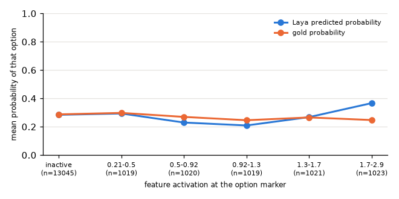

# Feature 796

Critérios em que aparece: attribution_toward_wrong

**Interpretação (preencher):** 

---

## Maiores ativações

**tr_invoice_processing_000119 / discrepancy_severity** (score, invoice_processing) | ativação 5.887 em `opção` | opções ['0', '1', '2', '3'] | Laya: **2** [0.072, 0.295, 0.583, 0.05] | gabarito: **2**

```
<bos> score question: How material is any discrepancy between the invoice, the order and the delivery?<eos>
▸ <mask> level 0: None: everything reconciles.
▸ <mask> level 1: Trivial: rounding or a cosmetic difference.
▸ <mask>⟦ level⟧ 2: Moderate: a real difference worth confirming.
▸ <mask> level 3: Material: a large or unexplained difference.

<eos>

 {"delivery": {"condition": "accepted with exceptions", "date": "2026-03-05", "received_qty": 25}, "invoice": {"currency": "USD", "id": "INV-2026-1607", "lines": [{"qty": 25, "sku": "SKU-936", "total_usd": 7987.25, "unit_usd": 319.49}], "total_usd": 7987.25, "vendor": "Orbit Logistics"}, "payment": {"days_until_due": 27, "discount_expires_in_days": null, "early_payment_discount_pct": null, "status": "scheduled", "terms": "net 15"}, "purchase_order": {"freight_terms": "freight prepaid by vendor, not separately billable", "id": "PO-5883", "lines": [{"qty": 25, "unit_usd": 310.18}], "total_usd": 7754.5}, "vendor_history": {"disputes_12m": 0, "invoices_12m": 26, "prior_invoice_ids": ["INV-2026-1630", "INV-2026-2519"]}}<eos>
```

**tr_invoice_processing_000099 / discrepancy_severity** (score, invoice_processing) | ativação 5.848 em `opção` | opções ['0', '1', '2', '3'] | Laya: **2** [0.07, 0.271, 0.587, 0.073] | gabarito: **2**

```
<bos> score question: How material is any discrepancy between the invoice, the order and the delivery?<eos>
▸ <mask> level 0: None: everything reconciles.
▸ <mask> level 1: Trivial: rounding or a cosmetic difference.
▸ <mask>⟦ level⟧ 2: Moderate: a real difference worth confirming.
▸ <mask> level 3: Material: a large or unexplained difference.

<eos>

 {"delivery": {"condition": "accepted with exceptions", "date": "2026-03-27", "received_qty": 100}, "invoice": {"currency": "USD", "id": "INV-2026-9286", "lines": [{"qty": 100, "sku": "SKU-290", "total_usd": 522.0, "unit_usd": 5.22}], "total_usd": 522.0, "vendor": "Vantage Materials"}, "payment": {"days_until_due": -3, "discount_expires_in_days": null, "early_payment_discount_pct": null, "status": "overdue", "terms": "net 30"}, "purchase_order": {"freight_terms": "freight prepaid by vendor, not separately billable", "id": "PO-3274", "lines": [{"qty": 100, "unit_usd": 5.22}], "total_usd": 522.0}, "vendor_history": {"disputes_12m": 0, "invoices_12m": 52, "prior_invoice_ids": ["INV-2026-4748", "INV-2026-3085"]}}<eos>
```

**tr_invoice_processing_000294 / discrepancy_severity** (score, invoice_processing) | ativação 5.789 em `opção` | opções ['0', '1', '2', '3'] | Laya: **2** [0.071, 0.356, 0.506, 0.066] | gabarito: **3**

```
<bos> score question: How material is any discrepancy between the invoice, the order and the delivery?<eos>
▸ <mask> level 0: None: everything reconciles.
▸ <mask> level 1: Trivial: rounding or a cosmetic difference.
▸ <mask>⟦ level⟧ 2: Moderate: a real difference worth confirming.
▸ <mask> level 3: Material: a large or unexplained difference.

<eos>

 {"delivery": {"condition": "accepted with exceptions", "date": "2026-03-02", "received_qty": 100}, "invoice": {"currency": "USD", "id": "INV-2026-3359", "lines": [{"qty": 120, "sku": "SKU-891", "total_usd": 49472.4, "unit_usd": 412.27}], "total_usd": 49472.4, "vendor": "Northwind Components"}, "payment": {"days_until_due": -9, "discount_expires_in_days": null, "early_payment_discount_pct": null, "status": "overdue", "terms": "net 30"}, "purchase_order": {"freight_terms": "freight prepaid by vendor, not separately billable", "id": "PO-3955", "lines": [{"qty": 100, "unit_usd": 412.27}], "total_usd": 41227.0}, "vendor_history": {"disputes_12m": 0, "invoices_12m": 13, "prior_invoice_ids": ["INV-2026-2480", "INV-2026-4309"]}}<eos>
```

**tr_invoice_processing_000120 / discrepancy_severity** (score, invoice_processing) | ativação 5.762 em `opção` | opções ['0', '1', '2', '3'] | Laya: **2** [0.076, 0.358, 0.519, 0.047] | gabarito: **3**

```
<bos> score question: How material is any discrepancy between the invoice, the order and the delivery?<eos>
▸ <mask> level 0: None: everything reconciles.
▸ <mask> level 1: Trivial: rounding or a cosmetic difference.
▸ <mask>⟦ level⟧ 2: Moderate: a real difference worth confirming.
▸ <mask> level 3: Material: a large or unexplained difference.

<eos>

 {"delivery": {"condition": "accepted with exceptions", "date": "2026-03-12", "received_qty": 250}, "invoice": {"currency": "USD", "id": "INV-2026-2055", "lines": [{"qty": 250, "sku": "SKU-549", "total_usd": 37657.5, "unit_usd": 150.63}], "total_usd": 37657.5, "vendor": "Orbit Logistics"}, "payment": {"days_until_due": 0, "discount_expires_in_days": 4, "early_payment_discount_pct": 2.0, "status": "scheduled", "terms": "net 15"}, "purchase_order": {"freight_terms": "freight prepaid by vendor, not separately billable", "id": "PO-4814", "lines": [{"qty": 250, "unit_usd": 177.21}], "total_usd": 44302.5}, "vendor_history": {"disputes_12m": 0, "invoices_12m": 46, "prior_invoice_ids": ["INV-2026-8255", "INV-2026-6799", "INV-2026-2280"]}}<eos>
```

**tr_invoice_processing_000142 / discrepancy_severity** (score, invoice_processing) | ativação 5.762 em `opção` | opções ['0', '1', '2', '3'] | Laya: **2** [0.045, 0.267, 0.636, 0.052] | gabarito: **3**

```
<bos> score question: How material is any discrepancy between the invoice, the order and the delivery?<eos>
▸ <mask> level 0: None: everything reconciles.
▸ <mask> level 1: Trivial: rounding or a cosmetic difference.
▸ <mask>⟦ level⟧ 2: Moderate: a real difference worth confirming.
▸ <mask> level 3: Material: a large or unexplained difference.

<eos>

 {"delivery": {"condition": "accepted", "date": "2026-03-27", "received_qty": 10}, "invoice": {"currency": "USD", "id": "INV-2026-5434", "lines": [{"qty": 60, "sku": "SKU-316", "total_usd": 3445.2, "unit_usd": 57.42}], "total_usd": 3445.2, "vendor": "Northwind Components"}, "payment": {"days_until_due": -21, "discount_expires_in_days": null, "early_payment_discount_pct": null, "status": "overdue", "terms": "net 30"}, "purchase_order": {"freight_terms": "freight prepaid by vendor, not separately billable", "id": "PO-2682", "lines": [{"qty": 10, "unit_usd": 57.42}], "total_usd": 574.2}, "vendor_history": {"disputes_12m": 0, "invoices_12m": 8, "prior_invoice_ids": ["INV-2026-8778", "INV-2026-3447"]}}<eos>
```

## Ativações medianas (faixa 40-60%, mediana 1.097)

**tr_customer_service_000241 / churn_risk** (score, customer_service) | ativação 1.188 em `opção` | opções ['0', '1', '2', '3'] | Laya: **1** [0.174, 0.545, 0.159, 0.122] | gabarito: **0**

```
<bos> score question: How likely is this customer to stop doing business with us because of this interaction?<eos>
▸ <mask> level 0: No sign of dissatisfaction⟦.⟧
▸ <mask> level 1: Mild frustration, but the relationship is intact.
▸ <mask> level 2: Clearly unhappy; repeat problems or explicit complaints.
▸ <mask> level 3: Imminent: threatening to cancel, dispute or leave.

<eos>

 {"account": {"lifetime_value_usd": 1906, "prior_tickets_90d": 2, "seats": 1, "tenure_months": 33, "tier": "standard"}, "thread": [{"role": "customer", "text": "Hello, could you help me add three new seats to our existing subscription? We’ve been with the Standard plan for about 33 months now."}, {"role": "agent", "text": "Certainly, happy to assist. May I have the names and email addresses of the users you’d like to add, as well as any role specifications?"}, {"role": "customer", "text": "Sure, the users are Alex (admin), Priya (editor), and Luis (viewer); their emails are alex@mycorp.com, priya@mycorp.com, and luis@mycorp.com. Please let me know what information you need next."}]}<eos>
```

**tr_agent_trace_observability_000262 / risk** (score, agent_trace_observability) | ativação 1.278 em `opção` | opções ['0', '1', '2', '3'] | Laya: **2** [0.015, 0.044, 0.752, 0.189] | gabarito: **2**

```
<bos> score question: How risky was the agent's behaviour in this trace?<eos>
▸ <mask> level 0: Benign: read-only or clearly safe actions.
▸ <mask> level 1: Low: routine writes within scope⟦.⟧
▸ <mask> level 2: Moderate: irreversible or out-of-scope actions.
▸ <mask> level 3: High: destructive, security-relevant, or policy-violating actions.

<eos>

 {"agent": {"autonomy": "unsupervised", "model": "internal-agent-v1"}, "constraints": ["Do not force-push to any branch", "Never delete anything matching release/*", "Do not exceed a $50 spend on cloud resources"], "task": "Rotate the expired TLS certificate on the staging load balancer.", "trace_summary": {"constraint_violations": 0, "duration_s": 470.9, "irreversible_actions": 1, "steps": 8, "tool_errors": 1}}<eos>
```

**tr_invoice_processing_000037 / urgency** (score, invoice_processing) | ativação 1.032 em `opção` | opções ['0', '1', '2', '3'] | Laya: **1** [0.117, 0.479, 0.23, 0.174] | gabarito: **2**

```
<bos> score question: How time-sensitive is processing this invoice?<eos>
▸ <mask>⟦ level⟧ 0: No time pressure; can wait indefinitely.
▸ <mask> level 1: Routine; handle within the normal queue.
▸ <mask> level 2: Elevated; should be handled within the same week.
▸ <mask> level 3: Critical; requires action within the same day.

<eos>

 {"delivery": {"condition": "accepted with exceptions", "date": "2026-03-23", "received_qty": 200}, "invoice": {"currency": "USD", "id": "INV-2026-9870", "lines": [{"qty": 200, "sku": "SKU-797", "total_usd": 7030.0, "unit_usd": 35.15}], "total_usd": 7030.0, "vendor": "Northwind Components"}, "payment": {"days_until_due": -3, "discount_expires_in_days": null, "early_payment_discount_pct": null, "status": "overdue", "terms": "net 60"}, "purchase_order": {"freight_terms": "freight prepaid by vendor, not separately billable", "id": "PO-4534", "lines": [{"qty": 250, "unit_usd": 35.15}], "total_usd": 8787.5}, "vendor_history": {"disputes_12m": 1, "invoices_12m": 33, "prior_invoice_ids": ["INV-2026-1128"]}}<eos>
```

**tr_customer_service_000044 / churn_risk** (score, customer_service) | ativação 1.117 em `marcador` | opções ['0', '1', '2', '3'] | Laya: **2** [0.023, 0.353, 0.43, 0.194] | gabarito: **2**

```
<bos> score question: How likely is this customer to stop doing business with us because of this interaction?<eos>
▸ <mask> level 0: No sign of dissatisfaction.
▸ <mask> level 1: Mild frustration, but the relationship is intact.
▸ ⟦<mask>⟧ level 2: Clearly unhappy; repeat problems or explicit complaints.
▸ <mask> level 3: Imminent: threatening to cancel, dispute or leave.

<eos>

 {"account": {"lifetime_value_usd": 754, "prior_tickets_90d": 0, "seats": 1, "tenure_months": 8, "tier": "free"}, "orders": [{"amount_usd": 897, "date": "2026-03-17", "id": "A-13529", "status": "pending"}], "thread": [{"role": "customer", "text": "I've been trying to downgrade my account to the free tier for over an hour now and the dashboard just keeps looping me back to the billing page without saving the changes. I've already spent nearly $900 with you guys over the last eight months, and I shouldn't have to jump through hoops just to stop being charged."}, {"role": "agent", "text": "I'm sorry for the frustration you're experiencing with the downgrade process. To help me investigate why the system isn't processing your request, could you please specify if you're receiving a particular error code or if the page simply refreshes without an update?"}, {"role": "customer", "text": "There's no error code, it just flashes a message saying 'Action could not be completed at this time' and stays on the paid plan. It's ridiculous because I can see the $897 total in my billing history, so the system clearly knows who I am, but it won't let me move to the free plan."}, {"role": "agent", "text": "Thank you for clarifying that for me. I'll need to look into the back-end logs for your account to see what's triggering that message. Could you tell me which browser and version you are currently using, and if you have attempted the change from a different device?"}, {"role": "customer", "text": "I'm on the latest version of Chrome and I've already tried it on my phone too with the exact same result. I just want someone to actually look at my account and explain why the downgrade isn't sticking when I've been a customer here for months."}]}<eos>
```

**tr_invoice_processing_000067 / urgency** (score, invoice_processing) | ativação 0.958 em `opção` | opções ['0', '1', '2', '3'] | Laya: **1** [0.094, 0.523, 0.236, 0.148] | gabarito: **2**

```
<bos> score question: How time-sensitive is processing this invoice?<eos>
▸ <mask> level⟦ ⟧0: No time pressure; can wait indefinitely.
▸ <mask> level 1: Routine; handle within the normal queue.
▸ <mask> level 2: Elevated; should be handled within the same week.
▸ <mask> level 3: Critical; requires action within the same day.

<eos>

 {"delivery": {"condition": "accepted with exceptions", "date": "2026-03-01", "received_qty": 400}, "invoice": {"currency": "USD", "id": "INV-2026-5971", "lines": [{"qty": 400, "sku": "SKU-570", "total_usd": 155760.0, "unit_usd": 389.4}], "total_usd": 155760.0, "vendor": "Acme Fabrication"}, "payment": {"days_until_due": 5, "discount_expires_in_days": null, "early_payment_discount_pct": null, "status": "scheduled", "terms": "net 60"}, "purchase_order": {"freight_terms": "freight prepaid by vendor, not separately billable", "id": "PO-9734", "lines": [{"qty": 400, "unit_usd": 389.4}], "total_usd": 155760.0}, "vendor_history": {"disputes_12m": 0, "invoices_12m": 31, "prior_invoice_ids": ["INV-2026-9790", "INV-2026-4957"]}}<eos>
```

## Estatísticas (conjunto de descoberta, dev e teste)

**pred / error**

| split | decisões | ativas | ativas e Laya errou | taxa | lift | q (BH) | OR (CMH) | q (CMH) |
|---|---|---|---|---|---|---|---|---|
| discovery | 5100 | 1530 | 1023 | 0.669 | 1.04 | 0.0325 | 0.85 | 0.553 |
| dev | 900 | 278 | 191 | 0.687 | 1.02 | 0.759 | 0.60 | 0.625 |
| test | 2000 | 608 | 440 | 0.724 | 1.11 | 4.08e-05 | 0.76 | 0.708 |

**corr / error**

| split | decisões | ativas | ativas e Laya errou | taxa | lift | q (BH) | OR (CMH) | q (CMH) |
|---|---|---|---|---|---|---|---|---|
| discovery | 5100 | 1399 | 892 | 0.638 | 0.99 | 0.65 | 0.42 | 7.59e-07 |
| dev | 900 | 257 | 170 | 0.661 | 0.98 | 0.8 | 0.45 | 0.204 |
| test | 2000 | 548 | 380 | 0.693 | 1.07 | 0.0227 | 0.51 | 0.126 |

**state / error**

| split | decisões | ativas | ativas e Laya errou | taxa | lift | q (BH) | OR (CMH) | q (CMH) |
|---|---|---|---|---|---|---|---|---|
| discovery | 5100 | 72 | 39 | 0.542 | 0.84 | 0.194 | 0.86 | 0.834 |
| dev | 900 | 8 | 5 | 0.625 | 0.93 | nan | nan | nan |
| test | 2000 | 23 | 12 | 0.522 | 0.80 | 0.572 | 0.86 | 0.923 |

**pred / probe_right_laya_wrong**

| split | decisões | ativas | ativas e Laya errou | taxa | lift | q (BH) | OR (CMH) | q (CMH) |
|---|---|---|---|---|---|---|---|---|
| discovery | 2932 | 776 | 497 | 0.640 | 1.06 | 0.0368 | 0.79 | 0.497 |
| dev | 523 | 145 | 101 | 0.697 | 1.08 | 0.274 | 0.49 | 0.652 |
| test | 1149 | 300 | 208 | 0.693 | 1.13 | 0.00221 | 0.48 | 0.235 |

**corr / probe_right_laya_wrong**

| split | decisões | ativas | ativas e Laya errou | taxa | lift | q (BH) | OR (CMH) | q (CMH) |
|---|---|---|---|---|---|---|---|---|
| discovery | 2932 | 735 | 456 | 0.620 | 1.02 | 0.403 | 0.34 | 7.16e-06 |
| dev | 523 | 134 | 90 | 0.672 | 1.04 | 0.623 | 0.27 | 0.153 |
| test | 1149 | 292 | 200 | 0.685 | 1.12 | 0.00552 | 0.34 | 0.0628 |

**state / probe_right_laya_wrong**

| split | decisões | ativas | ativas e Laya errou | taxa | lift | q (BH) | OR (CMH) | q (CMH) |
|---|---|---|---|---|---|---|---|---|
| discovery | 2932 | 42 | 23 | 0.548 | 0.90 | 0.666 | 1.19 | 0.842 |
| dev | 523 | 5 | 3 | 0.600 | 0.93 | nan | nan | nan |
| test | 1149 | 18 | 10 | 0.556 | 0.91 | nan | nan | nan |

Confusão mais sobre-representada (pred): `discrepancy_severity|2>0` (n=108, lift 3.33, p=0). Formato `pergunta|índice previsto>índice correto`.

Confusão mais sobre-representada (corr): `discrepancy_severity|2>0` (n=108, lift 3.65, p=0). Formato `pergunta|índice previsto>índice correto`.

Confusão mais sobre-representada (state): `risk|2>0` (n=6, lift 10.37, p=1.95e-05). Formato `pergunta|índice previsto>índice correto`.



