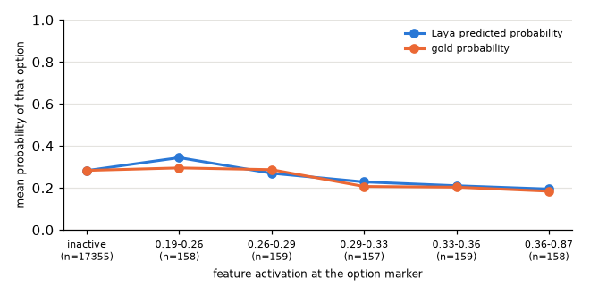

# Feature 898

Critérios em que aparece: corr_error_stratified, corr_probe_right_laya_wrong_stratified

**Interpretação (preencher):** 

---

## Maiores ativações

**tr_customer_service_000175 / action** (choice, customer_service) | ativação 2.543 em `estado` | opções ['answer_directly', 'close_no_action', 'escalate_to_human', 'execute_refund', 'request_information'] | Laya: **close_no_action** [0.37, 0.416, 0.023, 0.183, 0.008] | gabarito: **escalate_to_human**

```
<bos> choice question: What should the assistant do next with this conversation?<eos>
▸ <mask> answer_directly: The assistant can resolve this itself with information it already has.
▸ <mask> close_no_action: No further action is warranted; the matter is settled.
▸ <mask> escalate_to_human: Hand off to a human agent with the appropriate authority.
▸ <mask> execute_refund: Issue the refund or credit the customer is owed.
▸ <mask> request_information: More detail is needed from the customer before anything can be done.

<eos>

 {"account": {"lifetime_value_usd": 133, "prior_tickets_90d": 1, "seats": 40, "tenure_months": 8, "tier": "enterprise"}, "orders": [{"amount_usd": 149, "date": "2026-01-04", "id": "A-23809", "status": "settled"}, {"amount_usd": 149, "date": "2026-01-20", "id": "A-52054", "status": "refunded"}], "thread": [{"role": "customer", "text": "I just opened my enterprise delivery and it is the completely wrong item. After the last issue with the missing shipment, I guess I shouldn't be surprised that this is happening again."}, {"role": "agent", "text": "I am very sorry to hear that you received the incorrect item. Could you please provide the order number and describe the item you received instead?"}, {"role": "customer", "text": "The order number is #88291. It was supposed to be the $149 hardware kit, but I got a box⟦ of⟧ cables instead. I need the correct items by Friday morning at the latest."}, {"role": "agent", "text": "Thank you for those details. I've noted the discrepancy regarding the hardware kit. Could you please send over a photo of the packing slip that was included in the box?"}, {"role": "customer", "text": "I've attached the photo to this message. I really hope we can get this resolved before my event starts."}]}<eos>
```

**tr_customer_service_000265 / urgency** (score, customer_service) | ativação 2.537 em `estado` | opções ['0', '1', '2', '3'] | Laya: **1** [0.05, 0.459, 0.366, 0.125] | gabarito: **2**

```
<bos> score question: How time-sensitive is this conversation?<eos>
▸ <mask> level 0: No time pressure; can wait indefinitely.
▸ <mask> level 1: Routine; handle within the normal queue.
▸ <mask> level 2: Elevated; should be handled within the same week.
▸ <mask> level 3: Critical; requires action within the same day.

<eos>

 {"account": {"lifetime_value_usd": 379, "prior_tickets_90d": 3, "seats": 5, "tenure_months": 11, "tier": "premium"}, "orders": [{"amount_usd": 999, "date": "2026-02-26", "id": "A-44178", "status": "settled"}, {"amount_usd": 999, "date": "2026-02-11", "id": "A-78032", "status": "settled"}, {"amount_usd": 999, "date": "2026-03-13", "id": "A-48014", "status": "pending"}], "thread": [{"role": "customer", "text": "My premium subscription delivery arrived today, but I received the wrong item. It’s the $999 package, but it’s completely different from what I ordered."}, {"role": "agent", "text": "I see you have been with us for nearly a year, and I appreciate you bringing this discrepancy to our attention. To assist you further, could you please provide the order number and describe the item you actually received?"}, {"role": "customer", "text": "The order number is #88291. I was expecting the professional hardware kit, but the box I opened contained a set⟦ of⟧ basic cabling accessories instead."}, {"role": "agent", "text": "Thank you for providing those details. I am reviewing the shipping manifest for that specific order number now; would you be able to upload a photo of the packing slip that was included in the box?"}, {"role": "customer", "text": "I’ve attached the photo of the slip to this chat. I just need to know how we’re going to handle this mix-up."}]}<eos>
```

**tr_customer_service_000175 / category** (choice, customer_service) | ativação 2.480 em `estado` | opções ['account', 'billing', 'delivery', 'refund', 'technical'] | Laya: **delivery** [0.0, 0.0, 1.0, 0.0, 0.0] | gabarito: **delivery**

```
<bos> choice question: What is this customer conversation primarily about?<eos>
▸ <mask> account: Login, plan changes, profile or access management.
▸ <mask> billing: A charge, invoice, subscription or payment problem.
▸ <mask> delivery: Shipping, fulfilment or delivery of a physical item.
▸ <mask> refund: The customer is explicitly asking for money back.
▸ <mask> technical: The product or service is not working as expected.

<eos>

 {"account": {"lifetime_value_usd": 133, "prior_tickets_90d": 1, "seats": 40, "tenure_months": 8, "tier": "enterprise"}, "orders": [{"amount_usd": 149, "date": "2026-01-04", "id": "A-23809", "status": "settled"}, {"amount_usd": 149, "date": "2026-01-20", "id": "A-52054", "status": "refunded"}], "thread": [{"role": "customer", "text": "I just opened my enterprise delivery and it is the completely wrong item. After the last issue with the missing shipment, I guess I shouldn't be surprised that this is happening again."}, {"role": "agent", "text": "I am very sorry to hear that you received the incorrect item. Could you please provide the order number and describe the item you received instead?"}, {"role": "customer", "text": "The order number is #88291. It was supposed to be the $149 hardware kit, but I got a box⟦ of⟧ cables instead. I need the correct items by Friday morning at the latest."}, {"role": "agent", "text": "Thank you for those details. I've noted the discrepancy regarding the hardware kit. Could you please send over a photo of the packing slip that was included in the box?"}, {"role": "customer", "text": "I've attached the photo to this message. I really hope we can get this resolved before my event starts."}]}<eos>
```

**tr_customer_service_000265 / category** (choice, customer_service) | ativação 2.471 em `estado` | opções ['account', 'billing', 'delivery', 'refund', 'technical'] | Laya: **delivery** [0.0, 0.0, 1.0, 0.0, 0.0] | gabarito: **delivery**

```
<bos> choice question: What is this customer conversation primarily about?<eos>
▸ <mask> account: Login, plan changes, profile or access management.
▸ <mask> billing: A charge, invoice, subscription or payment problem.
▸ <mask> delivery: Shipping, fulfilment or delivery of a physical item.
▸ <mask> refund: The customer is explicitly asking for money back.
▸ <mask> technical: The product or service is not working as expected.

<eos>

 {"account": {"lifetime_value_usd": 379, "prior_tickets_90d": 3, "seats": 5, "tenure_months": 11, "tier": "premium"}, "orders": [{"amount_usd": 999, "date": "2026-02-26", "id": "A-44178", "status": "settled"}, {"amount_usd": 999, "date": "2026-02-11", "id": "A-78032", "status": "settled"}, {"amount_usd": 999, "date": "2026-03-13", "id": "A-48014", "status": "pending"}], "thread": [{"role": "customer", "text": "My premium subscription delivery arrived today, but I received the wrong item. It’s the $999 package, but it’s completely different from what I ordered."}, {"role": "agent", "text": "I see you have been with us for nearly a year, and I appreciate you bringing this discrepancy to our attention. To assist you further, could you please provide the order number and describe the item you actually received?"}, {"role": "customer", "text": "The order number is #88291. I was expecting the professional hardware kit, but the box I opened contained a set⟦ of⟧ basic cabling accessories instead."}, {"role": "agent", "text": "Thank you for providing those details. I am reviewing the shipping manifest for that specific order number now; would you be able to upload a photo of the packing slip that was included in the box?"}, {"role": "customer", "text": "I’ve attached the photo of the slip to this chat. I just need to know how we’re going to handle this mix-up."}]}<eos>
```

**tr_customer_service_000175 / needs_human** (noul, customer_service) | ativação 2.445 em `estado` | opções ['false', 'true'] | Laya: **false** [0.678, 0.322] | gabarito: **true**

```
<bos> noul question: This conversation requires a human agent rather than automated handling.<eos>
▸ <mask> false: Automation can carry this to resolution.
▸ <mask> true: A human must take over: judgement, authority or empathy is required.

<eos>

 {"account": {"lifetime_value_usd": 133, "prior_tickets_90d": 1, "seats": 40, "tenure_months": 8, "tier": "enterprise"}, "orders": [{"amount_usd": 149, "date": "2026-01-04", "id": "A-23809", "status": "settled"}, {"amount_usd": 149, "date": "2026-01-20", "id": "A-52054", "status": "refunded"}], "thread": [{"role": "customer", "text": "I just opened my enterprise delivery and it is the completely wrong item. After the last issue with the missing shipment, I guess I shouldn't be surprised that this is happening again."}, {"role": "agent", "text": "I am very sorry to hear that you received the incorrect item. Could you please provide the order number and describe the item you received instead?"}, {"role": "customer", "text": "The order number is #88291. It was supposed to be the $149 hardware kit, but I got a box⟦ of⟧ cables instead. I need the correct items by Friday morning at the latest."}, {"role": "agent", "text": "Thank you for those details. I've noted the discrepancy regarding the hardware kit. Could you please send over a photo of the packing slip that was included in the box?"}, {"role": "customer", "text": "I've attached the photo to this message. I really hope we can get this resolved before my event starts."}]}<eos>
```

## Ativações medianas (faixa 40-60%, mediana 0.452)

**tr_security_incidents_000167 / disposition** (choice, security_incidents) | ativação 0.430 em `estado` | opções ['close_benign', 'contain', 'investigate', 'monitor'] | Laya: **monitor** [0.102, 0.296, 0.026, 0.575] | gabarito: **monitor**

```
<bos> choice question: How should this security alert be dispositioned?<eos>
▸ <mask> close_benign: Expected, explainable activity; close without analyst time.
▸ <mask> contain: Contain the host or account immediately; do not wait for triage.
▸ <mask> investigate: Warrants an analyst opening an investigation.
▸ <mask> monitor: Not clearly malicious, but worth watching for recurrence.

<eos>

 {"alert": {"description": "a first-ever sign-in from an unfamiliar country", "evidence": "A VPN login for employee alice.smith was recorded at 2026-09-13 09:03 UTC from IP 45.90.28.11, located in Reykjavik, Iceland – the first sign‑in from that country for this user. The authentication succeeded with MFA. The employee’s password was last rotated 180 days prior.", "rule": "new_country_login"}, "context": {"asset⟦_⟧criticality": "crown_jewel", "change_window_active": false, "source_on_allowlist": true}, "history": {"credential_rotation_days_ago": 180, "distinct_countries_30d": 3, "logins_30d": 1877, "prior_alerts_90d": 1}, "principal": {"mfa_enrolled": true, "name": "ci-billing-107", "privileges": ["repo:read"], "type": "employee"}}<eos>
```

**tr_security_incidents_000253 / urgency** (score, security_incidents) | ativação 0.404 em `marcador` | opções ['0', '1', '2', '3'] | Laya: **1** [0.098, 0.37, 0.162, 0.37] | gabarito: **2**

```
<bos> score question: How quickly must a responder act on this alert?<eos>
▸ <mask> level 0: No time pressure; can wait indefinitely.
▸ ⟦<mask>⟧ level 1: Routine; handle within the normal queue.
▸ <mask> level 2: Elevated; should be handled within the same week.
▸ <mask> level 3: Critical; requires action within the same day.

<eos>

 {"alert": {"description": "an unusual volume of files read in a short window", "evidence": "Between 02:00 and 02:05 UTC on 2026‑09‑16, the privileged service account \"svc_data\" invoked \"backup.exe\" and generated 3,428 distinct file‑read operations on the shared storage server. The activity originated from an unrecognized source, occurred during an open change window, and the account's credentials have not been rotated for 412 days.", "rule": "mass_download"}, "context": {"asset_criticality": "low", "change_window_active": true, "source_on_allowlist": false}, "history": {"credential_rotation_days_ago": 412, "distinct_countries_30d": 3, "logins_30d": 183, "prior_alerts_90d": 0}, "principal": {"mfa_enrolled": false, "name": "svc-billing-689", "privileges": ["deploy:production", "secrets:read"], "type": "service_account"}}<eos>
```

**tr_invoice_processing_000208 / duplicate** (noul, invoice_processing) | ativação 0.499 em `estado` | opções ['false', 'true'] | Laya: **true** [0.012, 0.988] | gabarito: **false**

```
<bos> noul question: This invoice appears to duplicate an invoice already submitted.<eos>
▸ <mask> false: no, the statement does not hold
▸ <mask> true: yes, the statement holds

<eos>

 {"delivery": {"condition": "accepted", "date": "2026-03-19", "received_qty": 10}, "invoice": {"currency": "USD", "id": "INV-2026-6082", "lines": [{"qty": 10, "sku": "SKU-170", "total_usd": 1515.9, "unit_usd": 151.59}], "total_usd": 1515.9, "vendor": "Orbit Logistics"}, "payment": {"days_until_due": -9, "discount_expires_in_days": null, "early_payment_discount_pct": null, "status": "overdue", "terms": "net 45"}, "purchase_order": {"freight_terms":⟦ "⟧freight prepaid by vendor, not separately billable", "id": "PO-4990", "lines": [{"qty": 10, "unit_usd": 151.59}], "total_usd": 1515.9}, "vendor_history": {"disputes_12m": 0, "invoices_12m": 22, "prior_invoice_ids": ["INV-2026-4660"]}}<eos>
```

**tr_security_incidents_000050 / urgency** (score, security_incidents) | ativação 0.456 em `marcador` | opções ['0', '1', '2', '3'] | Laya: **2** [0.086, 0.122, 0.516, 0.276] | gabarito: **0**

```
<bos> score question: How quickly must a responder act on this alert?<eos>
▸ <mask> level 0: No time pressure; can wait indefinitely.
▸ ⟦<mask>⟧ level 1: Routine; handle within the normal queue.
▸ <mask> level 2: Elevated; should be handled within the same week.
▸ <mask> level 3: Critical; requires action within the same day.

<eos>

 {"alert": {"description": "an account granted itself or received elevated permissions", "evidence": "A privileged CI runner originating from an allowlisted source successfully executed a permission elevation during an open change window. The event was authenticated via MFA and occurred 90 days after the service principal's credentials were last updated.", "rule": "privilege_escalation"}, "context": {"asset_criticality": "medium", "change_window_active": true, "source_on_allowlist": true}, "history": {"credential_rotation_days_ago": 90, "distinct_countries_30d": 1, "logins_30d": 1520, "prior_alerts_90d": 0}, "principal": {"mfa_enrolled": true, "name": "ci-deploy-858", "privileges": ["deploy:production", "secrets:read"], "type": "ci_runner"}}<eos>
```

**tr_security_incidents_000248 / disposition** (choice, security_incidents) | ativação 0.475 em `estado` | opções ['close_benign', 'contain', 'investigate', 'monitor'] | Laya: **monitor** [0.074, 0.054, 0.219, 0.653] | gabarito: **investigate**

```
<bos> choice question: How should this security alert be dispositioned?<eos>
▸ <mask> close_benign: Expected, explainable activity; close without analyst time.
▸ <mask> contain: Contain the host or account immediately; do not wait for triage.
▸ <mask> investigate: Warrants an analyst opening an investigation.
▸ <mask> monitor: Not clearly malicious, but worth watching for recurrence.

<eos>

 {"alert": {"description": "a security group was opened to the public internet", "evidence": "A security group configuration was modified to allow inbound traffic from the 0.0.0.0/0 CIDR block at 14:22 UTC. The modification was initiated by an unrecognized source using an unprivileged service account, with no corresponding record in the change management log.", "rule": "config_drift"}, "context": {"asset⟦_⟧criticality": "medium", "change_window_active": false, "source_on_allowlist": false}, "history": {"credential_rotation_days_ago": 180, "distinct_countries_30d": 1, "logins_30d": 1240, "prior_alerts_90d": 0}, "principal": {"mfa_enrolled": true, "name": "svc-infra-709", "privileges": ["repo:read"], "type": "service_account"}}<eos>
```

## Estatísticas (conjunto de descoberta, dev e teste)

**pred / error**

| split | decisões | ativas | ativas e Laya errou | taxa | lift | q (BH) | OR (CMH) | q (CMH) |
|---|---|---|---|---|---|---|---|---|
| discovery | 5100 | 208 | 138 | 0.663 | 1.03 | 0.718 | 1.18 | 0.631 |
| dev | 900 | 38 | 25 | 0.658 | 0.98 | 1 | 0.99 | 0.997 |
| test | 2000 | 86 | 61 | 0.709 | 1.09 | 0.392 | 1.32 | 0.71 |

**corr / error**

| split | decisões | ativas | ativas e Laya errou | taxa | lift | q (BH) | OR (CMH) | q (CMH) |
|---|---|---|---|---|---|---|---|---|
| discovery | 5100 | 188 | 118 | 0.628 | 0.98 | 0.742 | 2.70 | 1.42e-06 |
| dev | 900 | 38 | 25 | 0.658 | 0.98 | 1 | 3.94 | 0.0432 |
| test | 2000 | 66 | 41 | 0.621 | 0.95 | 0.758 | 2.90 | 0.011 |

**state / error**

| split | decisões | ativas | ativas e Laya errou | taxa | lift | q (BH) | OR (CMH) | q (CMH) |
|---|---|---|---|---|---|---|---|---|
| discovery | 5100 | 2071 | 1306 | 0.631 | 0.98 | 0.224 | 0.82 | 0.054 |
| dev | 900 | 406 | 272 | 0.670 | 1.00 | 1 | 0.89 | 0.816 |
| test | 2000 | 868 | 569 | 0.656 | 1.01 | 0.914 | 0.91 | 0.718 |

**pred / probe_right_laya_wrong**

| split | decisões | ativas | ativas e Laya errou | taxa | lift | q (BH) | OR (CMH) | q (CMH) |
|---|---|---|---|---|---|---|---|---|
| discovery | 2932 | 104 | 58 | 0.558 | 0.92 | 0.431 | 1.14 | 0.75 |
| dev | 523 | 18 | 9 | 0.500 | 0.77 | nan | nan | nan |
| test | 1149 | 42 | 26 | 0.619 | 1.01 | 1 | 1.46 | 0.585 |

**corr / probe_right_laya_wrong**

| split | decisões | ativas | ativas e Laya errou | taxa | lift | q (BH) | OR (CMH) | q (CMH) |
|---|---|---|---|---|---|---|---|---|
| discovery | 2932 | 94 | 48 | 0.511 | 0.84 | 0.0917 | 2.69 | 0.00114 |
| dev | 523 | 19 | 10 | 0.526 | 0.81 | nan | nan | nan |
| test | 1149 | 26 | 10 | 0.385 | 0.63 | 0.0447 | 2.50 | 0.264 |

**state / probe_right_laya_wrong**

| split | decisões | ativas | ativas e Laya errou | taxa | lift | q (BH) | OR (CMH) | q (CMH) |
|---|---|---|---|---|---|---|---|---|
| discovery | 2932 | 1237 | 738 | 0.597 | 0.99 | 0.562 | 0.72 | 0.00438 |
| dev | 523 | 246 | 163 | 0.663 | 1.03 | 0.808 | 0.89 | 0.842 |
| test | 1149 | 517 | 316 | 0.611 | 1.00 | 1 | 0.71 | 0.145 |

Confusão mais sobre-representada (pred): `urgency|1>3` (n=30, lift 4.87, p=1.47e-13). Formato `pergunta|índice previsto>índice correto`.

Confusão mais sobre-representada (corr): `urgency|1>3` (n=49, lift 8.80, p=6.66e-35). Formato `pergunta|índice previsto>índice correto`.

Confusão mais sobre-representada (state): `duplicate|1>0` (n=173, lift 1.96, p=2.71e-33). Formato `pergunta|índice previsto>índice correto`.



