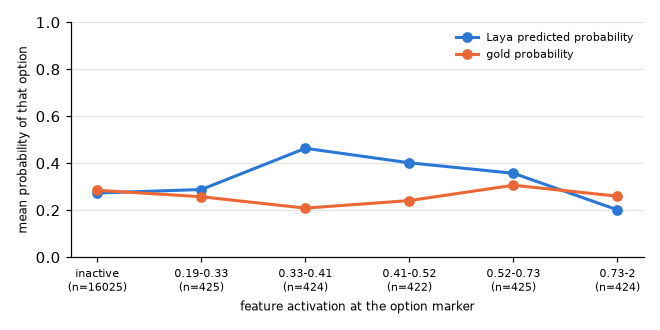

# Feature 1160

Critérios em que aparece: pred_probe_right_laya_wrong_stratified, attribution_toward_correct

**Interpretação (preencher):** 

---

## Maiores ativações

**tr_security_incidents_000041 / severity** (score, security_incidents) | ativação 3.088 em `estado` | opções ['0', '1', '2', '3', '4'] | Laya: **1** [0.071, 0.52, 0.282, 0.059, 0.067] | gabarito: **1**

```
<bos> score question: How severe is the potential impact if this alert is real?<eos>
▸ <mask> level 0: Negligible: no access to anything sensitive.
▸ <mask> level 1: Low: limited access, easily reversed.
▸ <mask> level 2: Moderate: access to internal systems or non-public data.
▸ <mask> level 3: High: access to production, secrets or customer data.
▸ <mask> level 4: Critical: active compromise of crown-jewel systems.

<eos>

 {"alert": {"description": "two successful logins from distant locations too close together", "evidence": "Two successful logins were recorded for service account svc_sync: one from IP 203.0.113.45 (New York) at 2026-09-16 01:02 UTC and another from IP 198.51.100.22 (Tokyo) at 2026-09-16 01:10 UTC, a span of eight minutes. The account is unprivileged, does not have MFA enabled, and its password was last changed three days ago. Both source entries appear on the allowlist.", "rule": "impossible_travel"}, "context": {"asset_criticality": "low", "change_window_active": false, "source_on_allowlist": true}, "history": {"credential_rotation_days_ago": 3, "distinct_countries_30d": 2, "logins_30d": 1729, "prior_alerts_90d": 0}, "principal": {"mfa_enrolled": false,⟦ "⟧name": "usr-analytics-776", "privileges": ["repo:read"], "type": "service_account"}}<eos>
```

**tr_security_incidents_000041 / urgency** (score, security_incidents) | ativação 2.861 em `estado` | opções ['0', '1', '2', '3'] | Laya: **1** [0.089, 0.447, 0.162, 0.302] | gabarito: **1**

```
<bos> score question: How quickly must a responder act on this alert?<eos>
▸ <mask> level 0: No time pressure; can wait indefinitely.
▸ <mask> level 1: Routine; handle within the normal queue.
▸ <mask> level 2: Elevated; should be handled within the same week.
▸ <mask> level 3: Critical; requires action within the same day.

<eos>

 {"alert": {"description": "two successful logins from distant locations too close together", "evidence": "Two successful logins were recorded for service account svc_sync: one from IP 203.0.113.45 (New York) at 2026-09-16 01:02 UTC and another from IP 198.51.100.22 (Tokyo) at 2026-09-16 01:10 UTC, a span of eight minutes. The account is unprivileged, does not have MFA enabled, and its password was last changed three days ago. Both source entries appear on the allowlist.", "rule": "impossible_travel"}, "context": {"asset_criticality": "low", "change_window_active": false, "source_on_allowlist": true}, "history": {"credential_rotation_days_ago": 3, "distinct_countries_30d": 2, "logins_30d": 1729, "prior_alerts_90d": 0}, "principal": {"mfa_enrolled": false,⟦ "⟧name": "usr-analytics-776", "privileges": ["repo:read"], "type": "service_account"}}<eos>
```

**tr_security_incidents_000156 / credential_compromise** (noul, security_incidents) | ativação 2.709 em `estado` | opções ['false', 'true'] | Laya: **true** [0.12, 0.88] | gabarito: **false**

```
<bos> noul question: The evidence indicates a credential or account has been compromised.<eos>
▸ <mask> false: no, the statement does not hold
▸ <mask> true: yes, the statement holds

<eos>

 {"alert": {"description": "two successful logins from distant locations too close together", "evidence": "At 2026-09-15 02:13 UTC the admin account authenticated successfully from 203.0.113.45 (New York, US). Twenty‑four minutes later the same account logged in from 51.178.0.1 (London, UK), both sessions using MFA and originating from IPs present on the allow‑list; the credentials for this account were last rotated on 2025‑09‑15.", "rule": "impossible_travel"}, "context": {"asset_criticality": "low", "change_window_active": false, "source_on_allowlist": true}, "history": {"credential_rotation_days_ago": 365, "distinct_countries_30d": 1, "logins_30d": 1571, "prior_alerts_90d": 0}, "principal": {"mfa_enrolled": true, "name": "svc-billing-407", "privileges": ["repo:read"],⟦ "⟧type": "admin"}}<eos>
```

**tr_security_incidents_000035 / urgency** (score, security_incidents) | ativação 2.697 em `estado` | opções ['0', '1', '2', '3'] | Laya: **3** [0.168, 0.286, 0.19, 0.356] | gabarito: **3**

```
<bos> score question: How quickly must a responder act on this alert?<eos>
▸ <mask> level 0: No time pressure; can wait indefinitely.
▸ <mask> level 1: Routine; handle within the normal queue.
▸ <mask> level 2: Elevated; should be handled within the same week.
▸ <mask> level 3: Critical; requires action within the same day.

<eos>

 {"alert": {"description": "an unrecognised binary executed on a server", "evidence":⟦ "⟧An unrecognized binary titled 'update_sys.bin' was executed on server WEB-PROD-01 at 02:15 UTC by an unprivileged contractor account. The session originated from an unrecognized remote IP address using MFA-authenticated credentials that were last rotated 365 days ago. No maintenance window was scheduled at the time of this process execution.", "rule": "suspicious_process"}, "context": {"asset_criticality": "crown_jewel", "change_window_active": false, "source_on_allowlist": false}, "history": {"credential_rotation_days_ago": 365, "distinct_countries_30d": 2, "logins_30d": 1459, "prior_alerts_90d": 1}, "principal": {"mfa_enrolled": true, "name": "ci-infra-369", "privileges": ["repo:read"], "type": "contractor"}}<eos>
```

**tr_security_incidents_000156 / severity** (score, security_incidents) | ativação 2.662 em `estado` | opções ['0', '1', '2', '3', '4'] | Laya: **2** [0.074, 0.232, 0.566, 0.064, 0.064] | gabarito: **1**

```
<bos> score question: How severe is the potential impact if this alert is real?<eos>
▸ <mask> level 0: Negligible: no access to anything sensitive.
▸ <mask> level 1: Low: limited access, easily reversed.
▸ <mask> level 2: Moderate: access to internal systems or non-public data.
▸ <mask> level 3: High: access to production, secrets or customer data.
▸ <mask> level 4: Critical: active compromise of crown-jewel systems.

<eos>

 {"alert": {"description": "two successful logins from distant locations too close together", "evidence": "At 2026-09-15 02:13 UTC the admin account authenticated successfully from 203.0.113.45 (New York, US). Twenty‑four minutes later the same account logged in from 51.178.0.1 (London, UK), both sessions using MFA and originating from IPs present on the allow‑list; the credentials for this account were last rotated on 2025‑09‑15.", "rule": "impossible_travel"}, "context": {"asset_criticality": "low", "change_window_active": false, "source_on_allowlist": true}, "history": {"credential_rotation_days_ago": 365, "distinct_countries_30d": 1, "logins_30d": 1571, "prior_alerts_90d": 0}, "principal": {"mfa_enrolled": true, "name": "svc-billing-407", "privileges": ["repo:read"],⟦ "⟧type": "admin"}}<eos>
```

## Ativações medianas (faixa 40-60%, mediana 0.604)

**tr_security_incidents_000291 / disposition** (choice, security_incidents) | ativação 0.590 em `estado` | opções ['close_benign', 'contain', 'investigate', 'monitor'] | Laya: **contain** [0.032, 0.488, 0.186, 0.295] | gabarito: **monitor**

```
<bos> choice question: How should this security alert be dispositioned?<eos>
▸ <mask> close_benign: Expected, explainable activity; close without analyst time.
▸ <mask> contain: Contain the host or account immediately; do not wait for triage.
▸ <mask> investigate: Warrants an analyst opening an investigation.
▸ <mask> monitor: Not clearly malicious, but worth watching for recurrence.

<eos>

 {"alert": {"description": "two successful logins from distant locations too close together", "evidence": "The service account successfully authenticated from IP 192.168.1.5 and 10.0.8.2 within an 8-minute interval. This principal operates without MFA and has not undergone credential rotation in 412 days.", "rule": "impossible_travel"}, "context": {"asset_criticality": "medium", "change_window_active": false, "source_on_allowlist": true}, "history": {"credential_rotation_days_ago": 412, "distinct_countries_30d": 1, "logins_30d": 44, "prior_alerts_90d": 3}, "principal": {"mfa_enrolled": false, "name": "adm-analytics-523", "privileges": ["deploy:production", "secrets:read⟦"],⟧ "type": "service_account"}}<eos>
```

**tr_agent_trace_observability_000202 / urgency** (score, agent_trace_observability) | ativação 0.602 em `estado` | opções ['0', '1', '2', '3'] | Laya: **1** [0.253, 0.38, 0.236, 0.131] | gabarito: **1**

```
<bos> score question: How quickly does this trace need attention?<eos>
▸ <mask> level 0: No time pressure; can wait indefinitely.
▸ <mask> level 1: Routine; handle within the normal queue.
▸ <mask> level 2: Elevated; should be handled within the same week.
▸ <mask> level 3: Critical; requires action within the same day.

<eos>

 {"agent": {"autonomy": "checkpointed", "model": "internal-agent-v4"}, "constraints": ["Do not force-push to any branch"],⟦ "⟧task": "Migrate the user table to the new schema without downtime.", "trace_summary": {"constraint_violations": 0, "duration_s": 574.1, "irreversible_actions": 1, "steps": 10, "tool_errors": 2}}<eos>
```

**tr_security_incidents_000216 / urgency** (score, security_incidents) | ativação 0.573 em `estado` | opções ['0', '1', '2', '3'] | Laya: **3** [0.158, 0.216, 0.174, 0.451] | gabarito: **3**

```
<bos> score question: How quickly must a responder act on this alert?<eos>
▸ <mask> level 0: No time pressure; can wait indefinitely.
▸ <mask> level 1: Routine; handle within the normal queue.
▸ <mask> level 2: Elevated; should be handled within the same week.
▸ <mask> level 3: Critical; requires action within the same day.

<eos>

 {"alert": {"description": "an unrecognised binary executed on a server", "evidence": "The privileged service account `svc_deployer` executed an unrecognized binary, `xc_update_v2`, on the production host at 04:15 UTC. This execution occurred outside of a scheduled change window using credentials that were last rotated 365 days ago.", "rule": "suspicious_process"},⟦ "⟧context": {"asset_criticality": "medium", "change_window_active": false, "source_on_allowlist": true}, "history": {"credential_rotation_days_ago": 365, "distinct_countries_30d": 2, "logins_30d": 178, "prior_alerts_90d": 1}, "principal": {"mfa_enrolled": false, "name": "svc-support-120", "privileges": ["deploy:production", "secrets:read"], "type": "service_account"}}<eos>
```

**tr_customer_service_000257 / category** (choice, customer_service) | ativação 0.543 em `estado` | opções ['account', 'billing', 'delivery', 'refund', 'technical'] | Laya: **billing** [0.021, 0.742, 0.029, 0.125, 0.083] | gabarito: **delivery**

```
<bos> choice question: What is this customer conversation primarily about?<eos>
▸ <mask> account: Login, plan changes, profile or access management.
▸ <mask> billing: A charge, invoice, subscription or payment problem.
▸ <mask> delivery: Shipping, fulfilment or delivery of a physical item.
▸ <mask> refund: The customer is explicitly asking for money back.
▸ <mask> technical: The product or service is not working as expected.

<eos>

 {"account": {"lifetime_value_usd": 131, "prior_tickets_90d": 1, "seats": 1, "tenure_months": 5, "tier": "standard"}, "orders": [{"amount_usd": 447, "date": "2026-03-22", "id": "A-40460", "status": "settled"}, {"amount_usd": 447, "date": "2026-02-25", "id": "A-64478", "status": "failed"}], "thread":⟦ [⟧{"role": "customer", "text": "What the hell? I ordered the deluxe headset for $447 and you sent me a basic mouse instead. This is unacceptable."}, {"role": "agent", "text": "I’m sorry you received the wrong item. Can you tell me the order number so I can look into the mix‑up?"}, {"role": "customer", "text": "Order #B5544LM. I need the correct headset sent to me immediately."}]}<eos>
```

**tr_security_incidents_000280 / urgency** (score, security_incidents) | ativação 0.679 em `estado` | opções ['0', '1', '2', '3'] | Laya: **2** [0.115, 0.345, 0.356, 0.184] | gabarito: **1**

```
<bos> score question: How quickly must a responder act on this alert?<eos>
▸ <mask> level 0: No time pressure; can wait indefinitely.
▸ <mask> level 1: Routine; handle within the normal queue.
▸ <mask> level 2: Elevated; should be handled within the same week.
▸ <mask> level 3: Critical; requires action within the same day.

<eos>

 {"alert": {"description": "a session token was presented from a second address", "evidence": "Session token \"f9d2a1c3\" associated with shared_mailbox@example.com was first used from IP 198.51.100.22 at 2026-09-16 02:11 UTC and then presented again from IP 198.51.100.55 at 2026-09-16 02:13 UTC. Both source IPs are on the allowlist; the token holder's credentials were last rotated 412 days ago and no change window was active.", "rule": "token_reuse"}, "context": {"asset_criticality": "low", "change_window_active": false, "source_on_allowlist": true}, "history": {"credential_rotation_days_ago": 412, "distinct_countries_30d": 4, "logins_30d": 1529, "prior_alerts_90d": 3}, "principal": {"mfa_enrolled": true, "name": "ci-analytics-679", "privileges": ["repo:read⟦"],⟧ "type": "shared_mailbox"}}<eos>
```

## Estatísticas (conjunto de descoberta, dev e teste)

**pred / error**

| split | decisões | ativas | ativas e Laya errou | taxa | lift | q (BH) | OR (CMH) | q (CMH) |
|---|---|---|---|---|---|---|---|---|
| discovery | 5100 | 792 | 556 | 0.702 | 1.09 | 0.000616 | 1.21 | 0.45 |
| dev | 900 | 137 | 110 | 0.803 | 1.19 | 0.00281 | 2.24 | 0.426 |
| test | 2000 | 295 | 212 | 0.719 | 1.10 | 0.021 | 1.63 | 0.448 |

**corr / error**

| split | decisões | ativas | ativas e Laya errou | taxa | lift | q (BH) | OR (CMH) | q (CMH) |
|---|---|---|---|---|---|---|---|---|
| discovery | 5100 | 560 | 324 | 0.579 | 0.90 | 0.00145 | 0.50 | 0.000279 |
| dev | 900 | 79 | 52 | 0.658 | 0.98 | 0.926 | 0.64 | 0.627 |
| test | 2000 | 232 | 149 | 0.642 | 0.99 | 0.87 | 0.76 | 0.625 |

**state / error**

| split | decisões | ativas | ativas e Laya errou | taxa | lift | q (BH) | OR (CMH) | q (CMH) |
|---|---|---|---|---|---|---|---|---|
| discovery | 5100 | 2763 | 1770 | 0.641 | 1.00 | 0.772 | 1.02 | 0.945 |
| dev | 900 | 495 | 338 | 0.683 | 1.02 | 0.838 | 1.40 | 0.316 |
| test | 2000 | 1142 | 737 | 0.645 | 0.99 | 0.853 | 1.10 | 0.749 |

**pred / probe_right_laya_wrong**

| split | decisões | ativas | ativas e Laya errou | taxa | lift | q (BH) | OR (CMH) | q (CMH) |
|---|---|---|---|---|---|---|---|---|
| discovery | 2932 | 508 | 377 | 0.742 | 1.23 | 1.96e-11 | 1.85 | 0.0281 |
| dev | 523 | 98 | 80 | 0.816 | 1.26 | 0.000641 | 1.35 | 0.732 |
| test | 1149 | 183 | 136 | 0.743 | 1.22 | 0.000228 | 2.30 | 0.262 |

**corr / probe_right_laya_wrong**

| split | decisões | ativas | ativas e Laya errou | taxa | lift | q (BH) | OR (CMH) | q (CMH) |
|---|---|---|---|---|---|---|---|---|
| discovery | 2932 | 298 | 167 | 0.560 | 0.93 | 0.131 | 0.72 | 0.352 |
| dev | 523 | 43 | 25 | 0.581 | 0.90 | 0.53 | 0.38 | 0.458 |
| test | 1149 | 114 | 67 | 0.588 | 0.96 | 0.747 | 0.57 | 0.437 |

**state / probe_right_laya_wrong**

| split | decisões | ativas | ativas e Laya errou | taxa | lift | q (BH) | OR (CMH) | q (CMH) |
|---|---|---|---|---|---|---|---|---|
| discovery | 2932 | 1546 | 895 | 0.579 | 0.96 | 0.00732 | 0.96 | 0.838 |
| dev | 523 | 284 | 178 | 0.627 | 0.97 | 0.677 | 1.10 | 0.86 |
| test | 1149 | 624 | 367 | 0.588 | 0.96 | 0.274 | 1.26 | 0.42 |

Confusão mais sobre-representada (pred): `duplicate|1>0` (n=180, lift 5.34, p=0). Formato `pergunta|índice previsto>índice correto`.

Confusão mais sobre-representada (corr): `severity|1>3` (n=59, lift 7.57, p=0). Formato `pergunta|índice previsto>índice correto`.

Confusão mais sobre-representada (state): `severity|1>3` (n=69, lift 1.79, p=1.6e-16). Formato `pergunta|índice previsto>índice correto`.



