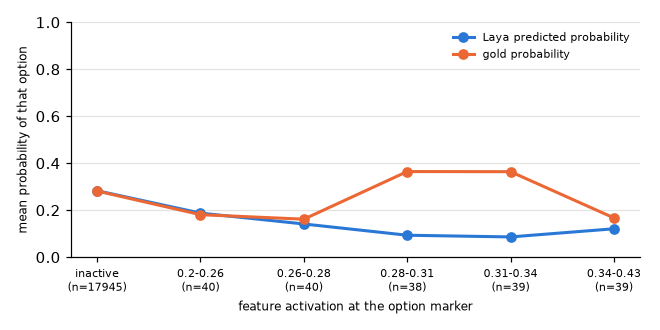

# Feature 1196

Critérios em que aparece: corr_probe_right_laya_wrong

**Interpretação (preencher):** 

---

## Maiores ativações

**tr_customer_service_000216 / action** (choice, customer_service) | ativação 2.207 em `estado` | opções ['answer_directly', 'close_no_action', 'escalate_to_human', 'execute_refund', 'request_information'] | Laya: **answer_directly** [0.615, 0.134, 0.042, 0.014, 0.195] | gabarito: **answer_directly**

```
<bos> choice question: What should the assistant do next with this conversation?<eos>
▸ <mask> answer_directly: The assistant can resolve this itself with information it already has.
▸ <mask> close_no_action: No further action is warranted; the matter is settled.
▸ <mask> escalate_to_human: Hand off to a human agent with the appropriate authority.
▸ <mask> execute_refund: Issue the refund or credit the customer is owed.
▸ <mask> request_information: More detail is needed from the customer before anything can be done.

<eos>

 {"account": {"lifetime_value_usd": 90, "prior_tickets_90d": 0, "seats": 1, "tenure_months": 2, "tier": "free"}, "thread": [{"role": "customer", "text": "Hello there, I am checking on the status of my order. It’s for a birthday party this weekend, so I’m a bit worried it hasn't arrived yet."}, {"role": "agent", "text": "I would be happy to look into that for you. Could you please provide the order number so I can check the current⟦ shipping⟧ status in our system?"}, {"role": "customer", "text": "Of course, the order number is #44921. I really need these supplies by Friday at the latest for the event to go smoothly, so any help is appreciated."}]}<eos>
```

**tr_customer_service_000021 / action** (choice, customer_service) | ativação 2.109 em `estado` | opções ['answer_directly', 'close_no_action', 'escalate_to_human', 'execute_refund', 'request_information'] | Laya: **answer_directly** [0.644, 0.209, 0.025, 0.035, 0.088] | gabarito: **escalate_to_human**

```
<bos> choice question: What should the assistant do next with this conversation?<eos>
▸ <mask> answer_directly: The assistant can resolve this itself with information it already has.
▸ <mask> close_no_action: No further action is warranted; the matter is settled.
▸ <mask> escalate_to_human: Hand off to a human agent with the appropriate authority.
▸ <mask> execute_refund: Issue the refund or credit the customer is owed.
▸ <mask> request_information: More detail is needed from the customer before anything can be done.

<eos>

 {"account": {"lifetime_value_usd": 2339, "prior_tickets_90d": 0, "seats": 1, "tenure_months": 33, "tier": "free"}, "orders": [{"amount_usd": 999, "date": "2026-02-27", "id": "A-76350", "status": "pending"}], "thread": [{"role": "customer", "text": "I was charged $999 this month even though I’m on the free⟦ plan⟧. Can you explain why this happened?"}, {"role": "agent", "text": "I see the charge you’re referring to. Could you share the invoice number or the date it appeared on your statement?"}, {"role": "customer", "text": "The invoice is #INV-20230914 and it shows up on my credit card as a $999 charge. I thought I was only on the free tier."}, {"role": "agent", "text": "Thank you for that information. I’ll pull up the billing records. Could you confirm the email address linked to your account?"}, {"role": "customer", "text": "The account email is user@example.com. Please let me know why this charge was applied."}]}<eos>
```

**tr_customer_service_000210 / action** (choice, customer_service) | ativação 2.088 em `estado` | opções ['answer_directly', 'close_no_action', 'escalate_to_human', 'execute_refund', 'request_information'] | Laya: **answer_directly** [0.76, 0.142, 0.012, 0.074, 0.012] | gabarito: **escalate_to_human**

```
<bos> choice question: What should the assistant do next with this conversation?<eos>
▸ <mask> answer_directly: The assistant can resolve this itself with information it already has.
▸ <mask> close_no_action: No further action is warranted; the matter is settled.
▸ <mask> escalate_to_human: Hand off to a human agent with the appropriate authority.
▸ <mask> execute_refund: Issue the refund or credit the customer is owed.
▸ <mask> request_information: More detail is needed from the customer before anything can be done.

<eos>

 {"account": {"lifetime_value_usd": 459, "prior_tickets_90d": 5, "seats": 1, "tenure_months": 14, "tier": "free"}, "orders": [{"amount_usd": 299, "date": "2026-03-18", "id": "A-97738", "status": "failed"}, {"amount_usd": 299, "date": "2026-02-26", "id": "A-91369", "status": "refunded"}, {"amount_usd": 299, "date": "2026-03-24", "id": "A-52614", "status": "settled"}], "thread": [{"role": "customer", "text": "Hello, I’d like to downgrade my⟦ account⟧ to the Free plan. I’ve been with you for over a year and have $299 worth of credits, but I need this change by the end of the month."}, {"role": "agent", "text": "Thank you for reaching out. Just to confirm, you’re currently on a paid tier and want to move to the Free plan. May I ask which features you rely on most so we can ensure the downgrade won’t impact your workflow?"}, {"role": "customer", "text": "I mainly use the analytics dashboard and the API access; I’m okay losing the advanced reporting, but I can’t lose API keys."}, {"role": "agent", "text": "Got it. Could you also let me know if there are any pending invoices or credit adjustments that need to be addressed before we proceed?"}, {"role": "customer", "text": "No pending invoices—just the $299 credit I’ve accumulated, which I’d like applied before the downgrade takes effect."}]}<eos>
```

**tr_customer_service_000216 / category** (choice, customer_service) | ativação 2.031 em `estado` | opções ['account', 'billing', 'delivery', 'refund', 'technical'] | Laya: **delivery** [0.0, 0.0, 0.997, 0.0, 0.002] | gabarito: **delivery**

```
<bos> choice question: What is this customer conversation primarily about?<eos>
▸ <mask> account: Login, plan changes, profile or access management.
▸ <mask> billing: A charge, invoice, subscription or payment problem.
▸ <mask> delivery: Shipping, fulfilment or delivery of a physical item.
▸ <mask> refund: The customer is explicitly asking for money back.
▸ <mask> technical: The product or service is not working as expected.

<eos>

 {"account": {"lifetime_value_usd": 90, "prior_tickets_90d": 0, "seats": 1, "tenure_months": 2, "tier": "free"}, "thread": [{"role": "customer", "text": "Hello there, I am checking on the status of my order. It’s for a birthday party this weekend, so I’m a bit worried it hasn't arrived yet."}, {"role": "agent", "text": "I would be happy to look into that for you. Could you please provide the order number so I can check the current⟦ shipping⟧ status in our system?"}, {"role": "customer", "text": "Of course, the order number is #44921. I really need these supplies by Friday at the latest for the event to go smoothly, so any help is appreciated."}]}<eos>
```

**tr_customer_service_000216 / needs_human** (noul, customer_service) | ativação 2.029 em `estado` | opções ['false', 'true'] | Laya: **true** [0.178, 0.822] | gabarito: **false**

```
<bos> noul question: This conversation requires a human agent rather than automated handling.<eos>
▸ <mask> false: Automation can carry this to resolution.
▸ <mask> true: A human must take over: judgement, authority or empathy is required.

<eos>

 {"account": {"lifetime_value_usd": 90, "prior_tickets_90d": 0, "seats": 1, "tenure_months": 2, "tier": "free"}, "thread": [{"role": "customer", "text": "Hello there, I am checking on the status of my order. It’s for a birthday party this weekend, so I’m a bit worried it hasn't arrived yet."}, {"role": "agent", "text": "I would be happy to look into that for you. Could you please provide the order number so I can check the current⟦ shipping⟧ status in our system?"}, {"role": "customer", "text": "Of course, the order number is #44921. I really need these supplies by Friday at the latest for the event to go smoothly, so any help is appreciated."}]}<eos>
```

## Ativações medianas (faixa 40-60%, mediana 0.829)

**tr_invoice_processing_000109 / discrepancy_severity** (score, invoice_processing) | ativação 0.768 em `pergunta` | opções ['0', '1', '2', '3'] | Laya: **2** [0.065, 0.33, 0.539, 0.065] | gabarito: **3**

```
<bos> score question: How material is any discrepancy between the invoice, the⟦ order⟧ and the delivery?<eos>
▸ <mask> level 0: None: everything reconciles.
▸ <mask> level 1: Trivial: rounding or a cosmetic difference.
▸ <mask> level 2: Moderate: a real difference worth confirming.
▸ <mask> level 3: Material: a large or unexplained difference.

<eos>

 {"delivery": {"condition": "accepted", "date": "2026-03-13", "received_qty": 50}, "invoice": {"currency": "USD", "id": "INV-2026-1558", "lines": [{"qty": 100, "sku": "SKU-351", "total_usd": 8003.0, "unit_usd": 80.03}], "total_usd": 8003.0, "vendor": "Vantage Materials"}, "payment": {"days_until_due": 44, "discount_expires_in_days": null, "early_payment_discount_pct": null, "status": "scheduled", "terms": "net 30"}, "purchase_order": {"freight_terms": "freight prepaid by vendor, not separately billable", "id": "PO-3499", "lines": [{"qty": 50, "unit_usd": 80.03}], "total_usd": 4001.5}, "vendor_history": {"disputes_12m": 0, "invoices_12m": 9, "prior_invoice_ids": ["INV-2026-2254", "INV-2026-7618", "INV-2026-3837", "INV-2026-2225"]}}<eos>
```

**tr_security_incidents_000106 / severity** (score, security_incidents) | ativação 0.836 em `opção` | opções ['0', '1', '2', '3', '4'] | Laya: **2** [0.107, 0.224, 0.467, 0.101, 0.101] | gabarito: **0**

```
<bos> score question: How severe is the potential impact if this alert is real?<eos>
▸ <mask> level 0: Negligible: no access to anything sensitive.
▸ <mask> level 1: Low: limited access, easily reversed.
▸ <mask> level 2: Moderate: access to internal systems or non-public data.
▸ <mask> level 3: High: access to production, secrets or customer data.
▸ <mask> level 4: Critical: active compromise of crown-jewel⟦ systems⟧.

<eos>

 {"alert": {"description": "a long-unused account became active", "evidence": "At 14:22 UTC, the contractor account 'c-smith' successfully authenticated from an allowlisted source despite being inactive for 120 days. Multi-factor authentication was verified during the session, which took place during a scheduled change window. The account's credentials were last rotated 30 days prior to this access.", "rule": "dormant_account_use"}, "context": {"asset_criticality": "low", "change_window_active": true, "source_on_allowlist": true}, "history": {"credential_rotation_days_ago": 30, "distinct_countries_30d": 1, "logins_30d": 1999, "prior_alerts_90d": 0}, "principal": {"mfa_enrolled": true, "name": "svc-infra-357", "privileges": ["repo:read"], "type": "contractor"}}<eos>
```

**tr_security_incidents_000261 / disposition** (choice, security_incidents) | ativação 0.850 em `pergunta` | opções ['close_benign', 'contain', 'investigate', 'monitor'] | Laya: **monitor** [0.115, 0.168, 0.281, 0.436] | gabarito: **investigate**

```
<bos> choice question: How should this⟦ security⟧ alert be dispositioned?<eos>
▸ <mask> close_benign: Expected, explainable activity; close without analyst time.
▸ <mask> contain: Contain the host or account immediately; do not wait for triage.
▸ <mask> investigate: Warrants an analyst opening an investigation.
▸ <mask> monitor: Not clearly malicious, but worth watching for recurrence.

<eos>

 {"alert": {"description": "an unrecognised binary executed on a server", "evidence": "At 02:14 UTC on 2026-09-15, a process named \"c:\\temp\\svchost.exe\" was launched on server APP01 by contractor user jdoe (ID C12345). The binary’s SHA‑256 hash (a1b2c3d4e5…) does not appear in the approved software inventory. MFA authentication succeeded and no maintenance window was active.", "rule": "suspicious_process"}, "context": {"asset_criticality": "medium", "change_window_active": false, "source_on_allowlist": true}, "history": {"credential_rotation_days_ago": 700, "distinct_countries_30d": 1, "logins_30d": 1197, "prior_alerts_90d": 0}, "principal": {"mfa_enrolled": true, "name": "svc-billing-358", "privileges": ["repo:read"], "type": "contractor"}}<eos>
```

**tr_security_incidents_000285 / severity** (score, security_incidents) | ativação 0.810 em `pergunta` | opções ['0', '1', '2', '3', '4'] | Laya: **1** [0.194, 0.266, 0.207, 0.156, 0.177] | gabarito: **4**

```
<bos> score question: How severe is the potential impact if this⟦ alert⟧ is real?<eos>
▸ <mask> level 0: Negligible: no access to anything sensitive.
▸ <mask> level 1: Low: limited access, easily reversed.
▸ <mask> level 2: Moderate: access to internal systems or non-public data.
▸ <mask> level 3: High: access to production, secrets or customer data.
▸ <mask> level 4: Critical: active compromise of crown-jewel systems.

<eos>

 {"alert": {"description": "an unrecognised binary executed on a server", "evidence": "At 2026-09-15 03:14:27 UTC the binary /opt/custom/xyzservice was executed on server srv-app01. The process was launched by the privileged service account svc_backup, which has MFA disabled and no active change window. The source IP 10.2.5.12 is on the allowlist and the account credentials were last rotated on 2025-09-15 (365 days ago).", "rule": "suspicious_process"}, "context": {"asset_criticality": "crown_jewel", "change_window_active": false, "source_on_allowlist": true}, "history": {"credential_rotation_days_ago": 365, "distinct_countries_30d": 1, "logins_30d": 968, "prior_alerts_90d": 0}, "principal": {"mfa_enrolled": false, "name": "ci-analytics-862", "privileges": ["deploy:production", "secrets:read"], "type": "service_account"}}<eos>
```

**tr_security_incidents_000049 / urgency** (score, security_incidents) | ativação 0.776 em `pergunta` | opções ['0', '1', '2', '3'] | Laya: **1** [0.119, 0.455, 0.19, 0.236] | gabarito: **1**

```
<bos> score question: How quickly must a⟦ responder⟧ act on this alert?<eos>
▸ <mask> level 0: No time pressure; can wait indefinitely.
▸ <mask> level 1: Routine; handle within the normal queue.
▸ <mask> level 2: Elevated; should be handled within the same week.
▸ <mask> level 3: Critical; requires action within the same day.

<eos>

 {"alert": {"description": "a first-ever sign-in from an unfamiliar country", "evidence": "An unprivileged employee account authenticated from a previously unseen country 30 days after its last credential rotation. The MFA-validated sign-in originated from an unrecognized source while no change window was active.", "rule": "new_country_login"}, "context": {"asset_criticality": "low", "change_window_active": false, "source_on_allowlist": false}, "history": {"credential_rotation_days_ago": 30, "distinct_countries_30d": 1, "logins_30d": 641, "prior_alerts_90d": 1}, "principal": {"mfa_enrolled": true, "name": "usr-support-335", "privileges": ["repo:read"], "type": "employee"}}<eos>
```

## Estatísticas (conjunto de descoberta, dev e teste)

**pred / error**

| split | decisões | ativas | ativas e Laya errou | taxa | lift | q (BH) | OR (CMH) | q (CMH) |
|---|---|---|---|---|---|---|---|---|
| discovery | 5100 | 14 | 12 | 0.857 | 1.33 | nan | nan | nan |
| dev | 900 | 3 | 2 | 0.667 | 0.99 | nan | nan | nan |
| test | 2000 | 11 | 11 | 1.000 | 1.54 | nan | nan | nan |

**corr / error**

| split | decisões | ativas | ativas e Laya errou | taxa | lift | q (BH) | OR (CMH) | q (CMH) |
|---|---|---|---|---|---|---|---|---|
| discovery | 5100 | 47 | 45 | 0.957 | 1.49 | 1.65e-06 | 2.77 | 0.383 |
| dev | 900 | 10 | 9 | 0.900 | 1.34 | nan | nan | nan |
| test | 2000 | 19 | 19 | 1.000 | 1.54 | nan | nan | nan |

**state / error**

| split | decisões | ativas | ativas e Laya errou | taxa | lift | q (BH) | OR (CMH) | q (CMH) |
|---|---|---|---|---|---|---|---|---|
| discovery | 5100 | 886 | 527 | 0.595 | 0.92 | 0.00499 | 0.99 | 0.962 |
| dev | 900 | 152 | 94 | 0.618 | 0.92 | 0.481 | 1.12 | 0.864 |
| test | 2000 | 307 | 187 | 0.609 | 0.94 | 0.349 | 1.09 | 0.827 |

**pred / probe_right_laya_wrong**

| split | decisões | ativas | ativas e Laya errou | taxa | lift | q (BH) | OR (CMH) | q (CMH) |
|---|---|---|---|---|---|---|---|---|
| discovery | 2932 | 6 | 6 | 1.000 | 1.65 | nan | nan | nan |
| dev | 523 | 1 | 1 | 1.000 | 1.55 | nan | nan | nan |
| test | 1149 | 3 | 3 | 1.000 | 1.64 | nan | nan | nan |

**corr / probe_right_laya_wrong**

| split | decisões | ativas | ativas e Laya errou | taxa | lift | q (BH) | OR (CMH) | q (CMH) |
|---|---|---|---|---|---|---|---|---|
| discovery | 2932 | 34 | 34 | 1.000 | 1.65 | 1.68e-07 | nan | nan |
| dev | 523 | 7 | 7 | 1.000 | 1.55 | nan | nan | nan |
| test | 1149 | 17 | 17 | 1.000 | 1.64 | nan | nan | nan |

**state / probe_right_laya_wrong**

| split | decisões | ativas | ativas e Laya errou | taxa | lift | q (BH) | OR (CMH) | q (CMH) |
|---|---|---|---|---|---|---|---|---|
| discovery | 2932 | 512 | 273 | 0.533 | 0.88 | 0.00135 | 1.06 | 0.824 |
| dev | 523 | 92 | 51 | 0.554 | 0.86 | 0.25 | 1.38 | 0.578 |
| test | 1149 | 184 | 104 | 0.565 | 0.93 | 0.426 | 1.14 | 0.757 |

Confusão mais sobre-representada (pred): `urgency|1>3` (n=10, lift 24.12, p=nan). Formato `pergunta|índice previsto>índice correto`.

Confusão mais sobre-representada (corr): `discrepancy_severity|2>0` (n=41, lift 41.19, p=0). Formato `pergunta|índice previsto>índice correto`.

Confusão mais sobre-representada (state): `true_positive|1>0` (n=28, lift 2.30, p=5.78e-06). Formato `pergunta|índice previsto>índice correto`.



