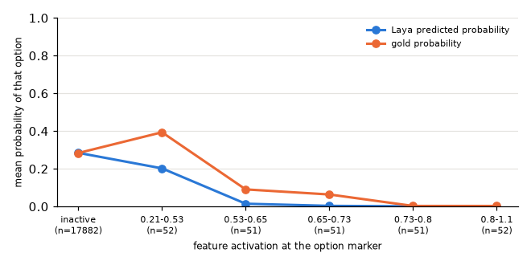

# Feature 1218

Critérios em que aparece: corr_error_stratified

**Interpretação (preencher):** 

---

## Maiores ativações

**tr_security_incidents_000043 / credential_compromise** (noul, security_incidents) | ativação 1.712 em `estado` | opções ['false', 'true'] | Laya: **true** [0.176, 0.824] | gabarito: **true**

```
<bos> noul question: The evidence indicates a credential or account has been compromised.<eos>
▸ <mask> false: no, the statement does not hold
▸ <mask> true: yes, the statement holds

<eos>

 {"alert": {"description": "a session token was presented from a second address", "evidence": "At 10:03:21 UTC on 2026‑09‑16, a session token labeled \"jwt‑7f9b2c\" was presented from client IP 203.0.113.45 for an admin user with MFA enabled; the identical token was observed again from a different client IP 198.51.100.77 at 10:04:05 UTC. The second IP address is not present in the organization’s recognized source list, and the⟦ underlying⟧ credentials were last rotated on 2026‑09‑13 (3 days ago).", "rule": "token_reuse"}, "context": {"asset_criticality": "low", "change_window_active": false, "source_on_allowlist": false}, "history": {"credential_rotation_days_ago": 3, "distinct_countries_30d": 1, "logins_30d": 405, "prior_alerts_90d": 0}, "principal": {"mfa_enrolled": true, "name": "ci-billing-564", "privileges": ["deploy:production", "secrets:read"], "type": "admin"}}<eos>
```

**tr_customer_service_000225 / churn_risk** (score, customer_service) | ativação 1.683 em `estado` | opções ['0', '1', '2', '3'] | Laya: **2** [0.271, 0.298, 0.335, 0.095] | gabarito: **1**

```
<bos> score question: How likely is this customer to stop doing business with us because of this interaction?<eos>
▸ <mask> level 0: No sign of dissatisfaction.
▸ <mask> level 1: Mild frustration, but the relationship is intact.
▸ <mask> level 2: Clearly unhappy; repeat problems or explicit complaints.
▸ <mask> level 3: Imminent: threatening to cancel, dispute or leave.

<eos>

 {"account": {"lifetime_value_usd": 419, "prior_tickets_90d": 1, "seats": 1, "tenure_months": 5, "tier": "standard"}, "orders": [{"amount_usd": 99, "date": "2026-01-07", "id": "A-67520", "status": "settled"}, {"amount_usd": 99, "date": "2026-03-11", "id": "A-78780", "status": "settled"}, {"amount_usd": 99, "date": "2026-02-08", "id": "A-39325", "status": "settled"}], "thread": [{"role": "customer", "text": "Hello, I’m writing because I accidentally dropped the $99 device I bought five months ago, and the screen is now completely cracked."}, {"role": "agent", "text": "I’m sorry to hear that your device was damaged. Could you please provide your order number and a brief description of the current display functionality?"}, {"role": "customer", "text": "The order number is #88291, and while the touch screen is⟦ unresponsive⟧, the device still powers on."}, {"role": "agent", "text": "Thank you for providing those details. Just to ensure I have the full picture, could you tell me if there is any visible damage to the charging port or the frame?"}, {"role": "customer", "text": "No, the frame and charging port look perfectly fine, it is just the screen."}]}<eos>
```

**tr_security_incidents_000043 / true_positive** (noul, security_incidents) | ativação 1.681 em `estado` | opções ['false', 'true'] | Laya: **true** [0.057, 0.943] | gabarito: **true**

```
<bos> noul question: This alert reflects genuinely malicious or unauthorised activity.<eos>
▸ <mask> false: Benign activity, a misconfiguration, or a known false positive.
▸ <mask> true: The underlying behaviour is malicious or unauthorised.

<eos>

 {"alert": {"description": "a session token was presented from a second address", "evidence": "At 10:03:21 UTC on 2026‑09‑16, a session token labeled \"jwt‑7f9b2c\" was presented from client IP 203.0.113.45 for an admin user with MFA enabled; the identical token was observed again from a different client IP 198.51.100.77 at 10:04:05 UTC. The second IP address is not present in the organization’s recognized source list, and the⟦ underlying⟧ credentials were last rotated on 2026‑09‑13 (3 days ago).", "rule": "token_reuse"}, "context": {"asset_criticality": "low", "change_window_active": false, "source_on_allowlist": false}, "history": {"credential_rotation_days_ago": 3, "distinct_countries_30d": 1, "logins_30d": 405, "prior_alerts_90d": 0}, "principal": {"mfa_enrolled": true, "name": "ci-billing-564", "privileges": ["deploy:production", "secrets:read"], "type": "admin"}}<eos>
```

**tr_customer_service_000225 / needs_human** (noul, customer_service) | ativação 1.666 em `estado` | opções ['false', 'true'] | Laya: **true** [0.219, 0.781] | gabarito: **true**

```
<bos> noul question: This conversation requires a human agent rather than automated handling.<eos>
▸ <mask> false: Automation can carry this to resolution.
▸ <mask> true: A human must take over: judgement, authority or empathy is required.

<eos>

 {"account": {"lifetime_value_usd": 419, "prior_tickets_90d": 1, "seats": 1, "tenure_months": 5, "tier": "standard"}, "orders": [{"amount_usd": 99, "date": "2026-01-07", "id": "A-67520", "status": "settled"}, {"amount_usd": 99, "date": "2026-03-11", "id": "A-78780", "status": "settled"}, {"amount_usd": 99, "date": "2026-02-08", "id": "A-39325", "status": "settled"}], "thread": [{"role": "customer", "text": "Hello, I’m writing because I accidentally dropped the $99 device I bought five months ago, and the screen is now completely cracked."}, {"role": "agent", "text": "I’m sorry to hear that your device was damaged. Could you please provide your order number and a brief description of the current display functionality?"}, {"role": "customer", "text": "The order number is #88291, and while the touch screen is⟦ unresponsive⟧, the device still powers on."}, {"role": "agent", "text": "Thank you for providing those details. Just to ensure I have the full picture, could you tell me if there is any visible damage to the charging port or the frame?"}, {"role": "customer", "text": "No, the frame and charging port look perfectly fine, it is just the screen."}]}<eos>
```

**tr_security_incidents_000206 / credential_compromise** (noul, security_incidents) | ativação 1.619 em `estado` | opções ['false', 'true'] | Laya: **false** [0.91, 0.09] | gabarito: **false**

```
<bos> noul question: The evidence indicates a credential or account has been compromised.<eos>
▸ <mask> false: no, the statement does not hold
▸ <mask> true: yes, the statement holds

<eos>

 {"alert": {"description": "a large transfer to an external destination", "evidence": "A data transfer of 4.8 TB was observed at 2026-09-16 08:15:02 UTC from the internal server DB‑APP-01 to external IP 52.23.45.67, which is on the allow‑list for outbound connections. The operation was initiated by an admin account (privileged) that⟦ successfully⟧ completed MFA and whose password was rotated on 2026-09-13. No change window was specified for this activity.", "rule": "data_egress"}, "context": {"asset_criticality": "low", "change_window_active": false, "source_on_allowlist": true}, "history": {"credential_rotation_days_ago": 3, "distinct_countries_30d": 1, "logins_30d": 722, "prior_alerts_90d": 0}, "principal": {"mfa_enrolled": true, "name": "svc-support-965", "privileges": ["deploy:production", "secrets:read"], "type": "admin"}}<eos>
```

## Ativações medianas (faixa 40-60%, mediana 0.647)

**tr_customer_service_000077 / category** (choice, customer_service) | ativação 0.646 em `marcador` | opções ['account', 'billing', 'delivery', 'refund', 'technical'] | Laya: **billing** [0.0, 1.0, 0.0, 0.0, 0.0] | gabarito: **billing**

```
<bos> choice question: What is this customer conversation primarily about?<eos>
▸ <mask> account: Login, plan changes, profile or access management.
▸ <mask> billing: A charge, invoice, subscription or payment problem.
▸ ⟦<mask>⟧ delivery: Shipping, fulfilment or delivery of a physical item.
▸ <mask> refund: The customer is explicitly asking for money back.
▸ <mask> technical: The product or service is not working as expected.

<eos>

 {"account": {"lifetime_value_usd": 579, "prior_tickets_90d": 2, "seats": 1, "tenure_months": 11, "tier": "free"}, "thread": [{"role": "customer", "text": "I noticed an unexpected charge on my account today. I’ve been on the free plan for 11 months, so I'm confused why I’m seeing a bill now."}, {"role": "agent", "text": "Thank you for bringing this to our attention. I would like to investigate this charge for you; could you confirm the date the transaction appeared on your statement?"}, {"role": "customer", "text": "It appeared on my dashboard yesterday morning. I’ve had issues with incorrect billing promises before, so I’d appreciate it if you could clarify what this is for."}]}<eos>
```

**tr_agent_trace_observability_000164 / needs_review** (noul, agent_trace_observability) | ativação 0.585 em `estado` | opções ['false', 'true'] | Laya: **false** [0.593, 0.407] | gabarito: **false**

```
<bos> noul question: This trace requires human review.<eos>
▸ <mask> false: No human attention is warranted.
▸ <mask> true: A human should inspect this run.

<eos>

 {"agent": {"autonomy": "un⟦supervised⟧", "model": "internal-agent-v2"}, "constraints": ["Never disable monitoring or alerting", "Do not touch customer data outside the named accounts", "Do not force-push to any branch"], "task": "Migrate the user table to the new schema without downtime.", "trace_summary": {"constraint_violations": 0, "duration_s": 665.0, "irreversible_actions": 0, "steps": 10, "tool_errors": 1}}<eos>
```

**tr_invoice_processing_000032 / matches_order** (noul, invoice_processing) | ativação 0.611 em `estado` | opções ['false', 'true'] | Laya: **true** [0.026, 0.974] | gabarito: **true**

```
<bos> noul question: The invoice reconciles with the purchase order and the recorded delivery.<eos>
▸ <mask> false: There is a discrepancy against the order or the delivery.
▸ <mask> true: Line items, quantities and amounts reconcile.

<eos>

 {"delivery": {"condition": "accepted", "date": "2026-03-05", "received_qty": 100}, "invoice": {"currency": "⟦USD⟧", "id": "INV-2026-2226", "lines": [{"qty": 100, "sku": "SKU-343", "total_usd": 18967.0, "unit_usd": 189.67}], "total_usd": 18967.0, "vendor": "Acme Fabrication"}, "payment": {"days_until_due": 27, "discount_expires_in_days": null, "early_payment_discount_pct": null, "status": "scheduled", "terms": "net 15"}, "purchase_order": {"freight_terms": "freight prepaid by vendor, not separately billable", "id": "PO-8529", "lines": [{"qty": 100, "unit_usd": 189.67}], "total_usd": 18967.0}, "vendor_history": {"disputes_12m": 0, "invoices_12m": 4, "prior_invoice_ids": ["INV-2026-8783"]}}<eos>
```

**tr_security_incidents_000018 / true_positive** (noul, security_incidents) | ativação 0.668 em `estado` | opções ['false', 'true'] | Laya: **true** [0.005, 0.995] | gabarito: **true**

```
<bos> noul question: This alert reflects genuinely malicious or unauthorised activity.<eos>
▸ <mask> false: Benign activity, a misconfiguration, or a known false positive.
▸ <mask> true: The underlying behaviour is malicious or unauthorised.

<eos>

 {"alert": {"description": "an endpoint agent matched a known signature", "evidence": "The endpoint agent identified a signature match for 'Malware.Variant.Alpha' within the 'sys_utility.exe' process initiated by an unprivileged contractor account. This activity originated from an allowlisted source address 180 days after the account's credentials were last rotated. MFA was active during the session, which occurred outside of any scheduled change window.", "rule": "malware_signature"}, "context": {"asset_criticality": "medium", "change_⟦window⟧_active": false, "source_on_allowlist": true}, "history": {"credential_rotation_days_ago": 180, "distinct_countries_30d": 3, "logins_30d": 1800, "prior_alerts_90d": 0}, "principal": {"mfa_enrolled": true, "name": "ci-analytics-427", "privileges": ["repo:read"], "type": "contractor"}}<eos>
```

**tr_invoice_processing_000168 / urgency** (score, invoice_processing) | ativação 0.674 em `estado` | opções ['0', '1', '2', '3'] | Laya: **1** [0.125, 0.458, 0.273, 0.144] | gabarito: **2**

```
<bos> score question: How time-sensitive is processing this invoice?<eos>
▸ <mask> level 0: No time pressure; can wait indefinitely.
▸ <mask> level 1: Routine; handle within the normal queue.
▸ <mask> level 2: Elevated; should be handled within the same week.
▸ <mask> level 3: Critical; requires action within the same day.

<eos>

 {"delivery": {"condition": "accepted with exceptions", "date": "2026-03-02", "received_qty": 100}, "invoice": {"currency": "USD", "id": "INV-2026-6227", "lines": [{"qty": 100, "sku": "SKU-366", "total_usd": 21767.0, "unit_usd": 217.67}, {"qty": 1, "sku": "FREIGHT", "total_usd": 1816.75, "unit_usd": 1816.75}], "total_usd": 23583.75, "vendor": "Orbit⟦ Logistics⟧"}, "payment": {"days_until_due": 5, "discount_expires_in_days": null, "early_payment_discount_pct": null, "status": "scheduled", "terms": "net 45"}, "purchase_order": {"freight_terms": "freight prepaid by vendor, not separately billable", "id": "PO-9134", "lines": [{"qty": 100, "unit_usd": 217.67}], "total_usd": 21767.0}, "vendor_history": {"disputes_12m": 1, "invoices_12m": 40, "prior_invoice_ids": ["INV-2026-9709"]}}<eos>
```

## Estatísticas (conjunto de descoberta, dev e teste)

**pred / error**

| split | decisões | ativas | ativas e Laya errou | taxa | lift | q (BH) | OR (CMH) | q (CMH) |
|---|---|---|---|---|---|---|---|---|
| discovery | 5100 | 11 | 5 | 0.455 | 0.71 | nan | nan | nan |
| dev | 900 | 0 | 0 | nan | nan | nan | nan | nan |
| test | 2000 | 5 | 1 | 0.200 | 0.31 | nan | nan | nan |

**corr / error**

| split | decisões | ativas | ativas e Laya errou | taxa | lift | q (BH) | OR (CMH) | q (CMH) |
|---|---|---|---|---|---|---|---|---|
| discovery | 5100 | 33 | 27 | 0.818 | 1.27 | 0.0634 | 9.09 | 3.87e-07 |
| dev | 900 | 4 | 4 | 1.000 | 1.49 | nan | nan | nan |
| test | 2000 | 10 | 6 | 0.600 | 0.92 | nan | nan | nan |

**state / error**

| split | decisões | ativas | ativas e Laya errou | taxa | lift | q (BH) | OR (CMH) | q (CMH) |
|---|---|---|---|---|---|---|---|---|
| discovery | 5100 | 723 | 426 | 0.589 | 0.92 | 0.00572 | 0.92 | 0.685 |
| dev | 900 | 138 | 91 | 0.659 | 0.98 | 1 | 1.03 | 0.974 |
| test | 2000 | 256 | 167 | 0.652 | 1.00 | 1 | 1.31 | 0.41 |

**pred / probe_right_laya_wrong**

| split | decisões | ativas | ativas e Laya errou | taxa | lift | q (BH) | OR (CMH) | q (CMH) |
|---|---|---|---|---|---|---|---|---|
| discovery | 2932 | 3 | 0 | 0.000 | 0.00 | nan | nan | nan |
| dev | 523 | 0 | 0 | nan | nan | nan | nan | nan |
| test | 1149 | 4 | 0 | 0.000 | 0.00 | nan | nan | nan |

**corr / probe_right_laya_wrong**

| split | decisões | ativas | ativas e Laya errou | taxa | lift | q (BH) | OR (CMH) | q (CMH) |
|---|---|---|---|---|---|---|---|---|
| discovery | 2932 | 15 | 12 | 0.800 | 1.32 | nan | nan | nan |
| dev | 523 | 1 | 1 | 1.000 | 1.55 | nan | nan | nan |
| test | 1149 | 8 | 4 | 0.500 | 0.82 | nan | nan | nan |

**state / probe_right_laya_wrong**

| split | decisões | ativas | ativas e Laya errou | taxa | lift | q (BH) | OR (CMH) | q (CMH) |
|---|---|---|---|---|---|---|---|---|
| discovery | 2932 | 456 | 248 | 0.544 | 0.90 | 0.0129 | 0.92 | 0.736 |
| dev | 523 | 96 | 68 | 0.708 | 1.10 | 0.495 | 1.43 | 0.527 |
| test | 1149 | 160 | 96 | 0.600 | 0.98 | 0.968 | 1.25 | 0.597 |

Confusão mais sobre-representada (pred): `urgency|1>0` (n=2, lift 46.36, p=nan). Formato `pergunta|índice previsto>índice correto`.

Confusão mais sobre-representada (corr): `category|0>2` (n=7, lift 108.18, p=2.85e-14). Formato `pergunta|índice previsto>índice correto`.

Confusão mais sobre-representada (state): `true_positive|1>0` (n=31, lift 3.12, p=8.04e-10). Formato `pergunta|índice previsto>índice correto`.



