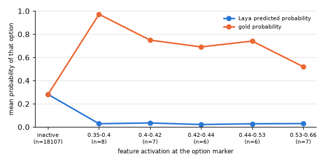

# Feature 1223

Critérios em que aparece: corr_error, corr_probe_right_laya_wrong

**Interpretação (preencher):** 

---

## Maiores ativações

**tr_invoice_processing_000038 / discrepancy_severity** (score, invoice_processing) | ativação 6.152 em `estado` | opções ['0', '1', '2', '3'] | Laya: **2** [0.057, 0.32, 0.536, 0.087] | gabarito: **2**

```
<bos> score question: How material is any discrepancy between the invoice, the order and the delivery?<eos>
▸ <mask> level 0: None: everything reconciles.
▸ <mask> level 1: Trivial: rounding or a cosmetic difference.
▸ <mask> level 2: Moderate: a real difference worth confirming.
▸ <mask> level 3: Material: a large or unexplained difference.

<eos>

 {"delivery": {"condition": "⟦accepted⟧ with exceptions", "date": "2026-03-01", "received_qty": 50}, "invoice": {"currency": "USD", "id": "INV-2026-3588", "lines": [{"qty": 50, "sku": "SKU-203", "total_usd": 11633.5, "unit_usd": 232.67}], "total_usd": 11633.5, "vendor": "Acme Fabrication"}, "payment": {"days_until_due": 5, "discount_expires_in_days": null, "early_payment_discount_pct": null, "status": "scheduled", "terms": "net 30"}, "purchase_order": {"freight_terms": "freight prepaid by vendor, not separately billable", "id": "PO-6472", "lines": [{"qty": 50, "unit_usd": 232.67}], "total_usd": 11633.5}, "vendor_history": {"disputes_12m": 0, "invoices_12m": 3, "prior_invoice_ids": ["INV-2026-7693", "INV-2026-1074", "INV-2026-5345", "INV-2026-5454"]}}<eos>
```

**tr_invoice_processing_000269 / discrepancy_severity** (score, invoice_processing) | ativação 6.074 em `estado` | opções ['0', '1', '2', '3'] | Laya: **2** [0.054, 0.233, 0.639, 0.073] | gabarito: **0**

```
<bos> score question: How material is any discrepancy between the invoice, the order and the delivery?<eos>
▸ <mask> level 0: None: everything reconciles.
▸ <mask> level 1: Trivial: rounding or a cosmetic difference.
▸ <mask> level 2: Moderate: a real difference worth confirming.
▸ <mask> level 3: Material: a large or unexplained difference.

<eos>

 {"delivery": {"condition": "⟦accepted⟧ with exceptions", "date": "2026-03-04", "received_qty": 250}, "invoice": {"currency": "USD", "id": "INV-2026-5045", "lines": [{"qty": 250, "sku": "SKU-657", "total_usd": 71242.5, "unit_usd": 284.97}], "total_usd": 71242.5, "vendor": "Vantage Materials"}, "payment": {"days_until_due": 44, "discount_expires_in_days": null, "early_payment_discount_pct": null, "status": "scheduled", "terms": "net 15"}, "purchase_order": {"freight_terms": "freight prepaid by vendor, not separately billable", "id": "PO-7733", "lines": [{"qty": 250, "unit_usd": 284.97}], "total_usd": 71242.5}, "vendor_history": {"disputes_12m": 0, "invoices_12m": 42, "prior_invoice_ids": ["INV-2026-5045"]}}<eos>
```

**tr_invoice_processing_000289 / discrepancy_severity** (score, invoice_processing) | ativação 6.043 em `estado` | opções ['0', '1', '2', '3'] | Laya: **2** [0.096, 0.35, 0.499, 0.055] | gabarito: **0**

```
<bos> score question: How material is any discrepancy between the invoice, the order and the delivery?<eos>
▸ <mask> level 0: None: everything reconciles.
▸ <mask> level 1: Trivial: rounding or a cosmetic difference.
▸ <mask> level 2: Moderate: a real difference worth confirming.
▸ <mask> level 3: Material: a large or unexplained difference.

<eos>

 {"delivery": {"condition": "⟦accepted⟧ with exceptions", "date": "2026-03-27", "received_qty": 100}, "invoice": {"currency": "USD", "id": "INV-2026-8801", "lines": [{"qty": 100, "sku": "SKU-986", "total_usd": 27049.0, "unit_usd": 270.49}], "total_usd": 27049.0, "vendor": "Orbit Logistics"}, "payment": {"days_until_due": 18, "discount_expires_in_days": 4, "early_payment_discount_pct": 2.0, "status": "scheduled", "terms": "net 30"}, "purchase_order": {"freight_terms": "freight prepaid by vendor, not separately billable", "id": "PO-5260", "lines": [{"qty": 100, "unit_usd": 270.49}], "total_usd": 27049.0}, "vendor_history": {"disputes_12m": 5, "invoices_12m": 52, "prior_invoice_ids": ["INV-2026-2893", "INV-2026-9152", "INV-2026-3271", "INV-2026-5562"]}}<eos>
```

**tr_invoice_processing_000001 / discrepancy_severity** (score, invoice_processing) | ativação 6.031 em `estado` | opções ['0', '1', '2', '3'] | Laya: **2** [0.051, 0.249, 0.589, 0.111] | gabarito: **0**

```
<bos> score question: How material is any discrepancy between the invoice, the order and the delivery?<eos>
▸ <mask> level 0: None: everything reconciles.
▸ <mask> level 1: Trivial: rounding or a cosmetic difference.
▸ <mask> level 2: Moderate: a real difference worth confirming.
▸ <mask> level 3: Material: a large or unexplained difference.

<eos>

 {"delivery": {"condition": "⟦accepted⟧ with exceptions", "date": "2026-03-08", "received_qty": 10}, "invoice": {"currency": "USD", "id": "INV-2026-8254", "lines": [{"qty": 10, "sku": "SKU-168", "total_usd": 940.7, "unit_usd": 94.07}], "total_usd": 940.7, "vendor": "Acme Fabrication"}, "payment": {"days_until_due": -21, "discount_expires_in_days": null, "early_payment_discount_pct": null, "status": "overdue", "terms": "net 45"}, "purchase_order": {"freight_terms": "freight prepaid by vendor, not separately billable", "id": "PO-1546", "lines": [{"qty": 10, "unit_usd": 94.07}], "total_usd": 940.7}, "vendor_history": {"disputes_12m": 0, "invoices_12m": 59, "prior_invoice_ids": ["INV-2026-2851", "INV-2026-4591", "INV-2026-9692", "INV-2026-3009"]}}<eos>
```

**tr_invoice_processing_000108 / discrepancy_severity** (score, invoice_processing) | ativação 6.020 em `estado` | opções ['0', '1', '2', '3'] | Laya: **2** [0.081, 0.365, 0.511, 0.043] | gabarito: **0**

```
<bos> score question: How material is any discrepancy between the invoice, the order and the delivery?<eos>
▸ <mask> level 0: None: everything reconciles.
▸ <mask> level 1: Trivial: rounding or a cosmetic difference.
▸ <mask> level 2: Moderate: a real difference worth confirming.
▸ <mask> level 3: Material: a large or unexplained difference.

<eos>

 {"delivery": {"condition": "⟦accepted⟧ with exceptions", "date": "2026-03-13", "received_qty": 400}, "invoice": {"currency": "USD", "id": "INV-2026-7363", "lines": [{"qty": 400, "sku": "SKU-513", "total_usd": 140000.0, "unit_usd": 350.0}], "total_usd": 140000.0, "vendor": "Orbit Logistics"}, "payment": {"days_until_due": 2, "discount_expires_in_days": 6, "early_payment_discount_pct": 2.0, "status": "scheduled", "terms": "net 30"}, "purchase_order": {"freight_terms": "freight prepaid by vendor, not separately billable", "id": "PO-9819", "lines": [{"qty": 400, "unit_usd": 350.0}], "total_usd": 140000.0}, "vendor_history": {"disputes_12m": 2, "invoices_12m": 45, "prior_invoice_ids": ["INV-2026-4378"]}}<eos>
```

## Ativações medianas (faixa 40-60%, mediana 1.914)

**tr_security_incidents_000118 / urgency** (score, security_incidents) | ativação 1.991 em `estado` | opções ['0', '1', '2', '3'] | Laya: **1** [0.232, 0.289, 0.232, 0.247] | gabarito: **3**

```
<bos> score question: How quickly must a responder act on this alert?<eos>
▸ <mask> level 0: No time pressure; can wait indefinitely.
▸ <mask> level 1: Routine; handle within the normal queue.
▸ <mask> level 2: Elevated; should be handled within the same week.
▸ <mask> level 3: Critical; requires action within the same day.

<eos>

 {"alert": {"description": "an unrecognised binary executed on a server", "evidence": "At 2026-09-15 22:05:41 UTC, admin user svc_admin launched the executable C:\\Temp\\unknown_7d9f.exe on server app01.company.com. The binary's SHA‑256 hash 3a5f9c2e8b7d4e1a9c6f0b1d2e3a4c5d6e7f8a9b0c1d2e3f4a5b6c7d8e9f0a1b is not listed in the approved software inventory.", "rule": "suspicious_process"}, "context": {"asset_criticality": "medium", "change_window_active": false, "source_on_allowlist": true}, "history": {"credential_rotation_days_ago": 3, "distinct_countries_30d": 3, "logins_30d": 921, "prior_alerts_90d": 0}, "⟦principal⟧": {"mfa_enrolled": false, "name": "usr-support-888", "privileges": ["deploy:production", "secrets:read"], "type": "admin"}}<eos>
```

**tr_invoice_processing_000147 / duplicate** (noul, invoice_processing) | ativação 1.874 em `estado` | opções ['false', 'true'] | Laya: **true** [0.018, 0.982] | gabarito: **false**

```
<bos> noul question: This invoice appears to duplicate an invoice already submitted.<eos>
▸ <mask> false: no, the statement does not hold
▸ <mask> true: yes, the statement holds

<eos>

 {"delivery": {"condition": "accepted", "date": "2026-03-01", "received_qty": 10}, "invoice": {"currency": "USD", "id": "INV-2026-5821", "lines": [{"qty": 10, "sku": "SKU-582", "total_usd": 1289.7, "unit_usd": 128.97}, {"qty": 1, "sku": "FREIGHT", "total_usd": 789.37, "unit_usd": 789.37}], "total_usd": 2079.07, "vendor": "Orbit Logistics"}, "payment": {"days_until_due": 11, "discount_expires_in_days": null, "early_payment_discount_pct": null, "status": "⟦scheduled⟧", "terms": "net 45"}, "purchase_order": {"freight_terms": "freight prepaid by vendor, not separately billable", "id": "PO-6078", "lines": [{"qty": 10, "unit_usd": 128.97}], "total_usd": 1289.7}, "vendor_history": {"disputes_12m": 0, "invoices_12m": 17, "prior_invoice_ids": ["INV-2026-8531", "INV-2026-5603", "INV-2026-2834", "INV-2026-2338"]}}<eos>
```

**tr_invoice_processing_000026 / duplicate** (noul, invoice_processing) | ativação 1.888 em `estado` | opções ['false', 'true'] | Laya: **true** [0.016, 0.984] | gabarito: **false**

```
<bos> noul question: This invoice appears to duplicate an invoice already submitted.<eos>
▸ <mask> false: no, the statement does not hold
▸ <mask> true: yes, the statement holds

<eos>

 {"delivery": {"condition": "accepted", "date": "2026-03-01", "received_qty": 25}, "invoice": {"currency": "USD", "id": "INV-2026-4433", "lines": [{"qty": 25, "sku": "SKU-294", "total_usd": 8313.5, "unit_usd": 332.54}], "total_usd": 8313.5, "vendor": "Kestrel Supply"}, "payment": {"days_until_due": 2, "discount_expires_in_days": null, "early_payment_discount_pct": null, "status": "⟦scheduled⟧", "terms": "net 45"}, "purchase_order": {"freight_terms": "freight prepaid by vendor, not separately billable", "id": "PO-2485", "lines": [{"qty": 25, "unit_usd": 332.54}], "total_usd": 8313.5}, "vendor_history": {"disputes_12m": 5, "invoices_12m": 55, "prior_invoice_ids": ["INV-2026-2147"]}}<eos>
```

**tr_customer_service_000030 / category** (choice, customer_service) | ativação 2.033 em `estado` | opções ['account', 'billing', 'delivery', 'refund', 'technical'] | Laya: **billing** [0.0, 1.0, 0.0, 0.0, 0.0] | gabarito: **billing**

```
<bos> choice question: What is this customer conversation primarily about?<eos>
▸ <mask> account: Login, plan changes, profile or access management.
▸ <mask> billing: A charge, invoice, subscription or payment problem.
▸ <mask> delivery: Shipping, fulfilment or delivery of a physical item.
▸ <mask> refund: The customer is explicitly asking for money back.
▸ <mask> technical: The product or service is not working as expected.

<eos>

 {"account": {"lifetime_value_usd": 5295, "prior_tickets_90d": 1, "seats": 1, "tenure_months": 72, "tier": "premium"}, "thread": [{"role": "customer", "text": "Hello, I’ve been a loyal subscriber for six years now, but I’ve just noticed an unexpected change in my premium plan billing. I really need to get this sorted out before the end of the business day today, if possible."}, {"role": "agent", "text": "I see you’ve been with us for quite a while, and I understand you’re looking into an unexpected charge on your account. Could you please provide the billing date and the specific invoice number you are referencing?"}, {"role": "⟦customer⟧", "text": "Thank you for looking into this. The invoice number is #99283 and the date is from this morning. It seems higher than the usual amount for the premium tier; I just need to understand why this fluctuation occurred before my deadline arrives."}]}<eos>
```

**tr_security_incidents_000081 / credential_compromise** (noul, security_incidents) | ativação 1.872 em `estado` | opções ['false', 'true'] | Laya: **true** [0.026, 0.974] | gabarito: **false**

```
<bos> noul question: The evidence indicates a credential or account has been compromised.<eos>
▸ <mask> false: no, the statement does not hold
▸ <mask> true: yes, the statement holds

<eos>

 {"alert": {"description": "a first-ever sign-in from an unfamiliar country", "evidence": "At 2026-09-15 03:42:10 UTC, the unprivileged service account \"svc_sync\" logged in from IP 203.0.113.45, which resolves to a country with no prior successful logins for this account. The login occurred during an active change window, the source host was not recognized, and the account's credentials were last rotated 90 days earlier.", "rule": "new_country_login"}, "context": {"asset_criticality": "high", "change_window_active": true, "source_on_allowlist": false}, "history": {"credential_rotation_days_ago": 90, "distinct_countries_30d": 3, "logins_30d": 120, "prior_alerts_90d": 0}, "⟦principal⟧": {"mfa_enrolled": false, "name": "ci-analytics-563", "privileges": ["repo:read"], "type": "service_account"}}<eos>
```

## Estatísticas (conjunto de descoberta, dev e teste)

**pred / error**

| split | decisões | ativas | ativas e Laya errou | taxa | lift | q (BH) | OR (CMH) | q (CMH) |
|---|---|---|---|---|---|---|---|---|
| discovery | 5100 | 0 | 0 | nan | nan | nan | nan | nan |
| dev | 900 | 0 | 0 | nan | nan | nan | nan | nan |
| test | 2000 | 0 | 0 | nan | nan | nan | nan | nan |

**corr / error**

| split | decisões | ativas | ativas e Laya errou | taxa | lift | q (BH) | OR (CMH) | q (CMH) |
|---|---|---|---|---|---|---|---|---|
| discovery | 5100 | 22 | 22 | 1.000 | 1.55 | 0.000227 | nan | nan |
| dev | 900 | 2 | 2 | 1.000 | 1.49 | nan | nan | nan |
| test | 2000 | 9 | 9 | 1.000 | 1.54 | nan | nan | nan |

**state / error**

| split | decisões | ativas | ativas e Laya errou | taxa | lift | q (BH) | OR (CMH) | q (CMH) |
|---|---|---|---|---|---|---|---|---|
| discovery | 5100 | 3387 | 2157 | 0.637 | 0.99 | 0.288 | 0.89 | 0.474 |
| dev | 900 | 644 | 430 | 0.668 | 0.99 | 0.961 | 0.67 | 0.384 |
| test | 2000 | 1341 | 859 | 0.641 | 0.98 | 0.476 | 0.72 | 0.25 |

**pred / probe_right_laya_wrong**

| split | decisões | ativas | ativas e Laya errou | taxa | lift | q (BH) | OR (CMH) | q (CMH) |
|---|---|---|---|---|---|---|---|---|
| discovery | 2932 | 0 | 0 | nan | nan | nan | nan | nan |
| dev | 523 | 0 | 0 | nan | nan | nan | nan | nan |
| test | 1149 | 0 | 0 | nan | nan | nan | nan | nan |

**corr / probe_right_laya_wrong**

| split | decisões | ativas | ativas e Laya errou | taxa | lift | q (BH) | OR (CMH) | q (CMH) |
|---|---|---|---|---|---|---|---|---|
| discovery | 2932 | 22 | 22 | 1.000 | 1.65 | 5.81e-05 | nan | nan |
| dev | 523 | 2 | 2 | 1.000 | 1.55 | nan | nan | nan |
| test | 1149 | 9 | 9 | 1.000 | 1.64 | nan | nan | nan |

**state / probe_right_laya_wrong**

| split | decisões | ativas | ativas e Laya errou | taxa | lift | q (BH) | OR (CMH) | q (CMH) |
|---|---|---|---|---|---|---|---|---|
| discovery | 2932 | 2058 | 1258 | 0.611 | 1.01 | 0.468 | 0.96 | 0.896 |
| dev | 523 | 391 | 257 | 0.657 | 1.02 | 0.735 | 0.66 | 0.492 |
| test | 1149 | 812 | 491 | 0.605 | 0.99 | 0.777 | 0.64 | 0.164 |

Confusão mais sobre-representada (corr): `duplicate|1>0` (n=22, lift 23.50, p=2.38e-31). Formato `pergunta|índice previsto>índice correto`.

Confusão mais sobre-representada (state): `duplicate|1>0` (n=217, lift 1.51, p=2.4e-40). Formato `pergunta|índice previsto>índice correto`.



