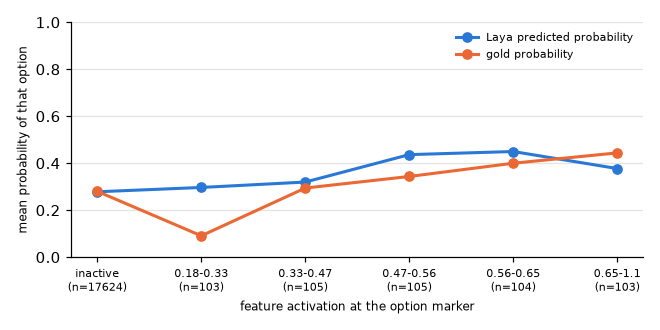

# Feature 1308

Critérios em que aparece: corr_probe_right_laya_wrong_stratified

**Interpretação (preencher):** 

---

## Maiores ativações

**tr_customer_service_000123 / category** (choice, customer_service) | ativação 3.035 em `estado` | opções ['account', 'billing', 'delivery', 'refund', 'technical'] | Laya: **account** [0.994, 0.0, 0.0, 0.0, 0.005] | gabarito: **account**

```
<bos> choice question: What is this customer conversation primarily about?<eos>
▸ <mask> account: Login, plan changes, profile or access management.
▸ <mask> billing: A charge, invoice, subscription or payment problem.
▸ <mask> delivery: Shipping, fulfilment or delivery of a physical item.
▸ <mask> refund: The customer is explicitly asking for money back.
▸ <mask> technical: The product or service is not working as expected.

<eos>

 {"account": {"lifetime_value_usd": 154, "prior_tickets_90d": 1, "seats": 5, "tenure_months": 2, "tier": "premium"}, "thread": [{"role": "customer", "text": "Hello there. I'm having a bit of a problem logging into my Premium account this morning⟦.⟧ It keeps telling me my credentials aren't recognized, even though I haven't changed them."}, {"role": "agent", "text": "I'd be happy to help you with that. Are you seeing a specific error code, or is it just the standard 'invalid password' notification?"}, {"role": "customer", "text": "It says 'User not found.' I had a ticket open last week about account syncing and the agent promised it would be fixed by now, but it seems I'm still locked out."}, {"role": "agent", "text": "I see. Since you mentioned the previous ticket, did you receive a confirmation email or a link to verify your identity after that interaction?"}, {"role": "customer", "text": "No, I never received any follow-up email at all, which is why I'm reaching out again. I've only been using the service for two months and I really like it, but I can't use what I can't access."}, {"role": "agent", "text": "I appreciate your patience while we work through this. Could you please confirm the primary email address associated with your account so I can check the status of your profile?"}, {"role": "customer", "text": "Of course, it's j.smith@example.com. I have a hard deadline for a project presentation at 1:00 PM today that requires the data in that account, so if you could check on that for me, I'd appreciate it."}]}<eos>
```

**tr_customer_service_000123 / action** (choice, customer_service) | ativação 2.922 em `estado` | opções ['answer_directly', 'close_no_action', 'escalate_to_human', 'execute_refund', 'request_information'] | Laya: **answer_directly** [0.718, 0.173, 0.058, 0.019, 0.032] | gabarito: **escalate_to_human**

```
<bos> choice question: What should the assistant do next with this conversation?<eos>
▸ <mask> answer_directly: The assistant can resolve this itself with information it already has.
▸ <mask> close_no_action: No further action is warranted; the matter is settled.
▸ <mask> escalate_to_human: Hand off to a human agent with the appropriate authority.
▸ <mask> execute_refund: Issue the refund or credit the customer is owed.
▸ <mask> request_information: More detail is needed from the customer before anything can be done.

<eos>

 {"account": {"lifetime_value_usd": 154, "prior_tickets_90d": 1, "seats": 5, "tenure_months": 2, "tier": "premium"}, "thread": [{"role": "customer", "text": "Hello there. I'm having a bit of a problem logging into my Premium account this morning⟦.⟧ It keeps telling me my credentials aren't recognized, even though I haven't changed them."}, {"role": "agent", "text": "I'd be happy to help you with that. Are you seeing a specific error code, or is it just the standard 'invalid password' notification?"}, {"role": "customer", "text": "It says 'User not found.' I had a ticket open last week about account syncing and the agent promised it would be fixed by now, but it seems I'm still locked out."}, {"role": "agent", "text": "I see. Since you mentioned the previous ticket, did you receive a confirmation email or a link to verify your identity after that interaction?"}, {"role": "customer", "text": "No, I never received any follow-up email at all, which is why I'm reaching out again. I've only been using the service for two months and I really like it, but I can't use what I can't access."}, {"role": "agent", "text": "I appreciate your patience while we work through this. Could you please confirm the primary email address associated with your account so I can check the status of your profile?"}, {"role": "customer", "text": "Of course, it's j.smith@example.com. I have a hard deadline for a project presentation at 1:00 PM today that requires the data in that account, so if you could check on that for me, I'd appreciate it."}]}<eos>
```

**tr_customer_service_000123 / churn_risk** (score, customer_service) | ativação 2.920 em `estado` | opções ['0', '1', '2', '3'] | Laya: **2** [0.139, 0.309, 0.43, 0.122] | gabarito: **2**

```
<bos> score question: How likely is this customer to stop doing business with us because of this interaction?<eos>
▸ <mask> level 0: No sign of dissatisfaction.
▸ <mask> level 1: Mild frustration, but the relationship is intact.
▸ <mask> level 2: Clearly unhappy; repeat problems or explicit complaints.
▸ <mask> level 3: Imminent: threatening to cancel, dispute or leave.

<eos>

 {"account": {"lifetime_value_usd": 154, "prior_tickets_90d": 1, "seats": 5, "tenure_months": 2, "tier": "premium"}, "thread": [{"role": "customer", "text": "Hello there. I'm having a bit of a problem logging into my Premium account this morning⟦.⟧ It keeps telling me my credentials aren't recognized, even though I haven't changed them."}, {"role": "agent", "text": "I'd be happy to help you with that. Are you seeing a specific error code, or is it just the standard 'invalid password' notification?"}, {"role": "customer", "text": "It says 'User not found.' I had a ticket open last week about account syncing and the agent promised it would be fixed by now, but it seems I'm still locked out."}, {"role": "agent", "text": "I see. Since you mentioned the previous ticket, did you receive a confirmation email or a link to verify your identity after that interaction?"}, {"role": "customer", "text": "No, I never received any follow-up email at all, which is why I'm reaching out again. I've only been using the service for two months and I really like it, but I can't use what I can't access."}, {"role": "agent", "text": "I appreciate your patience while we work through this. Could you please confirm the primary email address associated with your account so I can check the status of your profile?"}, {"role": "customer", "text": "Of course, it's j.smith@example.com. I have a hard deadline for a project presentation at 1:00 PM today that requires the data in that account, so if you could check on that for me, I'd appreciate it."}]}<eos>
```

**tr_customer_service_000123 / urgency** (score, customer_service) | ativação 2.896 em `estado` | opções ['0', '1', '2', '3'] | Laya: **1** [0.074, 0.416, 0.403, 0.108] | gabarito: **3**

```
<bos> score question: How time-sensitive is this conversation?<eos>
▸ <mask> level 0: No time pressure; can wait indefinitely.
▸ <mask> level 1: Routine; handle within the normal queue.
▸ <mask> level 2: Elevated; should be handled within the same week.
▸ <mask> level 3: Critical; requires action within the same day.

<eos>

 {"account": {"lifetime_value_usd": 154, "prior_tickets_90d": 1, "seats": 5, "tenure_months": 2, "tier": "premium"}, "thread": [{"role": "customer", "text": "Hello there. I'm having a bit of a problem logging into my Premium account this morning⟦.⟧ It keeps telling me my credentials aren't recognized, even though I haven't changed them."}, {"role": "agent", "text": "I'd be happy to help you with that. Are you seeing a specific error code, or is it just the standard 'invalid password' notification?"}, {"role": "customer", "text": "It says 'User not found.' I had a ticket open last week about account syncing and the agent promised it would be fixed by now, but it seems I'm still locked out."}, {"role": "agent", "text": "I see. Since you mentioned the previous ticket, did you receive a confirmation email or a link to verify your identity after that interaction?"}, {"role": "customer", "text": "No, I never received any follow-up email at all, which is why I'm reaching out again. I've only been using the service for two months and I really like it, but I can't use what I can't access."}, {"role": "agent", "text": "I appreciate your patience while we work through this. Could you please confirm the primary email address associated with your account so I can check the status of your profile?"}, {"role": "customer", "text": "Of course, it's j.smith@example.com. I have a hard deadline for a project presentation at 1:00 PM today that requires the data in that account, so if you could check on that for me, I'd appreciate it."}]}<eos>
```

**tr_customer_service_000123 / needs_human** (noul, customer_service) | ativação 2.824 em `estado` | opções ['false', 'true'] | Laya: **true** [0.373, 0.627] | gabarito: **true**

```
<bos> noul question: This conversation requires a human agent rather than automated handling.<eos>
▸ <mask> false: Automation can carry this to resolution.
▸ <mask> true: A human must take over: judgement, authority or empathy is required.

<eos>

 {"account": {"lifetime_value_usd": 154, "prior_tickets_90d": 1, "seats": 5, "tenure_months": 2, "tier": "premium"}, "thread": [{"role": "customer", "text": "Hello there. I'm having a bit of a problem logging into my Premium account this morning⟦.⟧ It keeps telling me my credentials aren't recognized, even though I haven't changed them."}, {"role": "agent", "text": "I'd be happy to help you with that. Are you seeing a specific error code, or is it just the standard 'invalid password' notification?"}, {"role": "customer", "text": "It says 'User not found.' I had a ticket open last week about account syncing and the agent promised it would be fixed by now, but it seems I'm still locked out."}, {"role": "agent", "text": "I see. Since you mentioned the previous ticket, did you receive a confirmation email or a link to verify your identity after that interaction?"}, {"role": "customer", "text": "No, I never received any follow-up email at all, which is why I'm reaching out again. I've only been using the service for two months and I really like it, but I can't use what I can't access."}, {"role": "agent", "text": "I appreciate your patience while we work through this. Could you please confirm the primary email address associated with your account so I can check the status of your profile?"}, {"role": "customer", "text": "Of course, it's j.smith@example.com. I have a hard deadline for a project presentation at 1:00 PM today that requires the data in that account, so if you could check on that for me, I'd appreciate it."}]}<eos>
```

## Ativações medianas (faixa 40-60%, mediana 0.636)

**tr_invoice_processing_000141 / disposition** (choice, invoice_processing) | ativação 0.576 em `opção` | opções ['approve', 'hold', 'manual_review', 'reject'] | Laya: **approve** [0.52, 0.122, 0.015, 0.343] | gabarito: **manual_review**

```
<bos> choice question: How should this vendor invoice be dispositioned?<eos>
▸ <mask> approve: Matches the order and delivery; approve for payment⟦.⟧
▸ <mask> hold: Something needs confirming before payment; hold pending clarification.
▸ <mask> manual_review: A human in finance must review the discrepancy.
▸ <mask> reject: Should not be paid: duplicate, unauthorised or materially wrong.

<eos>

 {"delivery": {"condition": "accepted", "date": "2026-03-04", "received_qty": 400}, "invoice": {"currency": "USD", "id": "INV-2026-9876", "lines": [{"qty": 400, "sku": "SKU-665", "total_usd": 40408.0, "unit_usd": 101.02}, {"qty": 1, "sku": "FREIGHT", "total_usd": 1975.55, "unit_usd": 1975.55}], "total_usd": 42383.55, "vendor": "Kestrel Supply"}, "payment": {"days_until_due": -9, "discount_expires_in_days": null, "early_payment_discount_pct": null, "status": "overdue", "terms": "net 60"}, "purchase_order": {"freight_terms": "freight prepaid by vendor, not separately billable", "id": "PO-5110", "lines": [{"qty": 400, "unit_usd": 101.02}], "total_usd": 40408.0}, "vendor_history": {"disputes_12m": 0, "invoices_12m": 12, "prior_invoice_ids": ["INV-2026-3144", "INV-2026-2282", "INV-2026-7894", "INV-2026-6333"]}}<eos>
```

**tr_security_incidents_000270 / true_positive** (noul, security_incidents) | ativação 0.688 em `opção` | opções ['false', 'true'] | Laya: **true** [0.008, 0.992] | gabarito: **true**

```
<bos> noul question: This alert reflects genuinely malicious or unauthorised activity.<eos>
▸ <mask> false: Benign activity, a misconfiguration, or a known false positive⟦.⟧
▸ <mask> true: The underlying behaviour is malicious or unauthorised.

<eos>

 {"alert": {"description": "an endpoint agent matched a known signature", "evidence": "On 2026-09-15 at 14:32:07 UTC, the endpoint sensor on host WIN-34A9F reported the execution of C:\\Temp\\malicious.exe, whose hash (SHA‑256: a1b2c3d4…) matched a known malware signature. The event was generated by a contractor account with MFA enabled, and the credential for that account was last rotated 180 days prior.", "rule": "malware_signature"}, "context": {"asset_criticality": "crown_jewel", "change_window_active": false, "source_on_allowlist": false}, "history": {"credential_rotation_days_ago": 180, "distinct_countries_30d": 3, "logins_30d": 924, "prior_alerts_90d": 0}, "principal": {"mfa_enrolled": true, "name": "usr-infra-611", "privileges": ["repo:read"], "type": "contractor"}}<eos>
```

**tr_customer_service_000233 / needs_human** (noul, customer_service) | ativação 0.617 em `opção` | opções ['false', 'true'] | Laya: **true** [0.411, 0.589] | gabarito: **true**

```
<bos> noul question: This conversation requires a human agent rather than automated handling.<eos>
▸ <mask> false: Automation can carry this to resolution⟦.⟧
▸ <mask> true: A human must take over: judgement, authority or empathy is required.

<eos>

 {"account": {"lifetime_value_usd": 273, "prior_tickets_90d": 2, "seats": 1, "tenure_months": 14, "tier": "free"}, "orders": [{"amount_usd": 29, "date": "2026-02-02", "id": "A-72334", "status": "settled"}, {"amount_usd": 29, "date": "2026-01-16", "id": "A-43421", "status": "settled"}], "thread": [{"role": "customer", "text": "I just opened my delivery and you sent me the wrong replacement part, I ordered the $29 filter kit but I received a pack of gaskets instead. I have an inspection scheduled for tomorrow morning and I absolutely must have the right parts installed by then."}, {"role": "agent", "text": "I'm sorry to hear that the incorrect items were delivered. Could you please provide the order number located on your packing slip so I can check the shipment details?"}, {"role": "customer", "text": "The order number is 44921-A. This is the third time I've had to reach out about shipping errors in the last year and I'm really in a bind here. Is there any way to get the correct filter kit to me today?"}, {"role": "agent", "text": "I've pulled up the order and see the filter kit listed. For our records, could you please describe any labels or SKU numbers visible on the packaging of the gaskets you received by mistake?"}, {"role": "customer", "text": "The sticker says G-992-X, but I really don't have time for a back-and-forth investigation. I need to know immediately how we can fix this because the inspector will be here at 9 AM and the system won't pass without those specific filters."}]}<eos>
```

**tr_security_incidents_000177 / credential_compromise** (noul, security_incidents) | ativação 0.699 em `opção` | opções ['false', 'true'] | Laya: **true** [0.35, 0.65] | gabarito: **false**

```
<bos> noul question: The evidence indicates a credential or account has been compromised.<eos>
▸ <mask> false: no, the statement does not hold
▸ <mask> true: yes⟦,⟧ the statement holds

<eos>

 {"alert": {"description": "a first-ever sign-in from an unfamiliar country", "evidence": "At 2026-09-15 02:13:47 UTC, employee user jdoe performed a sign‑in from IP 203.0.113.45 located in Brazil, a country not seen in prior login history for this account. The authentication succeeded with MFA, and the account's password was last rotated on 2026-09-01. No change window was active at the time of the event.", "rule": "new_country_login"}, "context": {"asset_criticality": "medium", "change_window_active": false, "source_on_allowlist": false}, "history": {"credential_rotation_days_ago": 14, "distinct_countries_30d": 3, "logins_30d": 1743, "prior_alerts_90d": 0}, "principal": {"mfa_enrolled": true, "name": "adm-analytics-183", "privileges": ["repo:read"], "type": "employee"}}<eos>
```

**tr_agent_trace_observability_000171 / needs_review** (noul, agent_trace_observability) | ativação 0.679 em `opção` | opções ['false', 'true'] | Laya: **false** [0.933, 0.067] | gabarito: **true**

```
<bos> noul question: This trace requires human review.<eos>
▸ <mask> false: No human attention is warranted⟦.⟧
▸ <mask> true: A human should inspect this run.

<eos>

 {"agent": {"autonomy": "unsupervised", "model": "internal-agent-v1"}, "constraints": ["Do not touch customer data outside the named accounts", "Never modify production without an approved change ticket"], "task": "Delete personal data for the accounts in the erasure queue.", "trace_summary": {"constraint_violations": 0, "duration_s": 599.7, "irreversible_actions": 0, "steps": 4, "tool_errors": 2}}<eos>
```

## Estatísticas (conjunto de descoberta, dev e teste)

**pred / error**

| split | decisões | ativas | ativas e Laya errou | taxa | lift | q (BH) | OR (CMH) | q (CMH) |
|---|---|---|---|---|---|---|---|---|
| discovery | 5100 | 179 | 89 | 0.497 | 0.77 | 0.000217 | 1.13 | 0.761 |
| dev | 900 | 26 | 18 | 0.692 | 1.03 | 1 | 2.09 | 0.625 |
| test | 2000 | 70 | 31 | 0.443 | 0.68 | 0.00175 | 0.82 | 0.911 |

**corr / error**

| split | decisões | ativas | ativas e Laya errou | taxa | lift | q (BH) | OR (CMH) | q (CMH) |
|---|---|---|---|---|---|---|---|---|
| discovery | 5100 | 164 | 74 | 0.451 | 0.70 | 1.25e-06 | 2.27 | 0.000372 |
| dev | 900 | 21 | 13 | 0.619 | 0.92 | 0.823 | 3.65 | 0.0274 |
| test | 2000 | 68 | 29 | 0.426 | 0.66 | 0.000429 | 2.37 | 0.0436 |

**state / error**

| split | decisões | ativas | ativas e Laya errou | taxa | lift | q (BH) | OR (CMH) | q (CMH) |
|---|---|---|---|---|---|---|---|---|
| discovery | 5100 | 1464 | 898 | 0.613 | 0.95 | 0.0178 | 1.08 | 0.6 |
| dev | 900 | 249 | 158 | 0.635 | 0.94 | 0.499 | 1.18 | 0.728 |
| test | 2000 | 539 | 322 | 0.597 | 0.92 | 0.0441 | 0.93 | 0.811 |

**pred / probe_right_laya_wrong**

| split | decisões | ativas | ativas e Laya errou | taxa | lift | q (BH) | OR (CMH) | q (CMH) |
|---|---|---|---|---|---|---|---|---|
| discovery | 2932 | 88 | 28 | 0.318 | 0.53 | 2.84e-07 | 0.78 | 0.567 |
| dev | 523 | 13 | 6 | 0.462 | 0.71 | nan | nan | nan |
| test | 1149 | 36 | 12 | 0.333 | 0.55 | 0.00311 | 0.59 | 0.59 |

**corr / probe_right_laya_wrong**

| split | decisões | ativas | ativas e Laya errou | taxa | lift | q (BH) | OR (CMH) | q (CMH) |
|---|---|---|---|---|---|---|---|---|
| discovery | 2932 | 98 | 38 | 0.388 | 0.64 | 3.16e-05 | 3.14 | 0.000387 |
| dev | 523 | 14 | 7 | 0.500 | 0.77 | nan | nan | nan |
| test | 1149 | 38 | 14 | 0.368 | 0.60 | 0.00631 | 2.25 | 0.308 |

**state / probe_right_laya_wrong**

| split | decisões | ativas | ativas e Laya errou | taxa | lift | q (BH) | OR (CMH) | q (CMH) |
|---|---|---|---|---|---|---|---|---|
| discovery | 2932 | 828 | 461 | 0.557 | 0.92 | 0.00335 | 1.19 | 0.251 |
| dev | 523 | 139 | 82 | 0.590 | 0.91 | 0.391 | 1.51 | 0.345 |
| test | 1149 | 311 | 173 | 0.556 | 0.91 | 0.115 | 1.12 | 0.734 |

Confusão mais sobre-representada (pred): `churn_risk|1>2` (n=19, lift 9.67, p=1.21e-14). Formato `pergunta|índice previsto>índice correto`.

Confusão mais sobre-representada (corr): `credential_compromise|0>1` (n=18, lift 25.44, p=3.47e-24). Formato `pergunta|índice previsto>índice correto`.

Confusão mais sobre-representada (state): `needs_human|0>1` (n=32, lift 2.06, p=2.46e-06). Formato `pergunta|índice previsto>índice correto`.



