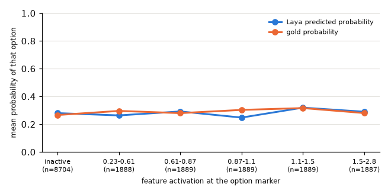

# Feature 1317

Critérios em que aparece: attribution_toward_wrong

**Interpretação (preencher):** 

---

## Maiores ativações

**tr_customer_service_000273 / category** (choice, customer_service) | ativação 8.203 em `estado` | opções ['account', 'billing', 'delivery', 'refund', 'technical'] | Laya: **billing** [0.0, 1.0, 0.0, 0.0, 0.0] | gabarito: **account**

```
<bos> choice question: What is this customer conversation primarily about?<eos>
▸ <mask> account: Login, plan changes, profile or access management.
▸ <mask> billing: A charge, invoice, subscription or payment problem.
▸ <mask> delivery: Shipping, fulfilment or delivery of a physical item.
▸ <mask> refund: The customer is explicitly asking for money back.
▸ <mask> technical: The product or service is not working as expected.

<eos>

 {"account": {"lifetime_value_usd": 278, "prior_tickets_90d": 2, "seats": 1, "tenure_months": 8, "tier": "free"}, "orders": [{"amount_usd": 598, "date": "2026-02-17", "id": "A-18443", "status": "pending⟦"},⟧ {"amount_usd": 598, "date": "2026-02-01", "id": "A-75942", "status": "refunded"}], "thread": [{"role": "customer", "text": "I’d like to cancel the account. I’ve been on the free plan for about eight months, and there’s roughly $598 tied up. There are two older tickets that haven’t been resolved."}, {"role": "agent", "text": "I’m sorry to hear that. Could you confirm the account email so I can look at the open items?"}, {"role": "customer", "text": "It’s the email on the billing page. I’m not in a hurry, but I need the cancellation request to stay open until those tickets are handled."}]}<eos>
```

**tr_customer_service_000058 / action** (choice, customer_service) | ativação 8.188 em `estado` | opções ['answer_directly', 'close_no_action', 'escalate_to_human', 'execute_refund', 'request_information'] | Laya: **close_no_action** [0.112, 0.768, 0.031, 0.084, 0.005] | gabarito: **answer_directly**

```
<bos> choice question: What should the assistant do next with this conversation?<eos>
▸ <mask> answer_directly: The assistant can resolve this itself with information it already has.
▸ <mask> close_no_action: No further action is warranted; the matter is settled.
▸ <mask> escalate_to_human: Hand off to a human agent with the appropriate authority.
▸ <mask> execute_refund: Issue the refund or credit the customer is owed.
▸ <mask> request_information: More detail is needed from the customer before anything can be done.

<eos>

 {"account": {"lifetime_value_usd": 386, "prior_tickets_90d": 0, "seats": 3, "tenure_months": 5, "tier": "enterprise"}, "orders": [{"amount_usd": 49, "date": "2026-03-18", "id": "A-70177", "status": "refunded"}, {"amount_usd": 49, "date": "2026-01-12", "id": "A-80512", "status": "refunded⟦"},⟧ {"amount_usd": 49, "date": "2026-03-04", "id": "A-71911", "status": "failed"}], "thread": [{"role": "customer", "text": "I’d like to request a data export from our account; I’m not in a rush, just need to know the steps."}, {"role": "agent", "text": "Sure thing. Which format would you prefer for the export?"}, {"role": "customer", "text": "CSV works for us. Also, could you tell me roughly how long the process takes?"}, {"role": "agent", "text": "I’ll check on the timing. Do you need the export for a specific date range?"}, {"role": "customer", "text": "Just the last month up to today, and I understand it may not be immediate."}, {"role": "agent", "text": "Thanks for confirming. I’ll queue the request and let you know when it’s ready. Anything else you’d like to add?"}, {"role": "customer", "text": "That’s all for now, thank you."}]}<eos>
```

**tr_customer_service_000270 / churn_risk** (score, customer_service) | ativação 8.164 em `estado` | opções ['0', '1', '2', '3'] | Laya: **1** [0.14, 0.527, 0.228, 0.105] | gabarito: **2**

```
<bos> score question: How likely is this customer to stop doing business with us because of this interaction?<eos>
▸ <mask> level 0: No sign of dissatisfaction.
▸ <mask> level 1: Mild frustration, but the relationship is intact.
▸ <mask> level 2: Clearly unhappy; repeat problems or explicit complaints.
▸ <mask> level 3: Imminent: threatening to cancel, dispute or leave.

<eos>

 {"account": {"lifetime_value_usd": 1765, "prior_tickets_90d": 2, "seats": 1, "tenure_months": 19, "tier": "standard"}, "orders": [{"amount_usd": 149, "date": "2026-02-28", "id": "A-88466", "status": "settled⟦"},⟧ {"amount_usd": 149, "date": "2026-02-27", "id": "A-17979", "status": "settled"}], "thread": [{"role": "customer", "text": "Hello, I’m writing about the seat‑management issue we’ve been seeing on our account. We’re on the standard plan, have been a customer for 19 months, and the monthly charge is about $149. This is the third time I’m reaching out—two earlier tickets were only partially addressed, and I have a hard deadline next Friday to reassign a few seats for an upcoming project."}, {"role": "agent", "text": "Thank you for the details. I’m sorry the prior tickets didn’t fully resolve the problem. Could you let me know exactly how many seats are affected and what the current error looks like?"}, {"role": "customer", "text": "Sure. We have five seats that are stuck in “pending” status, and when I try to move them to a different team they bounce back with a generic “operation failed” message. It’s preventing us from finalizing the team roster before the Friday deadline."}, {"role": "agent", "text": "Got it, five pending seats with a generic failure notice. Are there any particular teams or roles involved that might help us narrow down the cause?"}, {"role": "customer", "text": "The seats belong to our Marketing and Sales groups. Both groups use custom role configurations we set up last quarter, and the issue started after we added a new role hierarchy."}, {"role": "agent", "text": "Understood. I’ll note the custom role configurations and the recent hierarchy change. Just to confirm, have you noticed any impact on your billing or subscription status while this is happening?"}, {"role": "customer", "text": "No billing issues so far, but I really need those seats moved before Friday. Please let me know what you need from me to keep this moving forward."}]}<eos>
```

**tr_customer_service_000043 / category** (choice, customer_service) | ativação 8.141 em `estado` | opções ['account', 'billing', 'delivery', 'refund', 'technical'] | Laya: **account** [0.892, 0.008, 0.008, 0.005, 0.087] | gabarito: **account**

```
<bos> choice question: What is this customer conversation primarily about?<eos>
▸ <mask> account: Login, plan changes, profile or access management.
▸ <mask> billing: A charge, invoice, subscription or payment problem.
▸ <mask> delivery: Shipping, fulfilment or delivery of a physical item.
▸ <mask> refund: The customer is explicitly asking for money back.
▸ <mask> technical: The product or service is not working as expected.

<eos>

 {"account": {"lifetime_value_usd": 208, "prior_tickets_90d": 0, "seats": 1, "tenure_months": 3, "tier": "free"}, "orders": [{"amount_usd": 999, "date": "2026-03-09", "id": "A-17017", "status": "refunded⟦"},⟧ {"amount_usd": 999, "date": "2026-01-04", "id": "A-58989", "status": "failed"}], "thread": [{"role": "customer", "text": "I need to get my data out of the system, but I’m not holding my breath—it probably won’t happen any time soon."}, {"role": "agent", "text": "I hear you. Could you tell me which parts of your account you’d like included in the export?"}, {"role": "customer", "text": "Just the basic account information—profile details and settings. Nothing fancy."}, {"role": "agent", "text": "Understood. Do you have a preferred format for the file—CSV, JSON, or something else?"}, {"role": "customer", "text": "Whatever you can manage, I don’t mind waiting."}]}<eos>
```

**tr_customer_service_000058 / category** (choice, customer_service) | ativação 8.133 em `estado` | opções ['account', 'billing', 'delivery', 'refund', 'technical'] | Laya: **account** [0.583, 0.027, 0.004, 0.002, 0.384] | gabarito: **account**

```
<bos> choice question: What is this customer conversation primarily about?<eos>
▸ <mask> account: Login, plan changes, profile or access management.
▸ <mask> billing: A charge, invoice, subscription or payment problem.
▸ <mask> delivery: Shipping, fulfilment or delivery of a physical item.
▸ <mask> refund: The customer is explicitly asking for money back.
▸ <mask> technical: The product or service is not working as expected.

<eos>

 {"account": {"lifetime_value_usd": 386, "prior_tickets_90d": 0, "seats": 3, "tenure_months": 5, "tier": "enterprise"}, "orders": [{"amount_usd": 49, "date": "2026-03-18", "id": "A-70177", "status": "refunded"}, {"amount_usd": 49, "date": "2026-01-12", "id": "A-80512", "status": "refunded⟦"},⟧ {"amount_usd": 49, "date": "2026-03-04", "id": "A-71911", "status": "failed"}], "thread": [{"role": "customer", "text": "I’d like to request a data export from our account; I’m not in a rush, just need to know the steps."}, {"role": "agent", "text": "Sure thing. Which format would you prefer for the export?"}, {"role": "customer", "text": "CSV works for us. Also, could you tell me roughly how long the process takes?"}, {"role": "agent", "text": "I’ll check on the timing. Do you need the export for a specific date range?"}, {"role": "customer", "text": "Just the last month up to today, and I understand it may not be immediate."}, {"role": "agent", "text": "Thanks for confirming. I’ll queue the request and let you know when it’s ready. Anything else you’d like to add?"}, {"role": "customer", "text": "That’s all for now, thank you."}]}<eos>
```

## Ativações medianas (faixa 40-60%, mediana 0.953)

**tr_customer_service_000065 / category** (choice, customer_service) | ativação 0.870 em `estado` | opções ['account', 'billing', 'delivery', 'refund', 'technical'] | Laya: **technical** [0.037, 0.019, 0.005, 0.003, 0.935] | gabarito: **technical**

```
<bos> choice question: What is this customer conversation primarily about?<eos>
▸ <mask> account: Login, plan changes, profile or access management.
▸ <mask> billing: A charge, invoice, subscription or payment problem.
▸ <mask> delivery: Shipping, fulfilment or delivery of a physical item.
▸ <mask> refund: The customer is explicitly asking for money back.
▸ <mask> technical: The product or service is not working as expected.

<eos>

 {"account": {"lifetime_value_usd": 586, "prior_tickets_90d": 0, "seats": 1, "tenure_months": 19, "tier": "standard"}, "orders": [{"amount_usd": 99, "date": "2026-02-21", "id": "A-35676", "status": "settled"}, {"amount_usd": 99, "date": "2026-02-28", "id": "A-65097", "status": "failed"}, {"amount_usd": 99, "date": "2026-03-26", "id": "A-82387", "status": "refunded"}], "thread": [{"role": "customer", "text": "I'm trying to export my data and I can't find any option to do it. This is confusing, and if I can't get it sorted by Friday, I'm going to have to look elsewhere⟦."⟧}, {"role": "agent", "text": "Sorry for the trouble. Could you let me know which data set you're after and whether you need it in CSV or JSON format?"}, {"role": "customer", "text": "I need the full activity log for the past six months in CSV. It's critical for my reporting deadline this Friday."}]}<eos>
```

**tr_security_incidents_000158 / disposition** (choice, security_incidents) | ativação 0.953 em `opção` | opções ['close_benign', 'contain', 'investigate', 'monitor'] | Laya: **monitor** [0.035, 0.178, 0.129, 0.658] | gabarito: **investigate**

```
<bos> choice question: How should this security alert be dispositioned?<eos>
▸ <mask> close_benign: Expected, explainable activity; close without analyst time⟦.⟧
▸ <mask> contain: Contain the host or account immediately; do not wait for triage.
▸ <mask> investigate: Warrants an analyst opening an investigation.
▸ <mask> monitor: Not clearly malicious, but worth watching for recurrence.

<eos>

 {"alert": {"description": "many failed authentications followed by a success", "evidence": "Between 2026-09-16 11:02 UTC and 11:07 UTC, a contractor account experienced 27 consecutive failed authentication attempts from 198.51.100.22, after which a successful login occurred at 11:09 UTC using MFA. The originating address is absent from the approved source list, and the account's credentials were last rotated on 2026‑08‑17.", "rule": "brute_force"}, "context": {"asset_criticality": "medium", "change_window_active": false, "source_on_allowlist": false}, "history": {"credential_rotation_days_ago": 30, "distinct_countries_30d": 2, "logins_30d": 1639, "prior_alerts_90d": 3}, "principal": {"mfa_enrolled": true, "name": "ci-analytics-833", "privileges": ["repo:read"], "type": "contractor"}}<eos>
```

**tr_agent_trace_observability_000212 / risk** (score, agent_trace_observability) | ativação 0.852 em `marcador` | opções ['0', '1', '2', '3'] | Laya: **2** [0.01, 0.102, 0.658, 0.23] | gabarito: **2**

```
<bos> score question: How risky was the agent's behaviour in this trace?<eos>
▸ <mask> level 0: Benign: read-only or clearly safe actions.
▸ <mask> level 1: Low: routine writes within scope.
▸ ⟦<mask>⟧ level 2: Moderate: irreversible or out-of-scope actions.
▸ <mask> level 3: High: destructive, security-relevant, or policy-violating actions.

<eos>

 {"agent": {"autonomy": "checkpointed", "model": "internal-agent-v4"}, "constraints": ["Never disable monitoring or alerting"], "task": "Rotate the expired TLS certificate on the staging load balancer.", "trace_summary": {"constraint_violations": 0, "duration_s": 342.2, "irreversible_actions": 1, "steps": 4, "tool_errors": 3}}<eos>
```

**tr_customer_service_000078 / needs_human** (noul, customer_service) | ativação 0.897 em `marcador` | opções ['false', 'true'] | Laya: **false** [0.55, 0.45] | gabarito: **true**

```
<bos> noul question: This conversation requires a human agent rather than automated handling.<eos>
▸ ⟦<mask>⟧ false: Automation can carry this to resolution.
▸ <mask> true: A human must take over: judgement, authority or empathy is required.

<eos>

 {"account": {"lifetime_value_usd": 1592, "prior_tickets_90d": 0, "seats": 12, "tenure_months": 60, "tier": "premium"}, "orders": [{"amount_usd": 598, "date": "2026-01-10", "id": "A-12739", "status": "refunded"}, {"amount_usd": 598, "date": "2026-03-19", "id": "A-59410", "status": "failed"}, {"amount_usd": 598, "date": "2026-01-16", "id": "A-91127", "status": "failed"}], "thread": [{"role": "customer", "text": "Hello, I am a long-time premium member and my latest order of $598 just arrived with significant damage to the exterior packaging and the item itself. I have an event this Friday and really need this resolved."}, {"role": "agent", "text": "I am very sorry to hear that your order arrived in that condition. To help me understand the extent of the damage, could you please describe exactly what looks broken?"}, {"role": "customer", "text": "The glass display is completely shattered, and there is a deep dent on the base unit. It looks like it was crushed during transit."}, {"role": "agent", "text": "Thank you for those details. Would you be able to upload a few clear photographs of the damage to this chat so I can review them?"}, {"role": "customer", "text": "I have taken photos of the unit from several angles. Please let me know if there's anything else you need from me before the end of the day."}]}<eos>
```

**tr_customer_service_000054 / urgency** (score, customer_service) | ativação 0.880 em `estado` | opções ['0', '1', '2', '3'] | Laya: **2** [0.129, 0.131, 0.45, 0.289] | gabarito: **2**

```
<bos> score question: How time-sensitive is this conversation?<eos>
▸ <mask> level 0: No time pressure; can wait indefinitely.
▸ <mask> level 1: Routine; handle within the normal queue.
▸ <mask> level 2: Elevated; should be handled within the same week.
▸ <mask> level 3: Critical; requires action within the same day.

<eos>

 {"account": {"lifetime_value_usd": 1895, "prior_tickets_90d": 0, "seats": 1, "tenure_months": 26, "tier": "premium"}, "orders": [{"amount_usd": 99, "date": "2026-01-19", "id": "A-32208", "status": "settled"}, {"amount_usd": 99, "date": "2026-03-11", "id": "A-69390", "status": "settled"}, {"amount_usd": 99, "date": "2026-02-03", "id": "A-94974", "status": "settled"}], "thread": [{"role": "customer", "text": "I’m fed up with this service and want my account cancelled immediately. I’ve been a premium subscriber for 26 months, paying $99, and I need this done by the end of the week."}, {"role": "agent", "text": "I understand your frustration and can help with the cancellation. Could you confirm the email address tied to the account and the last four digits of the payment method on file?"⟦},⟧ {"role": "customer", "text": "The email is sarah.lee@example.com, and the card ends in 5678. I need this confirmed by Friday."}, {"role": "agent", "text": "Thanks for the details. I’ll start the cancellation process and will need you to confirm that you’d like all data removed. Could you confirm that as well?"}, {"role": "customer", "text": "Yes, delete everything. Just make sure it’s done before Friday, otherwise I’ll have to take further action."}]}<eos>
```

## Estatísticas (conjunto de descoberta, dev e teste)

**pred / error**

| split | decisões | ativas | ativas e Laya errou | taxa | lift | q (BH) | OR (CMH) | q (CMH) |
|---|---|---|---|---|---|---|---|---|
| discovery | 5100 | 2873 | 1986 | 0.691 | 1.07 | 1.97e-14 | 1.08 | 0.862 |
| dev | 900 | 502 | 348 | 0.693 | 1.03 | 0.315 | 0.57 | 0.75 |
| test | 2000 | 1105 | 786 | 0.711 | 1.09 | 6.24e-09 | 0.95 | 1 |

**corr / error**

| split | decisões | ativas | ativas e Laya errou | taxa | lift | q (BH) | OR (CMH) | q (CMH) |
|---|---|---|---|---|---|---|---|---|
| discovery | 5100 | 2782 | 1895 | 0.681 | 1.06 | 3.67e-09 | 1.22 | 0.495 |
| dev | 900 | 520 | 366 | 0.704 | 1.05 | 0.0414 | 0.86 | 0.999 |
| test | 2000 | 1077 | 758 | 0.704 | 1.08 | 3.38e-07 | 1.42 | 0.498 |

**state / error**

| split | decisões | ativas | ativas e Laya errou | taxa | lift | q (BH) | OR (CMH) | q (CMH) |
|---|---|---|---|---|---|---|---|---|
| discovery | 5100 | 5093 | 3280 | 0.644 | 1.00 | 0.584 | 1.70 | 0.841 |
| dev | 900 | 900 | 605 | 0.672 | 1.00 | 1 | nan | nan |
| test | 2000 | 1994 | 1297 | 0.650 | 1.00 | 1 | 0.43 | 0.808 |

**pred / probe_right_laya_wrong**

| split | decisões | ativas | ativas e Laya errou | taxa | lift | q (BH) | OR (CMH) | q (CMH) |
|---|---|---|---|---|---|---|---|---|
| discovery | 2932 | 1453 | 970 | 0.668 | 1.10 | 9.3e-11 | 0.84 | 0.859 |
| dev | 523 | 246 | 168 | 0.683 | 1.06 | 0.214 | 0.14 | 0.633 |
| test | 1149 | 525 | 367 | 0.699 | 1.14 | 1.88e-07 | 0.89 | 0.946 |

**corr / probe_right_laya_wrong**

| split | decisões | ativas | ativas e Laya errou | taxa | lift | q (BH) | OR (CMH) | q (CMH) |
|---|---|---|---|---|---|---|---|---|
| discovery | 2932 | 1542 | 1059 | 0.687 | 1.13 | 1.97e-20 | 1.24 | 0.621 |
| dev | 523 | 291 | 213 | 0.732 | 1.13 | 2.71e-05 | 1.34 | 0.827 |
| test | 1149 | 564 | 406 | 0.720 | 1.18 | 8.93e-13 | 2.29 | 0.41 |

**state / probe_right_laya_wrong**

| split | decisões | ativas | ativas e Laya errou | taxa | lift | q (BH) | OR (CMH) | q (CMH) |
|---|---|---|---|---|---|---|---|---|
| discovery | 2932 | 2929 | 1774 | 0.606 | 1.00 | 0.799 | 12.53 | 0.571 |
| dev | 523 | 523 | 338 | 0.646 | 1.00 | 1 | nan | nan |
| test | 1149 | 1145 | 700 | 0.611 | 1.00 | 1 | 0.46 | 0.817 |

Confusão mais sobre-representada (pred): `urgency|1>2` (n=209, lift 1.78, p=0). Formato `pergunta|índice previsto>índice correto`.

Confusão mais sobre-representada (corr): `duplicate|1>0` (n=217, lift 1.83, p=0). Formato `pergunta|índice previsto>índice correto`.

Confusão mais sobre-representada (state): `duplicate|1>0` (n=217, lift 1.00, p=0.737). Formato `pergunta|índice previsto>índice correto`.



