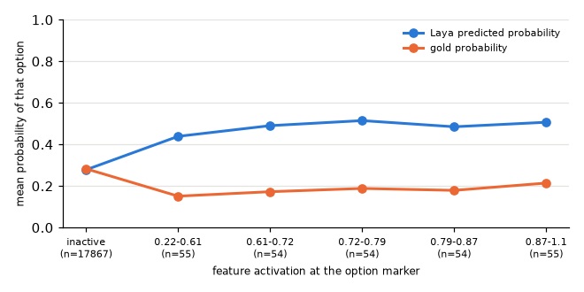

# Feature 1403

Critérios em que aparece: pred_probe_right_laya_wrong

**Interpretação (preencher):** 

---

## Maiores ativações

**tr_security_incidents_000140 / disposition** (choice, security_incidents) | ativação 2.883 em `opção` | opções ['close_benign', 'contain', 'investigate', 'monitor'] | Laya: **monitor** [0.06, 0.15, 0.071, 0.719] | gabarito: **contain**

```
<bos> choice question: How should this security alert be dispositioned?<eos>
▸ <mask> close_benign: Expected, explainable activity; close without analyst time.
▸ <mask> contain: Contain the host or account immediately; do not wait⟦ for⟧ triage.
▸ <mask> investigate: Warrants an analyst opening an investigation.
▸ <mask> monitor: Not clearly malicious, but worth watching for recurrence.

<eos>

 {"alert": {"description": "audit logging was turned off on a host", "evidence": "On 2026-09-16 at 01:07:58 UTC, the unprivileged service account svc-monitor on host 192.168.100.200 renamed the security log file C:\\Windows\\System32\\winevt\\Logs\\Security.evtx to Security.evtx.bak, effectively stopping audit logging. The action was initiated from an unrecognised source IP 172.20.30.40, and the account’s credentials have not been rotated for 412 days.", "rule": "disabled_logging"}, "context": {"asset_criticality": "crown_jewel", "change_window_active": false, "source_on_allowlist": false}, "history": {"credential_rotation_days_ago": 412, "distinct_countries_30d": 3, "logins_30d": 1000, "prior_alerts_90d": 0}, "principal": {"mfa_enrolled": false, "name": "usr-support-416", "privileges": ["repo:read"], "type": "service_account"}}<eos>
```

**tr_security_incidents_000113 / disposition** (choice, security_incidents) | ativação 2.807 em `opção` | opções ['close_benign', 'contain', 'investigate', 'monitor'] | Laya: **monitor** [0.263, 0.088, 0.134, 0.515] | gabarito: **investigate**

```
<bos> choice question: How should this security alert be dispositioned?<eos>
▸ <mask> close_benign: Expected, explainable activity; close without analyst time.
▸ <mask> contain: Contain the host or account immediately; do not wait⟦ for⟧ triage.
▸ <mask> investigate: Warrants an analyst opening an investigation.
▸ <mask> monitor: Not clearly malicious, but worth watching for recurrence.

<eos>

 {"alert": {"description": "audit logging was turned off on a host", "evidence": "At 2026-09-15 09:03:12 UTC the process \"auditctl\" executed on host \"win-01.example.com\" with arguments \"-e 0\" and disabled audit logging for the system. The command was issued by the shared_mailbox account \"audit_monitor\" from an allow‑listed source, and MFA was disabled for this principal.", "rule": "disabled_logging"}, "context": {"asset_criticality": "crown_jewel", "change_window_active": false, "source_on_allowlist": true}, "history": {"credential_rotation_days_ago": 412, "distinct_countries_30d": 2, "logins_30d": 491, "prior_alerts_90d": 8}, "principal": {"mfa_enrolled": false, "name": "adm-support-214", "privileges": ["repo:read"], "type": "shared_mailbox"}}<eos>
```

**tr_security_incidents_000138 / disposition** (choice, security_incidents) | ativação 2.721 em `opção` | opções ['close_benign', 'contain', 'investigate', 'monitor'] | Laya: **contain** [0.063, 0.459, 0.051, 0.428] | gabarito: **contain**

```
<bos> choice question: How should this security alert be dispositioned?<eos>
▸ <mask> close_benign: Expected, explainable activity; close without analyst time.
▸ <mask> contain: Contain the host or account immediately; do not wait⟦ for⟧ triage.
▸ <mask> investigate: Warrants an analyst opening an investigation.
▸ <mask> monitor: Not clearly malicious, but worth watching for recurrence.

<eos>

 {"alert": {"description": "an account granted itself or received elevated permissions", "evidence": "At 02:45:10 UTC on 2026-09-16, the unprivileged service account svc-data-ingest on host 172.16.45.12 executed a `sudo` command that added its own SID to the local sudoers file. The request originated from an unrecognised source IP 203.0.113.55, and the account's credentials were last rotated 3 days ago.", "rule": "privilege_escalation"}, "context": {"asset_criticality": "medium", "change_window_active": false, "source_on_allowlist": false}, "history": {"credential_rotation_days_ago": 3, "distinct_countries_30d": 3, "logins_30d": 818, "prior_alerts_90d": 8}, "principal": {"mfa_enrolled": true, "name": "usr-billing-689", "privileges": ["repo:read"], "type": "service_account"}}<eos>
```

**tr_security_incidents_000231 / disposition** (choice, security_incidents) | ativação 2.693 em `opção` | opções ['close_benign', 'contain', 'investigate', 'monitor'] | Laya: **monitor** [0.142, 0.158, 0.055, 0.645] | gabarito: **close_benign**

```
<bos> choice question: How should this security alert be dispositioned?<eos>
▸ <mask> close_benign: Expected, explainable activity; close without analyst time.
▸ <mask> contain: Contain the host or account immediately; do not wait⟦ for⟧ triage.
▸ <mask> investigate: Warrants an analyst opening an investigation.
▸ <mask> monitor: Not clearly malicious, but worth watching for recurrence.

<eos>

 {"alert": {"description": "a first-ever sign-in from an unfamiliar country", "evidence": "On 2026-09-15 08:45:12 UTC, employee user \"jdoe@example.com\" performed a successful interactive login to the corporate VPN from IP 203.0.113.45, which resolves to São Paulo, Brazil—a country not previously seen for this account. The login required MFA, the source IP is listed in the approved allowlist, and the account's password was last rotated on 2026-09-12.", "rule": "new_country_login"}, "context": {"asset_criticality": "high", "change_window_active": false, "source_on_allowlist": true}, "history": {"credential_rotation_days_ago": 3, "distinct_countries_30d": 2, "logins_30d": 1789, "prior_alerts_90d": 0}, "principal": {"mfa_enrolled": true, "name": "svc-support-177", "privileges": ["repo:read"], "type": "employee"}}<eos>
```

**tr_security_incidents_000228 / disposition** (choice, security_incidents) | ativação 2.666 em `opção` | opções ['close_benign', 'contain', 'investigate', 'monitor'] | Laya: **monitor** [0.121, 0.336, 0.113, 0.431] | gabarito: **investigate**

```
<bos> choice question: How should this security alert be dispositioned?<eos>
▸ <mask> close_benign: Expected, explainable activity; close without analyst time.
▸ <mask> contain: Contain the host or account immediately; do not wait⟦ for⟧ triage.
▸ <mask> investigate: Warrants an analyst opening an investigation.
▸ <mask> monitor: Not clearly malicious, but worth watching for recurrence.

<eos>

 {"alert": {"description": "a first-ever sign-in from an unfamiliar country", "evidence": "At 08:42 UTC, the unprivileged shared mailbox authenticated from IP 185.156.174.20 in the Netherlands, marking the first recorded sign-in from this country. The session used valid credentials rotated 14 days ago and passed multi-factor authentication from an unrecognized source device.", "rule": "new_country_login"}, "context": {"asset_criticality": "high", "change_window_active": false, "source_on_allowlist": false}, "history": {"credential_rotation_days_ago": 14, "distinct_countries_30d": 2, "logins_30d": 1119, "prior_alerts_90d": 0}, "principal": {"mfa_enrolled": true, "name": "ci-billing-303", "privileges": ["repo:read"], "type": "shared_mailbox"}}<eos>
```

## Ativações medianas (faixa 40-60%, mediana 0.812)

**tr_security_incidents_000151 / disposition** (choice, security_incidents) | ativação 0.857 em `marcador` | opções ['close_benign', 'contain', 'investigate', 'monitor'] | Laya: **monitor** [0.149, 0.146, 0.061, 0.644] | gabarito: **investigate**

```
<bos> choice question: How should this security alert be dispositioned?<eos>
▸ <mask> close_benign: Expected, explainable activity; close without analyst time.
▸ <mask> contain: Contain the host or account immediately; do not wait for triage.
▸ <mask> investigate: Warrants an analyst opening an investigation.
▸ ⟦<mask>⟧ monitor: Not clearly malicious, but worth watching for recurrence.

<eos>

 {"alert": {"description": "a long-unused account became active", "evidence": "At 2026-09-16 01:02 UTC, the privileged service account \"svc-data-export\" logged in from IP 203.0.113.45, a source not present on the allowlist, after having no successful logins since 2023‑09‑01. MFA was disabled for this session and the credential’s last rotation timestamp is 365 days old.", "rule": "dormant_account_use"}, "context": {"asset_criticality": "low", "change_window_active": false, "source_on_allowlist": false}, "history": {"credential_rotation_days_ago": 365, "distinct_countries_30d": 4, "logins_30d": 142, "prior_alerts_90d": 0}, "principal": {"mfa_enrolled": false, "name": "ci-infra-692", "privileges": ["deploy:production", "secrets:read"], "type": "service_account"}}<eos>
```

**tr_security_incidents_000177 / disposition** (choice, security_incidents) | ativação 0.827 em `estado` | opções ['close_benign', 'contain', 'investigate', 'monitor'] | Laya: **monitor** [0.087, 0.308, 0.053, 0.553] | gabarito: **monitor**

```
<bos> choice question: How should this security alert be dispositioned?<eos>
▸ <mask> close_benign: Expected, explainable activity; close without analyst time.
▸ <mask> contain: Contain the host or account immediately; do not wait for triage.
▸ <mask> investigate: Warrants an analyst opening an investigation.
▸ <mask> monitor: Not clearly malicious, but worth watching for recurrence.

<eos>

 {"alert": {"description": "a first-ever sign-in from an unfamiliar country", "evidence": "At 2026-09-15 02:13:47 UTC, employee user jdoe performed a sign‑in from IP 203.0.113.45 located in Brazil, a country not seen in prior⟦ login⟧ history for this account. The authentication succeeded with MFA, and the account's password was last rotated on 2026-09-01. No change window was active at the time of the event.", "rule": "new_country_login"}, "context": {"asset_criticality": "medium", "change_window_active": false, "source_on_allowlist": false}, "history": {"credential_rotation_days_ago": 14, "distinct_countries_30d": 3, "logins_30d": 1743, "prior_alerts_90d": 0}, "principal": {"mfa_enrolled": true, "name": "adm-analytics-183", "privileges": ["repo:read"], "type": "employee"}}<eos>
```

**tr_security_incidents_000210 / disposition** (choice, security_incidents) | ativação 0.758 em `marcador` | opções ['close_benign', 'contain', 'investigate', 'monitor'] | Laya: **monitor** [0.026, 0.194, 0.044, 0.737] | gabarito: **contain**

```
<bos> choice question: How should this security alert be dispositioned?<eos>
▸ <mask> close_benign: Expected, explainable activity; close without analyst time.
▸ <mask> contain: Contain the host or account immediately; do not wait for triage.
▸ <mask> investigate: Warrants an analyst opening an investigation.
▸ ⟦<mask>⟧ monitor: Not clearly malicious, but worth watching for recurrence.

<eos>

 {"alert": {"description": "an account granted itself or received elevated permissions", "evidence": "At 14:22 UTC, service account `svc-prod-access` performed a self-assignment of the 'Owner' role from unrecognized IP address 198.51.100.12. This action occurred outside of an approved change window using credentials that were last rotated 365 days ago.", "rule": "privilege_escalation"}, "context": {"asset_criticality": "medium", "change_window_active": false, "source_on_allowlist": false}, "history": {"credential_rotation_days_ago": 365, "distinct_countries_30d": 2, "logins_30d": 577, "prior_alerts_90d": 0}, "principal": {"mfa_enrolled": false, "name": "adm-analytics-333", "privileges": ["repo:read"], "type": "service_account"}}<eos>
```

**tr_security_incidents_000022 / disposition** (choice, security_incidents) | ativação 0.768 em `marcador` | opções ['close_benign', 'contain', 'investigate', 'monitor'] | Laya: **monitor** [0.042, 0.23, 0.09, 0.637] | gabarito: **monitor**

```
<bos> choice question: How should this security alert be dispositioned?<eos>
▸ <mask> close_benign: Expected, explainable activity; close without analyst time.
▸ <mask> contain: Contain the host or account immediately; do not wait for triage.
▸ <mask> investigate: Warrants an analyst opening an investigation.
▸ ⟦<mask>⟧ monitor: Not clearly malicious, but worth watching for recurrence.

<eos>

 {"alert": {"description": "a first-ever sign-in from an unfamiliar country", "evidence": "A CI runner principal performed a successful sign-in from a geographic location not previously associated with this account's history. The authentication involved MFA-protected credentials rotated one year ago and originated from an allowlisted source outside of a scheduled change window.", "rule": "new_country_login"}, "context": {"asset_criticality": "medium", "change_window_active": false, "source_on_allowlist": true}, "history": {"credential_rotation_days_ago": 365, "distinct_countries_30d": 1, "logins_30d": 1967, "prior_alerts_90d": 3}, "principal": {"mfa_enrolled": true, "name": "usr-analytics-668", "privileges": ["repo:read"], "type": "ci_runner"}}<eos>
```

**tr_security_incidents_000035 / disposition** (choice, security_incidents) | ativação 0.779 em `marcador` | opções ['close_benign', 'contain', 'investigate', 'monitor'] | Laya: **investigate** [0.012, 0.037, 0.518, 0.432] | gabarito: **investigate**

```
<bos> choice question: How should this security alert be dispositioned?<eos>
▸ <mask> close_benign: Expected, explainable activity; close without analyst time.
▸ <mask> contain: Contain the host or account immediately; do not wait for triage.
▸ <mask> investigate: Warrants an analyst opening an investigation.
▸ ⟦<mask>⟧ monitor: Not clearly malicious, but worth watching for recurrence.

<eos>

 {"alert": {"description": "an unrecognised binary executed on a server", "evidence": "An unrecognized binary titled 'update_sys.bin' was executed on server WEB-PROD-01 at 02:15 UTC by an unprivileged contractor account. The session originated from an unrecognized remote IP address using MFA-authenticated credentials that were last rotated 365 days ago. No maintenance window was scheduled at the time of this process execution.", "rule": "suspicious_process"}, "context": {"asset_criticality": "crown_jewel", "change_window_active": false, "source_on_allowlist": false}, "history": {"credential_rotation_days_ago": 365, "distinct_countries_30d": 2, "logins_30d": 1459, "prior_alerts_90d": 1}, "principal": {"mfa_enrolled": true, "name": "ci-infra-369", "privileges": ["repo:read"], "type": "contractor"}}<eos>
```

## Estatísticas (conjunto de descoberta, dev e teste)

**pred / error**

| split | decisões | ativas | ativas e Laya errou | taxa | lift | q (BH) | OR (CMH) | q (CMH) |
|---|---|---|---|---|---|---|---|---|
| discovery | 5100 | 186 | 169 | 0.909 | 1.41 | 9.28e-16 | 0.56 | 0.603 |
| dev | 900 | 33 | 32 | 0.970 | 1.44 | 0.000576 | 0.00 | 0.774 |
| test | 2000 | 72 | 68 | 0.944 | 1.45 | 6.24e-08 | 1.77 | 0.818 |

**corr / error**

| split | decisões | ativas | ativas e Laya errou | taxa | lift | q (BH) | OR (CMH) | q (CMH) |
|---|---|---|---|---|---|---|---|---|
| discovery | 5100 | 22 | 5 | 0.227 | 0.35 | 0.000292 | 0.19 | 0.0356 |
| dev | 900 | 1 | 0 | 0.000 | 0.00 | nan | nan | nan |
| test | 2000 | 8 | 4 | 0.500 | 0.77 | nan | nan | nan |

**state / error**

| split | decisões | ativas | ativas e Laya errou | taxa | lift | q (BH) | OR (CMH) | q (CMH) |
|---|---|---|---|---|---|---|---|---|
| discovery | 5100 | 999 | 620 | 0.621 | 0.96 | 0.2 | 0.94 | 0.769 |
| dev | 900 | 166 | 108 | 0.651 | 0.97 | 0.886 | 1.03 | 0.974 |
| test | 2000 | 346 | 216 | 0.624 | 0.96 | 0.582 | 0.94 | 0.881 |

**pred / probe_right_laya_wrong**

| split | decisões | ativas | ativas e Laya errou | taxa | lift | q (BH) | OR (CMH) | q (CMH) |
|---|---|---|---|---|---|---|---|---|
| discovery | 2932 | 120 | 118 | 0.983 | 1.62 | 2.36e-22 | 1.18 | 0.955 |
| dev | 523 | 23 | 23 | 1.000 | 1.55 | 0.000533 | nan | nan |
| test | 1149 | 51 | 51 | 1.000 | 1.64 | 2.96e-10 | inf | 0.379 |

**corr / probe_right_laya_wrong**

| split | decisões | ativas | ativas e Laya errou | taxa | lift | q (BH) | OR (CMH) | q (CMH) |
|---|---|---|---|---|---|---|---|---|
| discovery | 2932 | 2 | 0 | 0.000 | 0.00 | nan | nan | nan |
| dev | 523 | 0 | 0 | nan | nan | nan | nan | nan |
| test | 1149 | 0 | 0 | nan | nan | nan | nan | nan |

**state / probe_right_laya_wrong**

| split | decisões | ativas | ativas e Laya errou | taxa | lift | q (BH) | OR (CMH) | q (CMH) |
|---|---|---|---|---|---|---|---|---|
| discovery | 2932 | 600 | 355 | 0.592 | 0.98 | 0.602 | 1.01 | 0.975 |
| dev | 523 | 95 | 57 | 0.600 | 0.93 | 0.677 | 1.02 | 0.986 |
| test | 1149 | 219 | 126 | 0.575 | 0.94 | 0.51 | 0.89 | 0.78 |

Confusão mais sobre-representada (pred): `disposition|3>2` (n=132, lift 21.54, p=0). Formato `pergunta|índice previsto>índice correto`.

Confusão mais sobre-representada (corr): `disposition|1>3` (n=2, lift 154.55, p=5.32e-05). Formato `pergunta|índice previsto>índice correto`.

Confusão mais sobre-representada (state): `disposition|3>2` (n=45, lift 1.37, p=0.0131). Formato `pergunta|índice previsto>índice correto`.



