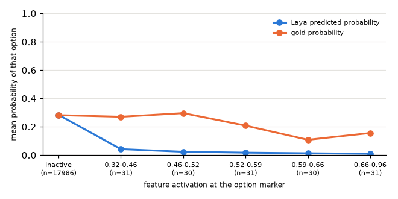

# Feature 1420

Critérios em que aparece: corr_error, corr_probe_right_laya_wrong

**Interpretação (preencher):** 

---

## Maiores ativações

**tr_customer_service_000262 / needs_human** (noul, customer_service) | ativação 2.996 em `estado` | opções ['false', 'true'] | Laya: **true** [0.066, 0.934] | gabarito: **true**

```
<bos> noul question: This conversation requires a human agent rather than automated handling.<eos>
▸ <mask> false: Automation can carry this to resolution.
▸ <mask> true: A human must take over: judgement, authority or empathy is required.

<eos>

 {"account": {"lifetime_value_usd": 728, "prior_tickets_90d": 1, "seats": 1, "tenure_months": 19, "tier": "standard"}, "orders": [{"amount_usd": 18, "date": "2026-01-04", "id": "A-75798", "status": "settled"}, {"amount_usd": 18, "date": "2026-02-14", "id": "A-84810", "status": "failed"}, {"amount_usd": 18, "date": "2026-01-11", "id": "A-71488", "status": "settled"}], "thread": [{"role": "customer", "text": "I need help immediately. I've been a loyal customer for 19 months on the $18 standard plan, but I just noticed I've been downgraded to the free tier without my consent. This happened⟦ once⟧ before and was only half-fixed, and now I've lost access to my active projects."}, {"role": "agent", "text": "I see your account history here and recognize you've been with us for quite a while. To help me investigate the billing status, could you confirm if you received any automated emails regarding a failed payment recently?"}, {"role": "customer", "text": "No, there were no emails at all, and my card on file is perfectly fine. I have a team waiting on these files right now and we can't get anything done while the account says 'Basic'."}, {"role": "agent", "text": "Thank you for that information. Could you please provide the last four digits of the card you have on file so I can cross-reference it with our payment processor's logs?"}, {"role": "customer", "text": "It's 4492. Please, just check whatever you need to check quickly, because our entire workflow is stalled until those standard features are toggled back on."}]}<eos>
```

**tr_customer_service_000262 / churn_risk** (score, customer_service) | ativação 2.990 em `estado` | opções ['0', '1', '2', '3'] | Laya: **3** [0.024, 0.05, 0.099, 0.828] | gabarito: **2**

```
<bos> score question: How likely is this customer to stop doing business with us because of this interaction?<eos>
▸ <mask> level 0: No sign of dissatisfaction.
▸ <mask> level 1: Mild frustration, but the relationship is intact.
▸ <mask> level 2: Clearly unhappy; repeat problems or explicit complaints.
▸ <mask> level 3: Imminent: threatening to cancel, dispute or leave.

<eos>

 {"account": {"lifetime_value_usd": 728, "prior_tickets_90d": 1, "seats": 1, "tenure_months": 19, "tier": "standard"}, "orders": [{"amount_usd": 18, "date": "2026-01-04", "id": "A-75798", "status": "settled"}, {"amount_usd": 18, "date": "2026-02-14", "id": "A-84810", "status": "failed"}, {"amount_usd": 18, "date": "2026-01-11", "id": "A-71488", "status": "settled"}], "thread": [{"role": "customer", "text": "I need help immediately. I've been a loyal customer for 19 months on the $18 standard plan, but I just noticed I've been downgraded to the free tier without my consent. This happened⟦ once⟧ before and was only half-fixed, and now I've lost access to my active projects."}, {"role": "agent", "text": "I see your account history here and recognize you've been with us for quite a while. To help me investigate the billing status, could you confirm if you received any automated emails regarding a failed payment recently?"}, {"role": "customer", "text": "No, there were no emails at all, and my card on file is perfectly fine. I have a team waiting on these files right now and we can't get anything done while the account says 'Basic'."}, {"role": "agent", "text": "Thank you for that information. Could you please provide the last four digits of the card you have on file so I can cross-reference it with our payment processor's logs?"}, {"role": "customer", "text": "It's 4492. Please, just check whatever you need to check quickly, because our entire workflow is stalled until those standard features are toggled back on."}]}<eos>
```

**tr_customer_service_000262 / action** (choice, customer_service) | ativação 2.908 em `estado` | opções ['answer_directly', 'close_no_action', 'escalate_to_human', 'execute_refund', 'request_information'] | Laya: **close_no_action** [0.16, 0.782, 0.023, 0.027, 0.008] | gabarito: **escalate_to_human**

```
<bos> choice question: What should the assistant do next with this conversation?<eos>
▸ <mask> answer_directly: The assistant can resolve this itself with information it already has.
▸ <mask> close_no_action: No further action is warranted; the matter is settled.
▸ <mask> escalate_to_human: Hand off to a human agent with the appropriate authority.
▸ <mask> execute_refund: Issue the refund or credit the customer is owed.
▸ <mask> request_information: More detail is needed from the customer before anything can be done.

<eos>

 {"account": {"lifetime_value_usd": 728, "prior_tickets_90d": 1, "seats": 1, "tenure_months": 19, "tier": "standard"}, "orders": [{"amount_usd": 18, "date": "2026-01-04", "id": "A-75798", "status": "settled"}, {"amount_usd": 18, "date": "2026-02-14", "id": "A-84810", "status": "failed"}, {"amount_usd": 18, "date": "2026-01-11", "id": "A-71488", "status": "settled"}], "thread": [{"role": "customer", "text": "I need help immediately. I've been a loyal customer for 19 months on the $18 standard plan, but I just noticed I've been downgraded to the free tier without my consent. This happened⟦ once⟧ before and was only half-fixed, and now I've lost access to my active projects."}, {"role": "agent", "text": "I see your account history here and recognize you've been with us for quite a while. To help me investigate the billing status, could you confirm if you received any automated emails regarding a failed payment recently?"}, {"role": "customer", "text": "No, there were no emails at all, and my card on file is perfectly fine. I have a team waiting on these files right now and we can't get anything done while the account says 'Basic'."}, {"role": "agent", "text": "Thank you for that information. Could you please provide the last four digits of the card you have on file so I can cross-reference it with our payment processor's logs?"}, {"role": "customer", "text": "It's 4492. Please, just check whatever you need to check quickly, because our entire workflow is stalled until those standard features are toggled back on."}]}<eos>
```

**tr_customer_service_000262 / urgency** (score, customer_service) | ativação 2.863 em `estado` | opções ['0', '1', '2', '3'] | Laya: **3** [0.103, 0.105, 0.039, 0.753] | gabarito: **3**

```
<bos> score question: How time-sensitive is this conversation?<eos>
▸ <mask> level 0: No time pressure; can wait indefinitely.
▸ <mask> level 1: Routine; handle within the normal queue.
▸ <mask> level 2: Elevated; should be handled within the same week.
▸ <mask> level 3: Critical; requires action within the same day.

<eos>

 {"account": {"lifetime_value_usd": 728, "prior_tickets_90d": 1, "seats": 1, "tenure_months": 19, "tier": "standard"}, "orders": [{"amount_usd": 18, "date": "2026-01-04", "id": "A-75798", "status": "settled"}, {"amount_usd": 18, "date": "2026-02-14", "id": "A-84810", "status": "failed"}, {"amount_usd": 18, "date": "2026-01-11", "id": "A-71488", "status": "settled"}], "thread": [{"role": "customer", "text": "I need help immediately. I've been a loyal customer for 19 months on the $18 standard plan, but I just noticed I've been downgraded to the free tier without my consent. This happened⟦ once⟧ before and was only half-fixed, and now I've lost access to my active projects."}, {"role": "agent", "text": "I see your account history here and recognize you've been with us for quite a while. To help me investigate the billing status, could you confirm if you received any automated emails regarding a failed payment recently?"}, {"role": "customer", "text": "No, there were no emails at all, and my card on file is perfectly fine. I have a team waiting on these files right now and we can't get anything done while the account says 'Basic'."}, {"role": "agent", "text": "Thank you for that information. Could you please provide the last four digits of the card you have on file so I can cross-reference it with our payment processor's logs?"}, {"role": "customer", "text": "It's 4492. Please, just check whatever you need to check quickly, because our entire workflow is stalled until those standard features are toggled back on."}]}<eos>
```

**tr_customer_service_000262 / category** (choice, customer_service) | ativação 2.844 em `estado` | opções ['account', 'billing', 'delivery', 'refund', 'technical'] | Laya: **billing** [0.002, 0.959, 0.0, 0.0, 0.038] | gabarito: **billing**

```
<bos> choice question: What is this customer conversation primarily about?<eos>
▸ <mask> account: Login, plan changes, profile or access management.
▸ <mask> billing: A charge, invoice, subscription or payment problem.
▸ <mask> delivery: Shipping, fulfilment or delivery of a physical item.
▸ <mask> refund: The customer is explicitly asking for money back.
▸ <mask> technical: The product or service is not working as expected.

<eos>

 {"account": {"lifetime_value_usd": 728, "prior_tickets_90d": 1, "seats": 1, "tenure_months": 19, "tier": "standard"}, "orders": [{"amount_usd": 18, "date": "2026-01-04", "id": "A-75798", "status": "settled"}, {"amount_usd": 18, "date": "2026-02-14", "id": "A-84810", "status": "failed"}, {"amount_usd": 18, "date": "2026-01-11", "id": "A-71488", "status": "settled"}], "thread": [{"role": "customer", "text": "I need help immediately. I've been a loyal customer for 19 months on the $18 standard plan, but I just noticed I've been downgraded to the free tier without my consent. This happened⟦ once⟧ before and was only half-fixed, and now I've lost access to my active projects."}, {"role": "agent", "text": "I see your account history here and recognize you've been with us for quite a while. To help me investigate the billing status, could you confirm if you received any automated emails regarding a failed payment recently?"}, {"role": "customer", "text": "No, there were no emails at all, and my card on file is perfectly fine. I have a team waiting on these files right now and we can't get anything done while the account says 'Basic'."}, {"role": "agent", "text": "Thank you for that information. Could you please provide the last four digits of the card you have on file so I can cross-reference it with our payment processor's logs?"}, {"role": "customer", "text": "It's 4492. Please, just check whatever you need to check quickly, because our entire workflow is stalled until those standard features are toggled back on."}]}<eos>
```

## Ativações medianas (faixa 40-60%, mediana 0.906)

**tr_customer_service_000068 / action** (choice, customer_service) | ativação 0.835 em `opção` | opções ['answer_directly', 'close_no_action', 'escalate_to_human', 'execute_refund', 'request_information'] | Laya: **close_no_action** [0.27, 0.432, 0.217, 0.038, 0.043] | gabarito: **escalate_to_human**

```
<bos> choice question: What should the assistant do next with this conversation?<eos>
▸ <mask> answer_directly: The assistant can resolve this itself with information it already has.
▸ <mask> close_no_action: No further action is warranted; the matter is settled.
▸ <mask> escalate_to_human: Hand off to a human agent with the appropriate authority.
▸ <mask> execute_refund: Issue the refund or credit the customer is owed.
▸ <mask> request_information: More detail is needed from the customer before anything⟦ can⟧ be done.

<eos>

 {"account": {"lifetime_value_usd": 1781, "prior_tickets_90d": 1, "seats": 1, "tenure_months": 19, "tier": "standard"}, "orders": [{"amount_usd": 999, "date": "2026-03-09", "id": "A-22295", "status": "pending"}, {"amount_usd": 999, "date": "2026-03-17", "id": "A-32594", "status": "refunded"}, {"amount_usd": 999, "date": "2026-03-04", "id": "A-42545", "status": "refunded"}], "thread": [{"role": "customer", "text": "Hello, I’ve been on the standard plan for about 19 months now (roughly $999 total) and I’m experiencing unusually slow performance across the board. I opened a ticket a while back that never got resolved, and I really need this sorted out before my project deadline this Friday."}, {"role": "agent", "text": "I’m sorry to hear that you’re still seeing slow speeds. Could you let me know when the slowdown first became noticeable and which specific features or tasks are most affected?"}, {"role": "customer", "text": "It started about two days ago, especially when I try to load the dashboard or run the monthly reports—everything takes double the usual time. With the deadline looming, any insight you can share would be appreciated."}]}<eos>
```

**tr_customer_service_000238 / needs_human** (noul, customer_service) | ativação 0.890 em `opção` | opções ['false', 'true'] | Laya: **false** [0.948, 0.052] | gabarito: **true**

```
<bos> noul question: This conversation requires a human agent rather than automated handling.<eos>
▸ <mask> false: Automation can carry this to resolution.
▸ <mask> true: A human must take over: judgement, authority⟦ or⟧ empathy is required.

<eos>

 {"account": {"lifetime_value_usd": 699, "prior_tickets_90d": 0, "seats": 12, "tenure_months": 19, "tier": "premium"}, "orders": [{"amount_usd": 49, "date": "2026-02-27", "id": "A-61611", "status": "failed"}, {"amount_usd": 49, "date": "2026-03-13", "id": "A-63348", "status": "settled"}], "thread": [{"role": "customer", "text": "The dashboard has been taking nearly two minutes to load every morning this week. I have a presentation at noon, but I suppose it’s just how things are now."}, {"role": "agent", "text": "I understand how frustrating that latency must be. To help me investigate, could you tell me if you are experiencing this slow-down on a specific browser or connection?"}, {"role": "customer", "text": "It’s the same on Chrome and Firefox, regardless of my network. I’ve been paying for the premium tier for a long time, but it doesn't seem to make much of a difference."}]}<eos>
```

**tr_security_incidents_000141 / credential_compromise** (noul, security_incidents) | ativação 0.957 em `estado` | opções ['false', 'true'] | Laya: **true** [0.38, 0.62] | gabarito: **true**

```
<bos> noul question: The evidence indicates a credential or account has been compromised.<eos>
▸ <mask> false: no, the statement does not hold
▸ <mask> true: yes, the statement holds

<eos>

 {"alert": {"description": "audit logging was turned off on a host", "evidence": "Audit logging was disabled on the host associated with ci_runner principal at 14:22 UTC. The action originated from an unrecognized⟦ IP⟧ address while credentials remain 90 days past their last rotation date.", "rule": "disabled_logging"}, "context": {"asset_criticality": "high", "change_window_active": true, "source_on_allowlist": false}, "history": {"credential_rotation_days_ago": 90, "distinct_countries_30d": 4, "logins_30d": 1259, "prior_alerts_90d": 0}, "principal": {"mfa_enrolled": true, "name": "adm-analytics-818", "privileges": ["repo:read"], "type": "ci_runner"}}<eos>
```

**tr_customer_service_000235 / action** (choice, customer_service) | ativação 0.959 em `estado` | opções ['answer_directly', 'close_no_action', 'escalate_to_human', 'execute_refund', 'request_information'] | Laya: **close_no_action** [0.003, 0.996, 0.0, 0.0, 0.0] | gabarito: **request_information**

```
<bos> choice question: What should the assistant do next with this conversation?<eos>
▸ <mask> answer_directly: The assistant can resolve this itself with information it already has.
▸ <mask> close_no_action: No further action is warranted; the matter is settled.
▸ <mask> escalate_to_human: Hand off to a human agent with the appropriate authority.
▸ <mask> execute_refund: Issue the refund or credit the customer is owed.
▸ <mask> request_information: More detail is needed from the customer before anything can be done.

<eos>

 {"account": {"lifetime_value_usd": 116, "prior_tickets_90d": 2, "seats": ⟦1⟧, "tenure_months": 3, "tier": "standard"}, "thread": [{"role": "customer", "text": "I’ve only been on the standard plan for three months, but I think it’s time to just cancel the account. It’s not working out for me."}, {"role": "agent", "text": "I am sorry to hear you're considering leaving. Could you share a bit more about what hasn't been working for you so I can better understand your experience?"}, {"role": "customer", "text": "It’s just been a series of small issues that never really get sorted out properly. I’ve had two tickets open already, and things just stay the same."}, {"role": "agent", "text": "I appreciate your patience regarding those previous interactions. Would you mind telling me which specific aspects of the service have remained unresolved?"}, {"role": "customer", "text": "It's the integration sync. It never seems to pick up the changes I make in the dashboard, no matter how many times I refresh."}, {"role": "agent", "text": "Thank you for that detail. Are you seeing any particular status indicators or warnings within the dashboard when the sync fails to update?"}, {"role": "customer", "text": "No, it just acts like nothing happened. I'm tired of guessing why things aren't syncing."}]}<eos>
```

**tr_security_incidents_000133 / severity** (score, security_incidents) | ativação 0.983 em `estado` | opções ['0', '1', '2', '3', '4'] | Laya: **1** [0.117, 0.333, 0.196, 0.11, 0.244] | gabarito: **4**

```
<bos> score question: How severe is the potential impact if this alert is real?<eos>
▸ <mask> level 0: Negligible: no access to anything sensitive.
▸ <mask> level 1: Low: limited access, easily reversed.
▸ <mask> level 2: Moderate: access to internal systems or non-public data.
▸ <mask> level 3: High: access to production, secrets or customer data.
▸ <mask> level 4: Critical: active compromise of crown-jewel systems.

<eos>

 {"alert": {"description": "audit logging was turned off on a host", "evidence": "Audit logging was disabled on host build-runner-07 at 2026-09-15 11:47 UTC, as evidenced by the removal of the journald.conf entry that enables persistent storage. The action originated from CI runner account ci-runner-42, which lacks elevated privileges but has MFA active, and occurred outside any scheduled change window. The initiating source (10.2.0.15) matches an allow‑listed⟦ IP⟧ range, and the runner's credentials were refreshed three days ago.", "rule": "disabled_logging"}, "context": {"asset_criticality": "crown_jewel", "change_window_active": false, "source_on_allowlist": true}, "history": {"credential_rotation_days_ago": 3, "distinct_countries_30d": 3, "logins_30d": 902, "prior_alerts_90d": 3}, "principal": {"mfa_enrolled": true, "name": "adm-support-681", "privileges": ["repo:read"], "type": "ci_runner"}}<eos>
```

## Estatísticas (conjunto de descoberta, dev e teste)

**pred / error**

| split | decisões | ativas | ativas e Laya errou | taxa | lift | q (BH) | OR (CMH) | q (CMH) |
|---|---|---|---|---|---|---|---|---|
| discovery | 5100 | 0 | 0 | nan | nan | nan | nan | nan |
| dev | 900 | 0 | 0 | nan | nan | nan | nan | nan |
| test | 2000 | 0 | 0 | nan | nan | nan | nan | nan |

**corr / error**

| split | decisões | ativas | ativas e Laya errou | taxa | lift | q (BH) | OR (CMH) | q (CMH) |
|---|---|---|---|---|---|---|---|---|
| discovery | 5100 | 36 | 36 | 1.000 | 1.55 | 6.42e-07 | inf | 0.413 |
| dev | 900 | 7 | 7 | 1.000 | 1.49 | nan | nan | nan |
| test | 2000 | 17 | 17 | 1.000 | 1.54 | nan | nan | nan |

**state / error**

| split | decisões | ativas | ativas e Laya errou | taxa | lift | q (BH) | OR (CMH) | q (CMH) |
|---|---|---|---|---|---|---|---|---|
| discovery | 5100 | 2025 | 1231 | 0.608 | 0.94 | 0.000159 | 0.91 | 0.479 |
| dev | 900 | 330 | 208 | 0.630 | 0.94 | 0.316 | 0.82 | 0.626 |
| test | 2000 | 735 | 462 | 0.629 | 0.97 | 0.372 | 0.90 | 0.706 |

**pred / probe_right_laya_wrong**

| split | decisões | ativas | ativas e Laya errou | taxa | lift | q (BH) | OR (CMH) | q (CMH) |
|---|---|---|---|---|---|---|---|---|
| discovery | 2932 | 0 | 0 | nan | nan | nan | nan | nan |
| dev | 523 | 0 | 0 | nan | nan | nan | nan | nan |
| test | 1149 | 0 | 0 | nan | nan | nan | nan | nan |

**corr / probe_right_laya_wrong**

| split | decisões | ativas | ativas e Laya errou | taxa | lift | q (BH) | OR (CMH) | q (CMH) |
|---|---|---|---|---|---|---|---|---|
| discovery | 2932 | 22 | 22 | 1.000 | 1.65 | 5.81e-05 | inf | 0.681 |
| dev | 523 | 2 | 2 | 1.000 | 1.55 | nan | nan | nan |
| test | 1149 | 9 | 9 | 1.000 | 1.64 | nan | nan | nan |

**state / probe_right_laya_wrong**

| split | decisões | ativas | ativas e Laya errou | taxa | lift | q (BH) | OR (CMH) | q (CMH) |
|---|---|---|---|---|---|---|---|---|
| discovery | 2932 | 1181 | 669 | 0.566 | 0.94 | 0.00194 | 1.00 | 1 |
| dev | 523 | 195 | 115 | 0.590 | 0.91 | 0.224 | 0.84 | 0.733 |
| test | 1149 | 457 | 262 | 0.573 | 0.94 | 0.155 | 0.83 | 0.54 |

Confusão mais sobre-representada (corr): `action|1>2` (n=16, lift 31.92, p=1.95e-21). Formato `pergunta|índice previsto>índice correto`.

Confusão mais sobre-representada (state): `disposition|3>2` (n=107, lift 1.60, p=1.52e-10). Formato `pergunta|índice previsto>índice correto`.



